# PythonSharp Ported Libraries Roadmap & Plan

This roadmap tracks the step-by-step porting of canonical, zero-external-dependency Python libraries into **PythonSharp** projects inside `Samples/Ported/`.

The primary goal is real-world **dogfooding** and stress-testing of the PythonSharp compiler (`psc`), LSP server, semantic analyzer, and emitted Python 3.11+ bytecode on concrete codebases from easiest to most advanced.

---

## Porting Tier Overview

```mermaid
flowchart TD
    subgraph Tier1["Tier 1: Text & String Manipulation (Easiest)"]
        P01["01_leftpad\n(String padding & length logic)"]
        P02["02_slugify\n(Regex, ASCII normalization, string cleaning)"]
    end

    subgraph Tier2["Tier 2: Algorithms & Math (Intermediate)"]
        P03["03_isprime\n(Trial division 6k±1, primes list, sieve)"]
        P04["04_levenshtein\n(2D dynamic programming, edit distance)"]
        P05["05_semver\n(SemVer 2.0.0 parser, records, comparison)"]
    end

    subgraph Tier3["Tier 3: Utilities & Tools (Advanced Intermediate)"]
        P06["06_micro_tqdm\n(Progress bar, carriage returns, time calculations)"]
        P07["07_micro_dotenv\n(File I/O, parsing, quote stripping, os.environ)"]
    end

    subgraph Tier4["Tier 4: Networking (Advanced)"]
        P08["08_micro_requests\n(HTTP GET/POST, headers, status, JSON decoding)"]
    end

    subgraph Tier5["Tier 5: Data Structures & Parsing (Medium Complexity)"]
        P09["09_micro_toml\n(TOML scanner, parsing state machine, dict tree)"]
        P10["10_micro_bitarray\n(Bitwise ops, hex formatting, buffer packing)"]
        P11["11_micro_croniter\n(Cron parser, modulo math, date rollover)"]
        P12["12_json_logger\n(JSON formatter, structured dicts, logging interop)"]
    end

    subgraph Tier6["Tier 6: Core Features & Metaprogramming (High Complexity)"]
        P13["13_micro_fn\n(Currying, partial application, higher-order funcs)"]
        P14["14_micro_pluggy\n(PluginManager, hook specs, dynamic invocation)"]
        P15["15_multimethod\n(Multiple dispatch, runtime type matching, decorators)"]
        P16["16_micro_retry\n(Retry decorator with args, exponential backoff)"]
    end

    subgraph Tier7["Tier 7: Concurrency & Async (Advanced Complexity)"]
        P17["17_micro_eventloop\n(Task/Future, coroutine step loop, sleep queue)"]
    end

    Tier1 --> Tier2 --> Tier3 --> Tier4 --> Tier5 --> Tier6 --> Tier7
```

---

## Detailed Project Specifications

### Tier 1: Text & String Manipulation (Easiest)

#### 1. `01_leftpad`
* **Target Package**: `left-pad` / `pad-left`
* **Features**:
  - `LeftPad(string str, int len, string ch = " ")`
  - `RightPad(string str, int len, string ch = " ")`
  - String length handling, negative length checks, repetitive concatenation.
* **Compiler Stress Tests**: Default parameter values, string interpolation, loops, boundary condition guards.

#### 2. `02_slugify`
* **Target Package**: `python-slugify` (minimal core)
* **Features**:
  - `Slugify(string text, string separator = "-", bool lowercase = true)`
  - Removal of non-alphanumeric characters, duplicate separator collapsing, leading/trailing separator stripping.
* **Compiler Stress Tests**: `Regex` / `extern using re`, string character inspection, ternary operators, collection manipulation.

---

### Tier 2: Algorithms & Math (Intermediate)

#### 3. `03_isprime`
* **Target Package**: `is-prime` / `prime-numbers`
* **Features**:
  - `IsPrime(long n)`: Fast $6k \pm 1$ primality test.
  - `NextPrime(long n)`: Finds the next prime number.
  - `PrimesUpTo(int limit)`: Sieve of Eratosthenes generating `List<int>`.
  - `PrimeFactors(long n)`: Integer prime factor decomposition.
* **Compiler Stress Tests**: 64-bit integer (`long`) operations, while/for loops, mathematical formulas (`Math.Sqrt`), generic `List<int>` emission.

#### 4. `04_levenshtein`
* **Target Package**: `Levenshtein` (minimal distance algorithm)
* **Features**:
  - `Distance(string s1, string s2)`: Wagner–Fischer 2D dynamic programming matrix.
  - `Ratio(string s1, string s2)`: Normalized similarity score ($0.0 \dots 1.0$).
* **Compiler Stress Tests**: 2D array / multidimensional indexing, nested loops, min/max calculations, floating-point division.

#### 5. `05_semver`
* **Target Package**: `semver`
* **Features**:
  - `record SemanticVersion(int Major, int Minor, int Patch, string Prerelease = "", string Build = "")`
  - `Parse(string versionString)`
  - `Compare(SemanticVersion v1, SemanticVersion v2)`
  - `IsGreaterThan`, `IsLessThan`, `IsCompatibleWith`
* **Compiler Stress Tests**: C# Records with primary constructors, string splitting, numeric parsing (`int.Parse`), custom comparison logic.

---

### Tier 3: Utilities & Tools (Advanced Intermediate)

#### 6. `06_micro_tqdm`
* **Target Package**: `tqdm` (micro subset)
* **Features**:
  - `ProgressBar`: Formatted CLI progress bar with `\r` (carriage return).
  - Elapsed time, estimated remaining time (ETA), iterations per second.
  - Progress bar track rendering `[=====>....] 50%`.
* **Compiler Stress Tests**: System console output (`Console.Write`), system time calculations (`time`), class state encapsulation, custom formatting.

#### 7. `07_micro_dotenv`
* **Target Package**: `python-dotenv` (core reader)
* **Features**:
  - `Parse(string content)`: Parses key-value pairs, strips `#` comments, handles single and double quotes, handles `export KEY=VAL`.
  - `Load(string filePath = ".env")`: Reads file from disk, parses, and injects into runtime environment.
* **Compiler Stress Tests**: File I/O (`File.ReadAllText` / ambient os/io stubs), dictionary manipulation (`Dict<string, string>`), string trimming/splitting.

---

### Tier 4: Networking (Advanced)

#### 8. `08_micro_requests`
* **Target Package**: `requests` (micro core)
* **Features**:
  - `record HttpResponse(int StatusCode, string Text, Dict<string, string> Headers)` with `Json<T>()` helper.
  - `Get(string url, Dict<string, string>? headers = null, double timeout = 10.0)`
  - `Post(string url, string data, Dict<string, string>? headers = null, double timeout = 10.0)`
* **Compiler Stress Tests**: Ambient interop (`urllib.request`, `http.client`), typed HTTP response records, nullable parameters, exception handling (`try / catch (Exception ex)`).

---

### Tier 5: Data Structures & Parsing (Medium Complexity)

#### 9. `09_micro_toml`
* **Target Package**: `pytoml` / `toml` (minimal parser subset)
* **Features**:
  - `Parse(string content)`: Parses TOML strings into nested dictionaries and strongly typed values.
  - Primitive value parsing: string literals, integers, floats, booleans, datetime representations, and inline arrays.
  - Section tables: `[section]` and nested `[section.subsection]` table headers.
  - Scanner / token state machine handling comments (`#`), whitespace, multiline blocks, and escape characters.
* **Compiler Stress Tests**: Lexer state machines (`while`, `switch`, character lookahead), recursive dictionary/list mutation (`Dict<string, object>`), string slicing, type discrimination.

#### 10. `10_micro_bitarray`
* **Target Package**: `bitarray` (pure-Python micro version)
* **Features**:
  - `class BitArray`: Dynamic bitset backed by packed byte/integer arrays.
  - Bitwise operations: `And`, `Or`, `Xor`, `Not`, left shift (`<<`), right shift (`>>`).
  - Bit indexer operations: `Get(int index)` and `Set(int index, bool value)`.
  - Binary and Hex formatting: `To01()` bit string and `ToHex()` / `FromHex(string)` conversions.
  - Bit metrics: `Count(bool value)` (popcount) and `Find(bool value)` (search).
* **Compiler Stress Tests**: Bitwise operators (`&`, `|`, `^`, `~`, `<<`, `>>`), numeric masking, bit packing/unpacking, byte array transformations.

#### 11. `11_micro_croniter`
* **Target Package**: `croniter` (standard 5-field subset)
* **Features**:
  - `class CronIterator`: Computes recurrence dates for standard 5-part cron expressions (`minute hour dom month dow`).
  - Expression syntax: wildcards (`*`), value lists (`1,15,30`), ranges (`9-17`), and step intervals (`*/5`, `1-10/2`).
  - `GetNext(DateTime baseTime)`: Calculates the next matching datetime taking month lengths, leap years, and calendar modulo into account.
  - `IsValid(string expression)`: Validates cron syntax without throwing exceptions.
* **Compiler Stress Tests**: Date-time arithmetic, calendar modulo algorithms, complex nested branch conditions, integer division, multi-field rule evaluation.

#### 12. `12_json_logger`
* **Target Package**: `python-json-logger`
* **Features**:
  - `class JsonFormatter`: Formats standard log records into structured JSON lines.
  - Custom field mapping and rename dictionary (`timestamp`, `level`, `message`, `module`).
  - Timestamp ISO-8601 formatting and millisecond precision.
  - Traceback and exception record serialization.
  - Merge arbitrary extra dictionary payloads into root JSON attributes.
* **Compiler Stress Tests**: Subclassing / inheritance patterns, string manipulation, JSON dictionary construction, Python logging framework interop.

---

### Tier 6: Core Language Features & Meta-programming (High Complexity)

#### 13. `13_micro_fn`
* **Target Package**: `fn.py` (functional programming toolkit)
* **Features**:
  - Function combinators: `Curry(func)`, `Partial(func, ...args)`, `Compose(f, g)`, and forward pipe operators.
  - Sequence operators: `DropWhile(predicate, seq)`, `TakeWhile(predicate, seq)`, `Partition(predicate, seq)`, `Flatten(seq)`.
  - Lazy streams: Infinite sequence generator helpers and cached stream evaluations.
* **Compiler Stress Tests**: First-class functions as arguments/returns (`Func<T, R>`), higher-order functions, lambda expressions, closures over scoped state, generic delegates.

#### 14. `14_micro_pluggy`
* **Target Package**: `pluggy` (micro hook engine)
* **Features**:
  - `HookSpec`: Marker / decorator declaring extension hook points and argument contracts.
  - `HookImpl`: Marker / decorator implementing extension hooks.
  - `class PluginManager`: Registers plugin objects, discovers hook implementations, and orchestrates calls.
  - Hook execution loop: Calling hooks sequentially, collecting results into `List<object>`, and first-result-wins mode.
* **Compiler Stress Tests**: `[PythonDecorator]` annotations, dynamic method dispatch / reflection interop, dictionary-backed registry lookups, list accumulations.

#### 15. `15_multimethod`
* **Target Package**: `multimethod` (multiple dispatch)
* **Features**:
  - Multiple dispatch registry: routes function calls to specific implementations based on runtime tuple of argument types `(typeof(A), typeof(B))`.
  - Method resolution order (MRO) and subtype matching: derived class arguments match registered base class signatures.
  - `[MultiMethod]` / decorator-based registration of overload implementations.
  - Ambiguity and MissingMethod detection with descriptive errors.
* **Compiler Stress Tests**: Metaprogramming decorators, runtime type inspection (`is`, `__ps_types__`, `isinstance`), type tuples as dictionary keys, dynamic function forwarding.

#### 16. `16_micro_retry`
* **Target Package**: `retry`
* **Features**:
  - `[Retry]` decorator and `RetryCall` helper: Retries flaky operations with configurable `tries`, `delay`, `backoff` multiplier, and `jitter`.
  - Exception filtering: Catches specific exception types or tuples of allowed exceptions.
  - Exponential backoff calculation with delay caps.
  - Exhaustion behavior: re-raises the original exception when retry budget is depleted.
* **Compiler Stress Tests**: Parameterized decorators (`[PythonDecorator]`), nested closure functions, exception handling and rethrow (`throw;`), system clock/sleep interop.

---

### Tier 7: Concurrency & Async (Advanced Complexity)

#### 17. `17_micro_eventloop`
* **Target Package**: `micro-asyncio` / Minimal Event Loop
* **Features**:
  - `class EventLoop`: Lightweight cooperative async/await runtime in ~50–100 lines.
  - `class Task<T>` / `Future`: Wraps coroutines and generators, tracking status (`Pending`, `Running`, `Completed`, `Failed`).
  - Scheduling queues: Ready queue (FIFO) and delayed sleep queue (sorted by deadline timestamp).
  - `RunUntilComplete(Task task)`: Iterates and steps active coroutines until the root task completes.
  - `Sleep(double seconds)`: Yields control back to the event loop until deadline expires.
* **Compiler Stress Tests**: `async` / `await` lowering, generator coroutines (`yield return`), state machine preservation, queue and priority list scheduling.

---

## Execution Status

| # | Project | Directory | Tier | Status |
| :-: | :--- | :--- | :--- | :---: |
| 1 | `leftpad` | `Samples/Ported/01_leftpad` | Tier 1: Text & String | Completed |
| 2 | `slugify` | `Samples/Ported/02_slugify` | Tier 1: Text & String | Completed |
| 3 | `isprime` | `Samples/Ported/03_isprime` | Tier 2: Algorithms & Math | Completed |
| 4 | `levenshtein` | `Samples/Ported/04_levenshtein` | Tier 2: Algorithms & Math | Completed |
| 5 | `semver` | `Samples/Ported/05_semver` | Tier 2: Algorithms & Math | Completed |
| 6 | `micro_tqdm` | `Samples/Ported/06_micro_tqdm` | Tier 3: Utilities & Tools | Completed |
| 7 | `micro_dotenv` | `Samples/Ported/07_micro_dotenv` | Tier 3: Utilities & Tools | Completed |
| 8 | `micro_requests` | `Samples/Ported/08_micro_requests` | Tier 4: Networking | Completed |
| 9 | `micro_toml` | `Samples/Ported/09_micro_toml` | Tier 5: Data Structures & Parsing | Completed |
| 10 | `micro_bitarray` | `Samples/Ported/10_micro_bitarray` | Tier 5: Data Structures & Parsing | Completed |
| 11 | `micro_croniter` | `Samples/Ported/11_micro_croniter` | Tier 5: Data Structures & Parsing | Completed |
| 12 | `json_logger` | `Samples/Ported/12_json_logger` | Tier 5: Data Structures & Parsing | Completed |
| 13 | `micro_fn` | `Samples/Ported/13_micro_fn` | Tier 6: Features & Metaprogramming | Completed |
| 14 | `micro_pluggy` | `Samples/Ported/14_micro_pluggy` | Tier 6: Features & Metaprogramming | Completed |
| 15 | `multimethod` | `Samples/Ported/15_multimethod` | Tier 6: Features & Metaprogramming | Completed |
| 16 | `micro_retry` | `Samples/Ported/16_micro_retry` | Tier 6: Features & Metaprogramming | Completed |
| 17 | `micro_eventloop` | `Samples/Ported/17_micro_eventloop` | Tier 7: Concurrency & Async | Completed |

---

## Standard Port Structure

Each ported package must contain:
1. `<Name>.psproj`: Project manifest specifying assembly name and target Python 3.11+.
2. `src/` (or root `.ps`): The PythonSharp source code defining classes/records under a clean namespace.
3. `run_<name>.py`: Verification harness comparing the compiled output with known expected outputs or Python standard tests.
4. `README.md`: Compilation commands (`psc build`) and usage examples.
