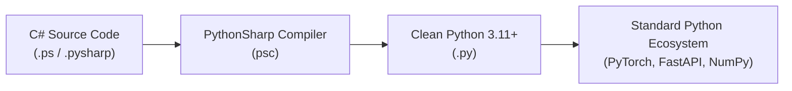

# Blog 01: The Vision — Why Transpile C# to Python?

Welcome to the first post in our deep-dive blog series on **PythonSharp (`psc`)**!

If you know basic Python and have written even a little bit of C# (or at least know what a static type is), you have probably felt the unique strengths—and frustrations—of both worlds.

In this introductory post, we will explore:
1. Why anyone would want to write C# and transpile it into Python.
2. The fundamental architectural philosophy behind PythonSharp: **The Zero Runtime Wrapper Tax**.
3. Why existing solutions like IronPython, Cython, or Python type hints didn't solve this problem.
4. A first look at how clean, idiomatic Python code emerges from C#.

---

## The Tale of Two Languages

### Python: The King of Ecosystems
Python is beloved worldwide. It dominates Machine Learning, AI (PyTorch, TensorFlow), Data Science (Pandas, NumPy), and Web APIs (FastAPI, Django). It is expressive, rapid to prototype with, and runs virtually everywhere without compilation ceremonies.

**The Catch?**
In large-scale codebases, Python's dynamic nature can bite you:
- `AttributeError: 'NoneType' object has no attribute 'total'` discovered at 3:00 AM in production.
- Refactoring a function signature requires grepping across the entire codebase and praying tests catch every caller.
- Tooling and autocomplete in large dynamic projects can only guess what a variable might hold.

### C#: The Master of Structure
C# is one of the most mature, elegant, and rigorously typed programming languages in history. With modern C# (versions 9 through 12), you get:
- Compile-time guarantees: if it compiles, whole categories of runtime errors simply cannot occur.
- **LINQ** (Language Integrated Query): expressive, functional data transformations.
- Rich object-oriented patterns: records, pattern matching, interfaces, access modifiers (`public`, `private`, `protected`).
- World-class IDE support (instant refactoring, infallible Go-To-Definition, lightning-fast IntelliSense).

**The Catch?**
The .NET runtime (CLR) is separate from the Python ecosystem. You cannot easily `import torch` or `import fastapi` inside a standard C# project without painful interop layers, native bridges, or serialization overhead.

---

## Enter PythonSharp: The Best of Both Worlds

What if you could **write code using C#'s compile-time rigor, records, and LINQ**, but **emit pure, modern Python 3.11+ that runs directly inside the standard CPython interpreter** with zero extra dependencies?



That is exactly what PythonSharp does. It is an **ahead-of-time (AOT) transpiler**:
- **Authoring Time**: You write strictly-typed C# (`.ps` files). The compiler verifies types, enforces null safety, checks access modifiers, and checks method overloads.
- **Transpile Time**: The compiler transforms the C# Abstract Syntax Tree (AST) into a native Python AST.
- **Runtime**: You run pure `.py` files on standard Python 3.11+. No virtual machines, no C-wrappers, no proprietary runtime libraries.

---

## Why Not Existing Alternatives?

You might wonder: *"Hasn't this been tried before?"* Let's look at why previous attempts took different routes:

| Tool | Approach | The Drawback |
| :--- | :--- | :--- |
| **IronPython** | Re-implements Python on top of the .NET CLR runtime. | Cannot run modern C-extension packages (NumPy, PyTorch, SciPy). It is stuck on older Python versions. |
| **Cython** | Compiles Python-like code into native C extensions. | Great for low-level CPU loops, but introduces complex C compilation toolchains and non-standard syntax. |
| **MyPy / Python Type Hints** | Adds static type hints (`x: int`) checked by a linter. | Types are optional and unenforced at runtime. Python's type system still lacks C#'s rich OOP features like true method overloading, interfaces, and LINQ. |
| **PythonSharp (`psc`)** | **True Source-to-Source Transpiler with Type Erasure.** | Gives you full C# syntax, type checking, and LINQ, while emitting 100% standard Python code. |

---

## The Core Philosophy: "Zero Runtime Wrapper Tax"

A common trap in transpilers is creating a heavy runtime library (e.g., `import pythonsharp_runtime as psr`). If every string operation called `psr.StringWrapper(s).substring(...)`, the emitted Python would be slow, ugly, and painful for other Python developers to read.

PythonSharp adheres strictly to **Pure Type Erasure**:
1. **Types exist to guide the compiler, then they vanish.**
2. A C# `string.Length` compiles straight to Python's native `len(s)`.
3. A C# `List<T>` compiles straight to a standard Python `list`.
4. A C# `Dict<TKey, TValue>` compiles straight to a native Python `{}` dictionary.
5. A C# LINQ query like `.Where(...).Select(...).ToList()` **fuses at compile-time** into a high-speed Python list comprehension `[x for x in ... if ...]`.

---

## A First Taste: See It in Action

Look at this simple C# service written in PythonSharp:

```csharp
namespace Commerce.Domain;

using PythonSharp.Core;

public record Order(int Id, string CustomerName, double Total, bool IsPaid);

public class OrderService
{
    public static List<string> GetPendingCustomerNames(List<Order> orders)
    {
        return orders
            .Where(o => !o.IsPaid && o.Total > 0.0)
            .Select(o => o.CustomerName.ToUpper())
            .ToList();
    }
}
```

When you run `psc build`, PythonSharp emits this **pure Python 3.11+ module**:

```python
# Auto-generated by PythonSharp (psc)
from __future__ import annotations
from dataclasses import dataclass

@dataclass(slots=True, frozen=True)
class Order:
    id: int
    customer_name: str
    total: float
    is_paid: bool

class OrderService:
    __slots__ = ()

    @staticmethod
    def get_pending_customer_names(orders: list[Order]) -> list[str]:
        return [o.customer_name.upper() for o in orders if not o.is_paid and o.total > 0.0]
```

Notice what happened:
- `record Order` became an optimized Python 3.11 `@dataclass(slots=True, frozen=True)`.
- `PascalCase` method and property names automatically converted to idiomatic Python `snake_case`.
- The LINQ query was compiled directly into a native list comprehension `[o.customer_name.upper() for o in orders if ...]`.
- Notice the types: `list[Order]` and `str` are standard PEP 484 type annotations.

---

## Summary & What's Next

PythonSharp bridges the gap between the rock-solid structure of C# and the explosive ecosystem of Python. It gives you the productivity of static types with zero runtime baggage.

In **[Blog 02: Tokens & Trees — How Code Becomes an Abstract Syntax Tree (AST)](./02_tokens_and_trees_the_lexer_and_parser.md)**, we'll open the hood and see how the compiler reads source text, chops it into tokens, and builds an Abstract Syntax Tree.

