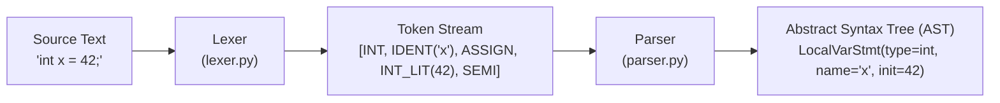
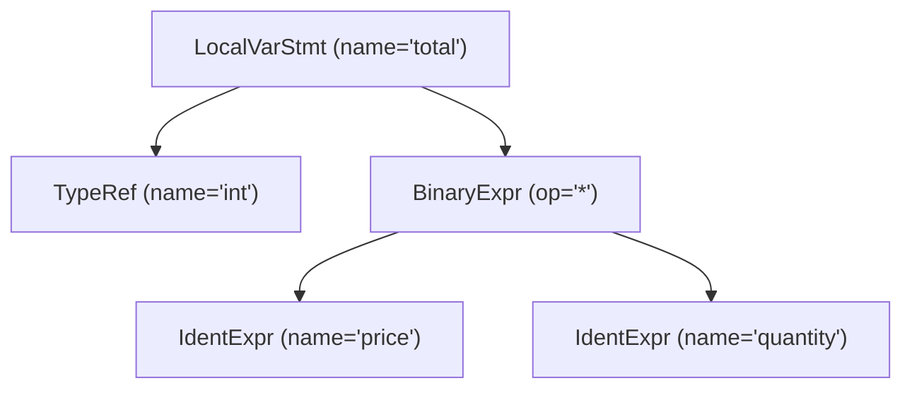

# Blog 02: Tokens & Trees — How Code Becomes an Abstract Syntax Tree (AST)

In [Blog 01](./01_the_vision_why_transpile_csharp_to_python.md), we explored *why* PythonSharp exists. Now, let's step inside the compiler itself and answer the first fundamental question of compiler engineering:

> **How does a computer read a plain text file like `Calculator.ps` and understand what it actually means?**

In this post, we will walk through the **compiler frontend**:
1. **The Lexer (Scanner)**: Breaking raw text characters into meaningful words called *Tokens*.
2. **The Parser**: Assembling those tokens into a hierarchical tree called an **Abstract Syntax Tree (AST)** using recursive descent.
3. **Source Spans**: How the compiler pinpoints errors down to the exact line and column number.

---

## The Frontend Pipeline

When you run `psc build`, every `.ps` file passes through two sequential stages before any type checking or code generation happens:



---

## 1. The Lexer: Breaking Text into Tokens

To human eyes, `int count = 10;` is obviously a variable declaration. But to a computer reading a disk file, it is just an array of raw Unicode bytes:
`['i', 'n', 't', ' ', 'c', 'o', 'u', 'n', 't', ' ', '=', ' ', '1', '0', ';']`

The Lexer's job is to scan these characters one by one and group them into logical units called **Tokens**.

### Inside `src/psc/frontend/tokens.py`
In PythonSharp, every token has:
- A **`TokenKind`**: What category of token it is (`CLASS`, `IF`, `IDENT`, `INT_LIT`, `LPAREN`, etc.).
- A **`lexeme`**: The exact raw text from the source file (`"count"`, `"10"`, `";"`).
- A **`SourceSpan`**: Exactly where it came from (file name, line number, column number).

```python
# From src/psc/frontend/tokens.py
class TokenKind(Enum):
    CLASS = auto()
    INT = auto()
    IDENT = auto()
    ASSIGN = auto()
    INT_LIT = auto()
    SEMICOLON = auto()
    # ... over 100 token kinds!
```

### How the Lexer Works (`src/psc/frontend/lexer.py`)
The lexer maintains a cursor pointer over the source string. In [`_scan_token()`](file:///home/abhijit/Videos/transpilers/PythonSharp/src/psc/frontend/lexer.py), it checks the current character:
- If it sees `"`: It scans until the closing `"`, unescaping characters like `\n` and `\t` into a `STRING_LIT`.
- If it sees `$` followed by `"`: It recognizes a C# string interpolation `$"Total: {total}"` and creates an `INTERP_STRING` token.
- If it sees digits `0`–`9`: It parses integers, floats, or scientific notation (`1.5e-3`).
- If it sees letters `a`–`z`: It accumulates the word. If the word matches a keyword table (`if`, `class`, `return`, `record`), it emits that specific keyword token; otherwise, it emits a generic `IDENT` (identifier) token.

---

## 2. Tracking Source Spans for Perfect Diagnostics

Have you ever used a compiler that reported an error like `Syntax error on line ?` with no other info? It is infuriating.

PythonSharp embeds a [`SourceSpan`](file:///home/abhijit/Videos/transpilers/PythonSharp/src/psc/frontend/ast_nodes.py) on **every single token and AST node**:

```python
@dataclass(frozen=True, slots=True)
class SourceSpan:
    file_id: int
    ps_filename: str
    start_line: int
    start_col: int
    end_line: int
    end_col: int
```

Because every AST node knows its exact starting and ending span, PythonSharp can emit compiler diagnostic messages that highlight the offending code:

```text
ERROR [PS102] at Services/OrderService.ps:14:23: Cannot assign null to non-nullable type 'string'
   14 |     string customer = null;
      |                       ^^^^
```

---

## 3. The Parser: Building the Abstract Syntax Tree (AST)

Tokens are just a flat sequence of words. But code is deeply nested:
- A **CompilationUnit** has **Namespaces**.
- A **Namespace** has **Classes** and **Records**.
- A **Class** has **Methods** and **Properties**.
- A **Method** has **Statements** (`if`, `while`, `return`).
- A **Statement** has nested **Expressions** (`a + b * c`).

To represent this hierarchy, the Parser constructs an **Abstract Syntax Tree (AST)**.

### What is Recursive Descent?
PythonSharp uses a **Recursive Descent Parser** in [`src/psc/frontend/parser.py`](file:///home/abhijit/Videos/transpilers/PythonSharp/src/psc/frontend/parser.py). "Recursive descent" sounds fancy, but the concept is very straightforward:

> **For every grammatical rule in the language, write a Python method with that same name.**

Look at how intuitive the parser code is:

```python
# Simplified snippet from src/psc/frontend/parser.py
def parse_while_stmt(self) -> WhileStmt:
    self.expect(TokenKind.WHILE)          # 1. Expect 'while'
    self.expect(TokenKind.LPAREN)         # 2. Expect '('
    condition = self.parse_expr()         # 3. Recursively parse the condition expression
    self.expect(TokenKind.RPAREN)         # 4. Expect ')'
    body = self.parse_stmt()              # 5. Recursively parse the loop body
    return WhileStmt(condition=condition, body=body)
```

The methods call each other in a hierarchy:
- `parse_compilation_unit()` calls `parse_type_decl()`
- `parse_type_decl()` calls `parse_member_decl()`
- `parse_member_decl()` calls `parse_stmt()`
- `parse_stmt()` calls `parse_expr()`

### Operator Precedence (PEMDAS for Code)
When parsing an expression like `2 + 3 * 4`, how does the parser know multiplication happens before addition?

In [`src/psc/frontend/parser.py`](file:///home/abhijit/Videos/transpilers/PythonSharp/src/psc/frontend/parser.py), expression parsing is layered into precedence tiers:
1. `parse_expr()` (Ternary `? :`, Assignment `=`)
2. `parse_logical_or()` (`||`)
3. `parse_logical_and()` (`&&`)
4. `parse_equality()` (`==`, `!=`)
5. `parse_relational()` (`<`, `>`, `<=`, `>=`)
6. `parse_additive()` (`+`, `-`)
7. `parse_multiplicative()` (`*`, `/`, `%`)
8. `parse_unary()` (`!`, `-`, `await`)
9. `parse_primary()` (Literals, identifiers, parenthesized expressions `(...)`)

Each level only consumes operators of its own precedence, passing tighter-binding operations down the chain.

---

## 4. Visualizing an AST Node

Consider this C# line:
```csharp
int total = price * quantity;
```

After lexing and parsing, the resulting AST node in [`src/psc/frontend/ast_nodes.py`](file:///home/abhijit/Videos/transpilers/PythonSharp/src/psc/frontend/ast_nodes.py) is:



In Python data structures, this is an instance of `LocalVarStmt`:
```python
LocalVarStmt(
    type_ref=TypeRef(path=['int']),
    name='total',
    initializer=Expr(
        kind=ExprKind.BINARY,
        data={
            'op': BinaryOp.MUL,
            'left': Expr(kind=ExprKind.IDENT, data={'name': 'price'}),
            'right': Expr(kind=ExprKind.IDENT, data={'name': 'quantity'}),
        }
    )
)
```

---

## Interactive Demo: See the Parser in Action

You can inspect PythonSharp's lexer and parser directly in your Python terminal:

```python
from psc.frontend.lexer import Lexer
from psc.frontend.parser import Parser
from psc.diagnostics import DiagnosticEngine

code = "int square(int x) { return x * x; }"
diag = DiagnosticEngine()

# 1. Lexing
lexer = Lexer(code, file_id=0, ps_filename="test.ps", diagnostics=diag)
tokens = lexer.tokenize()
print([f"{t.kind.name}: {t.lexeme}" for t in tokens[:6]])
# Output: ['INT: int', 'IDENT: square', 'LPAREN: (', 'INT: int', 'IDENT: x', 'RPAREN: )']

# 2. Parsing
parser = Parser(tokens, diagnostics=diag)
fn = parser.parse_member_decl(enclosing_type_name="Demo")
print(f"Parsed Method: {fn.name}, Return Type: {fn.return_type.path}")
# Output: Parsed Method: square, Return Type: ['int']
```

---

## Key Takeaways
1. **The Lexer** converts raw text bytes into structured `Token` objects while recording precise source line/column coordinates.
2. **The Parser** consumes tokens using recursive descent, respecting operator precedence to construct a clean **Abstract Syntax Tree (AST)**.
3. At this stage, the code has syntactic structure, but the compiler does not yet know what types exist or whether `price` and `quantity` are valid variables.

In **[Blog 03: The Brain — Symbols, Scopes & Name Mangling](./03_the_brain_symbols_and_type_resolution.md)**, we'll see how the compiler discovers types, builds symbol tables, and resolves identifiers across files.

