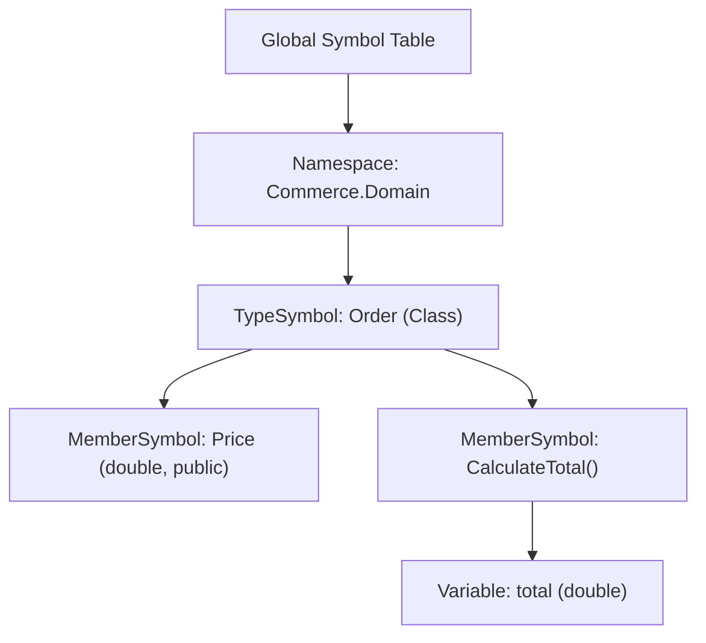

# Blog 03: The Brain — Symbols, Scopes & Name Mangling

In [Blog 02](./02_tokens_and_trees_the_lexer_and_parser.md), we saw how PythonSharp turns source code into an Abstract Syntax Tree (AST). 

Now, imagine the compiler looks at this statement in your code:
```csharp
total = price * quantity;
```
Syntactically, this is completely valid. But the compiler doesn't yet know:
- Does a variable named `price` actually exist in this function?
- Is `quantity` an integer, a string, or an HTTP response?
- Does the current method have permission to access `total`?

To answer these questions, the compiler needs a brain. In compiler theory, that brain is called the **Symbol Table**.

---

## 1. What is a Symbol Table?

A **Symbol** is any named entity in your program:
- A class, record, struct, or interface (`Order`, `CustomerRepository`).
- A method or constructor (`CalculateTotal`, `Save`).
- A property or field (`Price`, `_items`).
- A local variable or parameter (`total`, `quantity`).

The **Symbol Table** ([`src/psc/semantics/symbols.py`](file:///home/abhijit/Videos/transpilers/PythonSharp/src/psc/semantics/symbols.py)) is a hierarchical database that indexes all of these symbols and their properties:



Every symbol records:
1. **Name and Qualified Name**: e.g., `Price` and `Commerce.Domain.Order.Price`.
2. **Type**: Its declared static type (`double`, `string`, `List<Order>`).
3. **Scope**: Where it lives and who is allowed to see it (`public`, `private`).
4. **Attributes and Metadata**: Whether it maps to an ambient Python module or has an inline template.

---

## 2. Two-Pass Compilation: Solving Cross-File Dependencies

In dynamic scripts, file order often matters: you cannot reference a class before defining it. But in C#, Class A can reference Class B, and Class B can reference Class A:

```csharp
// File 1: Customer.ps
public class Customer {
    public List<Order> Orders { get; set; }
}

// File 2: Order.ps
public class Order {
    public Customer Customer { get; set; }
}
```

How does PythonSharp compile these without getting confused by circular dependencies?

By using a **Two-Pass Semantic Analysis**:

### Pass 1: Declaration Collection ([`src/psc/semantics/collector.py`](file:///home/abhijit/Videos/transpilers/PythonSharp/src/psc/semantics/collector.py))
The compiler scans the "skeletons" of every file in the project. It notes down:
- *"Ah, there is a class named `Customer` in namespace `Commerce.Domain`."*
- *"There is a class named `Order` in namespace `Commerce.Domain`."*
It registers all type names and method signatures in the `GlobalSymbolTable` without inspecting method bodies yet.

### Pass 2: Type Resolution & Body Analysis
Now that every type in the entire project is cataloged, the compiler goes back and inspects every method body, variable assignment, and expression. When it sees `public List<Order> Orders`, it looks up `Order` in the symbol table and successfully links them!

---

## 3. Resolving Types Across Namespaces

When you write `using System.Collections.Generic;` in C#, you don't want to type `System.Collections.Generic.List<string>` every single time.

In [`GlobalSymbolTable.lookup_type_in_context()`](file:///home/abhijit/Videos/transpilers/PythonSharp/src/psc/semantics/symbols.py), PythonSharp implements a 5-step resolution algorithm:
1. **Exact Qualified Match**: Did the user write `Commerce.Domain.Order`?
2. **Namespace Hierarchy**: Is `Order` in the current namespace or parent namespace?
3. **Explicit Alias**: Did the user write `using OrderList = List<Order>;`?
4. **Imported Namespaces**: Did the user write `using Commerce.Domain;` at the top of the file?
5. **Ambient Standard Library**: Is it a core type like `String`, `List`, `Dict`, `Math`, or `Console` from `PythonSharp.Core`?

If all 5 checks fail, PythonSharp halts and raises a clear compiler diagnostic:
```text
ERROR [PS020] at Services/OrderProcessor.ps:12:15: Type 'Invoice' could not be found. Are you missing a using directive?
```

---

## 4. Name Mangling: C# PascalCase to Python snake_case

C# and Python have completely different naming conventions:
- **C#**: `PascalCase` for methods (`CalculateTotal`), properties (`CustomerName`), and classes (`OrderService`).
- **Python**: `snake_case` for methods (`calculate_total`), attributes (`customer_name`), and `PascalCase` for classes (`OrderService`).

If PythonSharp emitted `order.CalculateTotal()`, Python developers consuming your library would feel like they were reading foreign code.

PythonSharp contains a specialized conversion function in [`src/psc/semantics/symbols.py`](file:///home/abhijit/Videos/transpilers/PythonSharp/src/psc/semantics/symbols.py):

```python
# From src/psc/semantics/symbols.py
def pascal_to_snake(name: str) -> str:
    # Converts 'CalculateTotal' -> 'calculate_total'
    # Converts 'HTTPResponse' -> 'http_response'
    # Converts 'IsActive' -> 'is_active'
```

### What About Python Keyword Collisions?
What if a C# property or parameter is named `from`, `class`, `def`, or `import`?
In Python, writing `o.def = 1` or `def func(from: str)` causes an immediate `SyntaxError`.

PythonSharp's `pascal_to_snake` automatically detects Python keywords and safely appends a trailing underscore (following PEP 8):
```csharp
// C# Source
public void Process(string from, string class) { }
```
```python
# Emitted Python
def process(self, from_: str, class_: str) -> None:
    pass
```

---

## Key Takeaways
1. **The Symbol Table** gives identity and scope to raw AST nodes, organizing variables, methods, and types into an accessible hierarchy.
2. **Two-Pass Compilation** allows arbitrary circular dependencies across multiple files without ordering issues.
3. **Casing Mangling** seamlessly bridges C# `PascalCase` into clean, idiomatic Python `snake_case`, while avoiding Python keyword collisions.

Now that the compiler has a full catalog of all types and symbols, it is ready to enforce the law! 

In **[Blog 04: The Compiler Police — Static Type Checking & Null Safety](./04_the_compiler_police_type_checking_and_access_rules.md)**, we'll see how PythonSharp prevents bugs from ever reaching Python.

