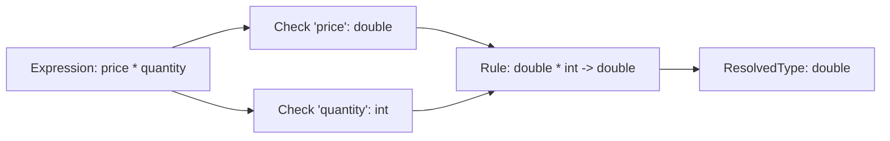

# Blog 04: The Compiler Police — Static Type Checking & Null Safety

In Python, you can write:
```python
def calculate_tax(subtotal):
    return subtotal * 0.15

# Somewhere in your codebase at 2:00 AM:
calculate_tax("one hundred dollars")  # TypeError: can't multiply sequence by non-int of type 'float'
```
Because Python is dynamically typed, this mistake stays hidden until that exact line of code runs in production.

In this post, we explore the **compiler police**:
1. **Static Type Checker** ([`src/psc/semantics/type_checker.py`](file:///home/abhijit/Videos/transpilers/PythonSharp/src/psc/semantics/type_checker.py)): Ensuring types match before any Python code is generated.
2. **Nullable Reference Types**: Eliminating `NoneType` attribute crashes.
3. **Access Control** ([`src/psc/semantics/access_checker.py`](file:///home/abhijit/Videos/transpilers/PythonSharp/src/psc/semantics/access_checker.py)): Enforcing `private`, `protected`, and `readonly` immutability.

---

## 1. How Static Type Checking Works

When PythonSharp's type checker encounters an expression, it calculates its **`ResolvedType`**:



If you try to assign that result to an incompatible type:
```csharp
string invoiceTotal = price * quantity; // Error!
```

The type checker halts with diagnostic code `[PS101]`:
```text
ERROR [PS101] at Services/InvoiceService.ps:18:9: Cannot implicitly convert type 'double' to 'string'.
   18 |     string invoiceTotal = price * quantity;
      |            ^^^^^^^^^^^^
```

### Generic Type Invariance (`List<T>`)
Generics are rigorously validated. If you declare a `List<int>`, PythonSharp prevents non-integers from ever entering:

```csharp
List<int> numbers = new List<int>();
numbers.Add(42);         // OK
numbers.Add("hello");    // Compiler Error: Argument 1 cannot convert from 'string' to 'int'
```

In standard Python, a list is heterogeneous—you can put anything in it. But in PythonSharp, the compiler guarantees that every element in that list matches its declared type.

---

## 2. Eliminating the "Billion-Dollar Mistake": Null Safety

Sir Tony Hoare famously called the invention of the `null` pointer his "billion-dollar mistake." In Python, it takes the form of:
`AttributeError: 'NoneType' object has no attribute 'name'`

PythonSharp implements modern C# **Nullable Reference Types**:
- `string`: **Non-nullable**. Guaranteed to never be `null` / `None`.
- `string?`: **Nullable**. Might be `null` / `None`.

### The Non-Nullable Rule
If a variable is declared as `string`, assigning `null` is a compile-time error:

```csharp
string name = null; // Compiler Error: Cannot assign null to non-nullable type 'string'
```

### Safe Navigation with `?.`
If a variable is explicitly marked as nullable (`User? user`), you cannot directly access `user.Email`:

```csharp
User? user = FindUser(id);
string email = user.Email; // Compiler Error: Dereference of a possibly null reference 'user'.
```

You are forced to safely handle the nullability using the null-conditional operator (`?.`) or a check:

```csharp
// Safe: compiles cleanly
string? email = user?.Email;

// Or with null check:
if (user != null) {
    string email = user.Email; // OK! Compiler knows user is not null here.
}
```

When lowered to Python, `user?.Profile?.Email` automatically turns into a safe walrus-expression chain:
```python
# Lowered Python
email: str | None = (_ps_t1.email if (_ps_t0 := user) is not None and (_ps_t1 := _ps_t0.profile) is not None else None)
```

---

## 3. The Access Checker: Enforcing Encapsulation

In standard Python, there is no real `private`:
```python
class Account:
    def __init__(self):
        self._balance = 100

acc = Account()
acc._balance = -9999  # Python allows this! The underscore is only a "gentleman's agreement".
```

In PythonSharp, access modifiers are **strictly enforced compile-time boundaries**:
- `public`: Accessible from anywhere.
- `private`: Accessible only within the enclosing type.
- `protected`: Accessible within the enclosing type and subclasses.
- `internal`: Accessible only within the same assembly/project.

In [`src/psc/semantics/access_checker.py`](file:///home/abhijit/Videos/transpilers/PythonSharp/src/psc/semantics/access_checker.py), the compiler verifies every member access:

```csharp
public class BankAccount
{
    private double _balance = 100.0;
}

public class Hacker
{
    public void Exploit(BankAccount account)
    {
        account._balance = 0.0; // Compiler Error: 'BankAccount._balance' is inaccessible due to its protection level.
    }
}
```

### Immutability & `readonly`
If you declare a field as `readonly`:
```csharp
public class Configuration
{
    public readonly string ApiKey;

    public Configuration(string key) {
        ApiKey = key; // OK in constructor
    }

    public void Mutate() {
        ApiKey = "new_key"; // Compiler Error: Cannot assign to 'ApiKey' because it is readonly
    }
}
```

---

## Key Takeaways
1. **Static Type Checking** catches type mismatches, missing methods, and illegal conversions before any Python code is generated.
2. **Nullable Reference Types (`T?`)** eliminate runtime `NoneType` exceptions.
3. **Access Checking** turns Python's informal underscore conventions into unbendable compile-time guarantees.

Now that our code is verified and secure, how does PythonSharp translate standard library calls like `string.Length` or `Math.Sqrt` without adding bloated runtime wrappers?

Find out in **[Blog 05: Zero-Cost Magic — The Ambient Standard Library (`PythonSharp.Core.d.ps`)](./05_zero_cost_magic_ambient_stdlib_and_type_erasure.md)**!

