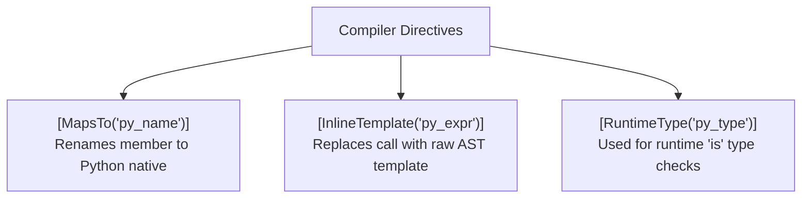

# Blog 05: Zero-Cost Magic — The Ambient Standard Library (`PythonSharp.Core.d.ps`)

In [Blog 01](./01_the_vision_why_transpile_csharp_to_python.md), we established PythonSharp's guiding principle: **The Zero Runtime Wrapper Tax**.

Now let's ask a difficult question:
> In C#, you write `s.Length`, `numbers.Add(42)`, and `Console.WriteLine(Math.Sqrt(16))`.
> In Python, those concepts are `len(s)`, `numbers.append(42)`, and `print(math.sqrt(16))`.
>
> How can the compiler let you write standard C# APIs without shipping a massive `pythonsharp_runtime.py` file that slows down every call?

The answer lies in **Ambient Stubs (`.d.ps`)** and **Compiler Metadata Attributes**.

---

## 1. What is an Ambient Declaration File?

If you have ever used TypeScript, you are familiar with `.d.ts` declaration files. They tell the TypeScript compiler: *"This function exists, here are its parameter types, but do not emit any JavaScript for this declaration."*

PythonSharp adopts this exact concept with **`.d.ps` files**!

The file [`stdlib/PythonSharp.Core.d.ps`](file:///home/abhijit/Videos/transpilers/PythonSharp/stdlib/PythonSharp.Core.d.ps) is the backbone of PythonSharp. It is automatically parsed by the compiler before your code. It declares C#'s standard library, but every method is marked with special compiler instructions.

---

## 2. The Three Magic Metadata Attributes

Inside `PythonSharp.Core.d.ps`, you will see three core attributes:



### Directive 1: `[MapsTo("name")]`
When a C# method maps 1:1 to a Python method with a different name, `[MapsTo]` tells the compiler to silently rewrite the name:

```csharp
[MapsTo("str")]
public primitive class String
{
    [MapsTo("startswith")]
    public extern bool StartsWith(string prefix);

    [MapsTo("lower")]
    public extern string ToLower();

    [MapsTo("strip")]
    public extern string Trim();
}
```

When you write:
```csharp
string clean = text.Trim().ToLower();
```
The compiler verifies that `.Trim()` and `.ToLower()` exist on `String`, and emits:
```python
clean: str = text.strip().lower()
```
Zero overhead. Pure Python.

---

### Directive 2: `[InlineTemplate("...")]`
What happens when a C# construct doesn't map to a Python method name, but to a Python built-in function, operator, or slice?

This is where `[InlineTemplate]` shines. It instructs the compiler's expression lowerer to substitute the caller `{self}` and arguments `{0}`, `{1}` directly into Python AST syntax!

#### Example A: `String.Length` -> `len(s)`
In C#, string length is a property: `s.Length`. In Python, it is a built-in function: `len(s)`.
```csharp
[InlineTemplate("len({self})")]
public extern int Length { get; }
```
When you write `if (password.Length < 8)`, PythonSharp emits:
```python
if len(password) < 8:
```

#### Example B: Substrings -> Python Slices
In C#, `text.Substring(0, 5)` takes `(start, length)`. In Python, that is a slice `text[0:0+5]`:
```csharp
[InlineTemplate("{self}[{0}:{0} + {1}]")]
public extern string Substring(int startIndex, int length);
```

#### Example C: `Console.WriteLine` -> `print()`
```csharp
public static primitive class Console
{
    [InlineTemplate("print({0})")]
    public static extern void WriteLine(object? value);

    [InlineTemplate("print({0}, end=\"\", flush=True)")]
    public static extern void Write(object? value);
}
```
Writing `Console.Write("\rProcessing...")` translates directly to `print('\rProcessing...', end='', flush=True)`.

---

### Directive 3: `[RuntimeType("py_type")]`
In C#, you can check an object's type at runtime:
```csharp
if (item is string) { ... }
```
How does Python check this? With `isinstance(item, str)`.

`[RuntimeType("str")]` tells the compiler what runtime type to test in Python:
```csharp
[MapsTo("str")]
[RuntimeType("str")]
public primitive class String { }
```
When PythonSharp lowers `item is string`, it emits:
```python
if isinstance(item, str):
```

---

## 3. Mapping Collections: `List<T>` and `Dict<K, V>`

Look at how standard collections are mapped in [`stdlib/PythonSharp.Core.d.ps`](file:///home/abhijit/Videos/transpilers/PythonSharp/stdlib/PythonSharp.Core.d.ps):

| C# Code | Ambient Definition | Emitted Python 3.11+ |
| :--- | :--- | :--- |
| `new List<int>()` | `[InlineTemplate("[]")]` | `[]` |
| `list.Count` | `[InlineTemplate("len({self})")]` | `len(list)` |
| `list.Add(x)` | `[MapsTo("append")]` | `list.append(x)` |
| `list.RemoveAt(0)` | `[MapsTo("pop")]` | `list.pop(0)` |
| `new Dict<string, int>()` | `[InlineTemplate("{}")]` | `{}` |
| `dict.ContainsKey(key)` | `[InlineTemplate("({0} in {self})")]` | `(key in dict)` |
| `dict.Count` | `[InlineTemplate("len({self})")]` | `len(dict)` |

---

## 4. The Result: 100% Type Erasure

Because every ambient declaration is marked `extern`, **none of the code in `PythonSharp.Core.d.ps` is ever emitted to Python**. 

The ambient file exists exclusively to give the compiler complete static awareness of types, method signatures, and emission patterns. Once compilation is finished, the stubs disappear entirely.

The resulting Python code has:
- **No wrapper objects** (no `StringWrapper` or `ListWrapper`).
- **No helper imports** (no `from pythonsharp import runtime`).
- **Maximum execution speed** (runs at native Python speeds).

---

## Key Takeaways
1. **`.d.ps` Files** provide type signatures for native platforms without generating output code.
2. **`[MapsTo]`** redirects method names directly to native Python methods.
3. **`[InlineTemplate]`** rewrites C# member access into Python built-ins, slicing, and operators.
4. The emitted Python is clean, idiomatic, and indistinguishable from code written by an expert Python engineer.

Now that we understand how the compiler views types and methods, let's explore the engine that builds Python code from scratch!

Join us in **[Blog 06: The Code Generator — Turning C# AST into Python AST](./06_the_code_generator_turning_csharp_ast_into_python.md)**!

