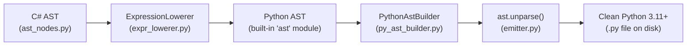

# Blog 06: The Code Generator — Turning C# AST into Python AST

In [Blog 02](./02_tokens_and_trees_the_lexer_and_parser.md), we saw how source code becomes an Abstract Syntax Tree (AST). In [Blog 04](./04_the_compiler_police_type_checking_and_access_rules.md), the compiler verified that every type and operation was legal.

Now comes the magic moment: **Code Generation**.

How does PythonSharp take a verified C# syntax tree and generate clean, formatted Python 3.11+ code?

---

## 1. Why Not Just Concatenate Strings?

A naive transpiler might try to generate Python code by stitching strings together:
```python
# The WRONG way: string templating
py_code = f"def {method_name}():\n    if {condition}:\n        return {val}"
```
This approach quickly falls apart:
- **Indentation nightmares**: Nested `if` blocks inside `while` loops inside classes break indentation easily.
- **Operator precedence bugs**: `2 + 3 * 4` might lose necessary parentheses.
- **Invalid syntax**: Special characters or escape sequences in strings can break the generated file.

Instead, PythonSharp performs an **AST-to-AST Transformation**:
It transforms the C# AST into a native **Python AST** (using Python's official built-in [`ast`](https://docs.python.org/3/library/ast.html) module), and then asks Python itself to serialize that tree into text!



---

## 2. Step 1: Lowering Expressions and Statements

The engine responsible for converting individual C# nodes into Python AST nodes is [`ExpressionLowerer`](file:///home/abhijit/Videos/transpilers/PythonSharp/src/psc/codegen/expr_lowerer.py).

### How Statements Lower
Look at how each C# statement maps to an equivalent Python `ast` node:

| C# AST Node | Python `ast` Equivalent | Example Output |
| :--- | :--- | :--- |
| `LocalVarStmt` (`int x = 10;`) | `ast.AnnAssign` | `x: int = 10` |
| `IfStmt` (`if (cond) { ... }`) | `ast.If` | `if cond:` |
| `WhileStmt` (`while (cond) { ... }`) | `ast.While` | `while cond:` |
| `ForEachStmt` (`foreach (var x in list)`) | `ast.For` | `for x in list:` |
| `BreakStmt` (`break;`) | `ast.Break` | `break` |
| `ContinueStmt` (`continue;`) | `ast.Continue` | `continue` |
| `ReturnStmt` (`return val;`) | `ast.Return` | `return val` |

### How Expressions Lower
Consider the C# ternary expression:
```csharp
int max = a > b ? a : b;
```
In [`lower_expr()`](file:///home/abhijit/Videos/transpilers/PythonSharp/src/psc/codegen/expr_lowerer.py), when it encounters `ExprKind.CONDITIONAL`, it constructs a Python `ast.IfExp`:
```python
# In expr_lowerer.py:
test_ast = self.lower_expr(expr.data["condition"])
body_ast = self.lower_expr(expr.data["then_expr"])
orelse_ast = self.lower_expr(expr.data["else_expr"])

return ast.IfExp(test=test_ast, body=body_ast, orelse=orelse_ast)
```
When unparsed, this directly yields:
```python
max: int = a if a > b else b
```

---

## 3. Step 2: Assembling the Module (`PythonAstBuilder`)

Individual statements must be assembled into classes, and classes into an entire Python file. That is the job of [`PythonAstBuilder`](file:///home/abhijit/Videos/transpilers/PythonSharp/src/psc/codegen/py_ast_builder.py).

### Automatic Import Deduction
How does Python know when to import `math`, `dataclasses`, or `typing`?

You don't need to manually import them in your C# code! `PythonAstBuilder` inspects the generated Python AST:
1. Did any class use `@dataclass`? -> Inject `from dataclasses import dataclass`.
2. Did any method use `Math.Sqrt` or `Math.PI`? -> Inject `import math`.
3. Did any type use `Decimal`? -> Inject `from decimal import Decimal`.
4. Always inject: `from __future__ import annotations` (enabling clean, modern Python 3.11+ type annotations like `list[Order]` without quoting).

```python
# From src/psc/codegen/py_ast_builder.py
if needs_dataclass:
    from_imports.append(ast.ImportFrom(module="dataclasses", names=[ast.alias(name="dataclass")]))
if needs_decimal:
    from_imports.append(ast.ImportFrom(module="decimal", names=[ast.alias(name="Decimal")]))
```

---

## 4. Step 3: Unparsing to Clean Python Code

Once the entire `ast.Module` tree is assembled with all classes, functions, statements, and imports, PythonSharp hands the tree to [`emitter.py`](file:///home/abhijit/Videos/transpilers/PythonSharp/src/psc/codegen/emitter.py).

Starting in Python 3.9+, Python has a standard library function:
```python
import ast
python_source = ast.unparse(py_module_ast)
```

Because `ast.unparse()` is built into CPython itself:
- Indentation is always 100% syntactically correct.
- Operator precedence parentheses are mathematically optimal.
- The output looks like it was formatted with `black` or `ruff`.

---

## A Complete Walkthrough

Let's watch a C# method make the complete journey through the lowerer:

```csharp
public static double Hypotenuse(double a, double b)
{
    return Math.Sqrt(a * a + b * b);
}
```

1. **Parser Output**:
   A `MethodDecl` node containing a `ReturnStmt` with an `InvocationExpr` (`Math.Sqrt`).
2. **Expression Lowering**:
   - `Math.Sqrt` matches `[MapsTo("sqrt")]` on primitive `Math` -> lowered to `math.sqrt(...)`.
   - `a * a + b * b` -> `ast.BinOp(op=ast.Add(), left=..., right=...)`.
   - Return statement -> `ast.Return(value=ast.Call(func=ast.Attribute(value=ast.Name('math'), attr='sqrt'), ...))`.
3. **Module Assembly**:
   - `math` detected in call -> adds `import math` to top of module.
   - Wraps function into `ast.ClassDef` with `@staticmethod`.
4. **Final Emitted Python**:
```python
from __future__ import annotations
import math

class Geometry:
    __slots__ = ()

    @staticmethod
    def hypotenuse(a: float, b: float) -> float:
        return math.sqrt(a * a + b * b)
```

---

## Key Takeaways
1. PythonSharp avoids fragile string concatenation by generating real **Python `ast` nodes**.
2. **`ExpressionLowerer`** maps C# statements and expressions directly to equivalent Python AST constructs.
3. **`PythonAstBuilder`** inspects the module tree and automatically generates necessary Python imports.
4. **`ast.unparse`** formats the AST into beautiful, PEP-8 compliant Python code.

In the next post, we'll see how PythonSharp tackles one of C#'s most famous features: **Method Overloading**, along with **Records** and high-performance **`__slots__`**!

Read on in **[Blog 07: Polymorphism & Speed — Method Overloads, Dataclasses & Slots](./07_overloads_dataclasses_and_slots.md)**!

