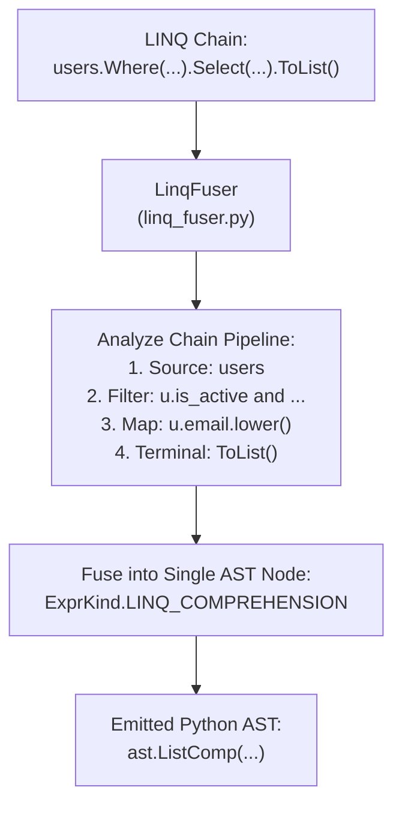

# Blog 08: The Secret Sauce — Fusing LINQ into Native Python Comprehensions

Ask any C# developer what feature they miss the most when switching to Python, and the answer is almost always **LINQ** (Language Integrated Query).

LINQ allows you to query, filter, map, and transform collections with fluent, readable method chains:
```csharp
var activeVips = users
    .Where(u => u.IsActive && u.SpentTotal > 1000)
    .Select(u => u.Email.ToLower())
    .ToList();
```

Now, how should a transpiler convert this to Python?
In this post, we explore PythonSharp's most sophisticated optimization: **The Pass 2 LINQ Fuser** ([`src/psc/semantics/linq_fuser.py`](file:///home/abhijit/Videos/transpilers/PythonSharp/src/psc/semantics/linq_fuser.py)).

---

## 1. The Naive Way vs. The Pythonic Way

If you wrote a naive transpiler, you might convert each method call directly to Python's `filter` and `map`:
```python
# The SLOW, Naive Way
list(map(lambda u: u.email.lower(), filter(lambda u: u.is_active and u.spent_total > 1000, users)))
```

Why is this bad?
1. **It's slow**: In CPython, invoking a Python `lambda` function for every single element inside `map` and `filter` has high stack-frame call overhead.
2. **It's unreadable**: Deeply nested parentheses make it hard to follow.

In Python, the fastest, most idiomatic way to transform data is a **Comprehension**:
```python
# The Fast, Idiomatic Way (List Comprehension)
[u.email.lower() for u in users if u.is_active and u.spent_total > 1000]
```
Python's list comprehensions run at C speed inside the Python virtual machine without per-item Python function call overhead.

---

## 2. How the LINQ Fuser Works

During compilation, PythonSharp runs a dedicated semantic optimization pass: **Pass 2: LINQ Comprehension Fusion**.



The fuser traverses the call tree backwards:
1. It identifies the **Terminal Materializer**: Is it `.ToList()`, `.ToHashSet()`, `.ToDict()`, or a lazy stream?
2. It walks up the chain, gathering all `.Where()` filter predicates.
3. It extracts the `.Select()` mapping projection.
4. It extracts the original collection source (`users`).
5. It **fuses** all separate stages into a single unified Python Comprehension AST node!

---

## 3. Supported LINQ Transformations

Look at how various C# LINQ query patterns fuse into clean Python:

### A. List Materialization (`.ToList()`)
```csharp
// C#
var result = items.Where(x => x > 0).Select(x => x * 2).ToList();
```
```python
# Emitted Python
result: list[int] = [x * 2 for x in items if x > 0]
```

---

### B. Set Materialization (`.ToHashSet()`)
```csharp
// C#
var uniqueTags = posts.Select(p => p.Tag).ToHashSet();
```
```python
# Emitted Python (Set Comprehension)
unique_tags: set[str] = {p.tag for p in posts}
```

---

### C. Dictionary Materialization (`.ToDict()`)
```csharp
// C#
var userMap = users.ToDict(u => u.Id, u => u.Name);
```
```python
# Emitted Python (Dict Comprehension)
user_map: dict[int, str] = {u.id: u.name for u in users}
```

---

### D. Predicate Fusion (`.Where().Where()`)
What if you chain multiple filters?
```csharp
// C#
var filtered = items
    .Where(x => x > 0)
    .Where(x => x % 2 == 0)
    .ToList();
```
The fuser automatically merges the conditions using Python's `and`:
```python
# Emitted Python
filtered: list[int] = [x for x in items if x > 0 and x % 2 == 0]
```

---

### E. Short-Circuiting Terminals (`.Any()`, `.All()`)
```csharp
// C#
bool hasAdmins = users.Any(u => u.IsAdmin);
bool allActive = users.All(u => u.IsActive);
```
Compiles to generator expressions inside Python's built-in `any()` and `all()`, which short-circuit at runtime:
```python
# Emitted Python
has_admins: bool = any((u.is_admin for u in users))
all_active: bool = all((u.is_active for u in users))
```

---

### F. Lazy Streams (No Terminal)
If you do not call `.ToList()`, the pipeline remains a lazy generator:
```csharp
// C#
IEnumerable<int> stream = numbers.Where(n => n > 10).Select(n => n * n);
```
```python
# Emitted Python (Lazy Generator Expression)
stream: collections.abc.Iterable[int] = (n * n for n in numbers if n > 10)
```
No list is allocated in memory until the generator is consumed!

---

## 4. Under the Hood: The Fuser Implementation

Inside [`src/psc/semantics/linq_fuser.py`](file:///home/abhijit/Videos/transpilers/PythonSharp/src/psc/semantics/linq_fuser.py), the fuser replaces the method call with an `ExprKind.LINQ_COMPREHENSION` node:

```python
# From src/psc/semantics/linq_fuser.py
return Expr(
    span=call_expr.span,
    kind=ExprKind.LINQ_COMPREHENSION,
    data={
        "comprehension_kind": ComprehensionKind.LIST,
        "source": base_collection,
        "item_name": item_name,
        "filter": combined_condition,
        "projection": projection_expr,
    }
)
```

When [`ExpressionLowerer`](file:///home/abhijit/Videos/transpilers/PythonSharp/src/psc/codegen/expr_lowerer.py) visits this node, it emits:
```python
ast.ListComp(
    elt=self.lower_expr(projection_expr),
    generators=[
        ast.comprehension(
            target=ast.Name(id=item_name, ctx=ast.Store()),
            iter=self.lower_expr(base_collection),
            ifs=[self.lower_expr(combined_condition)] if combined_condition else [],
            is_async=0,
        )
    ]
)
```

---

## Key Takeaways
1. **LINQ Query Fusion** eliminates slow `map(lambda ...)` calls and replaces them with native Python comprehensions.
2. Supports `.ToList()`, `.ToHashSet()`, `.ToDict()`, `.Any()`, `.All()`, and lazy generator expressions.
3. The emitted Python is clean, idiomatic, and executes at peak Python performance.

Now that we understand how code is compiled and optimized, how does the developer actually use the tool?

In **[Blog 09: Developer Experience — CLI, Incremental Caching & Pinned Tracebacks](./09_developer_experience_cli_caching_and_pinned_tracebacks.md)**, we'll explore the CLI, lightning-fast rebuilds, and how tracebacks point back to your C# source!

