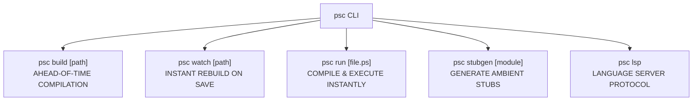
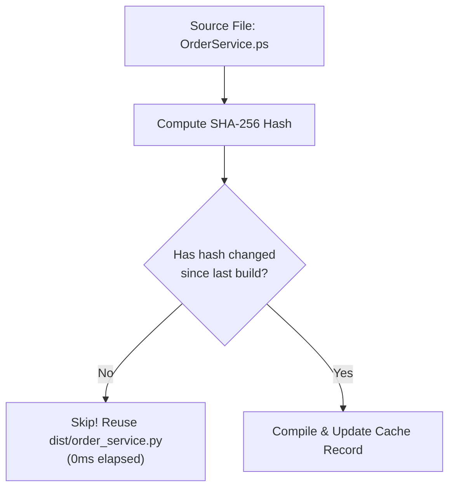

# Blog 09: Developer Experience — CLI, Incremental Caching & Pinned Tracebacks

A programming language can have the most beautiful type system in the world, but if the compiler is slow, cumbersome to run, or impossible to debug, developers will abandon it.

In this post, we explore how **PythonSharp (`psc`)** delivers a delightful developer experience:
1. **The CLI**: Commands for building, watching, and running projects.
2. **Incremental Build Caching**: Using SHA-256 hashes to make rebuilds instant.
3. **Line-Pinned Tracebacks**: When Python throws an error at runtime, how does the stack trace point directly back to your C# source code?

---

## 1. The `psc` Command-Line Interface (CLI)

PythonSharp provides an intuitive command-line interface installed as `psc`:



### Core Commands

#### 1. `psc build [path]`
Compiles a single `.ps` file or an entire project directory containing a `.psproj` file:
```bash
psc build ./MyProject
# Build succeeded: emitted 3 module(s) to 'MyProject/dist' in 0.08s
```

#### 2. `psc run [file.ps]`
Compiles the file into memory and executes it immediately using Python 3.11+:
```bash
psc run script.ps
# Compiles and executes in < 100ms!
```

#### 3. `psc watch [path]`
Starts an asynchronous file watcher ([`src/psc/watcher.py`](file:///home/abhijit/Videos/transpilers/PythonSharp/src/psc/watcher.py)). Whenever you save a `.ps` file in VS Code, the compiler recompiles the changed file instantly.

---

## 2. Incremental Caching: Instant Rebuilds

In a project with 50 source files, modifying one single line shouldn't force the compiler to re-analyze and re-emit all 50 files.

PythonSharp features a built-in **Incremental Build Cache** ([`src/psc/build_cache.py`](file:///home/abhijit/Videos/transpilers/PythonSharp/src/psc/build_cache.py)):



When you re-run `psc build`:
```text
=== Building Project ===
Build is up to date: outputs in 'MyProject/dist' are fresh. (3ms)
```
Only modified files and their direct dependents are recompiled.

---

## 3. Project Configuration: `.psproj`

PythonSharp projects use a clean, MSBuild-compatible XML project file:

```xml
<Project Sdk="PythonSharp.Sdk/0.1.0">
  <PropertyGroup>
    <AssemblyName>CommerceApp</AssemblyName>
    <TargetFramework>py3.11</TargetFramework>
    <Nullable>enable</Nullable>
    <EmitSourceMaps>true</EmitSourceMaps>
  </PropertyGroup>
</Project>
```

The compiler uses this manifest to plan package namespaces, determine the output directory (`dist/`), and configure compiler flags.

---

## 4. The Debugging Superpower: Line-Pinned Tracebacks

Here is the nightmare of traditional transpilers (like Babel, CoffeeScript, or old JS tools):
1. You write code on line 12 of `MyService.ps`.
2. The transpiler emits `dist/my_service.py` with 150 lines of boilerplate.
3. At runtime, Python crashes with:
   `ZeroDivisionError: division by zero at dist/my_service.py:114`
4. You are left staring at line 114 of a generated file, trying to guess which line in your original source code caused the error!

### How PythonSharp Solves This
PythonSharp embeds **AST Line-Pinning** during code generation:
Every generated Python AST statement has its line number (`lineno`) and column offset stamped with the **exact line number from the original `.ps` source file**!

In [`src/psc/codegen/expr_lowerer.py`](file:///home/abhijit/Videos/transpilers/PythonSharp/src/psc/codegen/expr_lowerer.py):
```python
def stamp_span(node: ast.AST, span: SourceSpan) -> ast.AST:
    node.lineno = span.start_line
    node.col_offset = span.start_col
    node.end_lineno = span.end_line
    node.end_col_offset = span.end_col
    return node
```

### The Magic: Custom Traceback Rewriting
When an unhandled exception occurs in Python, PythonSharp's traceback hook ([`src/psc/tracebacks.py`](file:///home/abhijit/Videos/transpilers/PythonSharp/src/psc/tracebacks.py)) intercepts the stack trace:

```text
Traceback (most recent call last):
  File "Services/PaymentService.ps", line 24, in ProcessPayment
    double fee = amount / divider;
                 ^^^^^^^^^^^^^^^^
ZeroDivisionError: float division by zero
```

Look at that stack trace:
- The file name says **`Services/PaymentService.ps`** (not `dist/payment_service.py`).
- The line number says **line 24** (the exact line in your C# file).
- The code snippet is the original C# source code!

You debug your code in terms of the language you wrote, not the generated output.

---

## Key Takeaways
1. **The CLI (`psc`)** provides zero-friction tools for building, watching, and executing code.
2. **SHA-256 Build Caching** guarantees that unchanged code is never redundantly compiled.
3. **Line-Pinned Tracebacks** make debugging seamless by routing runtime Python exceptions straight back to your original `.ps` source lines.

Now, what about the editor experience? How do you get autocompletion, red squiggles, and Go-To-Definition in your IDE?

Find out in **[Blog 10: IDE Superpowers — Inside the Language Server Protocol (LSP)](./10_ide_superpowers_building_the_lsp_server.md)**!

