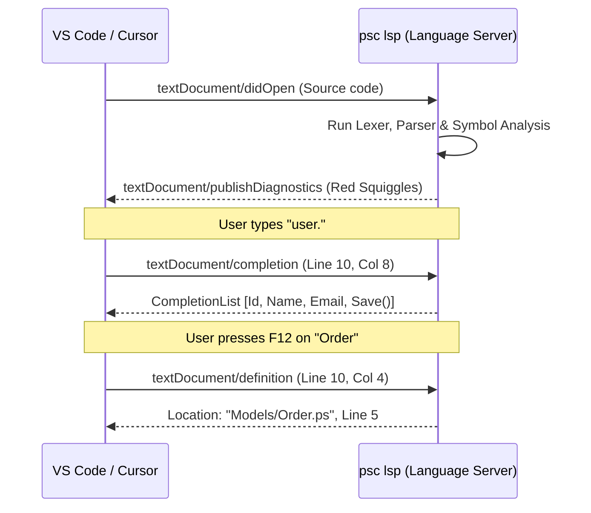

# Blog 10: IDE Superpowers — Inside the Language Server Protocol (LSP)

In modern software development, nobody wants to write code in a plain text editor without autocompletion, real-time error squiggles, or Go-To-Definition.

When you open a `.ps` or `.pysharp` file in VS Code, how does the editor know:
- Which words to highlight?
- Where to show red squiggly lines when a type error occurs?
- What methods to suggest when you type `order.`?
- Which file to open when you press **F12** on a class name?

The secret is the **Language Server Protocol (LSP)**. In this post, we explore how PythonSharp's built-in LSP server ([`src/psc/lsp/server.py`](file:///home/abhijit/Videos/transpilers/PythonSharp/src/psc/lsp/server.py)) gives you full IDE superpowers.

---

## 1. What is the Language Server Protocol?

In the old days of development tools, if you created a new programming language, you had to write a separate plugin for VS Code, another for Sublime Text, another for Vim, and another for IntelliJ.

In 2016, Microsoft introduced the **Language Server Protocol (LSP)**. Instead of writing custom plugins for every editor, you write **one single Language Server**. Any editor that speaks the LSP protocol can talk to your server using standard **JSON-RPC messages** over standard input/output (`stdin`/`stdout`).



---

## 2. Live Diagnostics: Real-Time Red Squiggles

Whenever you open or edit a file, the editor sends a `textDocument/didChange` notification to `psc lsp`.

Inside [`src/psc/lsp/server.py`](file:///home/abhijit/Videos/transpilers/PythonSharp/src/psc/lsp/server.py):
1. The server updates its in-memory document cache.
2. It runs the file through the **Lexer**, **Parser**, and **Semantic Analyzer**.
3. It collects all syntax and type errors from the `DiagnosticEngine`.
4. It sends a `textDocument/publishDiagnostics` message back to the editor.

```json
{
  "jsonrpc": "2.0",
  "method": "textDocument/publishDiagnostics",
  "params": {
    "uri": "file:///workspace/Services/OrderService.ps",
    "diagnostics": [
      {
        "range": {
          "start": { "line": 14, "character": 8 },
          "end": { "line": 14, "character": 16 }
        },
        "severity": 1,
        "code": "PS101",
        "message": "Cannot implicitly convert type 'double' to 'string'."
      }
    ]
  }
}
```
The editor immediately draws a red squiggly line under line 14, column 8!

---

## 3. Context-Aware Autocomplete (`textDocument/completion`)

When you type a dot (`.`), you expect the editor to pop up a list of available methods and properties.

How does the server know what to suggest?
1. The server extracts the token immediately before the dot (e.g., `user`).
2. It queries the `SymbolTable` to find the type of `user` (e.g., `Commerce.Domain.User`).
3. It retrieves all public members of `User` (and its base classes).
4. It returns a formatted list of completion items with type icons, parameter signatures, and docstrings!

```python
# From src/psc/lsp/server.py
for member in owner_sym.lookup_member(prefix="", include_bases=True):
    items.append({
        "label": member.name,
        "kind": CompletionItemKind.Method if member.kind == "method" else CompletionItemKind.Property,
        "detail": f"{member.resolved_type} {member.name}",
        "documentation": member.docstring
    })
```

---

## 4. Hover Tooltips & Type Information (`textDocument/hover`)

When you hover your mouse over any variable, parameter, or method, the editor requests `textDocument/hover`.

The server looks up the symbol at your mouse coordinates and returns rich Markdown content:

```text
(method) int PadUtil.LeftPad(string str, int length, string ch = " ")

Pads the left side of a string with a specific character until reaching length.
Declared in: TextUtil/PadUtil.ps
```

---

## 5. Cross-File Go-To-Definition (`textDocument/definition`)

Perhaps the most beloved feature of statically typed IDEs is pressing **F12** (or `Ctrl+Click`) on a class name to instantly jump to where it was defined.

PythonSharp's LSP server tracks exact symbol locations across all project files:
- If you press F12 on `Order` in `OrderProcessor.ps`, the server resolves `Order` in the symbol table and returns:
  `Location: "file:///workspace/Models/Order.ps#L5-L10"`.
- If you press F12 on `List<T>` or `Console.WriteLine()`, the server jumps directly into [`stdlib/PythonSharp.Core.d.ps`](file:///home/abhijit/Videos/transpilers/PythonSharp/stdlib/PythonSharp.Core.d.ps), allowing you to inspect the standard library definitions!

---

## Starting the LSP Server

You can launch the PythonSharp LSP server from any terminal:
```bash
psc lsp
```
The server starts listening on `stdin`/`stdout`, ready to communicate with any modern editor via the VS Code extension or generic LSP clients.

---

## Key Takeaways
1. **LSP** allows PythonSharp to provide world-class editor support across VS Code and other editors using a single, unified server.
2. **Diagnostics** publish compiler errors in real time as you type.
3. **Completions, Hover & Go-To-Definition** give developers the full power of statically typed navigation.

Now, what if you want to use existing third-party Python packages like **FastAPI**, **NumPy**, or **Requests** from inside your C# code?

Learn how in **[Blog 11: The Two-Way Bridge — Generating C# Stubs with Bindgen](./11_two_way_interop_generating_csharp_stubs_with_bindgen.md)**!

