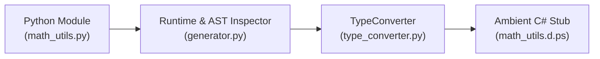

# Blog 11: The Two-Way Bridge — Generating C# Stubs with Bindgen

In [Blog 01](./01_the_vision_why_transpile_csharp_to_python.md), we talked about the immense power of the Python ecosystem: packages like **NumPy**, **Requests**, **FastAPI**, and **PyTorch**.

If you write code in PythonSharp, you naturally want to call those Python packages. But wait:
> If Python packages are dynamically typed, how can the PythonSharp compiler know what methods exist on a Python package, what arguments they take, and what types they return?

In this post, we explore the two-way bridge: **`psc stubgen`** and the **Binding Generator** ([`src/psc/bindgen/`](file:///home/abhijit/Videos/transpilers/PythonSharp/src/psc/bindgen/)).

---

## 1. The Interop Problem

Suppose you want to use a Python math utility in your C# code:
```python
# math_utils.py (existing Python module)
def calculate_discount(price: float, percentage: float = 0.1) -> float:
    """Calculates discounted price."""
    return price * (1.0 - percentage)
```

In your C# file (`Checkout.ps`), you want to write:
```csharp
double finalPrice = MathUtils.CalculateDiscount(100.0, 0.2);
```

For this to compile:
1. The C# compiler must know that `CalculateDiscount` exists.
2. It must verify that `100.0` is a `double` and `0.2` is a `double`.
3. It must know that the method returns a `double`.
4. Your editor must offer autocomplete and documentation on hover.

Where does this type information come from?

---

## 2. Generating Ambient Stubs (`psc stubgen`)

PythonSharp provides an automated stub generator command:
```bash
psc stubgen math_utils
```



The generator inspects the Python module (its functions, classes, PEP 484 type annotations, and docstrings) and automatically generates an **ambient declaration file** (`math_utils.d.ps`):

```csharp
// Auto-generated by psc stubgen from 'math_utils'
namespace MathUtils;

using PythonSharp.Core;

extern using math_utils;

[MapsTo("math_utils")]
public static class MathUtils
{
    /// <summary>Calculates discounted price.</summary>
    [MapsTo("calculate_discount")]
    public static extern double CalculateDiscount(double price, double percentage = 0.1);
}
```

Notice what just happened:
- `math_utils.py` became a strongly typed C# class `MathUtils`.
- `calculate_discount` became `CalculateDiscount`.
- Python's `float` became C#'s `double`.
- The docstring was preserved as an XML doc comment (`/// <summary>`).
- The method is marked `extern` with `[MapsTo("calculate_discount")]`, meaning it has **zero runtime wrapper overhead**.

Now, your C# code can write:
```csharp
using MathUtils;

double finalPrice = MathUtils.CalculateDiscount(100.0, 0.2);
```
You get **full IDE autocomplete**, **compile-time type verification**, and **instant hover documentation**!

---

## 3. How Types Translate: Python to C#

In [`src/psc/bindgen/type_converter.py`](file:///home/abhijit/Videos/transpilers/PythonSharp/src/psc/bindgen/type_converter.py), PythonSharp defines exact mapping rules between Python type annotations and C# types:

| Python Type Annotation | Generated C# Type |
| :--- | :--- |
| `str` | `string` |
| `int` | `int` |
| `float` | `double` |
| `bool` | `bool` |
| `list[str]` | `List<string>` |
| `dict[str, int]` | `Dict<string, int>` |
| `set[int]` | `HashSet<int>` |
| `tuple[int, str]` | `KeyValuePair<int, str>` / `tuple` |
| `Optional[str]` or `str \| None` | `string?` (Nullable reference type!) |
| `Any` | `dynamic` or `object` |
| `Callable[[int], bool]` | `Func<int, bool>` |

---

## 4. Hybrid Projects: Mixing C# and Python

In real-world projects, you rarely rewrite everything at once. PythonSharp natively supports **Hybrid Projects** (see [`Samples/03_python_interop_hybrid`](file:///home/abhijit/Videos/transpilers/PythonSharp/Samples/03_python_interop_hybrid)).

You can structure your repository like this:
```text
MyProject/
├── Models/
│   ├── Order.ps           # Written in C# (PythonSharp)
│   └── User.ps            # Written in C# (PythonSharp)
├── legacy_utils.py        # Existing Python script
├── ai_pipeline.py         # PyTorch/HuggingFace script
└── MyProject.psproj       # PythonSharp project file
```

1. Run `psc stubgen legacy_utils` to generate `legacy_utils.d.ps`.
2. Write all your business logic, validation, and domain models in type-safe C#.
3. Compile with `psc build .`.
4. Your existing Python scripts can import and use the emitted classes without ever knowing they were written in C#!

---

## Key Takeaways
1. **`psc stubgen`** automatically generates ambient C# stubs (`.d.ps`) from existing Python modules.
2. **`TypeConverter`** maps Python PEP 484 annotations to native C# types (including nullability `T?` and generics `List<T>`).
3. **Zero Overhead**: Interop doesn't use slow IPC or serialization; it compiles directly to native Python imports and calls.

We have now explored the entire compiler from frontend to backend, from LSP to bindgen.

Now, let's see the ultimate test:
In **[Blog 12: Putting It All Together — Dogfooding with 8 Real-World Ported Libraries](./12_dogfooding_porting_real_world_python_libraries.md)**, we'll see what happened when we ported 8 canonical open-source Python packages into PythonSharp!

