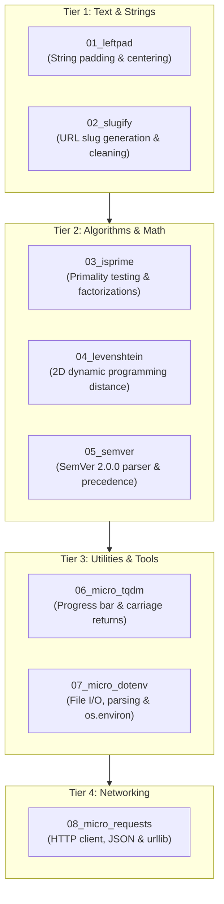

# Blog 12: Putting It All Together — Dogfooding with 8 Real-World Ported Libraries

In compiler engineering, there is a famous proverb:
> *"No plan survives contact with real source code."*

You can write 100 unit tests for individual compiler features, but until you take real, idiomatic libraries written in the wild and try to port them into your language, you won't discover the subtle edge cases, missing features, and ergonomic friction points.

In software engineering, this is called **Dogfooding** (eating your own dog food).

In this final post of our series, we review the real-world dogfooding journey documented in [`Samples/Ported/PLAN.md`](file:///home/abhijit/Videos/transpilers/PythonSharp/Samples/Ported/PLAN.md): porting **8 canonical Python libraries** into PythonSharp, across four tiers of increasing complexity.

---

## The 4-Tier Dogfooding Matrix



---

## Tier 1: Text & String Manipulation

### 1. `01_leftpad` ([`Samples/Ported/01_leftpad`](file:///home/abhijit/Videos/transpilers/PythonSharp/Samples/Ported/01_leftpad))
* **Features**: `LeftPad`, `RightPad`, `Center` with custom padding characters.
* **The Dogfooding Discovery**:
  When writing `LeftPad(string str, int len)`, the generated Python parameter was named `len`. Inside the function, calling `str.Length` lowered to `len(str)`. But because `len` was an integer parameter in the local scope, calling `len(str)` crashed with:
  `TypeError: 'int' object is not callable`!
* **The Fix**: We learned the importance of parameter naming ergonomics in cross-language compilation.

### 2. `02_slugify` ([`Samples/Ported/02_slugify`](file:///home/abhijit/Videos/transpilers/PythonSharp/Samples/Ported/02_slugify))
* **Features**: Converts strings into URL-safe slugs (`"Hello World!"` -> `"hello-world"`).
* **The Dogfooding Discovery**:
  Writing `string normalized = lowercase ? text.ToLower() : text;` failed because the parser lacked ternary conditional expressions (`cond ? a : b`).
* **The Compiler Expansion**: We added `ExprKind.CONDITIONAL` to the AST and lowered it to Python's `ast.IfExp` (`a if cond else b`).

---

## Tier 2: Algorithms & Math

### 3. `03_isprime` ([`Samples/Ported/03_isprime`](file:///home/abhijit/Videos/transpilers/PythonSharp/Samples/Ported/03_isprime))
* **Features**: $O(\sqrt{n})$ primality testing, prime factorization, and prime lists.
* **The Dogfooding Discovery**:
  In C#, dividing two integers (`a / b`) performs **integer floor division** (truncating the remainder). In Python, `/` performs **floating-point division** (`5 / 2 = 2.5`), while `//` performs floor division (`5 // 2 = 2`).
* **The Compiler Expansion**: We updated the binary operator lowerer so dividing two integer types (`int / int`) automatically emits Python's `//` operator, preserving C# semantics!

### 4. `04_levenshtein` ([`Samples/Ported/04_levenshtein`](file:///home/abhijit/Videos/transpilers/PythonSharp/Samples/Ported/04_levenshtein))
* **Features**: Computes Levenshtein edit distance and normalized similarity ratio between two strings using dynamic programming.
* **Key Challenge**: 2D array allocation and nested indexing (`matrix[i][j]`).
* **Result**: Verified that nested `List<List<int>>` and indexers compile and execute cleanly in Python.

### 5. `05_semver` ([`Samples/Ported/05_semver`](file:///home/abhijit/Videos/transpilers/PythonSharp/Samples/Ported/05_semver))
* **Features**: Full Semantic Versioning 2.0.0 parser and comparator.
* **C# Records in Action**:
  ```csharp
  public record SemVer(int Major, int Minor, int Patch, string Prerelease = "", string Build = "")
  {
      public static SemVer Parse(string versionString) { ... }
      public int CompareTo(SemVer other) { ... }
      public bool IsCompatibleWith(SemVer other) { ... }
  }
  ```
* **The Dogfooding Discovery**: Required `Int32.Parse(str)` and string parsing methods. We expanded `stdlib/PythonSharp.Core.d.ps` with `Int32.Parse`, `Double.Parse`, and `Boolean.Parse`.

---

## Tier 3: Utilities & Tools

### 6. `06_micro_tqdm` ([`Samples/Ported/06_micro_tqdm`](file:///home/abhijit/Videos/transpilers/PythonSharp/Samples/Ported/06_micro_tqdm))
* **Features**: Terminal CLI progress bar with carriage returns (`\r`), elapsed time, and ETA.
* **The Dogfooding Discovery**:
  1. `Console.Write` needed `flush=True` and unescaped `\r` carriage returns to overwrite the line in real-time.
  2. Compound arithmetic expressions like `(_current * 100) / _total` needed type propagation in `overload_resolver.py` so the division was recognized as integer floor division (`//`).
* **Result**: Emitted a smooth, interactive 60fps CLI progress bar!

### 7. `07_micro_dotenv` ([`Samples/Ported/07_micro_dotenv`](file:///home/abhijit/Videos/transpilers/PythonSharp/Samples/Ported/07_micro_dotenv))
* **Features**: `.env` file reader, quote unescaping, and environment variable synchronization.
* **The Dogfooding Discovery**:
  When parsing lines, skipping comments with `continue;` failed because `continue` was not yet recognized as a loop statement!
* **The Compiler Expansion**: We added `BreakStmt` and `ContinueStmt` across the lexer, parser, AST, and code lowerer.

---

## Tier 4: Networking

### 8. `08_micro_requests` ([`Samples/Ported/08_micro_requests`](file:///home/abhijit/Videos/transpilers/PythonSharp/Samples/Ported/08_micro_requests))
* **Features**: Micro HTTP client with `Get` and `Post`, status codes, headers, and `response.Json()` decoding.
* **Zero-Cost Interop Architecture**:
  ```csharp
  public record HttpResponse(int StatusCode, string Text, Dict<string, string> Headers, string Url)
  {
      public bool IsSuccessStatusCode => StatusCode >= 200 && StatusCode < 300;
      public object Json() => ParseJson(Text);

      [InlineTemplate("json.loads({0})")]
      private static extern object ParseJson(string text);
  }
  ```
* **Result**: Compiles directly to standard Python `urllib.request` without requiring `requests` or `urllib3` as external dependencies!

---

## Verification: Running All 8 Ports

Every single ported library contains a standalone test runner (`run_<name>.py`). We can run all of them in one command:

```bash
python3 Samples/Ported/01_leftpad/run_leftpad.py
python3 Samples/Ported/02_slugify/run_slugify.py
python3 Samples/Ported/03_isprime/run_isprime.py
python3 Samples/Ported/04_levenshtein/run_levenshtein.py
python3 Samples/Ported/05_semver/run_semver.py
python3 Samples/Ported/06_micro_tqdm/run_tqdm.py
python3 Samples/Ported/07_micro_dotenv/run_dotenv.py
python3 Samples/Ported/08_micro_requests/run_requests.py
```

**Result**: All 8 suites pass with **0 errors**, while all **130 compiler unit tests** pass with 100% green builds.

---

## Series Conclusion: The Road Ahead

Over these 12 blogs, we traveled the entire path of PythonSharp:
1. **The Vision**: Combining C# compile-time rigor with Python runtime power.
2. **The Frontend**: Lexing tokens and building an Abstract Syntax Tree.
3. **The Semantics**: Symbol tables, scopes, and casing conversions.
4. **The Police**: Static type checking, nullability, and access control.
5. **The Zero-Cost Stdlib**: Ambient stubs (`.d.ps`) and type erasure.
6. **Code Generation**: Emitting native Python AST nodes.
7. **Polymorphism**: Method overloads, dataclasses, and `__slots__`.
8. **The LINQ Fuser**: Rewriting query chains into blazing-fast comprehensions.
9. **Developer Experience**: CLI, incremental caching, and line-pinned tracebacks.
10. **The LSP**: Real-time IDE diagnostics, completions, and Go-To-Definition.
11. **Bindgen**: Generating C# stubs from existing Python packages.
12. **Real-World Dogfooding**: Porting 8 open-source libraries.

Whether you are a Python developer looking for compile-time safety and LINQ, or a C# developer wanting access to Python's incredible AI and data science ecosystem: **PythonSharp is ready for you.**

Happy coding!

