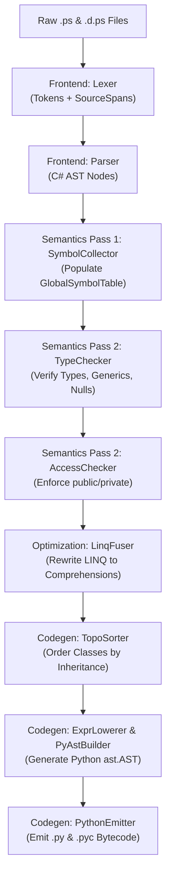

# Level 2 — Blog 01: The Monorepo Blueprint — Project Topology, Compilation Lifecycle & Build Pipeline

Welcome to **Level 2** of the PythonSharp deep dive! 

In Level 1, we explored the vision of writing strongly typed C# and emitting zero-overhead, wrapper-free Python 3.11+. In Level 2, we are opening up the engine bay. We will explore the actual Python code that drives the **PythonSharp (`psc`)** compiler, line by line and module by module.

In this first post, we dissect:
1. **The Monorepo Topology**: How `src/psc/` is organized into frontend, semantic, codegen, CLI, and tooling subsystems.
2. **The Multi-Pass Lifecycle**: What happens under the hood between running `psc build` and generating pure Python `.py` modules.
3. **Project Management & Assembly Boundaries**: How `project.py` loads `.psproj` manifests and groups multi-file source trees.
4. **The Incremental Build Cache**: How `build_cache.py` uses cryptographic SHA-256 fingerprinting to make rebuilds instantaneous.
5. **The Diagnostics Infrastructure**: How `diagnostics.py` aggregates and reports compile-time errors (`PS000`–`PS004`) with exact source spans.

---

## 1. Monorepo Anatomy: The Five Subsystems

PythonSharp is implemented as a clean, dependency-free Python 3.11+ compiler. The core code lives under [`src/psc/`](file:///home/abhijit/Videos/transpilers/PythonSharp/src/psc/). 

```
src/psc/
├── __init__.py
├── cli.py                     # Entry point for the `psc` CLI commands
├── project.py                 # .psproj manifest loader & project configuration
├── build_cache.py             # Incremental SHA-256 cache & artifact tracker
├── watcher.py                 # Continuous file watching & live rebuild daemon
├── diagnostics.py             # Error and warning diagnostic engine (PS000-PS004)
├── version.py                 # Compiler version metadata
├── frontend/                  # Lexer, Tokens, Parser & C# AST Nodes
│   ├── tokens.py
│   ├── lexer.py
│   ├── parser.py
│   └── ast_nodes.py
├── semantics/                 # Two-Pass Type Checking, Symbols & Optimizations
│   ├── symbols.py
│   ├── collector.py           # Pass 1: Symbol declaration harvesting
│   ├── type_checker.py        # Pass 2: Type checking & assignment validation
│   ├── access_checker.py      # Member visibility enforcement (public/private)
│   ├── primitive_resolver.py  # C# to Python primitive type mapping
│   ├── overload_resolver.py   # Method overload signature scoring
│   ├── slot_analyzer.py       # __slots__ inheritance calculation
│   └── linq_fuser.py          # Pass 2 optimization: LINQ to Python comprehension
├── codegen/                   # Python AST Construction & Source Text Emission
│   ├── py_ast_builder.py      # Helpers constructing standard `ast` nodes
│   ├── expr_lowerer.py        # Expression lowering & inline template engine
│   ├── overload_emitter.py    # Overload dispatcher & @typing.overload stubs
│   ├── topo_sorter.py         # Topological sorting of class hierarchies
│   └── emitter.py             # Module-level emitter & ast.unparse driver
├── lsp/                       # Pure-Python Language Server Protocol (LSP)
│   ├── protocol.py            # JSON-RPC schemas & LSP message definitions
│   └── server.py              # Live completion, hover, and Go-To-Definition
├── bindgen/                   # Two-Way Python-to-C# Ambient Stub Generator
│   ├── manifest.py
│   ├── type_converter.py
│   └── generator.py
└── native/                    # Experimental AOT Native Compiler
    └── compiler.py
```

---

## 2. The Compilation Lifecycle: From `.ps` to `.py`

When you invoke `psc build <path> -o <dist>`, the compiler executes an orchestrated pipeline of distinct passes:



### The Seven Deterministic Stages:
1. **Discovery & Invalidation**: [`project.py`](file:///home/abhijit/Videos/transpilers/PythonSharp/src/psc/project.py) discovers all `.ps` source files and `.d.ps` ambient stubs. [`build_cache.py`](file:///home/abhijit/Videos/transpilers/PythonSharp/src/psc/build_cache.py) computes SHA-256 digests. If outputs in `dist/` match the hashes of inputs and compiler version, the build terminates early with `0ms` overhead.
2. **Lexing**: [`lexer.py`](file:///home/abhijit/Videos/transpilers/PythonSharp/src/psc/frontend/lexer.py) scans character streams into tokens, tracking exact `SourceSpan(file_id, line, column, length)`.
3. **Parsing**: [`parser.py`](file:///home/abhijit/Videos/transpilers/PythonSharp/src/psc/frontend/parser.py) builds a strongly-typed C# Abstract Syntax Tree (`CompilationUnit`) using recursive descent.
4. **Symbol Harvesting (Pass 1)**: [`collector.py`](file:///home/abhijit/Videos/transpilers/PythonSharp/src/psc/semantics/collector.py) sweeps all compilation units to register namespaces, classes, structs, interfaces, records, methods, and properties in `GlobalSymbolTable`.
5. **Semantic Validation (Pass 2)**: 
   - [`type_checker.py`](file:///home/abhijit/Videos/transpilers/PythonSharp/src/psc/semantics/type_checker.py) verifies type assignments, generic constraints, method call signatures, and nullability.
   - [`access_checker.py`](file:///home/abhijit/Videos/transpilers/PythonSharp/src/psc/semantics/access_checker.py) checks encapsulation (`public`, `private`, `protected`, `internal`).
6. **Intermediate Optimization**:
   - [`linq_fuser.py`](file:///home/abhijit/Videos/transpilers/PythonSharp/src/psc/semantics/linq_fuser.py) detects chained LINQ calls (`.Where().Select().ToList()`) and replaces the AST nodes with unified Python list/set/dict comprehensions.
   - [`slot_analyzer.py`](file:///home/abhijit/Videos/transpilers/PythonSharp/src/psc/semantics/slot_analyzer.py) calculates deduplicated `__slots__` tuples.
7. **Python AST Lowering & Emission**: [`expr_lowerer.py`](file:///home/abhijit/Videos/transpilers/PythonSharp/src/psc/codegen/expr_lowerer.py) and [`py_ast_builder.py`](file:///home/abhijit/Videos/transpilers/PythonSharp/src/psc/codegen/py_ast_builder.py) generate Python `ast.Module` trees. [`emitter.py`](file:///home/abhijit/Videos/transpilers/PythonSharp/src/psc/codegen/emitter.py) unparses them into human-readable `.py` files and compiles `.pyc` bytecode.

---

## 3. Project Configuration & Assembly Boundaries

In C#, assemblies define compilation boundaries. In PythonSharp, this role is played by `.psproj` (or `.pysharpproj`) files, managed in [`src/psc/project.py`](file:///home/abhijit/Videos/transpilers/PythonSharp/src/psc/project.py).

Here is a typical project manifest:

```xml
<Project Sdk="PythonSharp.Sdk/0.1.0">
  <PropertyGroup>
    <AssemblyName>MicroToml</AssemblyName>
    <TargetPython>3.11</TargetPython>
    <EmitPyc>true</EmitPyc>
    <OutputPath>dist</OutputPath>
  </PropertyGroup>
</Project>
```

### The `PsProjectConfig` Data Structure
`project.py` parses either XML or TOML project formats into an immutable dataclass:

```python
@dataclass(slots=True)
class PsProjectConfig:
    project_name: str
    root_dir: Path
    out_dir: Path = field(default_factory=lambda: Path("dist"))
    target_python: str = "3.11"
    emit_pyc: bool = True
    source_files: list[Path] = field(default_factory=list)
    stub_files: list[Path] = field(default_factory=list)
    pypi_dependencies: dict[str, str] = field(default_factory=dict)

    def all_input_files(self) -> list[Path]:
        """Returns ambient .d.ps stubs first, followed by user .ps source files."""
        return [*self.stub_files, *self.source_files]
```

### Automatic File Discovery
When a folder or project file is provided, `load_project()` scans recursively:
- **Source extensions**: `.ps`, `.pysharp`, `.pys`
- **Ambient stub extensions**: `.d.ps`, `.d.pysharp`, `.d.pys`
- **Project extensions**: `.psproj`, `.pysharpproj`

Crucially, ambient stubs (including `PythonSharp.Core.d.ps`) are ordered **first** in `all_input_files()`. This guarantees that the compiler's symbol table has standard library types (`List<T>`, `Dictionary<TKey, TValue>`, `Console`, `Math`) registered before user code is even parsed.

---

## 4. The Incremental Build Cache: Sub-Second Recompilation

Large software projects cannot afford full rebuilds when a single file changes. [`src/psc/build_cache.py`](file:///home/abhijit/Videos/transpilers/PythonSharp/src/psc/build_cache.py) implements the `BuildCacheManager`.

### How Fingerprinting Works
1. For every input file (`.ps` and `.d.ps`), compute the SHA-256 hash of its content.
2. Record the compiler version (`psc.version.VERSION`).
3. Store the state in a lightweight `.psc-cache.json` file inside the output directory.

```python
class BuildCacheManager:
    def is_fresh(self, config: PsProjectConfig) -> bool:
        manifest_path = config.out_dir / ".psc-cache.json"
        if not manifest_path.exists():
            return False

        cache = json.loads(manifest_path.read_text(encoding="utf-8"))
        if cache.get("compiler_version") != VERSION:
            return False

        # Compare recorded SHA-256 with live files
        file_hashes = cache.get("file_hashes", {})
        for path in config.all_input_files():
            curr_hash = self.compute_hash(path)
            if file_hashes.get(str(path)) != curr_hash:
                return False  # Dirty file detected!

        return True
```

If `is_fresh()` returns `True`, `psc build` logs:
```
Build is up to date: outputs in '/path/to/dist' are fresh.
```
and exits immediately without invoking the parser or code generator!

---

## 5. The Diagnostics Subsystem

When code fails to compile, how does the user know what went wrong?
[`src/psc/diagnostics.py`](file:///home/abhijit/Videos/transpilers/PythonSharp/src/psc/diagnostics.py) provides a structured diagnostic engine:

| Code | Severity | Description | Typical Cause |
| :---: | :---: | :--- | :--- |
| `PS000` | Error | **Syntax / Parsing Error** | Missing semicolon, unmatched brace, invalid literal. |
| `PS001` | Error | **Symbol Not Found** | Calling an undefined method or referencing a missing class. |
| `PS002` | Error | **Type Mismatch** | Assigning `string` to `int` variable without cast. |
| `PS003` | Error | **Access Violation** | Accessing a `private` field from outside the enclosing class. |
| `PS004` | Warning | **Unused Symbol / Style** | Unused variable, redundant cast, deprecated construct. |

### Rich Console Formatting
Every `Diagnostic` carries a `SourceSpan`. The diagnostic engine formats error messages using standard compiler conventions:

```
ERROR [PS002] at Toml.ps:142:15: Cannot assign type 'string' to variable 'count' of type 'int'.
   141 |         string raw = "42";
>  142 |         int count = raw;
       |               ^^^^^
```

This formatted string can be parsed by VS Code, JetBrains IDEs, and GitHub Actions problem matchers seamlessly.

---

## Code Layout Summary

| Component | Responsibility | Source Location |
| :--- | :--- | :--- |
| **CLI Dispatcher** | Parses CLI arguments and routes subcommands | [`src/psc/cli.py`](file:///home/abhijit/Videos/transpilers/PythonSharp/src/psc/cli.py) |
| **Project System** | Parses `.psproj`, discovers inputs and stubs | [`src/psc/project.py`](file:///home/abhijit/Videos/transpilers/PythonSharp/src/psc/project.py) |
| **Build Cache** | Computes SHA-256 hashes to skip redundant builds | [`src/psc/build_cache.py`](file:///home/abhijit/Videos/transpilers/PythonSharp/src/psc/build_cache.py) |
| **Diagnostic Engine**| Tracks and formats compiler errors and warnings | [`src/psc/diagnostics.py`](file:///home/abhijit/Videos/transpilers/PythonSharp/src/psc/diagnostics.py) |

---

## Next Steps

Now that we understand how the compiler discovers files and orchestrates passes, we turn to the first operational stage: **The Frontend Pipeline**.

In **[Blog 02: The Frontend Pipeline — Tokens, Lexer, Source Spans & Grammar Parsing](./02_the_frontend_pipeline_tokens_lexer_and_ast.md)**, we dive into how raw source text is scanned into tokens and structured into a C# AST!

