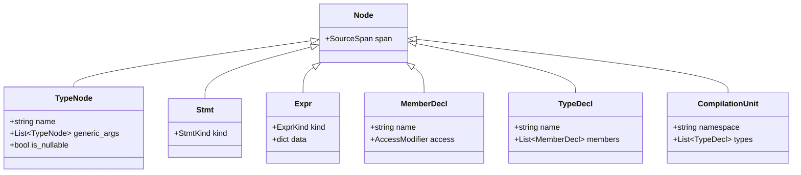

# Level 2 — Blog 02: The Frontend Pipeline — Tokens, Lexer, Source Spans & Grammar Parsing

In [Blog 01](./01_monorepo_blueprint_and_build_pipeline.md), we explored the compiler's monorepo structure and the orchestration of compilation passes. Now, let's step into the very first pass: **The Frontend Pipeline**.

The frontend has one mission: take unstructured raw source code (C# strings in `.ps` or `.d.ps` files) and transform it into a strongly typed, mathematically rigorous **Abstract Syntax Tree (AST)**.

In this post, we will explore:
1. **The Token Definition (`tokens.py`)**: Token kinds, literal representations, and the `SourceSpan` coordinate system.
2. **The Lexical Scanner (`lexer.py`)**: Character scanning, handling numbers (`0x...`, `0b...`, `10.5m`), string escapes, and `@verbatim` identifiers.
3. **The Recursive Descent Parser (`parser.py`)**: How grammar rules are implemented without third-party parser generators.
4. **The Grammar Disambiguation Problem**: Dynamic token splitting for nested generics (`List<List<T>>` vs. `>>` bitwise right-shift).
5. **The C# AST Node Hierarchy (`ast_nodes.py`)**: Nodes, statements, expressions, and compilation units.

---

## 1. Tokens and the SourceSpan Coordinate System

Everything begins in [`src/psc/frontend/tokens.py`](file:///home/abhijit/Videos/transpilers/PythonSharp/src/psc/frontend/tokens.py).

A token is the smallest meaningful unit in a program. In PythonSharp, every token is an instance of `Token`:

```python
@dataclass(slots=True)
class Token:
    kind: TokenKind
    lexeme: str
    span: SourceSpan
```

### The `SourceSpan` Structure
Why does `SourceSpan` matter? If your compiler loses line and column numbers during parsing, it can never produce line-pinned tracebacks or hover tooltips in the LSP server!

```python
@dataclass(slots=True, frozen=True)
class SourceSpan:
    file_id: int
    ps_filename: str
    start_line: int
    start_col: int
    end_line: int
    end_col: int

    def merge(self, other: SourceSpan) -> SourceSpan:
        """Merges two spans into a single bounding span covering both."""
        return SourceSpan(
            file_id=self.file_id,
            ps_filename=self.ps_filename,
            start_line=min(self.start_line, other.start_line),
            start_col=self.start_col if self.start_line <= other.start_line else other.start_col,
            end_line=max(self.end_line, other.end_line),
            end_col=other.end_col if other.end_line >= self.end_line else self.end_col,
        )
```

Whenever two expressions are combined (for example `left + right`), calling `left.span.merge(right.span)` automatically creates a bounding span that covers the entire binary operation.

---

## 2. Inside the Lexer: From Characters to Tokens

The scanner lives in [`src/psc/frontend/lexer.py`](file:///home/abhijit/Videos/transpilers/PythonSharp/src/psc/frontend/lexer.py). It operates linearly across the source string using three pointer helpers:
- `self._peek()`: inspects the current character without consuming it.
- `self._peek_next()`: inspects the character after the current one (2-character lookahead).
- `self._advance()`: consumes the current character and updates `line` and `col`.

### Lexing Hex, Binary, and Decimal Literals
In modern C#, integers can be written in decimal (`42`), hexadecimal (`0xFF`), or binary (`0b1010`), and decimals can carry an `m` suffix (`19.99m`).

```python
def _lex_number(self, start_line: int, start_col: int) -> Token:
    start_pos = self.pos

    # Check for 0x / 0X (hex) or 0b / 0B (binary)
    if self._peek() == "0" and self._peek_next().lower() in ("x", "b"):
        prefix = self._peek_next().lower()
        self._advance()  # '0'
        self._advance()  # 'x' or 'b'
        if prefix == "x":
            while self._peek().isalnum():  # 0-9, a-f, A-F
                self._advance()
        else:
            while self._peek() in ("0", "1"):
                self._advance()
        lexeme = self.source[start_pos : self.pos]
        return Token(TokenKind.INT_LIT, lexeme, self._make_span(start_line, start_col))

    # Standard decimal or float
    while self._peek().isdigit():
        self._advance()

    if self._peek() == "." and self._peek_next().isdigit():
        self._advance()  # consume '.'
        while self._peek().isdigit():
            self._advance()
        # Optional 'm' / 'M' decimal suffix
        if self._peek().lower() == "m":
            self._advance()
            return Token(TokenKind.DECIMAL_LIT, self.source[start_pos : self.pos], span)
        return Token(TokenKind.FLOAT_LIT, self.source[start_pos : self.pos], span)

    return Token(TokenKind.INT_LIT, self.source[start_pos : self.pos], span)
```

Notice that PythonSharp preserves the original string lexeme (e.g., `"0xFF"`) instead of immediately parsing it to an integer. The parser later converts it cleanly with `int(tok.lexeme, 0)`.

---

## 3. The Recursive Descent Parser

The parser in [`src/psc/frontend/parser.py`](file:///home/abhijit/Videos/transpilers/PythonSharp/src/psc/frontend/parser.py) is a hand-written **Recursive Descent Parser with Operator Precedence**. 

Why not use ANTLR or LALR parser generators like PLY or SLY?
1. **Zero External Dependencies**: PythonSharp runs on standard CPython 3.11+ without installing native C tools or Java runtimes.
2. **Superior Error Recovery**: Hand-written parsers can emit custom error recovery tokens and provide suggestions (`PS000: Expected ';' after expression`).
3. **Context Sensitivity**: Certain C# keywords (`get`, `set`, `value`, `record`, `where`) are contextual; they behave as keywords in declarations but as valid variable names in expressions.

### The Operator Precedence Hierarchy
Expression parsing is divided into precedence tiers, each calling into the next higher tier:

```
_parse_expression()
  └── _parse_assignment()          # =, +=, -=, *=, /=
      └── _parse_ternary()         # cond ? then : else
          └── _parse_null_coalesce()# ??
              └── _parse_logical_or()   # ||
                  └── _parse_logical_and()  # &&
                      └── _parse_bitwise_or()   # |
                          └── _parse_bitwise_xor()  # ^
                              └── _parse_bitwise_and()  # &
                                  └── _parse_equality()     # ==, !=
                                      └── _parse_relational()   # <, <=, >, >=, is, as
                                          └── _parse_shift()        # <<, >>
                                              └── _parse_additive()     # +, -
                                                  └── _parse_multiplicative() # *, /, %, //
                                                      └── _parse_unary()        # !, ~, -, +
                                                          └── _parse_primary()      # calls, literals, (expr)
```

Look at how cleanly C# operator precedence maps to methods:
```python
def _parse_bitwise_or(self) -> Expr:
    left = self._parse_bitwise_xor()
    while self._check(TokenKind.PIPE):
        self._advance()
        right = self._parse_bitwise_xor()
        left = Expr(
            span=left.span.merge(right.span),
            kind=ExprKind.BINARY,
            data={"op": BinaryOp.BITWISE_OR, "left": left, "right": right},
        )
    return left
```

---

## 4. The Classic Generic Grammar Problem: `>>` Token Splitting

In C# and C++, there is a notorious lexical ambiguity when writing nested generics:

```csharp
List<List<int>> matrix = new List<List<int>>();
```

At the lexical level, the characters `>>` match the **Bitwise Right Shift** operator (`TokenKind.RSHIFT`).
If the lexer emits a single `TokenKind.RSHIFT`, how does the parser close the two generic type arguments (`List<int>` and `List<...>`):

```
Expected '>' to close List<int>, but found '>>'
```

### The Solution: Dynamic Lookahead Splitting
Instead of complicating the lexer with parser state, PythonSharp solves this inside `parser._expect(TokenKind.GT)`:

```python
def _expect(self, kind: TokenKind, message: str) -> Token:
    # If the parser expects '>', but the current token is '>>' (RSHIFT),
    # dynamically split RSHIFT into two consecutive '>' tokens!
    if kind == TokenKind.GT and self._check(TokenKind.RSHIFT):
        tok = self.tokens[self.pos]
        span1 = SourceSpan(
            file_id=tok.span.file_id,
            ps_filename=tok.span.ps_filename,
            start_line=tok.span.start_line,
            start_col=tok.span.start_col,
            end_line=tok.span.start_line,
            end_col=tok.span.start_col + 1,
        )
        span2 = SourceSpan(
            file_id=tok.span.file_id,
            ps_filename=tok.span.ps_filename,
            start_line=tok.span.start_line,
            start_col=tok.span.start_col + 1,
            end_line=tok.span.end_line,
            end_col=tok.span.end_col,
        )
        # Replace RSHIFT in token stream with two GT tokens
        self.tokens[self.pos] = Token(TokenKind.GT, ">", span2)
        # Consume the first '>'
        return Token(TokenKind.GT, ">", span1)

    # Standard token expectation
    if self._check(kind):
        return self._advance()

    self.diagnostics.error(PS000, message, self._current().span)
    raise ParseError()
```

When parsing `List<List<int>>`:
1. The parser finishes `int`, expects `>`, sees `>>`.
2. It splits `>>` into `>` (consumed) and `>` (left at current position).
3. The parser returns to `List<...>`, expects `>`, sees the second `>`, and finishes cleanly.
4. If instead the user wrote `x >> 2`, `_parse_shift()` matches `TokenKind.RSHIFT` directly as an operator!

---

## 5. The AST Node Architecture

The AST nodes are defined in [`src/psc/frontend/ast_nodes.py`](file:///home/abhijit/Videos/transpilers/PythonSharp/src/psc/frontend/ast_nodes.py). All nodes inherit from a base node carrying a `SourceSpan`:



### Expression Flexibility
Notice how `Expr` uses a discriminated `ExprKind` enum paired with a typed `data` dictionary:
- `ExprKind.BINARY`: `data = {"op": BinaryOp.ADD, "left": Expr, "right": Expr}`
- `ExprKind.INVOCATION`: `data = {"target": Expr, "args": list[Argument]}`
- `ExprKind.MEMBER_ACCESS`: `data = {"target": Expr, "member": str}`
- `ExprKind.LAMBDA`: `data = {"params": list[Param], "body": Stmt | Expr}`

This design keeps the memory footprint light and allows semantic passes to attach inferred types directly to `expr.inferred_type`.

---

## Summary of Frontend Subsystem

| File | Purpose | Key Classes & Functions |
| :--- | :--- | :--- |
| [`tokens.py`](file:///home/abhijit/Videos/transpilers/PythonSharp/src/psc/frontend/tokens.py) | Lexical token definitions | `TokenKind`, `Token`, `SourceSpan` |
| [`lexer.py`](file:///home/abhijit/Videos/transpilers/PythonSharp/src/psc/frontend/lexer.py) | Character scanner | `Lexer`, `_lex_number()`, `_lex_string()` |
| [`parser.py`](file:///home/abhijit/Videos/transpilers/PythonSharp/src/psc/frontend/parser.py) | Recursive descent parser | `Parser`, `_parse_shift()`, `_expect()` token splitting |
| [`ast_nodes.py`](file:///home/abhijit/Videos/transpilers/PythonSharp/src/psc/frontend/ast_nodes.py) | AST hierarchy | `CompilationUnit`, `TypeDecl`, `Stmt`, `Expr` |

---

## Next Steps

Now that we have parsed our source code into an Abstract Syntax Tree, the AST is just a collection of syntactic shapes. It does not yet know what methods exist, whether a variable is in scope, or what type an expression produces.

In **[Blog 03: The Semantic Heart — Symbols, Scopes, Declaration Collection & Name Mangling](./03_the_semantic_heart_symbols_scopes_and_collector.md)**, we examine how Pass 1 harvests symbols and constructs the symbol table!

