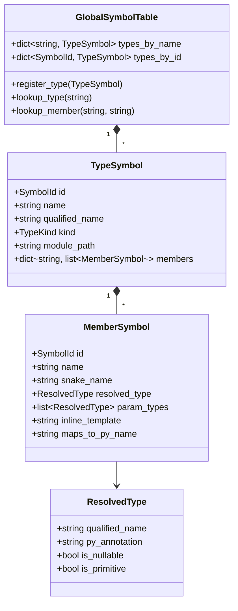

# Level 2 — Blog 03: The Semantic Heart — Symbols, Scopes, Declaration Collection & Name Mangling

In [Blog 02](./02_the_frontend_pipeline_tokens_lexer_and_ast.md), we explored how the lexer and parser construct a clean Abstract Syntax Tree (AST). But an AST by itself is "blind": it sees an identifier like `CalculateTotal()`, but it has no idea whether that method exists, what class it belongs to, what parameters it takes, or whether it returns an integer or a string.

Giving meaning to code is the responsibility of **Pass 1: Semantic Symbol Collection**.

In this post, we explore:
1. **The Symbol Architecture (`symbols.py`)**: `GlobalSymbolTable`, `TypeSymbol`, `MemberSymbol`, and `ResolvedType`.
2. **The Name Mangling Engine (`pascal_to_snake`)**: How C# naming conventions are translated into idiomatic, PEP-8 compliant Python.
3. **Pass 1 Decomposition in `SymbolCollector` (`collector.py`)**:
   - **Sub-pass 1A**: Global Type Registration & Namespace mapping.
   - **Sub-pass 1B**: Base Class & Interface Resolution (Cycle Detection).
   - **Sub-pass 1C**: Member Declaration Harvesting & Intrinsic Metadata.
4. **Handling Circular Type References**: How C# allows mutual dependencies without Python's module load-time crashes.

---

## 1. The Symbol Architecture

The symbol system lives in [`src/psc/semantics/symbols.py`](file:///home/abhijit/Videos/transpilers/PythonSharp/src/psc/semantics/symbols.py).

In compiler theory, a **Symbol** represents a declared entity: a namespace, type, method, property, or local variable.



### The `ResolvedType` Object
Every type in PythonSharp is tracked as a `ResolvedType`. It holds both the C# static type and its Python emission metadata:

```python
@dataclass(frozen=True, slots=True)
class ResolvedType:
    qualified_name: str
    py_annotation: str
    runtime_isinstance_type: str | None = None
    symbol_id: SymbolId | None = None
    type_args: tuple[ResolvedType, ...] = ()
    is_nullable: bool = False
    is_primitive: bool = False
    is_interface: bool = False

    def with_nullable(self, nullable: bool = True) -> ResolvedType:
        """Derives a nullable variant, updating PEP-484 annotation."""
        if self.is_nullable == nullable:
            return self
        ann = self.py_annotation
        if nullable and not ann.endswith(" | None"):
            ann = f"{ann} | None"
        elif not nullable and ann.endswith(" | None"):
            ann = ann.removesuffix(" | None")
        return ResolvedType(..., py_annotation=ann, is_nullable=nullable)
```

For example, when resolving `string?`, `ResolvedType` stores:
- `qualified_name`: `"PythonSharp.Core.String"`
- `py_annotation`: `"str | None"`
- `runtime_isinstance_type`: `"str"`
- `is_nullable`: `True`

---

## 2. Name Mangling & The `pascal_to_snake` Engine

C# conventions require `PascalCase` for method and property names. Python requires `snake_case`.

If a compiler naively emits `CalculateTotal()` into Python, the output looks un-Pythonic and breaks interop with standard Python tools.

[`src/psc/semantics/symbols.py`](file:///home/abhijit/Videos/transpilers/PythonSharp/src/psc/semantics/symbols.py) implements regex-powered name mangling:

```python
_SNAKE_1 = re.compile(r"([^_])([A-Z][a-z]+)")
_SNAKE_2 = re.compile(r"([a-z])([A-Z])")
_SNAKE_DIGIT = re.compile(r"([A-Za-z])([0-9])")

def pascal_to_snake(name: str) -> str:
    if not name:
        return name
    leading = ""
    core = name
    while core.startswith("_"):
        leading += "_"
        core = core[1:]
    if not core:
        return leading

    # Step 1: Insert underscores before digit boundaries: curry2 -> curry_2
    s1 = _SNAKE_DIGIT.sub(r"\1_\2", core)
    # Step 2: Handle acronym boundaries: XMLParser -> xml_parser
    s1 = _SNAKE_1.sub(r"\1_\2", s1)
    # Step 3: Handle standard PascalCase: CalculateTotal -> calculate_total
    s2 = _SNAKE_2.sub(r"\1_\2", s1).lower()

    result = f"{leading}{s2}"
    # Step 4: Python keyword collision avoidance: from -> from_
    return f"{result}_" if keyword.iskeyword(result) else result
```

Notice Step 4: if a C# property is named `From` or `Class`, converting it to `from` or `class` would cause Python syntax errors. `pascal_to_snake()` automatically appends a trailing underscore (`from_`, `class_`).

---

## 3. Pass 1: The Three Sub-Passes of `SymbolCollector`

The harvesting engine lives in [`src/psc/semantics/collector.py`](file:///home/abhijit/Videos/transpilers/PythonSharp/src/psc/semantics/collector.py).

Why is symbol collection divided into three distinct sub-passes? Because in C#, classes in File B can inherit from classes in File A, or use types declared later in the file, without forward-declaration headers.

### Sub-Pass 1A: Register All Type Headers
Before inspecting any methods or fields, the compiler scans all compilation units to register the existence of every type:

```python
for unit in units:
    ns_tuple = tuple(unit.namespace)
    module_path = namespace_to_module_path(ns_tuple)
    unit.emitted_py_module_path = module_path

    for type_decl in unit.types:
        qualified_name = f"{unit.namespace_str}.{type_decl.name}" if unit.namespace_str else type_decl.name
        type_sym = TypeSymbol(
            id=type_decl.symbol_id,
            name=type_decl.name,
            qualified_name=qualified_name,
            kind=type_decl.kind,
            module_path=module_path,
            ...
        )
        self.symtab.register_type(type_sym)
```

Now, every type (`Order`, `User`, `Invoice`) exists in `GlobalSymbolTable`, even if we don't know their members yet!

### Sub-Pass 1B: Base Class & Interface Resolution
Next, the compiler connects inheritance hierarchies:

```python
for type_sym in registered_types:
    if type_sym.ast_node.base_type:
        base_name = type_sym.ast_node.base_type.name
        resolved_base = self._resolve_type(base_name, type_sym.owner_namespace)
        type_sym.base_type = resolved_base

    # Detect illegal circular inheritance: class A : B, class B : A
    self._check_inheritance_cycles(type_sym)
```

### Sub-Pass 1C: Member Declaration Harvesting
Finally, the compiler visits every member (fields, properties, methods, constructors, indexers) within every class:

```python
for member in type_decl.members:
    member_sym = MemberSymbol(
        id=member.symbol_id,
        name=member.name,
        snake_name=pascal_to_snake(member.name),
        kind=member.kind,
        owner_type_id=type_sym.id,
        owner_qualified_name=type_sym.qualified_name,
        access=member.access,
        ...
    )
    # Check for compiler intrinsic attributes: [MapsTo], [InlineTemplate]
    self._extract_intrinsic_attributes(member, member_sym)
    type_sym.add_member(member_sym)
```

---

## 4. Compiler Intrinsics: `[MapsTo]` & `[InlineTemplate]`

How does PythonSharp know that `Console.WriteLine("Hello")` should compile directly into `print("Hello")`?

It reads metadata attached in ambient declarations (`.d.ps`), extracted in Sub-Pass 1C:

```csharp
// From stdlib/PythonSharp.Core.d.ps
public static class Console
{
    [InlineTemplate("print({0})")]
    public static extern void WriteLine(object value);
}
```

When Sub-Pass 1C encounters `[InlineTemplate("print({0})")]`:
1. It stores the template pattern `"print({0})"` directly on `member_sym.inline_template`.
2. When the code generator encounters a call to `Console.WriteLine(x)`, it bypasses method invocation emission and substitutes the argument into the template string: `print(x)`.
3. The result is pure, direct Python syntax with **zero runtime call overhead**.

---

## Summary of Symbol Subsystem

| Class / Function | Responsibility |
| :--- | :--- |
| [`GlobalSymbolTable`](file:///home/abhijit/Videos/transpilers/PythonSharp/src/psc/semantics/symbols.py) | Global registry mapping type names and IDs across all project files |
| [`TypeSymbol`](file:///home/abhijit/Videos/transpilers/PythonSharp/src/psc/semantics/symbols.py) | Metadata container for classes, records, structs, interfaces |
| [`MemberSymbol`](file:///home/abhijit/Videos/transpilers/PythonSharp/src/psc/semantics/symbols.py) | Metadata container for methods, properties, fields, constructors |
| [`pascal_to_snake`](file:///home/abhijit/Videos/transpilers/PythonSharp/src/psc/semantics/symbols.py) | Regex algorithm converting C# names to PEP-8 Python names |
| [`SymbolCollector`](file:///home/abhijit/Videos/transpilers/PythonSharp/src/psc/semantics/collector.py) | Pass 1 driver executing Sub-passes 1A, 1B, and 1C |

---

## Next Steps

With all symbols harvested and stored in `GlobalSymbolTable`, the compiler is ready to enforce static type guarantees.

In **[Blog 04: Semantic Validation & Type Checking — TypeChecker, AccessChecker & Primitive Resolver](./04_semantic_validation_typechecker_and_access.md)**, we examine how Pass 2 verifies types, catches access violations, and checks nullability!

