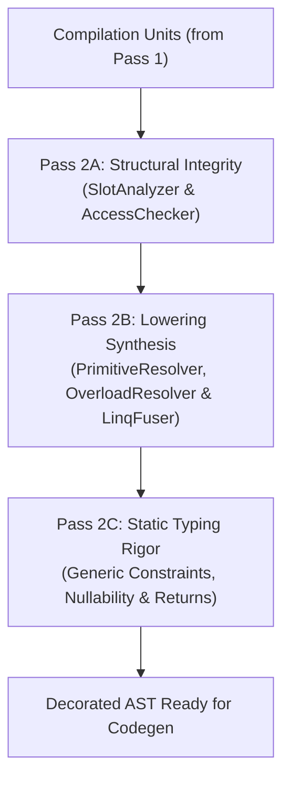

# Level 2 — Blog 04: Semantic Validation & Type Checking — TypeChecker, AccessChecker & Primitive Resolver

In [Blog 03](./03_the_semantic_heart_symbols_scopes_and_collector.md), we explored Pass 1: how the compiler harvested every class, method, property, and namespace into the `GlobalSymbolTable`.

Now the compiler assumes the role of **The Compiler Police**: **Pass 2 (Semantic Analysis and Verification)**.

In standard Python, type errors (`TypeError`, `AttributeError`) are only discovered when code executes at runtime. In PythonSharp, Pass 2 statically proves program safety *before* a single line of Python is ever emitted.

In this post, we explore:
1. **The Pass 2 Pipeline**: How [`type_checker.py`](file:///home/abhijit/Videos/transpilers/PythonSharp/src/psc/semantics/type_checker.py) orchestrates Pass 2A, Pass 2B, and Pass 2C.
2. **Access Control Enforcement (`access_checker.py`)**: Protecting `private`, `protected`, and `internal` boundaries.
3. **Nullability & Generic Constraint Verification (`verify_all`)**: `T` vs `T?`, `where T : BaseClass`, and assignment safety.
4. **Primitive Type Erasure & Intrinsic Attributes (`primitive_resolver.py`)**: `[MapsTo]`, `[InlineTemplate]`, `[KwArgs]`, `[SchemaModel]`, and `[NativeCompile]`.

---

## 1. The Pass 2 Orchestration Architecture

Pass 2 is coordinated by `TypeChecker` in [`src/psc/semantics/type_checker.py`](file:///home/abhijit/Videos/transpilers/PythonSharp/src/psc/semantics/type_checker.py):

```python
class TypeChecker:
    def check_and_decorate_all(self, units: list[CompilationUnit]) -> None:
        # Pass 2A: Hierarchy slots, access modifier verification (PS003/PS001)
        self.slot_analyzer.analyze_all(units)
        self.access_checker.check_all(units)

        # Pass 2B: Primitive erasure, overload dispatch synthesis, LINQ fusion
        self.primitive_resolver.resolve_all(units)
        self.overload_resolver.resolve_all(units)
        self.linq_fuser.fuse_all(units)

        # Pass 2C: Generic constraint verification, nullability & return checks
        self.verify_all(units)
```



By decoupling Pass 2 into sequential stages, each stage operates on an increasingly decorated and validated AST.

---

## 2. Enforcing Encapsulation: `AccessChecker`

In Python, access control is purely conventional (e.g. prefixing private members with an underscore `_item`). Nothing actually prevents another module from accessing or mutating private fields.

In PythonSharp, access modifiers are **hard compile-time barriers**, enforced by [`src/psc/semantics/access_checker.py`](file:///home/abhijit/Videos/transpilers/PythonSharp/src/psc/semantics/access_checker.py).

### How Access is Evaluated
When an expression accesses a member (`order.calculate_tax()`), `AccessChecker` computes the relationship between the caller's enclosing type and the member's owning type:

```python
def _can_access_member(
    self,
    current_type: TypeSymbol | None,
    current_assembly: str,
    target_member: MemberSymbol,
) -> bool:
    mod = target_member.access

    if mod == AccessMod.PUBLIC:
        return True

    if mod == AccessMod.PRIVATE:
        # Accessible ONLY within the exact enclosing TypeSymbol
        return current_type is not None and current_type.id == target_member.owner_type_id

    if mod == AccessMod.PROTECTED:
        # Accessible within the class or any derived subclass
        if current_type is None:
            return False
        return self.symtab.is_subclass_of(current_type, target_member.owner_type_id)

    if mod == AccessMod.INTERNAL:
        # Accessible anywhere within the same .psproj assembly
        return target_member.assembly == current_assembly

    return False
```

If code outside `Order` attempts to access `order._secret_key`, compilation halts immediately with error `PS003`:

```
ERROR [PS003] at Commerce.ps:89:17: Cannot access private member '_secret_key' on type 'Order'.
   88 |         var order = new Order();
>  89 |         var key = order._secret_key;
      |                   ^^^^^^^^^^^^^^^^^
```

Once compilation succeeds, the member is emitted into Python with a single underscore prefix, having already passed rigorous compile-time verification.

---

## 3. Generic Constraints & Nullability Verification

Pass 2C in [`src/psc/semantics/type_checker.py`](file:///home/abhijit/Videos/transpilers/PythonSharp/src/psc/semantics/type_checker.py) enforces C# generic constraints (`where T : IEntity`) and nullability (`T` vs `T?`).

### 1. Generic Constraints (`where T : Constraint`)
When a generic class or method declares constraints:

```csharp
public class Repository<T> where T : IEntity
{
    public void Save(T entity) { ... }
}
```

The `TypeChecker` checks every instantiation site (e.g. `new Repository<User>()`):
1. Resolves `User` in `GlobalSymbolTable`.
2. Inspects `User`'s base types and implemented interfaces.
3. If `User` does not implement `IEntity`, emits diagnostic `PS002`:
   ```
   ERROR [PS002] at Repo.ps:14:20: Type 'User' does not satisfy generic constraint 'IEntity'.
   ```

### 2. Nullability Analysis (`T?` vs `T`)
C# distinguishes between nullable and non-nullable reference types:
- `string` cannot be `null`.
- `string?` can be `null` or a `string`.

`TypeChecker` intercepts assignment and return sites:

```python
def _check_null_assignment(
    self,
    span: SourceSpan,
    target_name: str,
    declared_type: ResolvedType,
    value_expr: Expr,
) -> None:
    # If the declared type is NOT nullable, but the assigned expression is null:
    if not declared_type.is_nullable and self._is_null_literal(value_expr):
        self.diagnostics.error(
            PS002,
            f"Cannot assign 'null' to non-nullable variable '{target_name}' of type '{declared_type.qualified_name}'.",
            span,
        )
```

This prevents the dreaded `NoneType` bugs before runtime.

---

## 4. Primitive Type Erasure & Intrinsic Attributes

How does the compiler know how to translate C# attributes into compiler directives?
[`src/psc/semantics/primitive_resolver.py`](file:///home/abhijit/Videos/transpilers/PythonSharp/src/psc/semantics/primitive_resolver.py) scans and acts on all intrinsic compiler attributes:

```python
INTRINSIC_ATTR_NAMES = frozenset({
    "MapsTo",               # Maps C# class/method to an existing Python standard symbol
    "InlineTemplate",       # Inlines direct Python expressions without function call overhead
    "RuntimeType",          # Overrides the isinstance check type string
    "KwArgs",               # Marks a parameter dictionary to be unpacked as Python **kwargs
    "LinqStage",            # Identifies LINQ pipeline operator methods (.Where, .Select)
    "PythonDecorator",      # Emits native Python @decorator syntax above functions
    "SchemaModel",          # Generates Pydantic v2 BaseModel models
    "NativeCompile",        # Marks methods for AOT C compilation via Cython/PyO3
})
```

### Case Study: How `[InlineTemplate]` Works
In `PythonSharp.Core.d.ps`:

```csharp
public static class Math
{
    [InlineTemplate("max({0}, {1})")]
    public static extern int Max(int val1, int val2);
}
```

When `PrimitiveResolver` inspects `Math.Max`:
1. It reads the attribute argument `"max({0}, {1})"`.
2. It sets `member_sym.lowering_mode = MemberLoweringMode.InlineTemplate`.
3. It sets `member_sym.inline_template = "max({0}, {1})"`.

Later, when the code generator lowers `Math.Max(a, b)`, it substitutes `a` for `{0}` and `b` for `{1}`:

```python
# Generated Python:
max(a, b)
```

No `Math` class is imported, no wrapper function is executed, and execution runs at the native speed of Python's built-in `max()`.

---

## Summary of Semantic Checking Subsystem

| Subsystem | Source File | Core Verification |
| :--- | :--- | :--- |
| **Pass 2 Orchestrator** | [`type_checker.py`](file:///home/abhijit/Videos/transpilers/PythonSharp/src/psc/semantics/type_checker.py) | Coordinates Pass 2A/2B/2C, checks generic constraints and nullability |
| **Access Checker** | [`access_checker.py`](file:///home/abhijit/Videos/transpilers/PythonSharp/src/psc/semantics/access_checker.py) | Enforces `public`, `private`, `protected`, and `internal` scope rules |
| **Primitive Resolver**| [`primitive_resolver.py`](file:///home/abhijit/Videos/transpilers/PythonSharp/src/psc/semantics/primitive_resolver.py) | Resolves intrinsic attributes (`[InlineTemplate]`, `[MapsTo]`, `[KwArgs]`) |

---

## Next Steps

With semantic verification complete, the compiler moves to optimization. Before generating Python code, how does the compiler handle C# method overloading in Python's single-method world, and how does it optimize class memory layout with `__slots__`?

In **[Blog 05: Intermediate Optimizations — Overload Resolution, Slot Analyzer & Topo Sorter](./05_intermediate_optimizations_overloads_slots_and_topo.md)**, we dive into the compiler's OOP translation machinery!

