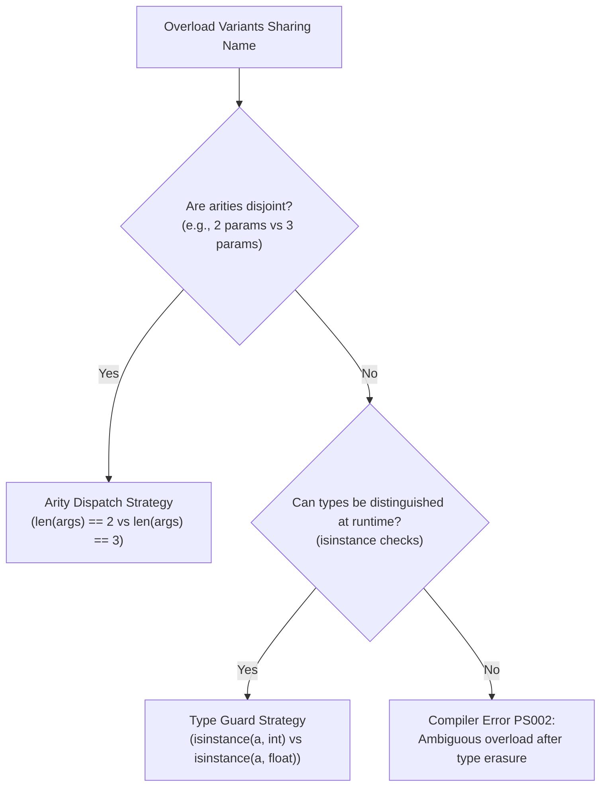

# Level 2 — Blog 05: Intermediate Optimizations — Overload Resolution, Slot Analyzer & Topo Sorter

In [Blog 04](./04_semantic_validation_typechecker_and_access.md), we explored how Pass 2 verifies types and enforces encapsulation boundaries. 

However, before the compiler can turn C# classes into Python classes, it must resolve three fundamental object-oriented impedance mismatches between C# and Python:

1. **Method Overloading**: C# allows multiple methods with the same name if their parameter types differ. Python supports only **one** function definition per name; defining a second one silently overwrites the first!
2. **Memory & Attribute Layout**: In Python, standard classes store attributes in dynamic dictionaries (`__dict__`), which incurs memory overhead and slower property access. C# allocates fields at fixed memory offsets.
3. **Declaration Order**: C# allows classes in the same namespace to reference each other in any order. In Python, a base class *must* be defined before its subclass can inherit from it (`class Derived(Base):`).

In this post, we examine how the compiler solves these challenges in:
- [`src/psc/semantics/overload_resolver.py`](file:///home/abhijit/Videos/transpilers/PythonSharp/src/psc/semantics/overload_resolver.py)
- [`src/psc/semantics/slot_analyzer.py`](file:///home/abhijit/Videos/transpilers/PythonSharp/src/psc/semantics/slot_analyzer.py)
- [`src/psc/codegen/topo_sorter.py`](file:///home/abhijit/Videos/transpilers/PythonSharp/src/psc/codegen/topo_sorter.py)

---

## 1. Bridging Method Overloads to Python: `OverloadResolver`

Consider this valid C# class:

```csharp
public class Calculator
{
    public int Add(int a, int b) => a + b;
    public double Add(double a, double b) => a + b;
    public int Add(int a, int b, int c) => a + b + c;
}
```

If a transpiler naively emits three `def add(...)` functions in Python, the third one will overwrite the previous two.

The `OverloadResolver` in [`src/psc/semantics/overload_resolver.py`](file:///home/abhijit/Videos/transpilers/PythonSharp/src/psc/semantics/overload_resolver.py) solves this with a two-part emission strategy:
1. Emit `@typing.overload` stubs for static analyzers and IDE autocompletion.
2. Emit a single **unified runtime dispatcher method** that inspects arguments at runtime.

### The Dispatch Classification Algorithm
The resolver analyzes all variants of an overloaded method and assigns an `OverloadDispatchGroup`:



```python
class OverloadResolver:
    def _create_dispatch_group(self, methods: list[MethodDecl]) -> OverloadDispatchGroup:
        arities = [len(m.parameters) for m in methods]
        is_arity_disjoint = len(set(arities)) == len(arities)

        guards: list[OverloadGuard] = []
        for method in methods:
            checks: list[RuntimeTypeCheck] = []
            for param in method.parameters:
                checks.append(self._derive_runtime_type_check(param))
            guards.append(OverloadGuard(method=method, checks=checks))

        return OverloadDispatchGroup(
            name=methods[0].name,
            snake_name=pascal_to_snake(methods[0].name),
            is_strictly_arity_disjoint=is_arity_disjoint,
            guards=guards,
        )
```

### The Generated Python Dispatcher
The emitted Python code produces both static stubs and an optimized runtime router:

```python
# 1. Static PEP-484 Overload Stubs
@typing.overload
def add(self, a: int, b: int) -> int: ...

@typing.overload
def add(self, a: float, b: float) -> float: ...

@typing.overload
def add(self, a: int, b: int, c: int) -> int: ...

# 2. Unified Runtime Dispatcher
def add(self, *args, **kwargs):
    if len(args) == 3:
        return self._add_3(args[0], args[1], args[2])
    elif len(args) == 2:
        if isinstance(args[0], int) and isinstance(args[1], int):
            return self._add_int(args[0], args[1])
        elif isinstance(args[0], (int, float)) and isinstance(args[1], (int, float)):
            return self._add_float(args[0], args[1])
    raise TypeError(f"No matching overload for 'add' with arguments {args}")
```

Notice Rule PS002: If two overloads both take `List<T>` (e.g. `Print(List<int> x)` and `Print(List<string> x)`), Python's runtime only sees `list`. The resolver detects this erasure collision and raises `PS002` at compile time, warning the developer to rename the methods.

---

## 2. Memory & Performance: `SlotAndHierarchyAnalyzer`

In Python, every instance of a standard class allocates a `__dict__` dictionary to store its attributes. For millions of objects, this consumes immense RAM.

Python's `__slots__` feature eliminates `__dict__`, storing attributes in compact, fixed-size C arrays.

However, `__slots__` has a strict inheritance rule: **a subclass must NOT redeclare any slot already declared by any of its base classes**, or Python will waste memory creating redundant descriptors.

[`src/psc/semantics/slot_analyzer.py`](file:///home/abhijit/Videos/transpilers/PythonSharp/src/psc/semantics/slot_analyzer.py) automates optimal `__slots__` calculation across inheritance trees.

```python
class SlotAndHierarchyAnalyzer:
    def _compute_class_slots(self, type_sym: TypeSymbol) -> tuple[str, ...]:
        # Step 1: Collect instance fields on this class
        own_slots: list[str] = []
        for field in type_sym.instance_fields:
            own_slots.append(field.snake_name)

        # Step 2: Auto-properties require backing storage (_prop)
        for prop in type_sym.auto_properties:
            own_slots.append(f"_{prop.snake_name}")

        # Step 3: Inherited slots subtraction
        ancestor_slots = self._collect_ancestor_slots(type_sym.base_type)
        deduplicated = [s for s in own_slots if s not in ancestor_slots]

        return tuple(deduplicated)
```

### Automatic Context Manager Synthesis (`IDisposable`)
`SlotAndHierarchyAnalyzer` also checks whether a class implements `IDisposable` or `IAsyncDisposable`.
If it finds `IDisposable`, it automatically marks the class for context manager synthesis:
- In C#: `using (var res = new Resource()) { ... }`
- In emitted Python: `def __enter__(self): return self` and `def __exit__(self, exc_type, exc_val, exc_tb): self.dispose()`
- In Python caller: `with Resource() as res: ...`

---

## 3. Order Independence: `TopoSorter`

In C#, you can write:

```csharp
namespace Commerce;

public class PremiumCustomer : Customer { ... }
public class Customer { ... }
```

In Python, executing `class PremiumCustomer(Customer):` before `Customer` is defined results in an immediate crash:
`NameError: name 'Customer' is not defined`.

[`src/psc/codegen/topo_sorter.py`](file:///home/abhijit/Videos/transpilers/PythonSharp/src/psc/codegen/topo_sorter.py) implements Kahn's topological sort algorithm to reorder classes prior to emission:

```python
class NamespacePackagePlanner:
    def topological_sort_types(self, types: list[TypeSymbol]) -> list[TypeSymbol]:
        # Build dependency graph: BaseClass -> SubClasses
        in_degree: dict[SymbolId, int] = {t.id: 0 for t in types}
        dependents: dict[SymbolId, list[TypeSymbol]] = {t.id: [] for t in types}

        for t in types:
            if t.base_type and t.base_type.symbol_id in in_degree:
                in_degree[t.id] += 1
                dependents[t.base_type.symbol_id].append(t)

        # Queue nodes with in_degree == 0 (classes with no base classes in this module)
        queue = [t for t in types if in_degree[t.id] == 0]
        sorted_types: list[TypeSymbol] = []

        while queue:
            node = queue.pop(0)
            sorted_types.append(node)
            for dep in dependents[node.id]:
                in_degree[dep.id] -= 1
                if in_degree[dep.id] == 0:
                    queue.append(dep)

        return sorted_types
```

In the emitted `.py` file, `class Customer:` is guaranteed to appear above `class PremiumCustomer(Customer):`, completely eliminating Python forward-reference errors without manual file restructuring.

---

## Summary of Intermediate Optimization Passes

| Optimization Component | Source File | Solved Problem |
| :--- | :--- | :--- |
| **Overload Dispatcher** | [`overload_resolver.py`](file:///home/abhijit/Videos/transpilers/PythonSharp/src/psc/semantics/overload_resolver.py) | Bridges C# method overloading to Python single-methods with `@typing.overload` + runtime type routers. |
| **Slot Analyzer** | [`slot_analyzer.py`](file:///home/abhijit/Videos/transpilers/PythonSharp/src/psc/semantics/slot_analyzer.py) | Computes deduplicated `__slots__` tuples across inheritance hierarchies; synthesizes `__enter__`/`__exit__`. |
| **Topological Sorter** | [`topo_sorter.py`](file:///home/abhijit/Videos/transpilers/PythonSharp/src/psc/codegen/topo_sorter.py) | Orders classes so base classes precede subclasses in emitted `.py` files. |

---

## Next Steps

Now we reach one of the most exciting innovations in PythonSharp: **LINQ Fusion**. How does the compiler detect chained queries like `.Where().Select().ToList()` and turn them directly into native Python list comprehensions?

In **[Blog 06: The Crown Jewel: LINQ Fusion — Comprehensions, Generators & AST Rewriting](./06_the_crown_jewel_linq_fusion_and_comprehensions.md)**, we inspect the pattern-matching compiler pass that optimizes functional pipelines!

