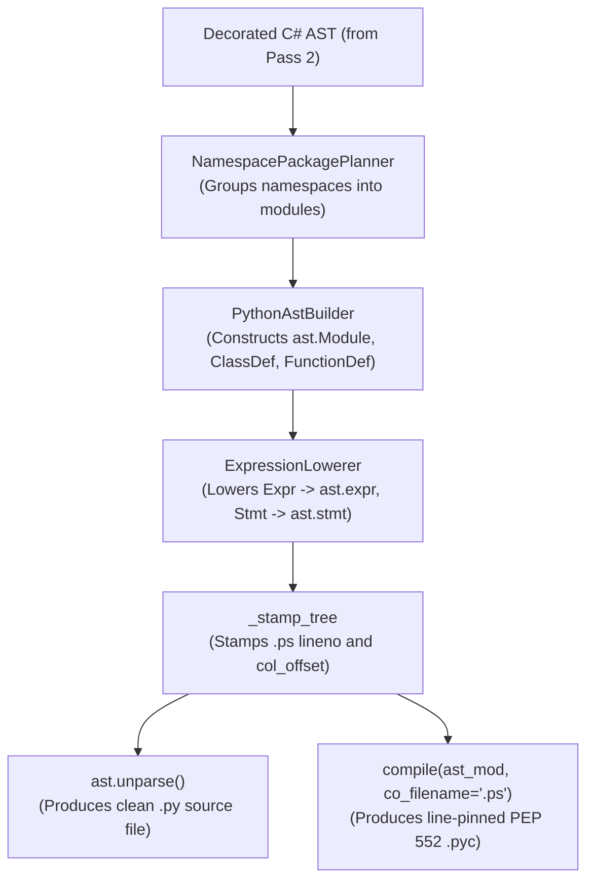

# Level 2 — Blog 07: Python 3.11+ Code Generation — PyAstBuilder, ExprLowerer, Emitter & Unparsing

In Blogs 01 through 06, we explored parsing, symbol tables, type validation, and LINQ optimizations. Now we reach the final destination of the compiler pipeline: **Pass 3 — Code Generation**.

Unlike naive transpilers that assemble Python code by concatenating strings (e.g. `f"def {name}({args}):"`), PythonSharp constructs a first-class **Python `ast.AST` tree** using Python's standard library `ast` module.

In this post, we explore:
1. **The Code Generation Architecture**: The interplay between [`py_ast_builder.py`](file:///home/abhijit/Videos/transpilers/PythonSharp/src/psc/codegen/py_ast_builder.py), [`expr_lowerer.py`](file:///home/abhijit/Videos/transpilers/PythonSharp/src/psc/codegen/expr_lowerer.py), and [`emitter.py`](file:///home/abhijit/Videos/transpilers/PythonSharp/src/psc/codegen/emitter.py).
2. **Expression Lowering & Template Substitution (`expr_lowerer.py`)**: How C# operators, casts, and inline templates become Python expressions.
3. **Line-Pinning `SourceSpan` Stamping (`_stamp_tree`)**: How AST nodes inherit `.ps` line and column coordinates.
4. **The Artifact Emitter (`emitter.py`)**: Emitting human-readable `.py` via `ast.unparse()` and compiling PEP 552 `.pyc` bytecode with pinned `co_filename`.

---

## 1. The Codegen Pipeline Architecture



The pipeline cleanly separates:
- **Module Structure**: Handled by `PythonAstBuilder`.
- **Statement & Expression Logic**: Handled by `ExpressionLowerer`.
- **Output Artifacts**: Handled by `ArtifactEmitter`.

---

## 2. Expression Lowering: From C# to Python AST

The core lowering engine in [`src/psc/codegen/expr_lowerer.py`](file:///home/abhijit/Videos/transpilers/PythonSharp/src/psc/codegen/expr_lowerer.py) transforms C# AST nodes into standard Python `ast.expr` nodes.

### 1. Arithmetic & Bitwise Operator Mapping
```python
def lower_binary(self, expr: Expr) -> ast.expr:
    op = expr.data["op"]
    left = self.lower_expr(expr.data["left"])
    right = self.lower_expr(expr.data["right"])

    if op == BinaryOp.ADD:
        return ast.BinOp(left=left, op=ast.Add(), right=right)
    elif op == BinaryOp.BITWISE_AND:
        return ast.BinOp(left=left, op=ast.BitAnd(), right=right)
    elif op == BinaryOp.BITWISE_OR:
        return ast.BinOp(left=left, op=ast.BitOr(), right=right)
    elif op == BinaryOp.BITWISE_XOR:
        return ast.BinOp(left=left, op=ast.BitXor(), right=right)
    elif op == BinaryOp.LSHIFT:
        return ast.BinOp(left=left, op=ast.LShift(), right=right)
    elif op == BinaryOp.RSHIFT:
        return ast.BinOp(left=left, op=ast.RShift(), right=right)
    elif op == BinaryOp.AND_AND:
        return ast.BoolOp(op=ast.And(), values=[left, right])
```

Notice how `&&` in C# lowers to `ast.BoolOp(op=ast.And())`, preserving short-circuit evaluation semantics in Python.

### 2. Lowering Inline Templates: Zero Function Call Overhead
When a method call carries an `[InlineTemplate("pattern")]`, `ExpressionLowerer` executes template substitution directly in the AST:

```python
def _lower_inline_template(
    self,
    template: str,
    target: ast.expr | None,
    args: list[ast.expr],
) -> ast.expr:
    # Pattern: "len({0})" or "{0}.strip()" or "print({0})"
    # Substitute placeholder tokens ({0}, {1}, {self})
    rendered = template
    if target is not None:
        rendered = rendered.replace("{self}", ast.unparse(target))

    for i, arg in enumerate(args):
        rendered = rendered.replace(f"{{{i}}}", ast.unparse(arg))

    # Parse substituted string back into a Python AST expression
    parsed = ast.parse(rendered, mode="eval")
    return parsed.body
```

If the C# code calls `s.Length`, the template `"len({0})"` is parsed into `ast.Call(func=ast.Name(id='len'), args=[target])`. The output is pure Python `len(s)`!

---

## 3. Line-Pinning: How Tracebacks Point to `.ps` Files

In traditional transpiled languages (like TypeScript or CoffeeScript), runtime errors in Node.js point to the generated `.js` file unless source maps are enabled.

PythonSharp achieves something much more elegant: **Native Line-Pinning Bytecode**.

### The Stamping Mechanism
In [`src/psc/codegen/expr_lowerer.py`](file:///home/abhijit/Videos/transpilers/PythonSharp/src/psc/codegen/expr_lowerer.py), `_stamp_tree()` stamps the line and column numbers of the original `.ps` source onto every generated Python AST node:

```python
def _stamp_tree(node: ast.AST, lineno: int, end_lineno: int, col: int, end_col: int) -> None:
    for child in ast.walk(node):
        if isinstance(child, (ast.expr, ast.stmt, ast.excepthandler)):
            child.lineno = lineno
            child.end_lineno = end_lineno
            child.col_offset = col
            child.end_col_offset = end_col
```

When Python compiles an `ast.AST` with custom line numbers, those exact line numbers are baked directly into the `.pyc` bytecode!

---

## 4. The Artifact Emitter: Emitting `.py` & `.pyc`

The emission engine lives in [`src/psc/codegen/emitter.py`](file:///home/abhijit/Videos/transpilers/PythonSharp/src/psc/codegen/emitter.py).

For every planned module, `ArtifactEmitter` performs two steps:

### Step 1: Human-Readable Source Text
Using Python's standard `ast.unparse()`:
```python
py_source = ast.unparse(ast_module)
py_path.write_text(py_source, encoding="utf-8")
```
This produces clean, beautifully formatted Python 3.11+ source code with `from __future__ import annotations`, docstrings, and type annotations.

### Step 2: Line-Pinned PEP 552 Bytecode
Next, the compiler compiles the stamped AST directly:
```python
code_obj = compile(
    ast_module,
    filename=primary_ps_filename,  # Points directly to the .ps file!
    mode="exec",
    dont_inherit=True,
)
```
Notice `filename=primary_ps_filename`. By passing `"Services/OrderCache.ps"` as the filename to CPython's `compile()` built-in:
1. Python creates a `types.CodeType` object where `co_filename == "Services/OrderCache.ps"`.
2. Python writes this code object to disk as a standard PEP 552 `.pyc` file.
3. When the Python interpreter executes this `.pyc` and an unhandled exception occurs, Python natively prints:
   ```
   Traceback (most recent call last):
     File "Services/OrderCache.ps", line 42, in calculate_discount
       result = total / count
   ZeroDivisionError: division by zero
   ```
**Zero source map parsers required at runtime.** CPython's own stack unwinder points directly to the line of C# that caused the error!

---

## Summary of Code Generation Subsystem

| Class | Source Location | Core Responsibility |
| :--- | :--- | :--- |
| **`PythonAstBuilder`** | [`py_ast_builder.py`](file:///home/abhijit/Videos/transpilers/PythonSharp/src/psc/codegen/py_ast_builder.py) | Builds module-level Python AST (`ClassDef`, `FunctionDef`, imports) |
| **`ExpressionLowerer`**| [`expr_lowerer.py`](file:///home/abhijit/Videos/transpilers/PythonSharp/src/psc/codegen/expr_lowerer.py) | Lowers expressions, bitwise operators, inline templates, and casts |
| **`ArtifactEmitter`**  | [`emitter.py`](file:///home/abhijit/Videos/transpilers/PythonSharp/src/psc/codegen/emitter.py) | Unparses `.py` source text and compiles line-pinned `.pyc` bytecode |

---

## Next Steps

We have covered the core compiler pipeline from end to end. But a modern language is more than just a compiler; it is an entire ecosystem of developer tools.

In **[Blog 08: Developer Tooling Subsystems — LSP Protocol Server, Bindgen & Build Cache](./08_developer_tooling_lsp_bindgen_and_cache.md)**, we examine how the Language Server Protocol (LSP) powers VS Code, how `ps-bindgen` generates C# stubs from Python, and how continuous watch mode works!

