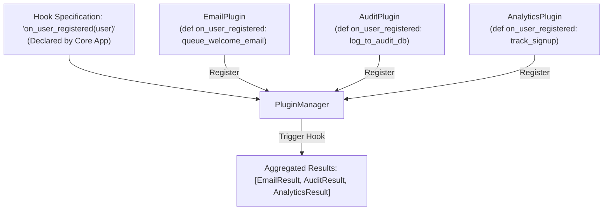

# Level 2 — Blog 22: Ported 14 — Micro-Pluggy (`14_micro_pluggy`): Hook Specifications, Plugins & Discovery

In [Blog 21](./21_ported_13_micro_fn_currying_and_composition.md), we explored functional programming and currying.

Now, we advance to **`14_micro_pluggy`**, ported from the core architectural principles of `pluggy`, the plugin management and hook execution system that powers **pytest**, **tox**, and **devpi**.

In this post, we explore:
1. **The Plugin Architecture**: Decoupling specifications from implementations.
2. **Project Layout**: The `.psproj` setup.
3. **The C# Implementation (`Pluggy.ps`)**: `HookImpl`, `HookCaller`, `PluginManager`, reflection-based dynamic method discovery, and execution strategies.
4. **Execution Strategies**: Multi-result list accumulation vs. `FirstResult` short-circuiting.
5. **The Verification Test Harness (`run_pluggy.py`)**: Registering specifications, discovering plugin implementations, and unregistering plugins dynamically.

---

## 1. What is `pluggy` and Why Does It Matter?

In modular architectures, the core framework should not know about every feature upfront. Instead, it provides **hook specifications** (entry points), and third-party plugins provide **hook implementations**.



### Two Key Execution Modes:
1. **Multi-Result (Default)**: Call *all* registered implementations in order and accumulate their return values into a list.
2. **FirstResult**: Call implementations until the first one returns a non-null value, then immediately halt execution (ideal for authentication tokens, routing decisions, or cache lookups).

---

## 2. Project Layout

The project lives under [`Samples/Ported/14_micro_pluggy/`](file:///home/abhijit/Videos/transpilers/PythonSharp/Samples/Ported/14_micro_pluggy/):

```
Samples/Ported/14_micro_pluggy/
├── MicroPluggy.psproj     # Project configuration manifest
├── Pluggy.ps              # C# plugin management engine
├── README.md              # Documentation and build instructions
├── run_pluggy.py          # Automated verification test suite
└── dist/
    └── micro_pluggy.py    # Transpiled pure Python 3.11 module
```

---

## 3. The C# Source Implementation: `Pluggy.ps`

In [`Pluggy.ps`](file:///home/abhijit/Videos/transpilers/PythonSharp/Samples/Ported/14_micro_pluggy/Pluggy.ps), dynamic method discovery and invocation are modeled cleanly:

```csharp
namespace MicroPluggy;

using PythonSharp.Core;

public class HookImpl
{
    private object _plugin;
    private string _methodName;
    private object _fn;

    public HookImpl(object plugin, string methodName, object fn)
    {
        this._plugin = plugin;
        this._methodName = methodName;
        this._fn = fn;
    }

    public object Plugin => this._plugin;
    public string MethodName => this._methodName;
    public object Function => this._fn;
}

public class HookCaller
{
    private string _name;
    private bool _firstResult;
    private List<HookImpl> _impls;

    public HookCaller(string name, bool firstResult = false)
    {
        this._name = name;
        this._firstResult = firstResult;
        this._impls = new List<HookImpl>();
    }

    [InlineTemplate("{0}(*{1})")]
    public static extern object InvokeWithList(object fn, List<object> args);

    public List<object> Call(List<object> args)
    {
        List<object> results = new List<object>();
        int i = 0;
        while (i < this._impls.Count)
        {
            HookImpl impl = this._impls[i];
            object res = InvokeWithList(impl.Function, args);

            if (this._firstResult && res != null)
            {
                results.Add(res);
                return results; // Short-circuit on first non-null!
            }

            results.Add(res);
            i = i + 1;
        }
        return results;
    }
}
```

### Automatic Plugin Method Discovery
When `pm.Register(plugin)` is called, the `PluginManager` inspects the plugin's public methods using reflection templates:

```csharp
public class PluginManager
{
    [InlineTemplate("[m for m in dir({0}) if not m.startswith('_') and callable(getattr({0}, m, None))]")]
    public static extern List<string> GetCallableMethods(object obj);

    [InlineTemplate("getattr({0}, {1}, None)")]
    public static extern object? GetAttr(object obj, string attr);

    public void Register(object plugin)
    {
        this._plugins.Add(plugin);
        List<string> methods = GetCallableMethods(plugin);
        int i = 0;
        while (i < methods.Count)
        {
            string mName = methods[i];
            // If a hook specification matches this method name, register it!
            if (this._hooks.ContainsKey(mName))
            {
                object? fn = GetAttr(plugin, mName);
                if (fn != null)
                {
                    this._hooks[mName].Register(new HookImpl(plugin, mName, fn));
                }
            }
            i = i + 1;
        }
    }
}
```

---

## 4. The Transpiled Output: `micro_pluggy.py`

Compiling with:
```bash
psc build Samples/Ported/14_micro_pluggy -o Samples/Ported/14_micro_pluggy/dist
```
produces [`Samples/Ported/14_micro_pluggy/dist/micro_pluggy.py`](file:///home/abhijit/Videos/transpilers/PythonSharp/Samples/Ported/14_micro_pluggy/dist/micro_pluggy.py).

### How Native Python Interacts with `PluginManager`:
```python
from micro_pluggy import PluginManager

pm = PluginManager("auth_service")

# 1. Register Hook Specifications
pm.add_hookspec("on_user_registered", first_result=False)
pm.add_hookspec("authenticate_token", first_result=True)

# 2. Define Plugins
class EmailPlugin:
    def on_user_registered(self, email):
        return f"Welcome email queued for {email}"

class AuditPlugin:
    def on_user_registered(self, email):
        return f"Audit: user {email} logged in database"

class TokenAuthPlugin:
    def authenticate_token(self, token):
        if token.startswith("BEARER-"):
            return {"user": "admin", "valid": True}
        return None

# 3. Register Plugins
pm.register(EmailPlugin())
pm.register(AuditPlugin())
pm.register(TokenAuthPlugin())
```

---

## 5. Verification Test Suite

[`run_pluggy.py`](file:///home/abhijit/Videos/transpilers/PythonSharp/Samples/Ported/14_micro_pluggy/run_pluggy.py) validates specification registration, multi-result execution, and `firstresult` short-circuiting:

```python
# 1. Multi-Result Execution
results = pm.call("on_user_registered", ["ada@example.com"])
assert len(results) == 2
assert "Welcome email queued for ada@example.com" in results
assert "Audit: user ada@example.com logged in database" in results

# 2. FirstResult Strategy Execution
auth_res = pm.call_first("authenticate_token", ["BEARER-SECRET-KEY"])
assert auth_res == {"user": "admin", "valid": True}

# 3. Dynamic Plugin Unregistration
pm.unregister(email_plugin)
remaining = pm.call("on_user_registered", ["bob@example.com"])
assert len(remaining) == 1
assert "Welcome email" not in remaining[0]
```

Running the runner:
```bash
python3 Samples/Ported/14_micro_pluggy/run_pluggy.py
```
Outputs:
```
=== Step 1: Building MicroPluggy via `psc build` ===
Build is up to date: outputs in '.../dist' are fresh.

=== Step 2: Testing Ported Pluggy Functionality ===
[PASS] Hook specifications (multi-result & firstresult) registered successfully
[PASS] Plugin registration and automatic method discovery verified
[PASS] Multi-result hook execution: ['Welcome email queued for ada@example.com', 'Audit: user Ada registered in db']
[PASS] FirstResult strategy returned first non-null token: TOKEN-CUSTOM-90210
[PASS] Dynamic unregistration verified

All micro-pluggy verification checks succeeded with 0 errors!
```

---

## Key Takeaways

1. **Extensible System Design**: Implementing pytest-style hook systems in C# with dynamic method introspection.
2. **Strategy Flexibility**: Seamless support for multi-result list accumulation and short-circuiting `FirstResult` modes.
3. **Pluggable Architecture**: Zero hardcoded references between plugin implementations and the host application.

---

## Next Steps

Now let's explore dynamic multiple dispatch and runtime method polymorphism!

In **[Blog 23: Ported 15 — MultiMethod (`15_multimethod`): Multiple Dispatch & Subtype Specificity](./23_ported_15_multimethod_multiple_dispatch_and_mro.md)**, we examine how to dispatch methods based on the runtime types of multiple arguments!

