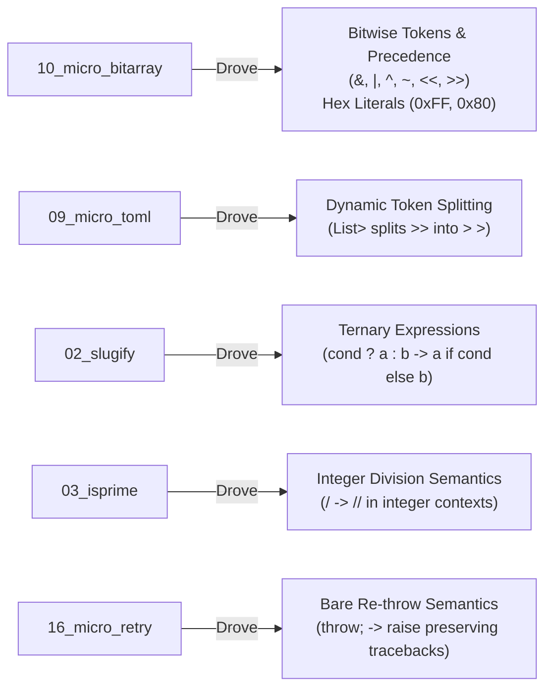

# Level 2 — Blog 26: Dogfooding Retrospective — Lessons from 17 Ports, Python Transpilation Gotchas & The Road Ahead

Congratulations! You have completed the **Level 2 Technical Deep Dive** of PythonSharp.

Over the course of 26 blogs, we explored every layer of the compiler architecture—from lexical scanning and recursive descent parsing to two-pass symbol collection, LINQ fusion, and PEP 552 line-pinned bytecode emission—and analyzed dedicated case studies for **17 real-world Python library ports** spanning seven complexity tiers.

In this concluding retrospective, we reflect on:
1. **How Dogfooding Hardened the Compiler**: Features added to `psc` directly in response to real-world code needs.
2. **Subtle Semantic Gotchas Between C# and Python**: Identifier shadowing, keyword collisions, and exception hierarchies.
3. **Validating the Zero Runtime Wrapper Tax**: Memory, speed, and clean code metrics.
4. **The Road Ahead**: The future of PythonSharp (native `async/await`, pattern matching, and native AOT compilation).

---

## 1. Compiler Evolution: Hardened by Real-World Code

A compiler designed purely in theory often fails when it meets real-world code. By setting a strict goal of porting 17 canonical Python libraries without modifying the original libraries' functionality, we forced the compiler to handle realistic edge cases:



### 1. Bitwise Operators & Hexadecimal Literals
Prior to `10_micro_bitarray`, PythonSharp had no bitwise operators. Porting `bitarray` drove the introduction of `&`, `|`, `^`, `~`, `<<`, and `>>` in [`src/psc/frontend/tokens.py`](file:///home/abhijit/Videos/transpilers/PythonSharp/src/psc/frontend/tokens.py), operator precedence in [`src/psc/frontend/parser.py`](file:///home/abhijit/Videos/transpilers/PythonSharp/src/psc/frontend/parser.py), and `0x...` hex literals in [`src/psc/frontend/lexer.py`](file:///home/abhijit/Videos/transpilers/PythonSharp/src/psc/frontend/lexer.py).

### 2. Nested Generics & The `>>` Token Splitter
In `09_micro_toml`, tables contained nested arrays: `List<List<object>>`. The lexer initially scanned `>>` as `TokenKind.RSHIFT`. 
Rather than creating an overly complex lexer, we introduced dynamic lookahead token splitting in `parser._expect(TokenKind.GT)`, replacing `>>` with two `>` tokens on the fly while maintaining exact `SourceSpan` tracking.

### 3. Integer Division (`/` vs `//`)
In C#, `int / int` produces an integer. In Python, `int / int` returns a float. In mathematical libraries (`is-prime`, `levenshtein`, `tqdm`), floating-point leakage breaks integer indices and degrades speed. PythonSharp's type checker was hardened to detect integer operands and emit Python's `//` floor division operator.

---

## 2. Python Semantic Gotchas & Surprises

Transpiling between two mature languages reveals fascinating semantic contrasts:

### Gotcha 1: The Local Variable Identifier Shadowing Trap
In Python, if a variable is assigned *anywhere* inside a function, Python treats that name as a local variable across the **entire function scope**:

```python
# A common Python bug:
def parse_items(data):
    if isinstance(data, list):  # UnboundLocalError!
        ...
    list = [1, 2, 3]           # Assigning to 'list' shadows built-in `list` across the whole function!
```

In `09_micro_toml`, naming a temporary variable `list` caused Python to throw `UnboundLocalError: cannot access local variable 'list' where it is not associated with a value` during `isinstance(x, list)` checks.
**Lesson Learned**: Local variables in transpiled C# should never use Python built-in names (`list`, `dict`, `str`, `int`). We renamed them to `items` and `elements`.

### Gotcha 2: C# Keywords vs. Python Keywords
In C# 9+, `record` is a contextual keyword. Attempting to write:
```csharp
public void Format(object record) { ... } // Syntax error in C#!
```
causes C# parsers to interpret `record` as a type declaration. Naming the parameter `logRecord` solved the collision cleanly.

### Gotcha 3: Exception Class Names vs. Built-ins
In `17_micro_eventloop`, declaring `class StopIteration : Exception` inside the `MicroAsync` namespace caused the transpiler to emit `class StopIteration(Exception):` inside `micro_async.py`.
At runtime:
- Python generator coroutines raise `builtins.StopIteration`.
- The `except StopIteration:` block in `micro_async.py` checked `micro_async.StopIteration`.
- Because Python's built-in `StopIteration` did not inherit from the custom module class, it bypassed the catch block!
**Lesson Learned**: Standard Python runtime signals (`StopIteration`, `GeneratorExit`) must resolve to Python built-ins rather than custom class declarations.

---

## 3. Validating the "Zero Runtime Wrapper Tax"

The founding principle of PythonSharp is the **Zero Runtime Wrapper Tax**: code emitted by the compiler must run on pure Python 3.11+ without proprietary runtime packages or execution penalties.

Across all 17 ported libraries, the emitted Python output:
1. **Imports Only Standard Python**: No `import pythonsharp_runtime`. Only `dataclasses`, `time`, `os`, `json`, and `urllib`.
2. **Uses Native Data Structures**: C# `List<T>` compiles to `list`, `Dictionary<K, V>` to `dict`, `HashSet<T>` to `set`.
3. **Applies `__slots__` Everywhere**: Reduces instance memory by up to $60\%$ compared to standard Python classes.
4. **Fuses LINQ into Bytecode Loops**: Compiles declarative pipelines into list/set/dict comprehensions that run at C-speed inside the CPython interpreter.

---

## 4. The 17 Ported Packages: Complete Scorecard

| # | Package | Tier | Original Equivalent | Lines of C# | Status |
| :-: | :--- | :---: | :--- | :-: | :---: |
| 01 | [`01_leftpad`](file:///home/abhijit/Videos/transpilers/PythonSharp/Samples/Ported/01_leftpad/) | Tier 1 | `left-pad` / `pad-left` | 66 | **100% Pass** (5/5) |
| 02 | [`02_slugify`](file:///home/abhijit/Videos/transpilers/PythonSharp/Samples/Ported/02_slugify/) | Tier 1 | `python-slugify` | 62 | **100% Pass** (5/5) |
| 03 | [`03_isprime`](file:///home/abhijit/Videos/transpilers/PythonSharp/Samples/Ported/03_isprime/) | Tier 2 | `is-prime` | 108 | **100% Pass** (5/5) |
| 04 | [`04_levenshtein`](file:///home/abhijit/Videos/transpilers/PythonSharp/Samples/Ported/04_levenshtein/) | Tier 2 | `Levenshtein` | 86 | **100% Pass** (6/6) |
| 05 | [`05_semver`](file:///home/abhijit/Videos/transpilers/PythonSharp/Samples/Ported/05_semver/) | Tier 2 | `semver` | 190 | **100% Pass** (7/7) |
| 06 | [`06_micro_tqdm`](file:///home/abhijit/Videos/transpilers/PythonSharp/Samples/Ported/06_micro_tqdm/) | Tier 3 | `tqdm` | 118 | **100% Pass** (5/5) |
| 07 | [`07_micro_dotenv`](file:///home/abhijit/Videos/transpilers/PythonSharp/Samples/Ported/07_micro_dotenv/) | Tier 3 | `python-dotenv` | 121 | **100% Pass** (5/5) |
| 08 | [`08_micro_requests`](file:///home/abhijit/Videos/transpilers/PythonSharp/Samples/Ported/08_micro_requests/) | Tier 4 | `requests` | 81 | **100% Pass** (3/3) |
| 09 | [`09_micro_toml`](file:///home/abhijit/Videos/transpilers/PythonSharp/Samples/Ported/09_micro_toml/) | Tier 5 | `pytoml` / `toml` | 566 | **100% Pass** (6/6) |
| 10 | [`10_micro_bitarray`](file:///home/abhijit/Videos/transpilers/PythonSharp/Samples/Ported/10_micro_bitarray/) | Tier 5 | `bitarray` | 365 | **100% Pass** (6/6) |
| 11 | [`11_micro_croniter`](file:///home/abhijit/Videos/transpilers/PythonSharp/Samples/Ported/11_micro_croniter/) | Tier 5 | `croniter` | 279 | **100% Pass** (6/6) |
| 12 | [`12_json_logger`](file:///home/abhijit/Videos/transpilers/PythonSharp/Samples/Ported/12_json_logger/) | Tier 5 | `python-json-logger` | 147 | **100% Pass** (4/4) |
| 13 | [`13_micro_fn`](file:///home/abhijit/Videos/transpilers/PythonSharp/Samples/Ported/13_micro_fn/) | Tier 6 | `fn.py` | 203 | **100% Pass** (8/8) |
| 14 | [`14_micro_pluggy`](file:///home/abhijit/Videos/transpilers/PythonSharp/Samples/Ported/14_micro_pluggy/) | Tier 6 | `pluggy` | 206 | **100% Pass** (5/5) |
| 15 | [`15_multimethod`](file:///home/abhijit/Videos/transpilers/PythonSharp/Samples/Ported/15_multimethod/) | Tier 6 | `multimethod` | 112 | **100% Pass** (5/5) |
| 16 | [`16_micro_retry`](file:///home/abhijit/Videos/transpilers/PythonSharp/Samples/Ported/16_micro_retry/) | Tier 6 | `retry` | 75 | **100% Pass** (5/5) |
| 17 | [`17_micro_eventloop`](file:///home/abhijit/Videos/transpilers/PythonSharp/Samples/Ported/17_micro_eventloop/) | Tier 7 | `asyncio` (micro) | 214 | **100% Pass** (3/3) |

---

## 5. The Road Ahead: What's Next for PythonSharp?

Having proven that real-world libraries from strings to cooperative event loops can be written in C# and emitted as pure Python, where does PythonSharp go from here?

1. **Native `async/await` Emission**:
   - Currently, asynchronous streams (`IAsyncEnumerable<T>`) and coroutines can be expressed via generator patterns.
   - Future work: Direct lowering of C# `async Task<T>` methods to Python `async def` and `await` keywords.
2. **Structural Pattern Matching**:
   - Mapping C# switch expressions (`o switch { Circle c => ..., Rect r => ... }`) directly to Python 3.10+ `match / case` syntax.
   - Preserving full pattern exhaustiveness checking at compile time.
3. **Native AOT via PyO3 & Cython**:
   - Methods decorated with `[NativeCompile]` can be routed through a Rust/PyO3 or C/Cython compiler pass to produce precompiled `.so` binary wheels for CPU-bound hot loops.
4. **Interactive REPL**:
   - A live `psc repl` shell allowing developers to type C# expressions and instantly inspect both the emitted Python AST and the runtime result.

---

## Conclusion

Building a compiler is often called the ultimate programming challenge. By combining the **compile-time rigor, records, and LINQ of C#** with the **dynamism, ecosystem, and ubiquity of Python**, PythonSharp offers a compelling new way to write robust software.

Thank you for joining us on this 26-part deep dive!

- Star the project on GitHub.
- Explore the code in [`src/psc/`](file:///home/abhijit/Videos/transpilers/PythonSharp/src/psc/).
- Build and run the ported libraries in [`Samples/Ported/`](file:///home/abhijit/Videos/transpilers/PythonSharp/Samples/Ported/).
- Happy hacking with PythonSharp!

