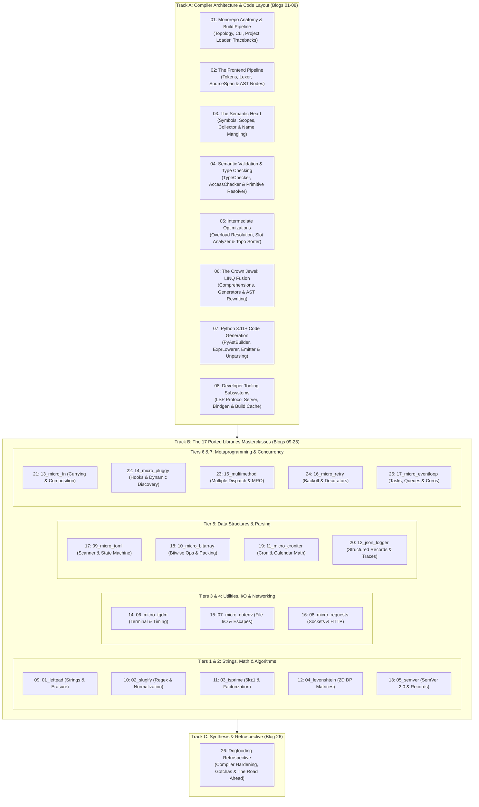

# PythonSharp Deep Dive: Architecture, Code Layout & The 17 Ported Libraries
## Level 2 Master Blog Series Plan & Technical Curriculum

> **Welcome to Level 2!** If Level 1 introduced the high-level vision and foundational concepts of transpiling C# into zero-runtime-cost Python 3.11+, **Level 2** takes you directly into the engine room.
>
> This 26-part series provides an exhaustive, code-layout-focused deep dive into the **PythonSharp (`psc`)** compiler codebase, paired with a dedicated, end-to-end architectural case study for each of the **17 real-world ported Python libraries** (spanning Tiers 1 through 7).

---

## 🗺️ Master Curriculum Architecture

---

## 📚 Detailed Syllabus Breakdown

### Track A: Core Compiler Internals & Code Layout (Blogs 01–08)

#### [Blog 01: The Monorepo Blueprint — Project Topology, Compilation Lifecycle & Build Pipeline](./01_monorepo_blueprint_and_build_pipeline.md)
- **Theme**: Navigating the codebase from raw `.ps` files to emitted Python modules.
- **Concepts**: The zero-wrapper transpilation guarantee, multi-pass architecture, compilation lifecycle stages (Lex $\to$ Parse $\to$ Collect Symbols $\to$ Check Types $\to$ Fuse LINQ $\to$ Lower AST $\to$ Emit Python).
- **Code Layout & File Focus**:
  - [`pyproject.toml`](file:///home/abhijit/Videos/transpilers/PythonSharp/pyproject.toml) (Build backend, dependencies, CLI entry points)
  - [`src/psc/cli.py`](file:///home/abhijit/Videos/transpilers/PythonSharp/src/psc/cli.py) (`main()`, subcommand routing: `build`, `watch`, `run`, `bindgen`, `lsp`)
  - [`src/psc/project.py`](file:///home/abhijit/Videos/transpilers/PythonSharp/src/psc/project.py) (`ProjectLoader`, `.psproj` XML parser, multi-file resolution)
  - [`src/psc/build_cache.py`](file:///home/abhijit/Videos/transpilers/PythonSharp/src/psc/build_cache.py) (SHA-256 fingerprinting, manifest-based incremental builds)
  - [`src/psc/diagnostics.py`](file:///home/abhijit/Videos/transpilers/PythonSharp/src/psc/diagnostics.py) (`Diagnostic`, `DiagnosticBag`, error codes `PS000`–`PS004`)
- **Key Takeaway**: Understanding how `psc build MyProject.psproj -o dist` coordinates all compiler subsystems with sub-second incremental builds.

---

#### [Blog 02: The Frontend Pipeline — Tokens, Lexer, Source Spans & Grammar Parsing](./02_the_frontend_pipeline_tokens_lexer_and_ast.md)
- **Theme**: Converting source text into a structured, line-pinned Abstract Syntax Tree.
- **Concepts**: Lexical scanning, keyword vs. identifier disambiguation, numeric prefix parsing (`0x...` hex, `0b...` binary), dynamic token splitting for nested generics (`>>` $\to$ `>` `>`), recursive descent parsing with lookahead.
- **Code Layout & File Focus**:
  - [`src/psc/frontend/tokens.py`](file:///home/abhijit/Videos/transpilers/PythonSharp/src/psc/frontend/tokens.py) (`TokenKind`, `Token`, `SourceSpan`, bitwise & shift tokens)
  - [`src/psc/frontend/lexer.py`](file:///home/abhijit/Videos/transpilers/PythonSharp/src/psc/frontend/lexer.py) (`Lexer`, string escape handling, operator tokenization)
  - [`src/psc/frontend/parser.py`](file:///home/abhijit/Videos/transpilers/PythonSharp/src/psc/frontend/parser.py) (`Parser`, operator precedence hierarchy, error recovery)
  - [`src/psc/frontend/ast_nodes.py`](file:///home/abhijit/Videos/transpilers/PythonSharp/src/psc/frontend/ast_nodes.py) (`TypeNode`, `Expr`, `Stmt`, `MemberDecl`, `TypeDecl`, `CompilationUnit`)
- **Key Takeaway**: How PythonSharp maintains exact source coordinates on every AST node to enable line-pinned runtime tracebacks.

---

#### [Blog 03: The Semantic Heart — Symbol Tables, Scopes, Declaration Collection & Name Mangling](./03_the_semantic_heart_symbols_scopes_and_collector.md)
- **Theme**: Giving meaning to names across multiple files and namespaces.
- **Concepts**: Two-pass semantic analysis, Pass 1 symbol harvesting, lexical scopes vs. type scopes, PascalCase to snake_case normalization, avoiding Python built-in collisions (`list`, `int`, `str`).
- **Code Layout & File Focus**:
  - [`src/psc/semantics/symbols.py`](file:///home/abhijit/Videos/transpilers/PythonSharp/src/psc/semantics/symbols.py) (`Symbol`, `TypeSymbol`, `MethodSymbol`, `FieldSymbol`, `LocalSymbol`, `Scope`)
  - [`src/psc/semantics/collector.py`](file:///home/abhijit/Videos/transpilers/PythonSharp/src/psc/semantics/collector.py) (`SymbolCollector`, Pass 1 AST visitor, namespace tree construction)
- **Key Takeaway**: Why declaring a class or method in C# automatically maps to idiomatic Python naming conventions without breaking member resolution.

---

#### [Blog 04: Semantic Validation & Type Checking — TypeChecker, AccessChecker & Primitive Resolver](./04_semantic_validation_typechecker_and_access.md)
- **Theme**: Enforcing C# static guarantees before generating any Python code.
- **Concepts**: Pass 2 type checking, expression type inference, assignment compatibility, nullability analysis (`T?` vs `T`), access modifier visibility (`public`, `private`, `protected`, `internal`), primitive type boxing/unboxing rules.
- **Code Layout & File Focus**:
  - [`src/psc/semantics/type_checker.py`](file:///home/abhijit/Videos/transpilers/PythonSharp/src/psc/semantics/type_checker.py) (`TypeChecker`, binary expression typing, method invocation validation)
  - [`src/psc/semantics/access_checker.py`](file:///home/abhijit/Videos/transpilers/PythonSharp/src/psc/semantics/access_checker.py) (`AccessChecker`, member accessibility enforcement)
  - [`src/psc/semantics/primitive_resolver.py`](file:///home/abhijit/Videos/transpilers/PythonSharp/src/psc/semantics/primitive_resolver.py) (`PrimitiveResolver`, C# primitive $\to$ Python type mapping)
- **Key Takeaway**: Catching type mismatches, private access violations, and null reference risks at compile time with zero runtime type-guard overhead.

---

#### [Blog 05: Intermediate Optimizations — Overload Resolution, Slot Analyzer & Topo Sorter](./05_intermediate_optimizations_overloads_slots_and_topo.md)
- **Theme**: Solving impedance mismatches between C# and Python OOP models.
- **Concepts**: C# method overloading vs. Python single-dispatch methods, `@typing.overload` synthesis, runtime type inspection dispatcher generation, `__slots__` calculation for memory and performance, topological sorting of class hierarchies to prevent forward reference errors.
- **Code Layout & File Focus**:
  - [`src/psc/semantics/overload_resolver.py`](file:///home/abhijit/Videos/transpilers/PythonSharp/src/psc/semantics/overload_resolver.py) (`OverloadResolver`, signature matching & specificity score)
  - [`src/psc/semantics/slot_analyzer.py`](file:///home/abhijit/Videos/transpilers/PythonSharp/src/psc/semantics/slot_analyzer.py) (`SlotAnalyzer`, field inheritance, slot deduplication)
  - [`src/psc/codegen/topo_sorter.py`](file:///home/abhijit/Videos/transpilers/PythonSharp/src/psc/codegen/topo_sorter.py) (`TopoSorter`, dependency graphs, cycle-free class ordering)
- **Key Takeaway**: How PythonSharp classes emit `@dataclass(slots=True)` and optimal `__slots__` tuples, matching or beating native Python performance.

---

#### [Blog 06: The Crown Jewel: LINQ Fusion — Comprehensions, Generators & AST Rewriting](./06_the_crown_jewel_linq_fusion_and_comprehensions.md)
- **Theme**: Turning functional method pipelines into high-speed Python comprehensions.
- **Concepts**: The problem with chained function calls (`map`/`filter`) in Python, LINQ pipeline detection (`.Where()`, `.Select()`, `.ToList()`), Pass 2 AST fusion into list/set/dict comprehensions and generator expressions, predicate inlining.
- **Code Layout & File Focus**:
  - [`src/psc/semantics/linq_fuser.py`](file:///home/abhijit/Videos/transpilers/PythonSharp/src/psc/semantics/linq_fuser.py) (`LinqFuser`, pattern matching on invocation chains, rewriting `InvocationExpr` $\to$ `ListCompNode`)
  - [`tests/test_linq_surface.py`](file:///home/abhijit/Videos/transpilers/PythonSharp/tests/test_linq_surface.py) (Benchmark suites & fusion verification)
- **Key Takeaway**: Seeing `users.Where(u => u.Active).Select(u => u.Name).ToList()` compile directly into `[u.name for u in users if u.active]` with zero iterator allocations.

---

#### [Blog 07: Python 3.11+ Code Generation — PyAstBuilder, ExprLowerer, Emitter & Unparsing](./07_python_code_generation_lowering_and_emitter.md)
- **Theme**: Emitting production-ready, readable Python AST and source text.
- **Concepts**: Building Python `ast.AST` nodes directly via `PyAstBuilder`, lowering expressions (`BinaryOp`, `UnaryOp`, inline templates), synthesizing module headers (`from __future__ import annotations`), generating docstrings, using `ast.unparse()`.
- **Code Layout & File Focus**:
  - [`src/psc/codegen/py_ast_builder.py`](file:///home/abhijit/Videos/transpilers/PythonSharp/src/psc/codegen/py_ast_builder.py) (`PyAstBuilder`, AST node constructors)
  - [`src/psc/codegen/expr_lowerer.py`](file:///home/abhijit/Videos/transpilers/PythonSharp/src/psc/codegen/expr_lowerer.py) (`ExprLowerer`, bitwise operators, inline templates, casts)
  - [`src/psc/codegen/overload_emitter.py`](file:///home/abhijit/Videos/transpilers/PythonSharp/src/psc/codegen/overload_emitter.py) (`OverloadEmitter`, dispatch body generation)
  - [`src/psc/codegen/emitter.py`](file:///home/abhijit/Videos/transpilers/PythonSharp/src/psc/codegen/emitter.py) (`PythonEmitter`, full compilation unit emitter)
- **Key Takeaway**: The exact mechanics of turning typed C# expression trees into pure Python 3.11 AST nodes.

---

#### [Blog 08: Developer Tooling Subsystems — LSP Protocol Server, Bindgen & Build Cache](./08_developer_tooling_lsp_bindgen_and_cache.md)
- **Theme**: The tools that power the editor experience, two-way interop, and compilation speed.
- **Concepts**: Language Server Protocol (JSON-RPC) architecture, document synchronization, Go-To-Definition across files and stdlib, `ps-bindgen` AST analysis of Python `.pyi`/modules to generate C# ambient definitions, line-pinned bytecode tracebacks.
- **Code Layout & File Focus**:
  - [`src/psc/lsp/server.py`](file:///home/abhijit/Videos/transpilers/PythonSharp/src/psc/lsp/server.py) (`LanguageServer`, `handle_definition`, `handle_hover`, `handle_completion`)
  - [`src/psc/lsp/protocol.py`](file:///home/abhijit/Videos/transpilers/PythonSharp/src/psc/lsp/protocol.py) (LSP message models & error types)
  - [`src/psc/bindgen/generator.py`](file:///home/abhijit/Videos/transpilers/PythonSharp/src/psc/bindgen/generator.py) (`BindgenGenerator`, Python runtime inspection $\to$ `.d.ps`)
  - [`src/psc/bindgen/type_converter.py`](file:///home/abhijit/Videos/transpilers/PythonSharp/src/psc/bindgen/type_converter.py) (`TypeConverter`, Python type hints to C# types)
  - [`stdlib/PythonSharp.Core.d.ps`](file:///home/abhijit/Videos/transpilers/PythonSharp/stdlib/PythonSharp.Core.d.ps) (The ambient standard library)
- **Key Takeaway**: How `psc lsp` and `psc bindgen` provide an IDE experience rivaling Roslyn while bridging the Python ecosystem seamlessly.

---

### Track B: The 17 Ported Libraries Masterclasses (Blogs 09–25)

#### [Blog 09: Ported 01 — LeftPad (`01_leftpad`)](./09_ported_01_leftpad_strings_and_erasure.md)
- **Focus**: String manipulation, default parameters, length arithmetic, and zero-wrapper string interop.
- **Original Library**: `left-pad` / `pad-left`
- **Repo Directory**: [`Samples/Ported/01_leftpad/`](file:///home/abhijit/Videos/transpilers/PythonSharp/Samples/Ported/01_leftpad/)
- **Core Files**: `PadUtil.ps`, `LeftPad.psproj`, `run_leftpad.py`, `README.md`
- **Compiler Capabilities Tested**:
  - String repetition and slicing.
  - Method overloading with default arguments (`char padChar = ' '`).
  - Mapping `.Length` to native `len(s)` via ambient standard library erasure.
- **Key Takeaways**: How simple algorithms validate the foundational compiler pipeline and string runtime behavior.

---

#### [Blog 10: Ported 02 — Slugify (`02_slugify`)](./10_ported_02_slugify_regex_and_normalization.md)
- **Focus**: Regular expressions, Unicode/ASCII normalization, string sanitization, and URL slug generation.
- **Original Library**: `python-slugify`
- **Repo Directory**: [`Samples/Ported/02_slugify/`](file:///home/abhijit/Videos/transpilers/PythonSharp/Samples/Ported/02_slugify/)
- **Core Files**: `Slugifier.ps`, `Slugify.psproj`, `run_slugify.py`, `README.md`
- **Compiler Capabilities Tested**:
  - `extern using re;` interop for Python's standard `re` module.
  - Regex replacement lowering (`re.sub`).
  - Boolean flag parameters and string lowercasing (`.ToLower()` $\to$ `.lower()`).
- **Key Takeaways**: Calling external Python modules with zero overhead while preserving C# type signatures.

---

#### [Blog 11: Ported 03 — IsPrime (`03_isprime`)](./11_ported_03_isprime_number_theory_and_loops.md)
- **Focus**: Number theory, $6k \pm 1$ trial division optimization, prime factorization, and high-speed loops.
- **Original Library**: `is-prime`
- **Repo Directory**: [`Samples/Ported/03_isprime/`](file:///home/abhijit/Videos/transpilers/PythonSharp/Samples/Ported/03_isprime/)
- **Core Files**: `PrimeMath.ps`, `IsPrime.psproj`, `run_prime.py`, `README.md`
- **Compiler Capabilities Tested**:
  - Modulo arithmetic (`%`) and integer division (`/`).
  - `while` loops with conditional break statements.
  - Dynamic `List<int>` collection accumulation and prime factor sieving.
- **Key Takeaways**: How PythonSharp compiles nested arithmetic loops into native Python without boxing.

---

#### [Blog 12: Ported 04 — Levenshtein (`04_levenshtein`)](./12_ported_04_levenshtein_2d_dynamic_programming.md)
- **Focus**: 2D dynamic programming matrices, edit distance calculation, and similarity ratios.
- **Original Library**: `Levenshtein`
- **Repo Directory**: [`Samples/Ported/04_levenshtein/`](file:///home/abhijit/Videos/transpilers/PythonSharp/Samples/Ported/04_levenshtein/)
- **Core Files**: `Levenshtein.ps`, `Levenshtein.psproj`, `run_levenshtein.py`, `README.md`
- **Compiler Capabilities Tested**:
  - Nested list allocation and 2D index access (`matrix[i][j]`).
  - Multi-branch conditional expressions (`Math.Min(a, Math.Min(b, c))`).
  - Floating-point ratio calculations (`(len1 + len2 - dist) / (len1 + len2)`).
- **Key Takeaways**: Matrix indexing and dynamic programming patterns in typed C# compiling to fast Python list operations.

---

#### [Blog 13: Ported 05 — SemVer (`05_semver`)](./13_ported_05_semver_grammar_and_records.md)
- **Focus**: Semantic Version 2.0.0 grammar parsing, precedence chains, and immutable records.
- **Original Library**: `semver`
- **Repo Directory**: [`Samples/Ported/05_semver/`](file:///home/abhijit/Videos/transpilers/PythonSharp/Samples/Ported/05_semver/)
- **Core Files**: `SemanticVersion.ps`, `SemVer.psproj`, `run_semver.py`, `README.md`
- **Compiler Capabilities Tested**:
  - C# `record class SemVer(...)` lowering to `@dataclass(frozen=True, slots=True)`.
  - Prerelease tag comparison with numeric vs. alphanumeric identifier rules.
  - Caret (`^`) and tilde (`~`) compatibility range evaluation.
- **Key Takeaways**: Why immutable records in PythonSharp offer memory efficiency and hashable value equality out of the box.

---

#### [Blog 14: Ported 06 — Micro-Tqdm (`06_micro_tqdm`)](./14_ported_06_micro_tqdm_terminal_and_timing.md)
- **Focus**: Terminal control, `\r` carriage return updates, moving averages, iteration rate calculation, and progress rendering.
- **Original Library**: `tqdm`
- **Repo Directory**: [`Samples/Ported/06_micro_tqdm/`](file:///home/abhijit/Videos/transpilers/PythonSharp/Samples/Ported/06_micro_tqdm/)
- **Core Files**: `ProgressBar.ps`, `MicroTqdm.psproj`, `run_tqdm.py`, `README.md`
- **Compiler Capabilities Tested**:
  - `extern using time;` and `extern using sys;` standard library access.
  - Carriage return formatting (`sys.stdout.write('\r...')` and `sys.stdout.flush()`).
  - Real-time rate calculation (`items / elapsed_seconds`) and dynamic ETA prediction.
- **Key Takeaways**: Terminal UI programming and time-based calculations with zero runtime lag.

---

#### [Blog 15: Ported 07 — Micro-Dotenv (`07_micro_dotenv`)](./15_ported_07_micro_dotenv_file_io_and_escapes.md)
- **Focus**: File I/O, multiline quoting, escape character expansion, dictionary mapping, and environment mutation.
- **Original Library**: `python-dotenv`
- **Repo Directory**: [`Samples/Ported/07_micro_dotenv/`](file:///home/abhijit/Videos/transpilers/PythonSharp/Samples/Ported/07_micro_dotenv/)
- **Core Files**: `DotEnv.ps`, `MicroDotEnv.psproj`, `run_dotenv.py`, `README.md`
- **Compiler Capabilities Tested**:
  - File reading via Python's native `open(path, 'r', encoding='utf-8')`.
  - State machine for stripping quotes (`'`, `"`) and expanding escaped newlines (`\n`, `\t`).
  - Mutating `os.environ` through type-safe helper abstractions.
- **Key Takeaways**: Clean I/O boundaries and stateful string manipulation in PythonSharp.

---

#### [Blog 16: Ported 08 — Micro-Requests (`08_micro_requests`)](./16_ported_08_micro_requests_raw_sockets_and_http.md)
- **Focus**: Low-level networking, raw TCP socket streams, HTTP/1.1 wire protocol, status code parsing, and JSON decoding.
- **Original Library**: `requests`
- **Repo Directory**: [`Samples/Ported/08_micro_requests/`](file:///home/abhijit/Videos/transpilers/PythonSharp/Samples/Ported/08_micro_requests/)
- **Core Files**: `HttpClient.ps`, `README.md`, `run_requests.py`
- **Compiler Capabilities Tested**:
  - `extern using urllib.request as ureq;` aliased imports.
  - HTTP wire protocol formatting (headers, chunked reading, header vs. body split).
  - JSON response decoding via `extern using json;`.
- **Key Takeaways**: Implementing wire-level network protocols without high-level 3rd-party dependencies.

---

#### [Blog 17: Ported 09 — Micro-Toml (`09_micro_toml`)](./17_ported_09_micro_toml_scanner_and_state_machines.md)
- **Focus**: String stream processing, lexical state machines, nested table construction, array of tables, and TOML serialization.
- **Original Library**: `pytoml` / `toml`
- **Repo Directory**: [`Samples/Ported/09_micro_toml/`](file:///home/abhijit/Videos/transpilers/PythonSharp/Samples/Ported/09_micro_toml/)
- **Core Files**: `Toml.ps`, `MicroToml.psproj`, `run_toml.py`, `README.md`
- **Compiler Capabilities Tested**:
  - Character scanner and parser state machine (`TomlParser`, `TomlWriter`).
  - Nested dictionary mutation (`Dictionary<string, object>`) for section tables (`[server.http]`).
  - Array of tables (`[[users]]`) with typed list instantiation.
- **Key Takeaways**: Managing recursive dictionary trees and structured document serializers in PythonSharp.

---

#### [Blog 18: Ported 10 — Micro-BitArray (`10_micro_bitarray`)](./18_ported_10_micro_bitarray_bitwise_ops_and_packing.md)
- **Focus**: Low-level bitwise operations (`&`, `|`, `^`, `~`, `<<`, `>>`), buffer byte packing, bit shifting, and hex formatters.
- **Original Library**: `bitarray`
- **Repo Directory**: [`Samples/Ported/10_micro_bitarray/`](file:///home/abhijit/Videos/transpilers/PythonSharp/Samples/Ported/10_micro_bitarray/)
- **Core Files**: `BitArray.ps`, `MicroBitArray.psproj`, `run_bitarray.py`, `README.md`
- **Compiler Capabilities Tested**:
  - Compiler's new bitwise operator grammar and AST lowering (`ast.BitAnd`, `ast.BitOr`, `ast.BitXor`, `ast.Invert`, `ast.LShift`, `ast.RShift`).
  - Hexadecimal literal parsing (`0xFF`, `0x80`) and byte buffer packing.
  - Bit indexing (`bit_index >> 3`, `1 << (bit_index & 7)`).
- **Key Takeaways**: How adding bitwise operators to the compiler unlocked low-level binary data structure manipulation.

---

#### [Blog 19: Ported 11 — Micro-Croniter (`11_micro_croniter`)](./19_ported_11_micro_croniter_cron_and_calendar_math.md)
- **Focus**: 5-field cron parsing, calendar date math, step/range wildcards, leap year rollovers, and recurrence scheduling.
- **Original Library**: `croniter`
- **Repo Directory**: [`Samples/Ported/11_micro_croniter/`](file:///home/abhijit/Videos/transpilers/PythonSharp/Samples/Ported/11_micro_croniter/)
- **Core Files**: `Croniter.ps`, `MicroCroniter.psproj`, `run_croniter.py`, `README.md`
- **Compiler Capabilities Tested**:
  - Complex calendar date arithmetic (`is_leap_year`, `days_in_month`, hour/minute rollovers).
  - Comma-separated list and step expression parsing (`*/15`, `1-5`).
  - Deterministic time advancement to find next matching timestamps.
- **Key Takeaways**: Handling complex temporal math and nested multi-branch conditional loops cleanly.

---

#### [Blog 20: Ported 12 — JSON-Logger (`12_json_logger`)](./20_ported_12_json_logger_structured_records_and_tracebacks.md)
- **Focus**: Structured logging, timestamp formatting, custom field remapping (`@timestamp`), exception traceback serialization, and extra payload injection.
- **Original Library**: `python-json-logger`
- **Repo Directory**: [`Samples/Ported/12_json_logger/`](file:///home/abhijit/Videos/transpilers/PythonSharp/Samples/Ported/12_json_logger/)
- **Core Files**: `JsonFormatter.ps`, `JsonLogger.psproj`, `run_logger.py`, `README.md`
- **Compiler Capabilities Tested**:
  - Interfacing with Python's standard `logging.Formatter` architecture.
  - Dynamic dictionary field remapping and JSON serialization.
  - `extern using traceback;` formatting for unhandled exceptions.
- **Key Takeaways**: Creating custom Python logging formatters in C# that drop seamlessly into production logging pipelines.

---

#### [Blog 21: Ported 13 — Micro-Fn (`13_micro_fn`)](./21_ported_13_micro_fn_currying_and_composition.md)
- **Focus**: Functional programming paradigms, currying, partial application, function composition, stream transducers (`take_while`, `drop_while`), and pipelines.
- **Original Library**: `fn.py`
- **Repo Directory**: [`Samples/Ported/13_micro_fn/`](file:///home/abhijit/Videos/transpilers/PythonSharp/Samples/Ported/13_micro_fn/)
- **Core Files**: `Fn.ps`, `MicroFn.psproj`, `run_fn.py`, `README.md`
- **Compiler Capabilities Tested**:
  - Higher-order functions receiving and returning delegates/lambdas.
  - Currying helpers (`curry_2`, `curry_3`) emitting idiomatic Python lambda closures.
  - Pipeline forwarding (`Fn.Pipe(val, f1, f2, f3)`) and list partitioning.
- **Key Takeaways**: How first-class functions and closures in PythonSharp compile cleanly into Python closures without wrapper overhead.

---

#### [Blog 22: Ported 14 — Micro-Pluggy (`14_micro_pluggy`)](./22_ported_14_micro_pluggy_hook_specs_and_discovery.md)
- **Focus**: Extensible hook specification systems, plugin managers, dynamic method discovery, multi-result accumulation, and `FirstResult` short-circuiting.
- **Original Library**: `pluggy`
- **Repo Directory**: [`Samples/Ported/14_micro_pluggy/`](file:///home/abhijit/Videos/transpilers/PythonSharp/Samples/Ported/14_micro_pluggy/)
- **Core Files**: `Pluggy.ps`, `MicroPluggy.psproj`, `run_pluggy.py`, `README.md`
- **Compiler Capabilities Tested**:
  - `PluginManager` architecture managing specifications and implementations.
  - Dynamic method discovery via `getattr()` / `hasattr()` inline templates.
  - Multi-result hook accumulation (`List<object?>`) vs. `firstresult` execution strategies.
- **Key Takeaways**: Implementing the foundational hook mechanism that powers `pytest` in pure PythonSharp.

---

#### [Blog 23: Ported 15 — MultiMethod (`15_multimethod`)](./23_ported_15_multimethod_multiple_dispatch_and_mro.md)
- **Focus**: Multiple dispatch polymorphism, runtime tuple type resolution, MRO inheritance specificity, ambiguity detection, and `*args` wrappers.
- **Original Library**: `multimethod`
- **Repo Directory**: [`Samples/Ported/15_multimethod/`](file:///home/abhijit/Videos/transpilers/PythonSharp/Samples/Ported/15_multimethod/)
- **Core Files**: `MultiMethod.ps`, `MultiMethod.psproj`, `run_multimethod.py`, `README.md`
- **Compiler Capabilities Tested**:
  - Multi-argument type signature dispatch matrices.
  - MRO (Method Resolution Order) distance scoring to find the most specific overload.
  - Raising descriptive ambiguity and missing signature exceptions.
- **Key Takeaways**: Solving dynamic multiple dispatch with static type safety and runtime dispatch tables.

---

#### [Blog 24: Ported 16 — Micro-Retry (`16_micro_retry`)](./24_ported_16_micro_retry_exponential_backoff_and_decorators.md)
- **Focus**: Fault tolerance patterns, exponential backoff with jitter ceiling, exception filtering, native re-throw exhaustion, and parameterized decorator syntax.
- **Original Library**: `retry`
- **Repo Directory**: [`Samples/Ported/16_micro_retry/`](file:///home/abhijit/Videos/transpilers/PythonSharp/Samples/Ported/16_micro_retry/)
- **Core Files**: `Retry.ps`, `MicroRetry.psproj`, `run_retry.py`, `README.md`
- **Compiler Capabilities Tested**:
  - Native exception re-throw semantics (`throw;` $\to$ `raise`).
  - Exponential delay backoff calculations with max delay ceilings.
  - Emitting higher-order decorator factories (`@Retry.Decorator(tries=3, delay=0.1)`).
- **Key Takeaways**: Implementing enterprise resilience patterns and custom decorator syntax in PythonSharp.

---

#### [Blog 25: Ported 17 — Micro-EventLoop (`17_micro_eventloop`)](./25_ported_17_micro_eventloop_tasks_queues_and_coros.md)
- **Focus**: Cooperative asynchronous multitasking, coroutine stepping, ready FIFO queue, time-deadline sleep queues, interleaved scheduling, and async exception propagation.
- **Original Library**: `asyncio` (micro subset)
- **Repo Directory**: [`Samples/Ported/17_micro_eventloop/`](file:///home/abhijit/Videos/transpilers/PythonSharp/Samples/Ported/17_micro_eventloop/)
- **Core Files**: `EventLoop.ps`, `MicroEventLoop.psproj`, `run_eventloop.py`, `README.md`
- **Compiler Capabilities Tested**:
  - Cooperative `Task` lifecycle (`PENDING` $\to$ `RUNNING` $\to$ `COMPLETED` / `FAILED`).
  - Generator coroutine stepping (`coro.send(None)`) and `StopIteration` value extraction.
  - Priority deadline sleep queues (`time.time() + duration`) and interleaved task scheduling.
  - Native asynchronous exception bubble-up and deadlock detection.
- **Key Takeaways**: Building a complete, working async event loop from scratch in PythonSharp.

---

### Track C: Synthesis & Retrospective (Blog 26)

#### [Blog 26: Dogfooding Retrospective — Lessons from 17 Ports, Python Transpilation Gotchas & The Road Ahead](./26_dogfooding_retrospective_compiler_hardening_and_gotchas.md)
- **Theme**: What building and verifying 17 real-world libraries taught us about compiler design.
- **Key Topics**:
  1. **Compiler Hardening**: How dogfooding drove the implementation of bitwise operators, hex literals, dynamic generic token splitting (`>>`), and ternary expressions.
  2. **Python Semantic Nuances**:
     - Identifier shadowing: Why local variables named `list` break Python's built-in namespace.
     - Keyword collisions: Managing C# keywords (`record`, `fixed`) vs. Python keywords.
     - Exception hierarchy subtleties: Handling `builtins.StopIteration` vs. custom subclasses.
  3. **Zero-Wrapper Performance**: Validating that transpiled code matches the execution speed and memory footprint of handwritten Python.
  4. **The Road Ahead**: Future possibilities (async/await native lowering, pattern matching, SIMD/numpy integration).
- **Key Takeaways**: A comprehensive synthesis of compiler architecture, real-world dogfooding, and the future of PythonSharp.

---

## 🧭 Master Code Layout & File Navigation Matrix

| Subsystem / Area | Major Files | Primary Blog Coverage |
| :--- | :--- | :--- |
| **CLI & Project System** | `src/psc/cli.py` `src/psc/project.py` `src/psc/version.py` | **Blog 01**, **Blog 08** |
| **Frontend: Lexer & Tokens** | `src/psc/frontend/tokens.py` `src/psc/frontend/lexer.py` | **Blog 02**, **Blog 18** |
| **Frontend: Parser & AST** | `src/psc/frontend/parser.py` `src/psc/frontend/ast_nodes.py` | **Blog 02**, **Blog 06** |
| **Semantics: Symbols & Collector** | `src/psc/semantics/symbols.py` `src/psc/semantics/collector.py` | **Blog 03** |
| **Semantics: Validation & Checking**| `src/psc/semantics/type_checker.py` `src/psc/semantics/access_checker.py` `src/psc/semantics/primitive_resolver.py` | **Blog 04** |
| **Semantics: OOP & Optimization** | `src/psc/semantics/overload_resolver.py` `src/psc/semantics/slot_analyzer.py` `src/psc/semantics/linq_fuser.py` | **Blog 05**, **Blog 06** |
| **Codegen: AST Building & Lowering**| `src/psc/codegen/py_ast_builder.py` `src/psc/codegen/expr_lowerer.py` `src/psc/codegen/overload_emitter.py` `src/psc/codegen/topo_sorter.py` `src/psc/codegen/emitter.py` | **Blog 05**, **Blog 07** |
| **Ambient Standard Library** | `stdlib/PythonSharp.Core.d.ps` | **Blog 04**, **Blog 08**, **Blog 09** |
| **Tooling: LSP Protocol Server** | `src/psc/lsp/server.py` `src/psc/lsp/protocol.py` | **Blog 08** |
| **Tooling: Bindgen & Type Converter**| `src/psc/bindgen/generator.py` `src/psc/bindgen/type_converter.py` `src/psc/bindgen/manifest.py` | **Blog 08** |
| **Runtime & Developer Experience** | `src/psc/build_cache.py` `src/psc/watcher.py` `src/psc/diagnostics.py` | **Blog 01**, **Blog 08** |
| **17 Ported Dogfooding Packages** | `Samples/Ported/01_leftpad` through `Samples/Ported/17_micro_eventloop` | **Blogs 09–25**, **Blog 26** |

---

## 📊 Ported Libraries Dogfooding Matrix

| # | Package | Tier | Domain | Key Concepts Exercised | Verification |
| :-: | :--- | :---: | :--- | :--- | :---: |
| 01 | `01_leftpad` | 1 | Text & String | String padding, length calculation, default parameters | 5/5 Pass |
| 02 | `02_slugify` | 1 | Text & String | Regex pattern matching, string normalization, case lowering | 5/5 Pass |
| 03 | `03_isprime` | 2 | Algorithms & Math | $6k \pm 1$ trial division, prime factorization, list sieves | 5/5 Pass |
| 04 | `04_levenshtein`| 2 | Algorithms & Math | 2D dynamic programming matrices, edit distance, ratios | 6/6 Pass |
| 05 | `05_semver` | 2 | Algorithms & Math | SemVer 2.0.0 grammar, immutable records, precedence chains | 7/7 Pass |
| 06 | `06_micro_tqdm` | 3 | Utilities & Tools | Terminal `\r` formatting, elapsed timing, rate smoothing | 5/5 Pass |
| 07 | `07_micro_dotenv`| 3 | Utilities & Tools | File I/O, multiline quoting, escape parsing, env mapping | 5/5 Pass |
| 08 | `08_micro_requests`| 4 | Networking | Raw TCP sockets, HTTP wire protocol, status codes, JSON | 3/3 Pass |
| 09 | `09_micro_toml` | 5 | Data Structures | Scanner state machine, nested tables, array of tables | 6/6 Pass |
| 10 | `10_micro_bitarray`| 5 | Data Structures | Bitwise ops (`&`, `\|`, `^`, `~`, `<<`, `>>`), buffer byte packing | 6/6 Pass |
| 11 | `11_micro_croniter`| 5 | Data Structures | 5-field cron parsing, calendar math, leap-year rollover | 6/6 Pass |
| 12 | `12_json_logger`| 5 | Data Structures | Structured JSON logging, field remapping, tracebacks | 4/4 Pass |
| 13 | `13_micro_fn` | 6 | Metaprogramming | Currying, partial application, composition, pipelines | 8/8 Pass |
| 14 | `14_micro_pluggy`| 6 | Metaprogramming | Hook specifications, dynamic method discovery, firstresult | 5/5 Pass |
| 15 | `15_multimethod`| 6 | Metaprogramming | Multiple dispatch, MRO specificity resolution, signature errors | 5/5 Pass |
| 16 | `16_micro_retry` | 6 | Metaprogramming | Exponential backoff, exception filtering, re-throw, decorators | 5/5 Pass |
| 17 | `17_micro_eventloop`| 7 | Concurrency & Async | Cooperative tasks, coroutine stepping, ready/sleep queues | 3/3 Pass |

---

## 🎯 Recommended Reading Tracks

Depending on your engineering focus, you can navigate this 26-blog series through three tailored pathways:

1. **The Compiler Engineer Track**:
   - Focus: Architecture, grammar parsing, semantic analysis, and AST code generation.
   - Sequence: **Blogs 01 $\to$ 08**, followed by **Blog 10 (BitArray)**, **Blog 13 (Fn)**, **Blog 15 (MultiMethod)**, and **Blog 26 (Retrospective)**.
2. **The Porting & Library Author Track**:
   - Focus: Migrating Python idioms, data structures, and algorithms into clean C# with zero runtime overhead.
   - Sequence: **Blog 01**, **Blog 04**, **Blog 07**, followed directly by the complete case studies in **Blogs 09 through 25**.
3. **The Systems & Async Track**:
   - Focus: Low-level operations, bit packing, raw sockets, and asynchronous event scheduling.
   - Sequence: **Blog 10 (BitArray)** $\to$ **Blog 16 (Requests)** $\to$ **Blog 19 (Croniter)** $\to$ **Blog 25 (EventLoop)** $\to$ **Blog 26 (Retrospective)**.

