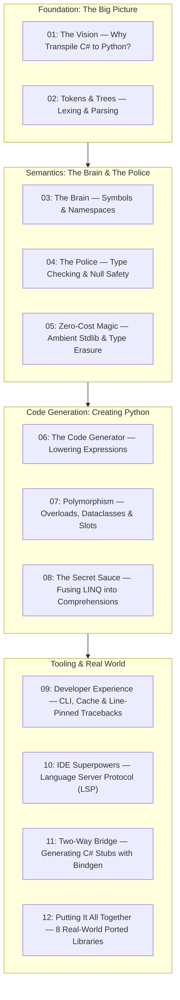

# PythonSharp: From C# to Pure Python
## Master Blog Series Plan & Curriculum Guide

> **Welcome!** If you know basic Python (variables, loops, functions, classes) and have dabbled in C# (or know what static types and compilation mean), this 12-part blog series is designed specifically for you.
>
> We will demystify how **PythonSharp (`psc`)** takes strongly typed, high-performance C# code and turns it into clean, idiomatic, zero-overhead Python 3.11+ code—without any bulky runtime libraries or execution penalties.

---

## 🗺️ The Learning Roadmap

---

## 📚 Curriculum Breakdown

### Module 1: The Core Vision & Frontend
1. **[Blog 01: The Vision — Why Transpile C# to Python?](./01_the_vision_why_transpile_csharp_to_python.md)**
   - *Theme*: The "Best of Both Worlds" philosophy.
   - *Core Concepts*: Why transpile? Type safety at authoring time vs. dynamic agility at runtime. Why not IronPython or Cython? The Zero Runtime Wrapper Tax principle.
   - *Repo Focus*: High-level architecture, `pyproject.toml`, project goals.

2. **[Blog 02: Tokens & Trees — How Code Becomes an Abstract Syntax Tree (AST)](./02_tokens_and_trees_the_lexer_and_parser.md)**
   - *Theme*: Reading text and turning it into structured data.
   - *Core Concepts*: What is a Lexer (token stream)? What is a recursive descent Parser? What is an Abstract Syntax Tree (AST)?
   - *Repo Focus*: `src/psc/frontend/tokens.py`, `src/psc/frontend/lexer.py`, `src/psc/frontend/parser.py`, `src/psc/frontend/ast_nodes.py`.

---

### Module 2: The Semantics Engine
3. **[Blog 03: The Brain — Symbol Tables, Scopes & Name Mangling](./03_the_brain_symbols_and_type_resolution.md)**
   - *Theme*: Giving meaning to identifiers.
   - *Core Concepts*: What is a Symbol Table? How does PythonSharp track classes, methods, and variables across files? Converting PascalCase to snake_case.
   - *Repo Focus*: `src/psc/semantics/symbols.py`, `src/psc/semantics/collector.py`.

4. **[Blog 04: The Compiler Police — Static Type Checking & Null Safety](./04_the_compiler_police_type_checking_and_access_rules.md)**
   - *Theme*: Catching bugs before Python ever runs.
   - *Core Concepts*: Strong static types, generic validation (`List<T>`), nullable reference types (`string?` vs `string`), and access modifiers (`public`, `private`).
   - *Repo Focus*: `src/psc/semantics/type_checker.py`, `src/psc/semantics/access_checker.py`.

5. **[Blog 05: Zero-Cost Magic — The Ambient Standard Library (`PythonSharp.Core.d.ps`)](./05_zero_cost_magic_ambient_stdlib_and_type_erasure.md)**
   - *Theme*: Pure type erasure without runtime wrappers.
   - *Core Concepts*: Ambient declaration files (`.d.ps`), `[MapsTo]`, `[InlineTemplate]`, and `[RuntimeType]`. How `string.Length` compiles straight to `len(s)` with zero function call overhead.
   - *Repo Focus*: `stdlib/PythonSharp.Core.d.ps`, `src/psc/codegen/expr_lowerer.py`.

---

### Module 3: Code Generation & Optimization
6. **[Blog 06: The Code Generator — Turning C# AST into Python AST](./06_the_code_generator_turning_csharp_ast_into_python.md)**
   - *Theme*: Emitting idiomatic Python 3.11+.
   - *Core Concepts*: Python's built-in `ast` module. Lowering expressions (`x + y`, method calls, ternaries). How `ast.unparse()` produces human-readable Python code.
   - *Repo Focus*: `src/psc/codegen/expr_lowerer.py`, `src/psc/codegen/py_ast_builder.py`, `src/psc/codegen/emitter.py`.

7. **[Blog 07: Polymorphism & Speed — Method Overloads, Dataclasses & Slots](./07_overloads_dataclasses_and_slots.md)**
   - *Theme*: Bridging C# OOP features into high-performance Python.
   - *Core Concepts*: C# method overloading meets Python's single-method model (using `typing.overload` + runtime type dispatchers). C# records mapped to `@dataclass(frozen=True, slots=True)`. Why `__slots__` makes Python classes faster and memory-efficient.
   - *Repo Focus*: `src/psc/codegen/overload_emitter.py`, `src/psc/semantics/slot_analyzer.py`.

8. **[Blog 08: The Secret Sauce — Fusing LINQ into Native Python Comprehensions](./08_the_secret_sauce_fusing_linq_into_comprehensions.md)**
   - *Theme*: The compiler's crown jewel optimization pass.
   - *Core Concepts*: What is LINQ? (`.Where().Select().ToList()`). Why chained function calls are slow in Python. How Pass 2 compiler fusion rewrites LINQ pipelines directly into high-speed Python list/set/dict comprehensions and generator expressions.
   - *Repo Focus*: `src/psc/semantics/linq_fuser.py`, `tests/test_linq_surface.py`.

---

### Module 4: Tooling, IDE & Real-World Dogfooding
9. **[Blog 09: Developer Experience — CLI, Incremental Caching & Pinned Tracebacks](./09_developer_experience_cli_caching_and_pinned_tracebacks.md)**
   - *Theme*: Making the compiler fast, enjoyable, and easy to debug.
   - *Core Concepts*: The `psc` CLI commands (`build`, `watch`, `run`). How SHA-256 build caching skips unchanged files. Line-pinning bytecode: how Python runtime tracebacks point directly to the line of `.ps` source code that caused them!
   - *Repo Focus*: `src/psc/cli/`, `src/psc/build_cache.py`, `src/psc/tracebacks.py`, `src/psc/watcher.py`.

10. **[Blog 10: IDE Superpowers — Inside the Language Server Protocol (LSP)](./10_ide_superpowers_building_the_lsp_server.md)**
    - *Theme*: Bringing syntax highlighting, auto-complete, and Go-To-Definition to your editor.
    - *Core Concepts*: What is LSP? JSON-RPC communication between VS Code and `psc lsp`. Publishing live diagnostics, auto-completions, type hover cards, and cross-file symbol navigation.
    - *Repo Focus*: `src/psc/lsp/server.py`.

11. **[Blog 11: The Two-Way Bridge — Generating C# Stubs from Python with Bindgen](./11_two_way_interop_generating_csharp_stubs_with_bindgen.md)**
    - *Theme*: Calling external Python packages (FastAPI, NumPy, Requests) from C# with full IntelliSense.
    - *Core Concepts*: Python runtime reflection & type inspection. Generating ambient `.d.ps` interface declarations from any existing Python package.
    - *Repo Focus*: `src/psc/bindgen/generator.py`, `src/psc/bindgen/type_converter.py`.

12. **[Blog 12: Putting It All Together — Dogfooding with 8 Real-World Ported Libraries](./12_dogfooding_porting_real_world_python_libraries.md)**
    - *Theme*: Stress-testing the compiler against real codebases.
    - *Core Concepts*: From `left-pad` and `slugify` to `is-prime`, `levenshtein`, `semver`, `micro_tqdm`, `micro_dotenv`, and `micro_requests`. What bugs were caught, how the language evolved, and what you can build today.
    - *Repo Focus*: `Samples/Ported/`, `Samples/Ported/PLAN.md`.

---

## 🎯 How to Read This Series
- If you're completely new to compilers: Start at **Blog 01** and follow sequentially. Each post builds upon the concepts of the previous one.
- If you just want to see how C# code becomes Python: Jump directly to **Blog 05**, **Blog 06**, and **Blog 08**.
- If you want to build editor tooling and developer experiences: Check out **Blog 09** and **Blog 10**.

---

## 🚀 Looking for More? Level 2 Series

Ready for a deep dive into the compiler's code layout, subsystem implementations, and detailed architectural walkthroughs of all 17 real-world ported Python libraries?

Check out **[Level 2: Architecture, Code Layout & The 17 Ported Libraries](./2/PLAN.md)**!

