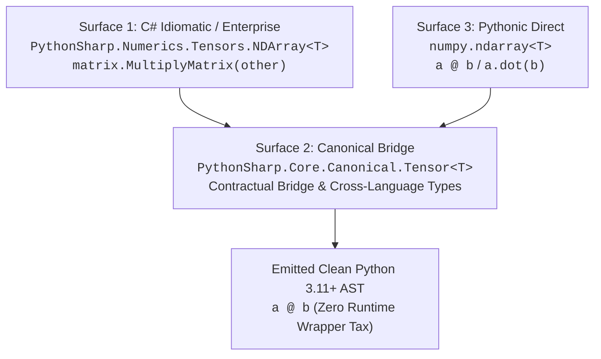

# PythonSharp Triple-Surface Architecture

**Status:** Milestones U1–U5 Implemented & Verified  
**Date:** 2026-10-31  
**Version:** `2.1.0-dev`  
**Related Docs:** [ARCHITECTURE.md](../ARCHITECTURE.md), [LANGUAGE-SPEC.md](../LANGUAGE-SPEC.md), [CORE-API.md](../CORE-API.md), [DIAGNOSTICS.md](../DIAGNOSTICS.md), [LSP.md](../LSP.md), [TESTING.md](../TESTING.md)

---

## 1. Overview & Architectural Vision

The **Triple-Surface Architecture** is PythonSharp's unifying solution to a fundamental dilemma in mixed C# / Python engineering:

1. **Enterprise C# developers** require deep structural organization, strongly typed signatures, and self-documenting naming conventions where reading a fully qualified name explains its exact mathematical or business intent.
2. **Python developers and data scientists** rely on terse, idiomatic, 1:1 standard and package conventions (e.g. `np.linalg.inv(matrix)`, `@` matrix multiplication, `matrix[0:2, 0:2]`).
3. **Migration workflows** require progressive modernization: starting with copy-pasted Python idioms, bridging to canonical interfaces, and graduating to enterprise-grade strongly typed C# architectures without runtime penalties.

By leveraging compile-time type erasure (`[MapsTo]`, `[InlineTemplate]`) and intrinsic metadata attributes (`[SurfaceLevel]`, `[CanonicalApi]`), PythonSharp fulfills all three needs with **Zero Runtime Wrapper Tax**.

---

## 2. Directory Index & Analytical Foundations

This directory preserves the strategic analysis and specifications that guided the Triple-Surface implementation:

| Document | Purpose & Architectural Scope |
| :--- | :--- |
| [`Final Analysis.md`](Final%20Analysis.md) | **Core Design Specification:** Outlines the dual/triple-surface ambient library architecture, compile-time type erasure mechanics, ambient `.d.ps` decomposition, intrinsic attributes (`[SurfaceLevel]`, `[CanonicalApi]`), and scientific computing extensions (NumPy, SciPy, PyTorch). |
| [`PythonSharp next goals final.md`](PythonSharp%20next%20goals%20final.md) | **Progression Roadmap:** Evaluates incremental porting tiers beyond scalar algorithms, establishing roadmap targets across Tier 8 (Host OS & Resources), Tier 9 (Scientific Numerics), and native boundaries. |

---

## 3. The Tri-Modal Surface Ladder

The architecture defines three distinct developer surfaces that resolve to the exact same underlying runtime targets:



### Surface 1: C# Enterprise & Idiomatic
- **Goal:** Maximum self-documentation, type-safety, and IDE discoverability.
- **Example:**
  ```csharp
  using PythonSharp.Numerics.Tensors;
  using PythonSharp.Numerics.LinearAlgebra;

  NDArray<double> weights = ArrayFactory.CreateZeroFilled<double>(rows: 4, columns: 4);
  NDArray<double> output = weights.MultiplyMatrix(inputs);
  ```

### Surface 2: Canonical Bridge
- **Goal:** Common interop currency and standardized contract level across modules.
- **Example:**
  ```csharp
  using PythonSharp.Core.Canonical;

  Tensor<double> modelWeights = loader.LoadCanonicalTensor("weights.bin");
  ```

### Surface 3: Pythonic Direct
- **Goal:** Zero-friction migration from Python scripts and familiarity for data science teams.
- **Example:**
  ```csharp
  using numpy;

  var a = np.zeros(new int[] { 4, 4 });
  var b = a @ x; // Matrix multiplication lowers directly to Python @ operator
  ```

---

## 4. Compiler Implementation (Milestones U1–U5)

All five milestones specified in the architecture plan are fully implemented and passing:

1. **Milestone U1 — Standard Library Modularization:**
   - Modularized standard library declarations into separate bundles under `stdlib/`:
     - `stdlib/canonical/`: Core shared definitions (`PythonSharp.Core.Canonical.d.ps`).
     - `stdlib/surface_1/`: C# Enterprise types (`PythonSharp.Enterprise.d.ps`).
     - `stdlib/surface_2/`: Canonical bridge declarations.
     - `stdlib/surface_3/`: Pythonic 1:1 stubs (`PythonSharp.Pythonic.d.ps`, `numpy.d.ps`).

2. **Milestone U2 — Intrinsic Surface Metadata Attributes:**
   - Supported `[SurfaceLevel(1|2|3)]` and `[CanonicalApi("target")]` attributes in `src/psc/semantics/symbol_collector.py`.
   - Guaranteed 100% compile-time erasure in `PrimitiveResolver` (Pass 2B) and `PyASTBuilder` (Pass 3A); intrinsic decorators are never emitted to Python output.

3. **Milestone U3 — Tri-Surface Bindgen Bundles (`psc bindgen --triple-surface`):**
   - Extended `src/psc/interop/bindgen.py` and CLI to generate a 4-file bundle from `.pyi` type hints:
     1. `canonical_api.d.ps`: Clean canonical contracts.
     2. `surface_1.d.ps`: PascalCase enterprise methods.
     3. `surface_2.d.ps`: Canonical bridge interfaces.
     4. `surface_3.d.ps`: 1:1 Pythonic stubs.

4. **Milestone U4 — Target Surface Checking & Rule PS005:**
   - Added `--target-surface=surface_1|surface_2|surface_3` compiler flag to `psc check` and `psc build`.
   - Implemented `SurfaceMigrationChecker` in `src/psc/semantics/surface_checker.py`.
   - Diagnoses Rule `PS005` surface mismatch warnings with actionable migration hints.

5. **Milestone U5 — Tri-Modal Hover Cards in Language Server Protocol:**
   - Updated `src/psc/lsp/server.py` to format LSP hover tooltips with a 3-tier surface ladder showing equivalent syntax across Surface 1, Surface 2, and Surface 3.

---

## 5. Scientific Computing & Tensor Math Support

PythonSharp includes native compilation support for multi-dimensional tensor workflows:

- **Automatic Module Injection:** Calls to `numpy` or `NDArray` automatically inject `import numpy as np` in emitted Python modules.
- **Matrix Multiplication Operator (`@`):** C# method calls `.MultiplyMatrix(...)` and `.dot(...)` or binary `@` operators lower directly to compile-time Python `@` or `.dot()` calls without runtime wrappers.
- **Multi-Dimensional Indexing & Slicing:** Multi-axis C# indexers (`matrix[0..2, 0..2]`) lower directly to native Python multi-axis slicing (`matrix[0:2, 0:2]`).

---

## 6. Live Samples & Verification

| Sample / Test Suite | Description | Verification Command |
| :--- | :--- | :--- |
| [`Samples/06_triple_surface_migration/`](../../Samples/06_triple_surface_migration/) | Multi-surface linear regression pipeline demonstrating progressive migration from Surface 1 to Surface 3. | `python3 Samples/06_triple_surface_migration/run_triple_surface.py` |
| [`Samples/Ported/20_numpy_numerics/`](../../Samples/Ported/20_numpy_numerics/) | Full Tier 9 dogfooding port testing tensor algebra, dot products, reshaping, and multi-axis slicing. | `python3 Samples/Ported/20_numpy_numerics/run_numpy.py` |
| `tests/test_triple_surface.py` | Compiler test suite verifying surface compilation, attribute erasure, and `@` lowering. | `.venv/bin/pytest tests/test_triple_surface.py -q` |
| `tests/test_bindgen_triple_surface.py` | Interop test suite verifying 4-file stub bundle generation. | `.venv/bin/pytest tests/test_bindgen_triple_surface.py -q` |
| `tests/test_surface_diagnostics.py` | Diagnostic test suite verifying `PS005` migration warnings and LSP hover cards. | `.venv/bin/pytest tests/test_surface_diagnostics.py -q` |
