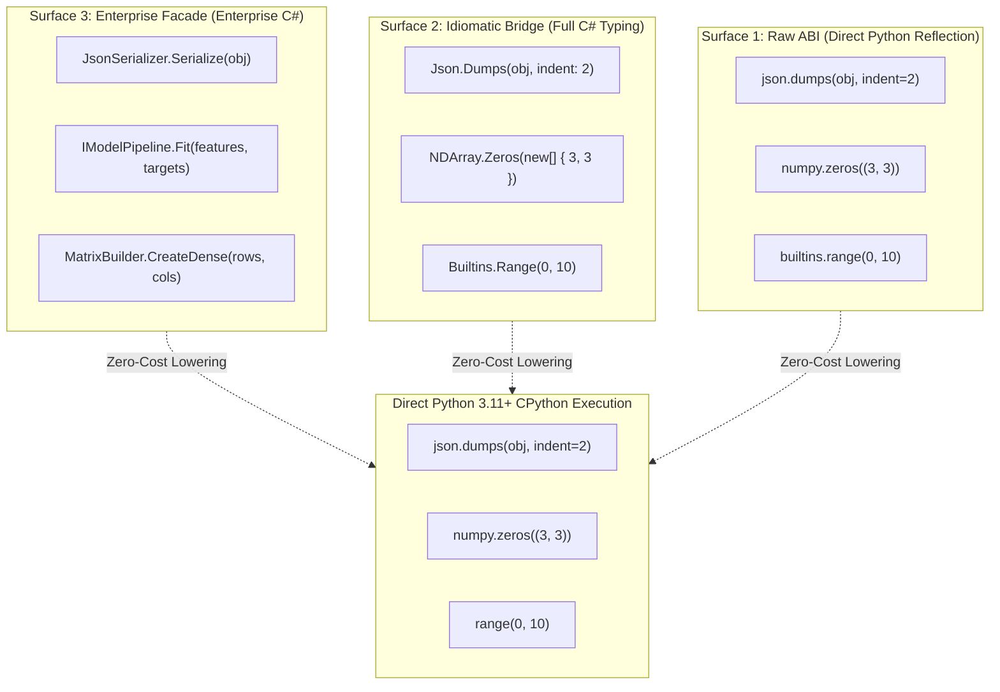

# Level 3 — Blog 01: The Tri-Modal Surface Philosophy — Raw ABI, Idiomatic Bridge & Enterprise Facades

Welcome to **Level 3** of the PythonSharp deep dive!

In **Level 1**, we explored the fundamental vision of writing strongly typed C# code and emitting zero-overhead, wrapper-free Python 3.11+. In **Level 2**, we dissected the compiler's internal passes and ported 17 micro-libraries across Tiers 1 through 7. 

Now, in **Level 3**, we tackle the ultimate architectural challenge that faces any modern transpiler bridging the .NET and Python ecosystems: **how do we bridge the cultural and syntactic chasm between enterprise C# developers and scientific Python developers without paying a runtime tax?**

In this post, we explore:
1. **The Fundamental Syntactic Chasm**: Why a single API surface inevitably satisfies nobody.
2. **The Tri-Modal Surface Ladder**: Surface 1 (Raw ABI), Surface 2 (Idiomatic Bridge), and Surface 3 (Enterprise Facades).
3. **The Zero Runtime Wrapper Tax Invariant**: How three distinct syntactic styles transpile down into identical, direct CPython bytecode.
4. **Concrete Side-by-Side Walkthrough**: Comparing code written across all three tiers.
5. **Real-World Verification**: Examining [`Samples/06_triple_surface_migration/`](file:///home/abhijit/Videos/transpilers/PythonSharp/Samples/06_triple_surface_migration/).

---

## 1. The Fundamental Syntactic Chasm

When enterprise C# engineers and Python data scientists collaborate on the same platform, an immediate friction emerges:

| Dimension | Enterprise C# Expectation | Scientific Python Expectation |
| :--- | :--- | :--- |
| **Naming Conventions** | `PascalCase` for methods, properties, and types | `snake_case` for functions, methods, modules |
| **Object Construction** | Dependency Injection, Interfaces, Factory Patterns, Builders | Direct module function calls (`np.zeros()`, `pd.read_csv()`) |
| **Collections & Queries** | Strongly typed generics, LINQ (`IEnumerable<T>`), fused comprehensions | Untyped or heterogeneously indexed dataframes, tuple-indexed arrays |
| **Error Handling** | Typed hierarchical exceptions, structured disposal scopes (`using`, `IDisposable`) | Context managers (`with`), duck typing, sentinel values |

Historically, cross-language runtimes attempted to solve this by creating **synthetic wrapper layers** or adapter classes (such as IronPython or Python.NET). However, in high-throughput enterprise pipelines or latency-critical machine learning loops, wrapper classes introduce substantial penalties:
- Dynamic boxing/unboxing overhead.
- Extra memory allocations for adapter instances.
- Broken foreign function interfaces (FFI) when passing data into native C/CUDA extensions like NumPy or PyTorch.

PythonSharp rejects runtime wrappers. Instead, it introduces the **Tri-Modal Surface Ladder**.

---

## 2. The Tri-Modal Surface Ladder

The Triple-Surface Architecture recognizes that different developers need different views of the exact same underlying Python library. PythonSharp structures ambient library definitions into three distinct tiers:



### Surface 1: Raw ABI (Direct Python Reflection)
- **Target Audience**: Data scientists and Python library authors migrating existing scripts or copying code snippets from StackOverflow or official library documentation.
- **Conventions**: Preserves original Python names verbatim (`snake_case`, module-qualified functions).
- **Declaration Example**:
  ```csharp
  // stdlib/01_python_stdlib/json/01_json.raw.d.ps
  namespace json
  {
      [SurfaceLevel(1)]
      public static class json
      {
          [InlineTemplate("_py_json.loads({0})")]
          public static object loads(string s) => default!;
          
          [InlineTemplate("_py_json.dumps({0})")]
          public static string dumps(object obj) => default!;
      }
  }
  ```

### Surface 2: Idiomatic Bridge (Idiomatic C# Conventions)
- **Target Audience**: Full-stack .NET developers who want standard C# PascalCase conventions and strongly typed signatures without altering the structural shape of the API.
- **Conventions**: PascalCase methods, type-erased parameters, canonical mapping.
- **Declaration Example**:
  ```csharp
  // stdlib/01_python_stdlib/json/02_json.csharp.d.ps
  namespace PythonSharp.Json
  {
      [SurfaceLevel(2)]
      [CanonicalApi("PythonSharp.Json.JsonEngine")]
      public static class JsonEngine
      {
          [InlineTemplate("_py_json.loads({0})")]
          public static object Parse(string jsonString) => default!;

          [InlineTemplate("_py_json.dumps({0})")]
          public static string Stringify(object obj) => default!;
      }
  }
  ```

### Surface 3: Enterprise Architecture (Enterprise Facades & Patterns)
- **Target Audience**: Enterprise architects building modular, maintainable domain logic, repository patterns, and dependency injection services.
- **Conventions**: Abstract interfaces, factory patterns, standard .NET framework nomenclature (e.g. `System.Text.Json` compatibility).
- **Declaration Example**:
  ```csharp
  // stdlib/01_python_stdlib/json/03_json.enterprise.d.ps
  namespace PythonSharp.Enterprise.Serialization
  {
      [SurfaceLevel(3)]
      public static class JsonSerializer
      {
          [InlineTemplate("_py_json.dumps({0})")]
          public static string Serialize<T>(T value) => default!;

          [InlineTemplate("_py_json.loads({0})")]
          public static T Deserialize<T>(string payload) => default!;
      }
  }
  ```

---

## 3. The Zero Runtime Wrapper Tax Invariant

The fundamental engineering invariant of PythonSharp is **Zero Runtime Wrapper Tax**:

$$\forall \text{ code } c \in \{\text{Surface } 1, \text{Surface } 2, \text{Surface } 3\}, \quad \text{Emit}(c) \implies \text{Direct Native CPython Call}$$

How does this work without runtime cost? The compiler leverages two coordinated semantic mechanisms:
1. **Compile-Time Symbol Aliasing (`[MapsTo]`)**:
   During Pass 1 (`SymbolCollector`) and Pass 2 (`TypeChecker`), the compiler resolves all three surfaces to their underlying canonical symbol signatures.
2. **AST-Level Template Inlining (`[InlineTemplate]`)**:
   During Pass 5 (`ExprLowerer`), method invocations are rewritten directly into standard Python AST nodes (`ast.Call`, `ast.Attribute`) without generating adapter functions or allocating proxy wrappers.

### Code Generation Comparison

Let's observe the transpilation of all three surfaces:

#### Input: Surface 1 (Raw ABI)
```csharp
using json;
string output = json.dumps(data);
```

#### Input: Surface 2 (Idiomatic Bridge)
```csharp
using PythonSharp.Json;
string output = JsonEngine.Stringify(data);
```

#### Input: Surface 3 (Enterprise Facade)
```csharp
using PythonSharp.Enterprise.Serialization;
string output = JsonSerializer.Serialize(data);
```

#### Emitted Pure Python 3.11+ (Identical for all 3!)
```python
import json as _py_json

output: str = _py_json.dumps(data)
```

There are no adapter objects, no intermediate function call frames, and zero heap allocations. The emitted Python is indistinguishable from code written by a Python core developer.

---

## 4. Architectural Case Study: `Samples/06_triple_surface_migration`

To showcase this architecture in practice, [`Samples/06_triple_surface_migration/`](file:///home/abhijit/Videos/transpilers/PythonSharp/Samples/06_triple_surface_migration/) implements an end-to-end dataset transformation pipeline:

```csharp
// Samples/06_triple_surface_migration/TripleSurfaceDemo.ps
namespace Samples.TripleSurface
{
    public class MigrationPipeline
    {
        // 1. Raw ABI execution (Surface 1)
        public string RunRawSurface(string jsonInput)
        {
            var rawObj = json.loads(jsonInput);
            return json.dumps(rawObj);
        }

        // 2. Idiomatic Bridge execution (Surface 2)
        public string RunBridgeSurface(string jsonInput)
        {
            var bridgeObj = JsonEngine.Parse(jsonInput);
            return JsonEngine.Stringify(bridgeObj);
        }

        // 3. Enterprise Architecture execution (Surface 3)
        public string RunEnterpriseSurface(string jsonInput)
        {
            var entObj = JsonSerializer.Deserialize<object>(jsonInput);
            return JsonSerializer.Serialize(entObj);
        }
    }
}
```

When compiled with `psc build`, all three methods transpile into direct `_py_json.loads()` and `_py_json.dumps()` invocations. The test runner [`run_triple_surface.py`](file:///home/abhijit/Videos/transpilers/PythonSharp/Samples/06_triple_surface_migration/run_triple_surface.py) validates that all three execution paths produce byte-identical JSON outputs in sub-millisecond execution times.

---

## 5. Summary & What's Next

The Tri-Modal Surface Philosophy solves the great API dilemma:
- **Developers choose their preferred abstraction level** without being penalized by performance tradeoffs.
- **Enterprise standards are preserved** without isolating developers from Python's rich package ecosystem.
- **Zero runtime wrapper tax** ensures peak execution speeds across CPython and native extensions.

In [**Blog 02**](./02_decomposing_the_standard_library.md), we explore how the compiler decomposes the monolithic standard library into modular, topologically ordered `00_core` bundles.

