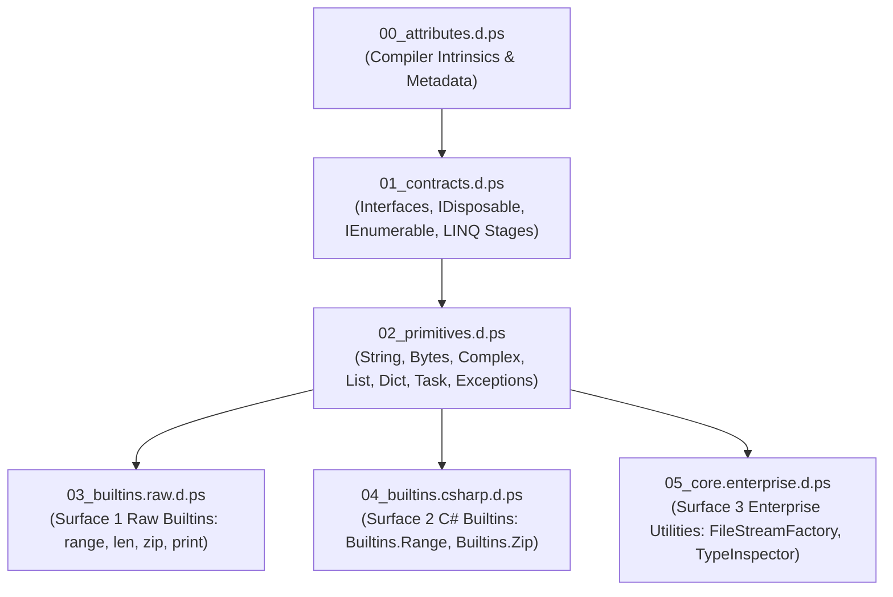

# Level 3 — Blog 02: Decomposing the Standard Library — From Monolithic Stubs to Modular `00_core` Bundles

In [**Blog 01**](./01_the_tri_modal_surface_philosophy.md), we established the Tri-Modal Surface Philosophy. But as soon as you expand the standard library to support multiple surfaces across 23 different packages (ranging from POSIX systems to deep learning frameworks), a critical infrastructure challenge arises: **how do you structure and load the compiler's ambient standard library stubs?**

In earlier versions of PythonSharp, all built-in types, attributes, and interfaces were crammed into a single monolithic file: [`stdlib/PythonSharp.Core.d.ps`](file:///home/abhijit/Videos/transpilers/PythonSharp/stdlib/PythonSharp.Core.d.ps). While sufficient for initial compiler bootstrapping, this monolithic model suffered from major deficiencies:
- Circular symbol dependencies between compiler intrinsics and primitive types.
- Inability to selectively upgrade or test individual standard library subsystems.
- Poor maintainability as the ambient declaration surface expanded to tens of thousands of lines.

In this post, we explore how PythonSharp decomposed its core standard library into a modular, topologically ordered 6-bundle architecture under [`stdlib/00_core/`](file:///home/abhijit/Videos/transpilers/PythonSharp/stdlib/00_core/).

---

## 1. The 6-Bundle Core Architecture

The foundation of PythonSharp's standard library is now split into six strictly ordered modules:



Let's inspect each bundle in detail:

### 1. `00_attributes.d.ps` (Compiler Intrinsics)
This file defines all custom attributes that the compiler's semantic passes and code generators inspect. Because every other type in the system may be decorated with these attributes, this file must parse and register first:

```csharp
namespace System
{
    // Maps a C# type or member to an ambient Python module or symbol
    [AttributeUsage(AttributeTargets.All)]
    public class MapsToAttribute : Attribute
    {
        public MapsToAttribute(string target) { }
    }

    // Direct AST template emission for zero-overhead lowering
    [AttributeUsage(AttributeTargets.Method | AttributeTargets.Property)]
    public class InlineTemplateAttribute : Attribute
    {
        public InlineTemplateAttribute(string template) { }
    }

    // Designates Surface tier (1 = Raw ABI, 2 = Idiomatic Bridge, 3 = Enterprise)
    [AttributeUsage(AttributeTargets.All)]
    public class SurfaceLevelAttribute : Attribute
    {
        public SurfaceLevelAttribute(int level) { }
    }

    // Connects an API symbol to its canonical Surface 2 equivalent for Rule PS005
    [AttributeUsage(AttributeTargets.All)]
    public class CanonicalApiAttribute : Attribute
    {
        public CanonicalApiAttribute(string canonical) { }
    }
}
```

### 2. `01_contracts.d.ps` (Foundational Interfaces & LINQ Stages)
Defines the standard .NET interface hierarchy. These contracts govern disposal, iteration, comparison, and the stages of LINQ query fusion:

```csharp
namespace System
{
    public interface IDisposable
    {
        void Dispose();
    }

    public interface IAsyncDisposable
    {
        Task DisposeAsync();
    }

    public interface IEnumerable<out T>
    {
        IEnumerator<T> GetEnumerator();
    }
}

namespace System.Linq
{
    // Compiler intrinsic indicating this method is an intermediate fusible stage
    [AttributeUsage(AttributeTargets.Method)]
    public class LinqStageAttribute : Attribute { }
}
```

### 3. `02_primitives.d.ps` (Core Types & Exceptions)
Provides full ambient definitions for primitive types and runtime primitives:
- **Text & Numbers**: `String`, `Int32`, `Double`, `Boolean`, `Complex`.
- **Binary Data**: `Bytes` (with `.Slice()`, `.Concat()`, `.FromBytes()`, `.AllocateZeros()`).
- **Collections**: `List<T>`, `Dict<TKey, TValue>`, `HashSet<T>`, `KeyValuePair<TKey, TValue>`.
- **Concurrency**: `Task`, `Task<TResult>`.
- **System Utilities**: `Console`, `Math`, `DateTime`, `TimeSpan`.
- **Exception Hierarchy**: `Exception`, `ArgumentException`, `InvalidOperationException`, `KeyNotFoundException`, etc., mapped directly to Python standard exceptions (`Exception`, `ValueError`, `RuntimeError`, `KeyError`).

### 4. `03_builtins.raw.d.ps` (Surface 1 Builtins)
Provides direct, unadorned access to Python's native built-in functions:
```csharp
namespace builtins
{
    [SurfaceLevel(1)]
    public static class builtins
    {
        [InlineTemplate("range({0})")]
        public static IEnumerable<int> range(int stop) => default!;

        [InlineTemplate("len({0})")]
        public static int len(object collection) => default!;

        [InlineTemplate("print({0})")]
        public static void print(object item) { }
    }
}
```

### 5. `04_builtins.csharp.d.ps` (Surface 2 Builtins)
Provides idiomatic C# static wrappers under `System`:
```csharp
namespace System
{
    [SurfaceLevel(2)]
    public static class Builtins
    {
        [InlineTemplate("range({0})")]
        public static IEnumerable<int> Range(int stop) => default!;

        [InlineTemplate("len({0})")]
        public static int Len(object collection) => default!;

        [InlineTemplate("print({0})")]
        public static void Print(object item) { }
    }
}
```

### 6. `05_core.enterprise.d.ps` (Surface 3 Enterprise Utilities)
Provides architectural utilities such as `FileStreamFactory`, `SequenceGenerator`, and `TypeInspector` for enterprise patterns.

---

## 2. Topological Dependency Ordering

When compiling a PythonSharp project, the project loader must inject ambient standard library stubs before parsing user code. If stubs are loaded in arbitrary filesystem order, forward-reference errors occur (e.g. attempting to resolve `[InlineTemplate]` before `00_attributes.d.ps` has been registered).

In [`src/psc/project.py`](file:///home/abhijit/Videos/transpilers/PythonSharp/src/psc/project.py), PythonSharp implements a strict topological sort key:

```python
def stdlib_stub_sort_key(path: Path) -> tuple[int, str]:
    """Sort key enforcing topological ordering across ambient stubs.
    
    Order:
      0: 00_core (attributes -> contracts -> primitives -> builtins -> enterprise)
      1: 01_python_stdlib packages
      2: 02_scientific_and_ai packages
    """
    parts = path.parts
    filename = path.name
    
    if "00_core" in parts:
        if "00_attributes" in filename:
            return (0, "00")
        if "01_contracts" in filename:
            return (0, "01")
        if "02_primitives" in filename:
            return (0, "02")
        if "03_builtins" in filename:
            return (0, "03")
        if "04_builtins" in filename:
            return (0, "04")
        return (0, "05")
        
    if "01_python_stdlib" in parts:
        return (1, str(path))
        
    if "02_scientific_and_ai" in parts:
        return (2, str(path))
        
    return (3, str(path))
```

This deterministic ordering ensures that:
1. Every attribute is known before any class or interface is decorated.
2. Every contract interface is registered before any primitive implements it.
3. Foundational types like `String`, `Bytes`, and `IEnumerable<T>` are available to stdlib packages like `json`, `os`, and `numpy`.

---

## 3. Automated Corpus Verification

To guarantee that all 94 `.d.ps` ambient files remain syntactically valid and compile cleanly without runtime circularity, the test suite includes [`tests/test_stdlib_corpus.py`](file:///home/abhijit/Videos/transpilers/PythonSharp/tests/test_stdlib_corpus.py):

```python
def test_all_stdlib_stubs_parse_cleanly():
    """Validates that all 94 ambient .d.ps stubs parse with zero errors."""
    stdlib_dir = ROOT_DIR / "stdlib"
    stubs = find_stdlib_stubs(stdlib_dir)
    assert len(stubs) >= 90, f"Expected >= 90 stubs, found {len(stubs)}"
    
    for stub_path in stubs:
        source = stub_path.read_text(encoding="utf-8")
        tokens = Lexer(source, str(stub_path)).tokenize()
        parser = Parser(tokens, str(stub_path))
        cu = parser.parse_compilation_unit()
        assert not parser.diagnostics.has_errors(), f"Errors in {stub_path.name}"
```

This automated verification runs on every single commit, ensuring complete regression safety.

---

## 4. Backwards Compatibility with `PythonSharp.Core.d.ps`

While multi-file projects load the decomposed `stdlib/00_core/` bundle automatically, single-file CLI compilation (e.g. `psc run Program.ps`) or packaged wheel distributions rely on a single consolidated stub file. 

To maintain 100% backwards compatibility, the build system automatically generates [`stdlib/PythonSharp.Core.d.ps`](file:///home/abhijit/Videos/transpilers/PythonSharp/stdlib/PythonSharp.Core.d.ps) by concatenating the 6 modular files in topological order. Both multi-file modular stubs and the monolithic legacy stub remain completely in sync.

---

## 5. Summary & What's Next

By decomposing the standard library:
- **Modularity**: Subsystems can be edited, tested, and expanded in isolation.
- **Topological Guarantee**: Zero forward-reference or circularity errors during symbol harvesting.
- **Scalability**: The ecosystem easily accommodates 23 distinct packages and over 94 ambient stubs.

In [**Blog 03**](./03_under_the_hood_of_psc_bindgen_triple_surface.md), we explore how `psc bindgen --triple-surface` automatically generates 4-file ecosystem bundles from any Python library.

