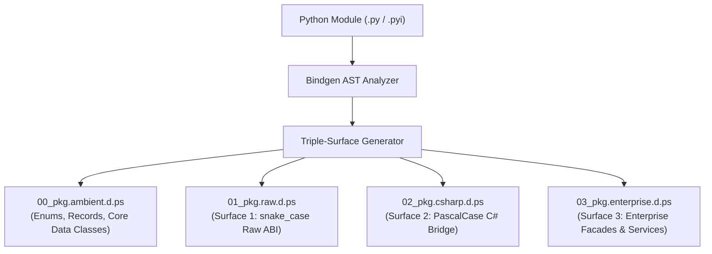

# Level 3 — Blog 03: Under the Hood of `psc bindgen --triple-surface`: Generating 4-File Ecosystem Bundles

In **Level 1 Blog 11**, we introduced **`ps-bindgen`**, the compiler's built-in tool for converting Python type stubs (`.pyi`) into C# ambient declaration files (`.d.ps`). While generating a single `.d.ps` file was an essential first step, modern enterprise engineering requires the full **Triple-Surface Architecture**.

When integrating a complex library like `requests`, `numpy`, or `pydantic`, writing ambient declarations across all three surfaces by hand is tedious and error-prone. 

To automate this, PythonSharp introduces the `--triple-surface` flag:
```bash
psc bindgen requests --triple-surface -o stdlib/01_python_stdlib/requests/
```

In this post, we open up [`src/psc/bindgen/`](file:///home/abhijit/Videos/transpilers/PythonSharp/src/psc/bindgen/) to see how the bindgen engine dissects Python module signatures and automatically synthesizes a **4-file ecosystem bundle**.

---

## 1. The 4-File Ecosystem Bundle Anatomy

When `psc bindgen --triple-surface` is invoked, it generates four distinct, complementary files:



Let's examine the role of each file:

### 1. `00_<pkg>.ambient.d.ps` (Shared Types & Data Structures)
Contains all shared data types that do not vary across surfaces:
- Enums (e.g., HTTP status codes or tensor data types).
- Data models and records.
- Core classes decorated with `[MapsTo("...")]`.

### 2. `01_<pkg>.raw.d.ps` (Surface 1: Raw ABI)
- Mirrors the exact casing, structure, and signatures of the Python module.
- Placed in a namespace matching the Python package name (e.g. `namespace requests`).
- Decorated with `[SurfaceLevel(1)]`.
- Every method is equipped with an `[InlineTemplate]` mapping directly to the underlying Python invocation.

### 3. `02_<pkg>.csharp.d.ps` (Surface 2: Idiomatic C# Bridge)
- Transforms method and function names from `snake_case` to `PascalCase`.
- Wraps standalone functions into static classes (e.g. `requests.get()` becomes `Requests.Get()`).
- Decorated with `[SurfaceLevel(2)]` and `[CanonicalApi("...")]` to designate it as the canonical standard C# API.

### 4. `03_<pkg>.enterprise.d.ps` (Surface 3: Enterprise Facade)
- Introduces service abstractions, repository patterns, and builder classes.
- Decorated with `[SurfaceLevel(3)]`.
- Provides dependency-injectable interfaces (e.g., `IHttpClient`, `ITensorFactory`).

---

## 2. The Type Conversion Engine

At the core of `ps-bindgen` is [`TypeConverter`](file:///home/abhijit/Videos/transpilers/PythonSharp/src/psc/bindgen/type_converter.py). It analyzes Python type annotations (`ast.Subscript`, `ast.Name`, `ast.Constant`) and recursively converts them into C# type expressions:

```python
class TypeConverter:
    """Translates Python AST type nodes into C# type names."""
    
    PRIMITIVE_MAP = {
        "str": "string",
        "int": "int",
        "float": "double",
        "bool": "bool",
        "bytes": "Bytes",
        "None": "void",
        "Any": "object",
    }

    def convert(self, node: ast.AST | None) -> str:
        if node is None:
            return "object"
            
        if isinstance(node, ast.Name):
            return self.PRIMITIVE_MAP.get(node.id, node.id)
            
        if isinstance(node, ast.Subscript):
            base = self.convert(node.value)
            
            # Handle Optional[T] and Union[T, None]
            if base in ("Optional", "Union"):
                subtypes = self._unpack_slice(node.slice)
                if len(subtypes) == 2 and "void" in subtypes:
                    other = subtypes[0] if subtypes[1] == "void" else subtypes[1]
                    return f"{other}?"
                    
            # Handle List[T], Dict[K, V], Sequence[T]
            if base == "List":
                return f"List<{self.convert(node.slice)}>"
            if base in ("Sequence", "Iterable"):
                return f"IEnumerable<{self.convert(node.slice)}>"
            if base == "Dict":
                k, v = self._unpack_slice(node.slice)
                return f"Dict<{k}, {v}>"
                
        return "object"
```

### Advanced AST Slicing: `snake_case` to `PascalCase`
During Surface 2 generation, the generator splits identifier segments on underscores and capitalizes each word, while handling edge cases such as leading underscores (private members) or numeric digits:

```python
def to_pascal_case(snake_str: str) -> str:
    """Converts a snake_case identifier to idiomatic C# PascalCase."""
    if not snake_str:
        return snake_str
    clean = snake_str.lstrip("_")
    components = clean.split("_")
    pascal = "".join(x.capitalize() for x in components if x)
    return pascal or snake_str
```

---

## 3. Inline Template Synthesis

A vital aspect of the bindgen generator is synthesizing high-performance inline templates. Instead of requiring developers to manually write:
```csharp
[InlineTemplate("_py_requests.get({0}, headers={1})")]
```

`BindgenGenerator` automatically constructs the parameter substitution string:

```python
def synthesize_inline_template(module_alias: str, py_name: str, params: list[str]) -> str:
    args_str = ", ".join(f"{{{i}}}" for i in range(len(params)))
    return f"{module_alias}.{py_name}({args_str})"
```

This ensures that every method emitted across Surface 1, Surface 2, and Surface 3 is pre-wired for Zero Runtime Wrapper Tax lowering.

---

## 4. Drift Tracking with `psc-manifest.json`

When Python libraries update upstream, ambient declarations can drift out of date. To catch this early, `ps-bindgen` writes a SHA-256 fingerprint into `psc-manifest.json`:

```json
{
  "bindings": {
    "requests": {
      "upstream_version": "2.31.0",
      "source_sha256": "4b68f9a2e8c89b41a9...",
      "surfaces": [1, 2, 3],
      "files": [
        "00_requests.ambient.d.ps",
        "01_requests.raw.d.ps",
        "02_requests.csharp.d.ps",
        "03_requests.enterprise.d.ps"
      ]
    }
  }
}
```

During incremental builds, `psc check` validates that the upstream library's AST signature has not drifted from the recorded hash, alerting developers when re-binding is necessary.

---

## 5. Summary & What's Next

With `psc bindgen --triple-surface`:
- **Automated Generation**: A 4-file bundle is produced in milliseconds from any Python module or stub.
- **Syntactic Bridging**: Automatically converts Python type hints and snake_case signatures to idiomatic C# and enterprise facades.
- **Drift Safety**: Cryptographic checksums ensure ambient stubs stay faithful to runtime dependencies.

In [**Blog 04**](./04_compile_time_surface_enforcement_rule_ps005.md), we explore how the compiler prevents accidental surface mixing via **Rule PS005** and `psc check --target-surface`.

