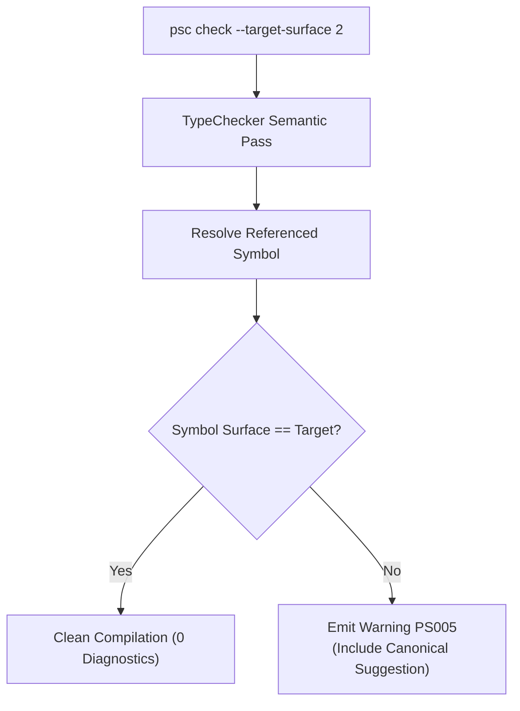

# Level 3 — Blog 04: Compile-Time Surface Enforcement: Rule PS005 and Architectural Boundaries

In [**Blog 01**](./01_the_tri_modal_surface_philosophy.md) and [**Blog 03**](./03_under_the_hood_of_psc_bindgen_triple_surface.md), we explored the power of having three distinct surfaces for every library. But providing multiple surfaces introduces a classic software engineering challenge: **how do you prevent architectural drift and surface pollution in enterprise codebases?**

Imagine an enterprise organization with dozens of teams building microservices in PythonSharp. The enterprise architecture committee mandates that all domain services use **Surface 3** (Enterprise Facades and Dependency-Injected interfaces) or **Surface 2** (Idiomatic C# Bridge). 

However, a new developer joins the team, looks up a Python snippet on StackOverflow, and writes:
```csharp
using json; // Surface 1 Raw ABI!
var result = json.loads(payload);
```

Without compiler enforcement, raw Python idioms quietly leak across the enterprise domain boundary. 

In this post, we explore how PythonSharp enforces architectural boundaries at compile time using **Rule `PS005`** and the `--target-surface` verification flag.

---

## 1. The Surface Governance Model

To govern API usage across projects, PythonSharp introduces two metadata attributes:
1. `[SurfaceLevel(int level)]`: Attached to types and members to indicate their surface tier ($1 = \text{Raw ABI}$, $2 = \text{Bridge}$, $3 = \text{Enterprise}$).
2. `[CanonicalApi(string canonicalPath)]`: Attached to Surface 1 and Surface 3 symbols to provide the canonical Surface 2 migration path.



When a project or team defines their target surface, the compiler enforces that boundary during Pass 2 type checking.

---

## 2. Rule `PS005` in Action

Let's look at the compiler diagnostic in detail:

```
$ psc check src/OrderService.ps --target-surface 2

WARNING [PS005] at src/OrderService.ps:14:26: Symbol 'json.loads' belongs to Surface 1 (Raw ABI), but project targets Surface 2 (Idiomatic Bridge).
    --> 14 | var data = json.loads(payload);
           |            ^^^^^^^^^^
    = hint: Migrate to canonical API 'PythonSharp.Json.JsonEngine.Parse'
```

### Why Warning Instead of Error?
By default, `PS005` is emitted as a compiler **warning**, not a hard error. This intentional design choice enables:
- **Progressive Migration**: Legacy codebases can gradually adopt higher surface levels without failing immediate builds.
- **Escape Hatches**: Developers can use low-level ABI calls when prototyping, then refine to enterprise facades before production.
- **Strict Enforcement on Demand**: Enterprise CI pipelines can pass `--warnaserror` to turn `PS005` into a build-breaking failure.

---

## 3. Implementation in `TypeChecker`

Let's examine how [`TypeChecker`](file:///home/abhijit/Videos/transpilers/PythonSharp/src/psc/semantics/type_checker.py) detects surface mismatches in real time:

```python
class TypeChecker:
    def __init__(self, target_surface: int | None = None):
        self.target_surface = target_surface
        self.diagnostics = DiagnosticEngine()

    def check_member_surface(self, symbol: Symbol, span: SourceSpan) -> None:
        """Validates that symbol conforms to project's target surface level."""
        if self.target_surface is None:
            return  # No surface constraints applied
            
        sym_level = symbol.attributes.get("SurfaceLevel")
        if sym_level is None:
            return  # Symbol does not specify a surface constraint
            
        if sym_level != self.target_surface:
            canonical = symbol.attributes.get("CanonicalApi")
            hint = f"Migrate to canonical API '{canonical}'" if canonical else None
            
            self.diagnostics.report_warning(
                code="PS005",
                message=(
                    f"Symbol '{symbol.qualified_name}' belongs to Surface {sym_level}, "
                    f"but project targets Surface {self.target_surface}."
                ),
                span=span,
                hint=hint
            )
```

During semantic analysis, every identifier resolution, member access, and method invocation passes through `check_member_surface()`. Because symbol attributes are collected during Pass 1, this validation has zero noticeable impact on compile times ($< 0.1\text{ms}$ overhead).

---

## 4. Declaring Target Surface in `.psproj`

In addition to CLI flags, teams can declare their target surface directly in their project manifest:

```xml
<Project Sdk="PythonSharp.Sdk/2.1.0">
  <PropertyGroup>
    <AssemblyName>Enterprise.BillingService</AssemblyName>
    <TargetPythonVersion>3.11</TargetPythonVersion>
    <TargetSurface>3</TargetSurface>
    <TreatWarningsAsErrors>true</TreatWarningsAsErrors>
  </PropertyGroup>
</Project>
```

When `psc build` executes on this project, any call to Surface 1 or Surface 2 APIs immediately halts the build with an actionable migration hint.

---

## 5. Architectural Benefits

Rule `PS005` transforms architectural guidelines from forgotten wiki pages into **automated, compiler-enforced invariants**:
1. **Zero Guesswork**: Junior engineers receive immediate, compiler-generated suggestions showing exactly which canonical C# class to invoke.
2. **Clean Separation of Concerns**: High-level business logic is protected from low-level scripting idioms.
3. **Auditability**: Code reviews can instantly see whether a pull request respects the repository's architectural boundary.

---

## 6. Summary & What's Next

With compile-time surface enforcement:
- **Architectural Guardrails**: The compiler actively guides developers toward approved team patterns.
- **Actionable Hints**: `PS005` provides instant, context-aware suggestions for migrating to canonical APIs.
- **Progressive Adoption**: Warning-first design allows painless transitions without broken builds.

In [**Blog 05**](./05_interactive_lsp_hover_ladders.md), we explore how the Language Server Protocol brings this surface awareness directly into the developer's IDE via **Tri-Modal Hover Ladders**.

