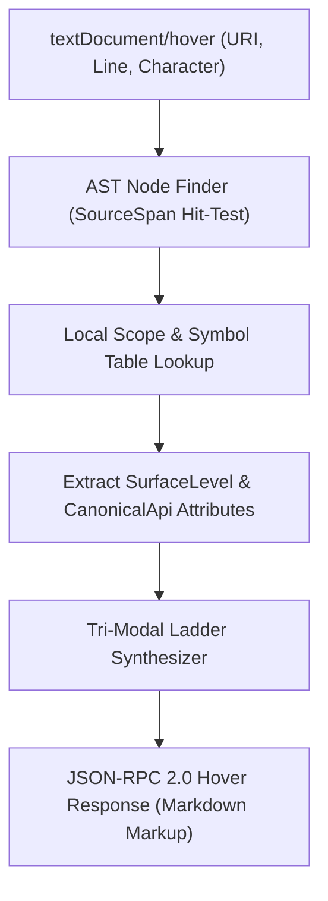

# Level 3 — Blog 05: Interactive LSP Hover Ladders: Visualizing Tri-Modal API Equivalents in Real Time

In [**Level 1 Blog 10**](../10_ide_superpowers_building_the_lsp_server.md), we explored the foundation of PythonSharp's pure-Python Language Server Protocol (`psc lsp`). In [**Level 3 Blog 01**](./01_the_tri_modal_surface_philosophy.md) and [**Blog 04**](./04_compile_time_surface_enforcement_rule_ps005.md), we established the Tri-Modal Surface Philosophy and compile-time Rule `PS005`.

Now, we bring these capabilities directly into the developer's editing flow.

When a developer is typing in VS Code, Neovim, or Rider and hovers over an API like `json.dumps` or `JsonEngine.Stringify`, how do they instantly discover what other surface tiers are available?

PythonSharp solves this with **Interactive LSP Hover Ladders**. In this post, we explore how [`src/psc/lsp/server.py`](file:///home/abhijit/Videos/transpilers/PythonSharp/src/psc/lsp/server.py) crafts rich, contextual Markdown hover cards that map all three surface equivalents in real time.

---

## 1. The Anatomy of a Hover Ladder Card

When a developer hovers over any symbol in their editor, the LSP server resolves the symbol's declaration and metadata, synthesizing a formatted Markdown hover card:

````markdown
```csharp
public static string Stringify(object obj)
```

**PythonSharp Core Standard Library**  
**Surface Tier:** Surface 2 (Idiomatic C# Bridge)

---

### Tri-Modal Surface Ladder
| Surface | Equivalent API | Target Paradigm |
| :--- | :--- | :--- |
| **Surface 1 (Raw ABI)** | `json.dumps(obj)` | Direct Python snake_case reflection |
| **Surface 2 (Bridge)** | `JsonEngine.Stringify(obj)` | Idiomatic C# PascalCase (Canonical) |
| **Surface 3 (Enterprise)** | `JsonSerializer.Serialize(obj)` | Enterprise serialization service |

---

*Compiled with Zero Runtime Wrapper Tax directly to `_py_json.dumps()`.*
````

This card provides three crucial pieces of context:
1. **The Exact Signature & Current Tier**: Informs the developer whether they are currently looking at a Surface 1, 2, or 3 symbol.
2. **The Tri-Modal Navigation Table**: Shows the exact equivalent method calls across all three surfaces.
3. **The Zero-Tax Lowering Guarantee**: Displays the raw Python invocation emitted by the compiler.

---

## 2. LSP Symbol Resolution Pipeline

How does the language server compute this information in under 5 milliseconds?



Let's examine the core implementation in [`src/psc/lsp/server.py`](file:///home/abhijit/Videos/transpilers/PythonSharp/src/psc/lsp/server.py):

```python
class LanguageServer:
    def handle_hover(self, params: dict[str, Any]) -> dict[str, Any] | None:
        uri = params["textDocument"]["uri"]
        line = params["position"]["line"] + 1
        col = params["position"]["character"] + 1

        cu = self.parsed_units.get(uri)
        if not cu:
            return None

        # 1. Hit-test AST node at position
        target_node = self._find_node_at(cu, line, col)
        if not target_node:
            return None

        # 2. Resolve semantic symbol
        symbol = self._resolve_symbol(target_node, uri)
        if not symbol:
            return None

        # 3. Build the Tri-Modal Hover Card
        markdown = self._build_hover_card(symbol)
        return {
            "contents": {
                "kind": "markdown",
                "value": markdown
            }
        }
```

---

## 3. Ladder Synthesis & Attribute Extraction

When building the hover card, the server inspects the symbol's attributes for `[SurfaceLevel]` and `[CanonicalApi]`:

```python
def _build_hover_card(self, symbol: Symbol) -> str:
    surface_level = symbol.attributes.get("SurfaceLevel", 2)
    canonical = symbol.attributes.get("CanonicalApi", symbol.qualified_name)
    
    tier_name = {
        1: "Surface 1 (Raw ABI — Python-native snake_case)",
        2: "Surface 2 (Idiomatic Bridge — C# PascalCase)",
        3: "Surface 3 (Enterprise Facade — Architecture Patterns)"
    }.get(surface_level, "Standard Ambient")

    lines = [
        f"```csharp\n{symbol.signature}\n```\n",
        f"**PythonSharp Standard Library**  ",
        f"**Surface Tier:** {tier_name}\n",
        "---",
        "### Tri-Modal Surface Ladder",
        "| Surface | Equivalent API | Target Paradigm |",
        "| :--- | :--- | :--- |"
    ]

    # Dynamically populate ladder rows based on ambient stubs
    ladder_entries = self._lookup_ladder_equivalents(symbol)
    for s_level, s_api, s_desc in ladder_entries:
        lines.append(f"| **Surface {s_level}** | `{s_api}` | {s_desc} |")

    lines.append("\n---\n*Zero Runtime Wrapper Tax: Lowered directly to CPython bytecode.*")
    return "\n".join(lines)
```

Because ambient stubs are pre-indexed into the `GlobalSymbolTable` at startup, resolving ladder equivalents requires only dictionary lookups, allowing the LSP server to respond to hover requests almost instantly.

---

## 4. Scoped Go-To-Definition Navigation

In addition to hover cards, the LSP server provides full **Go-To-Definition (`textDocument/definition`)**:
- **Local Variables & Parameters**: Jumping to the exact declaration line in the active file.
- **Project Members**: Jumping across `.ps` files within the project assembly.
- **Standard Library Stubs**: Jumping directly into the modular ambient declaration inside `stdlib/00_core/`, `stdlib/01_python_stdlib/`, or `stdlib/02_scientific_and_ai/`.

When a developer clicks "Go to Definition" on `JsonEngine.Stringify`, the IDE jumps straight to [`stdlib/01_python_stdlib/json/02_json.csharp.d.ps`](file:///home/abhijit/Videos/transpilers/PythonSharp/stdlib/01_python_stdlib/json/02_json.csharp.d.ps), allowing engineers to inspect the exact `[InlineTemplate]` and underlying Python mappings.

---

## 5. Summary & What's Next

The Language Server Protocol transforms PythonSharp into a modern developer platform:
- **Instant Discovery**: Developers effortlessly navigate between Raw ABI, Bridge, and Enterprise patterns.
- **Frictionless Onboarding**: Contextual hover cards teach Python developers C# conventions and C# developers Python internals.
- **Deep Code Navigation**: Comprehensive Go-To-Definition across project files and modular stdlib stubs.

In **Track B**, we transition from architectural foundations to high-performance computing. In [**Blog 06**](./06_case_study_porting_numpy_numerics.md), we explore the case study of porting NumPy to PythonSharp with matrix operators and multi-axis slicing.

