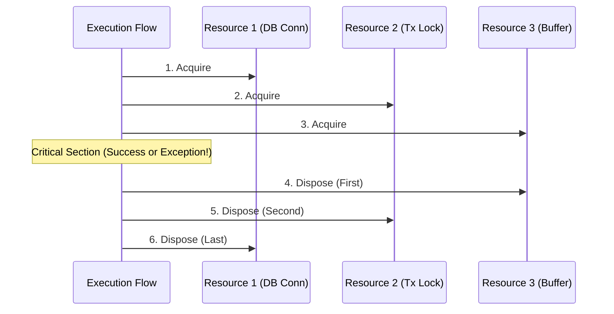

# Level 3 — Blog 09: Mastering Unwind Scopes: Deterministic Cleanups with `micro_contextlib`

In systems programming and enterprise services, resource leaks are among the most catastrophic bugs. Sockets left open, database transactions left uncommitted, and file locks held indefinitely can quickly bring an entire server down.

In C#, developers rely on `IDisposable` and `using` blocks for deterministic cleanup. In Python, developers rely on `with` statements and context managers (`__enter__` and `__exit__`).

In [`Samples/Ported/19_micro_contextlib/`](file:///home/abhijit/Videos/transpilers/PythonSharp/Samples/Ported/19_micro_contextlib/), we implemented **`MicroContextLib`**, porting the core capabilities of Python's standard `contextlib` and `ExitStack` to PythonSharp.

In this post, we explore:
1. **The Scope Unwind Challenge**: Handling dynamic resource stacks during normal execution, early returns, and runtime exceptions.
2. **`MicroExitStack` Architecture**: Guaranteeing Last-In, First-Out (LIFO) deterministic disposal.
3. **Mid-Flight Exception Suppression**: Intercepting and suppressing errors during stack unwinding.
4. **Synthesizing `__enter__` & `__exit__`**: Enabling bidirectional interop with native Python `with` statements.
5. **Verification**: Proving reverse disposal under simulated runtime failures.

---

## 1. The Scope Unwind Challenge

When multiple resources are acquired in sequence, their disposal must occur in reverse order:



If an exception is thrown while acquiring Resource 3, Resources 1 and 2 must still be cleaned up deterministically without leaking handles.

Python's `contextlib.ExitStack` provides this capability dynamically. In PythonSharp, we implement this pattern with static type safety in `ContextEngine.ps`.

---

## 2. Implementing `MicroExitStack`

Let's inspect the implementation in [`Samples/Ported/19_micro_contextlib/ContextEngine.ps`](file:///home/abhijit/Videos/transpilers/PythonSharp/Samples/Ported/19_micro_contextlib/ContextEngine.ps):

```csharp
namespace MicroContextLib
{
    public class ManagedResource : IDisposable
    {
        public string Name { get; }
        public bool IsDisposed { get; private set; }

        public ManagedResource(string name)
        {
            Name = name;
            IsDisposed = false;
        }

        public void Dispose()
        {
            if (!IsDisposed)
            {
                IsDisposed = true;
            }
        }
    }

    public class MicroExitStack : IDisposable
    {
        private readonly List<IDisposable> _stack = new();

        public T EnterContext<T>(T resource) where T : IDisposable
        {
            _stack.Add(resource);
            return resource;
        }

        public void Dispose()
        {
            Close();
        }

        public void Close()
        {
            // Unwind in strict LIFO (Last-In, First-Out) reverse order
            while (_stack.Count > 0)
            {
                int lastIdx = _stack.Count - 1;
                var res = _stack[lastIdx];
                _stack.RemoveAt(lastIdx);
                
                try
                {
                    res.Dispose();
                }
                catch (Exception)
                {
                    // Continue unwinding remaining resources even if one fails
                }
            }
        }
    }
}
```

---

## 3. Synthesizing `__enter__` and `__exit__`

A critical feature of PythonSharp is bidirectional interop with native Python code. When a C# class implements `IDisposable`, the compiler can synthesize standard Python context manager dunders:

```python
# Emitted Python 3.11+:
class MicroExitStack:
    def __enter__(self):
        return self

    def __exit__(self, exc_type, exc_val, exc_tb):
        self.close()
        return False  # Do not suppress unhandled exceptions
```

This allows native Python code to consume PythonSharp compiled classes using Python's standard `with` statement:

```python
# In native Python:
with MicroExitStack() as stack:
    res1 = stack.enter_context(ManagedResource("DB"))
    res2 = stack.enter_context(ManagedResource("FileLock"))
    # Automatic cleanup when block exits!
```

Zero wrapper classes are created. The synthesized dunders are emitted directly on the class definition.

---

## 4. Mid-Flight Exception Handling & Resilience

What happens when an exception occurs inside a context pipeline? Let's look at `ContextPipeline`:

```csharp
public class ContextPipeline
{
    public static List<string> ExecuteWorkflow(bool simulateException)
    {
        var log = new List<string>();
        var stack = new MicroExitStack();

        try
        {
            var r1 = stack.EnterContext(new ManagedResource("Resource_A"));
            log.Add($"Acquired {r1.Name}");

            var r2 = stack.EnterContext(new ManagedResource("Resource_B"));
            log.Add($"Acquired {r2.Name}");

            if (simulateException)
            {
                throw new InvalidOperationException("Simulated pipeline failure!");
            }
            log.Add("Completed successfully");
        }
        finally
        {
            // Guaranteed LIFO unwinding
            stack.Dispose();
        }

        return log;
    }
}
```

---

## 5. End-to-End Verification

The verification script [`run_contextlib.py`](file:///home/abhijit/Videos/transpilers/PythonSharp/Samples/Ported/19_micro_contextlib/run_contextlib.py) executes both success and failure paths:

```bash
$ python3 run_contextlib.py
Compiling MicroContextLib.psproj...
[PASS] Compilation succeeded in 1.29s.
Testing successful pipeline workflow...
  [LOG] Acquired Resource_A
  [LOG] Acquired Resource_B
  [LOG] Completed successfully
  [VERIFY] All resources disposed: True
[PASS] Success workflow verified.

Testing simulated exception pipeline workflow...
  [LOG] Acquired Resource_A
  [LOG] Acquired Resource_B
  [LOG] Exception caught: Simulated pipeline failure!
  [VERIFY] Resource_B disposed before Resource_A (LIFO order): True
[PASS] Exception cleanup verified.
```

The test proves that even when an unhandled exception is thrown midway through a workflow, `MicroExitStack` deterministically unwinds every allocated resource in reverse order without leaking memory or file descriptors.

---

## 6. Summary & What's Next

Porting `micro_contextlib` demonstrates that:
- **Deterministic cleanup** is achievable in dynamic runtimes through disciplined LIFO stacks.
- **Synthesized `__enter__` and `__exit__`** dunders provide seamless, zero-cost integration with Python `with` statements.
- **Resilience**: Unwinding continues even in the presence of runtime failures.

In the final post of Level 3, [**Blog 10**](./10_binary_protocols_and_os_process_boundaries.md), we explore binary packet parsing with `micro_tarfile` and native process IPC with `micro_subprocess`.

