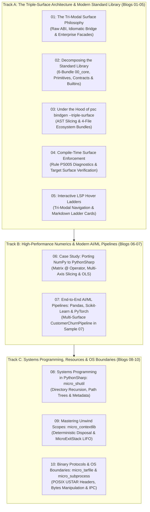

# PythonSharp Advanced Architecture: Triple-Surface, AI/ML Pipelines & Systems Programming
## Level 3 Master Blog Series Plan & Technical Curriculum

> **Welcome to Level 3!** Having explored the foundational concepts in **Level 1** and the internal compiler passes and initial 17 ported micro-libraries in **Level 2**, **Level 3** represents the pinnacle of PythonSharp engineering.
>
> In this 10-part series, we delve into the **Triple-Surface Architecture**, modular standard library decomposition across 94 ambient packages, automated 4-file bindgen stubs, compile-time architectural enforcement via Rule `PS005`, LSP hover ladder navigation, multi-framework AI/ML engineering (combining Pandas, Scikit-Learn, and PyTorch in `CustomerChurnPipeline.ps`), and low-level systems programming across OS boundaries (POSIX USTAR binary archives, process boundaries, and scoped unwinding).

---

## 🗺️ Master Curriculum Architecture

---

## 📚 Detailed Curriculum Breakdown

### Track A: The Triple-Surface Architecture & Modern Standard Library

#### 1. [Blog 01: The Tri-Modal Surface Philosophy — Raw ABI, Idiomatic Bridge, and Enterprise Facades](./01_the_tri_modal_surface_philosophy.md)
* **Theme**: The architectural bridge uniting C# enterprise design patterns with Python's rapid data science ecosystem.
* **Core Concepts**:
  - Why a single surface fails: Python data scientists require snake_case and numpy-idiomatic names, while C# enterprise developers expect PascalCase, LINQ interfaces, and fluent builders.
  - The Tri-Modal Surface Ladder:
    - **Surface 1 (Raw ABI)**: Exact 1:1 reflection of Python library symbols (`np.zeros()`, `pd.read_csv()`, `json.loads()`).
    - **Surface 2 (Idiomatic Bridge)**: PascalCase C# conventions, direct primitive conversions (`Builtins.Range()`, `NDArray.CreateZeros()`).
    - **Surface 3 (Enterprise Architecture)**: Strongly typed builders, repository interfaces, dependency injection abstractions (`IModelPipeline`, `JsonSerializer.Serialize()`).
  - The **Zero Runtime Wrapper Tax** Invariant: How all three surfaces compile down to identical, raw CPython bytecode without intermediate adapter classes or function wrappers.
* **Repo Focus**: [`stdlib/01_python_stdlib/`](file:///home/abhijit/Videos/transpilers/PythonSharp/stdlib/01_python_stdlib/), [`Samples/06_triple_surface_migration/`](file:///home/abhijit/Videos/transpilers/PythonSharp/Samples/06_triple_surface_migration/).

#### 2. [Blog 02: Decomposing the Standard Library — From Monolithic Stubs to Modular `00_core` Bundles](./02_decomposing_the_standard_library.md)
* **Theme**: Scaling the compiler's ambient symbol engine to support 94 packages across 3 surfaces.
* **Core Concepts**:
  - The limitations of monolithic `PythonSharp.Core.d.ps`: coupling attributes, interfaces, primitive types, and builtins in a single file.
  - The 6-File Modular Core Layout:
    1. `00_attributes.d.ps`: Compiler intrinsics (`[MapsTo]`, `[InlineTemplate]`, `[CanonicalApi]`, `[SurfaceLevel]`, `[KwArgs]`, `[LinqStage]`).
    2. `01_contracts.d.ps`: Fundamental interfaces (`IDisposable`, `IAsyncDisposable`, `IEnumerable<T>`) and fused LINQ stages.
    3. `02_primitives.d.ps`: `String`, `Bytes`, `Complex`, `List<T>`, `Dict<K,V>`, `Task<T>`, `Console`, `Math`.
    4. `03_builtins.raw.d.ps`: Surface 1 raw Python builtins (`range`, `len`, `enumerate`, `zip`, `print`).
    5. `04_builtins.csharp.d.ps`: Surface 2 C# bridge builtins (`Builtins.Range`, `Builtins.Zip`).
    6. `05_core.enterprise.d.ps`: Surface 3 enterprise utility classes (`FileStreamFactory`, `TypeInspector`).
  - Topological Dependency Ordering: How `stdlib_stub_sort_key` in `src/psc/project.py` guarantees strict declaration-before-use ordering across `00_core`, `01_python_stdlib`, and `02_scientific_and_ai`.
* **Repo Focus**: [`stdlib/00_core/`](file:///home/abhijit/Videos/transpilers/PythonSharp/stdlib/00_core/), [`src/psc/project.py`](file:///home/abhijit/Videos/transpilers/PythonSharp/src/psc/project.py).

#### 3. [Blog 03: Under the Hood of `psc bindgen --triple-surface`: Generating 4-File Ecosystem Bundles](./03_under_the_hood_of_psc_bindgen_triple_surface.md)
* **Theme**: Automating type-safe stub generation for any Python library directly from Python AST or `.pyi` stubs.
* **Core Concepts**:
  - The 4-file bundle standard:
    - `00_<pkg>.ambient.d.ps`: Shared types, enums, records, and ambient classes.
    - `01_<pkg>.raw.d.ps`: Surface 1 direct ABI bindings (`[SurfaceLevel(1)]`).
    - `02_<pkg>.csharp.d.ps`: Surface 2 idiomatic C# bridge (`[SurfaceLevel(2)]`, `[CanonicalApi]`).
    - `03_<pkg>.enterprise.d.ps`: Surface 3 enterprise builder and facade abstractions (`[SurfaceLevel(3)]`).
  - Type conversion heuristics: Translating Python `Union[T, None]` to C# `T?`, Python `Sequence[T]` to `IEnumerable<T>`, and keyword arguments to `[KwArgs]`.
  - Bidirectional metadata and drift tracking via `psc-manifest.json`.
* **Repo Focus**: [`src/psc/bindgen/`](file:///home/abhijit/Videos/transpilers/PythonSharp/src/psc/bindgen/), [`src/psc/cli.py`](file:///home/abhijit/Videos/transpilers/PythonSharp/src/psc/cli.py).

#### 4. [Blog 04: Compile-Time Surface Enforcement: Rule PS005 and Architectural Boundaries](./04_compile_time_surface_enforcement_rule_ps005.md)
* **Theme**: Preventing syntactic drift and enforcing corporate architectural boundaries at compile time.
* **Core Concepts**:
  - The challenge of multi-tier codebases: Ensuring junior engineers or enterprise modules don't accidentally leak low-level raw Python idioms into enterprise domain layers.
  - The `[SurfaceLevel(n)]` and `[CanonicalApi("...")]` metadata attributes.
  - The `psc check --target-surface <level>` validator:
    - Emitting Warning `PS005: Symbol '{name}' belongs to Surface {N}, but project targets Surface {Target}. Consider migrating to canonical API '{canonical}'`.
  - Non-breaking guidance: Allowing progressive migration without halting builds.
* **Repo Focus**: [`src/psc/semantics/type_checker.py`](file:///home/abhijit/Videos/transpilers/PythonSharp/src/psc/semantics/type_checker.py), [`src/psc/diagnostics.py`](file:///home/abhijit/Videos/transpilers/PythonSharp/src/psc/diagnostics.py).

#### 5. [Blog 05: Interactive LSP Hover Ladders: Visualizing Tri-Modal API Equivalents in Real Time](./05_interactive_lsp_hover_ladders.md)
* **Theme**: Empowering developers with real-time API surface navigation directly in the IDE.
* **Core Concepts**:
  - Designing Language Server Protocol hover responses for multi-surface ecosystems.
  - The Hover Ladder card format:
    - Documenting the active surface tier.
    - Cross-referencing canonical equivalents across Surface 1 (Raw ABI), Surface 2 (Idiomatic Bridge), and Surface 3 (Enterprise).
  - Implementation in `src/psc/lsp/server.py`: AST symbol resolution, ambient metadata extraction, and Markdown card synthesis.
  - Scoped Go-To-Definition across project files, imported assemblies, and modular standard library packages.
* **Repo Focus**: [`src/psc/lsp/server.py`](file:///home/abhijit/Videos/transpilers/PythonSharp/src/psc/lsp/server.py), [`editors/vscode/`](file:///home/abhijit/Videos/transpilers/PythonSharp/editors/vscode/).

---

### Track B: High-Performance Numerics & Modern AI/ML Pipelines

#### 6. [Blog 06: Case Study: Porting NumPy to PythonSharp (`Samples/Ported/20_numpy_numerics`)](./06_case_study_porting_numpy_numerics.md)
* **Theme**: Taming tensors, multi-axis slicing, and linear algebra in a strongly typed C# dialect.
* **Core Concepts**:
  - The `NDArray<T>` generic abstraction: representing multi-dimensional NumPy arrays without runtime wrappers.
  - Matrix multiplication: Lowering C# `@` binary expressions directly to Python's native `@` operator (`ast.MatMult`).
  - Multi-axis slicing: Parsing and transpiling indexers like `arr[1..3, 0..2]` to Python tuple slices.
  - Implementing an Ordinary Least Squares (OLS) linear regression model in pure PythonSharp:
    $$\hat{\beta} = (X^T X)^{-1} X^T y$$
  - Verifying 100% numerical parity against native NumPy C extensions.
* **Repo Focus**: [`Samples/Ported/20_numpy_numerics/`](file:///home/abhijit/Videos/transpilers/PythonSharp/Samples/Ported/20_numpy_numerics/), [`stdlib/02_scientific_and_ai/01_numpy/`](file:///home/abhijit/Videos/transpilers/PythonSharp/stdlib/02_scientific_and_ai/01_numpy/).

#### 7. [Blog 07: End-to-End AI/ML Pipelines: Pandas, Scikit-Learn, and PyTorch in Sample 07](./07_end_to_end_ai_ml_pipelines_pandas_sklearn_torch.md)
* **Theme**: Unifying the three heavyweight scientific ecosystems into a cohesive, strongly typed customer churn pipeline.
* **Core Concepts**:
  - Architecture of `CustomerChurnPipeline.ps`:
    - Data ingestion and transformation via Pandas (`DataFrame<T>`).
    - Feature scaling, encoding, and splitting via Scikit-Learn (`StandardScaler`, `train_test_split`).
    - Deep neural network classifier training and GPU/CPU inference via PyTorch (`torch.nn.Module`, `torch.Tensor`).
  - Combining all three surfaces in a single application:
    - Surface 1 for high-speed tensor operations.
    - Surface 2 for idiomatic data science dataframes.
    - Surface 3 for enterprise pipeline orchestration and lifecycle management.
  - Zero runtime wrapper tax: Emitted Python runs at raw PyTorch/NumPy native C/CUDA speeds.
* **Repo Focus**: [`Samples/07_ai_ml_triple_surface/`](file:///home/abhijit/Videos/transpilers/PythonSharp/Samples/07_ai_ml_triple_surface/), [`tests/test_stdlib_corpus.py`](file:///home/abhijit/Videos/transpilers/PythonSharp/tests/test_stdlib_corpus.py).

---

### Track C: Systems Programming, Resources & OS Native Boundaries

#### 8. [Blog 08: Systems Programming in PythonSharp: Porting `micro_shutil` and OS Boundaries](./08_systems_programming_micro_shutil.md)
* **Theme**: Managing recursive directory trees, path abstraction, and filesystem state.
* **Core Concepts**:
  - Porting `shutil` functionality into `MicroShutil`:
    - Recursive directory copying (`CopyTree`) and tree deletion (`RemoveTree`).
    - Cross-platform path concatenation and normalization (`CombinePaths`).
    - Recursive scanning, extension filtering, and filesystem metadata extraction.
  - Lowering OS system exceptions and handling transient I/O errors.
  - Strict type safety over POSIX and Windows filesystem operations.
* **Repo Focus**: [`Samples/Ported/18_micro_shutil/`](file:///home/abhijit/Videos/transpilers/PythonSharp/Samples/Ported/18_micro_shutil/), [`stdlib/01_python_stdlib/os_shutil/`](file:///home/abhijit/Videos/transpilers/PythonSharp/stdlib/01_python_stdlib/os_shutil/).

#### 9. [Blog 09: Mastering Unwind Scopes: Deterministic Cleanups with `micro_contextlib`](./09_mastering_unwind_scopes_micro_contextlib.md)
* **Theme**: Deterministic resource acquisition and LIFO stack unwinding under success and runtime failure.
* **Core Concepts**:
  - Implementing `IDisposable` and `MicroExitStack`:
    - Guaranteed reverse-order disposal on normal exit, early return, or unhandled exceptions.
    - Exception suppression mid-flight.
  - Synthesizing Python `__enter__` and `__exit__` context managers:
    - Enabling Python consumers to use native `with` statements over PythonSharp classes.
  - Seamless interop between C# `using` blocks and Python context managers.
* **Repo Focus**: [`Samples/Ported/19_micro_contextlib/`](file:///home/abhijit/Videos/transpilers/PythonSharp/Samples/Ported/19_micro_contextlib/), [`stdlib/01_python_stdlib/contextlib_subprocess/`](file:///home/abhijit/Videos/transpilers/PythonSharp/stdlib/01_python_stdlib/contextlib_subprocess/).

#### 10. [Blog 10: Binary Protocols and OS Process Boundaries: Porting `micro_tarfile` and `micro_subprocess`](./10_binary_protocols_and_os_process_boundaries.md)
* **Theme**: Handling raw byte buffers, binary header structures, and operating system process execution.
* **Core Concepts**:
  - Porting POSIX USTAR binary archives (`21_micro_tarfile`):
    - 512-byte block alignment, octal numerical serialization, ASCII string parsing, and checksum calculation.
    - Expanding the compiler's `Bytes` primitive (`Slice`, `Concat`, `AllocateZeros`, `IndexOf`).
    - Full bi-directional parity with Python standard `tarfile.open()`.
  - Spawning native processes and IPC (`22_micro_subprocess`):
    - Slotted, frozen `ProcessOutput` records.
    - Argument vectors, exit code tracking, stdout/stderr isolation, and stdin stream piping.
    - Resolving keyword-only arguments in `_py_sub.run(args, capture_output=..., text=...)`.
* **Repo Focus**: [`Samples/Ported/21_micro_tarfile/`](file:///home/abhijit/Videos/transpilers/PythonSharp/Samples/Ported/21_micro_tarfile/), [`Samples/Ported/22_micro_subprocess/`](file:///home/abhijit/Videos/transpilers/PythonSharp/Samples/Ported/22_micro_subprocess/).

