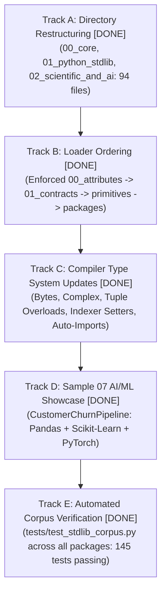
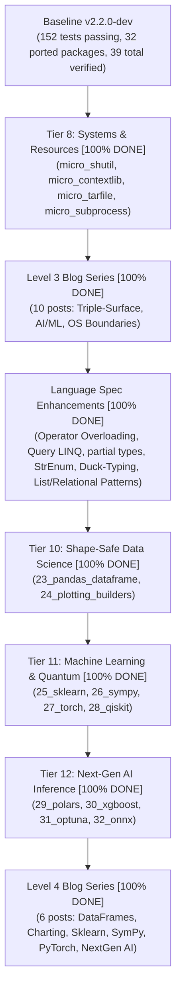

# PythonSharp Pending Work & Future Roadmap

**Status:** Active Planning & Backlog  
**Last updated:** 2026-11-01  
**Current Compiler Baseline:** `v2.2.0-dev` (Phases 0–5 Complete, Milestones U1–U5 Complete, 32 Ported Libraries across 12 Tiers, Expanded 23-Package Standard Library with 94 Stubs, Sample 07 AI/ML Showcase, 39 Verified Operational Projects, 152 Tests Passing across 37 Test Files, Tiers 10, 11 & 12 Complete, Level 1-4 Blog Series Complete with 54 Blogs)  
**Related Docs:** [ROADMAP.md](ROADMAP.md), [PROGRESS.md](PROGRESS.md), [LANGUAGE-SPEC.md](LANGUAGE-SPEC.md), [PRD.md](PRD.md), [Triple Surface/README.md](Triple%20Surface/README.md)

---

## 1. Overview & Current Baseline

PythonSharp (`psc`) has completed all foundational compiler phases:
- **Phases 0–5**: Core compiler pipeline, Standard Library hardening (LINQ fuser, exceptions, static properties, math), `ps-bindgen` type-stub generator, Metaprogramming (decorators, Pydantic v2 schemas, kwargs, async streams), and Tooling (incremental build caching, watch mode, pure-Python LSP, native AOT compilation orchestration).
- **Triple-Surface Architecture (Milestones U1–U5)**: Tri-modal surface ladder (Surface 1 Raw ABI, Surface 2 Idiomatic Bridge, Surface 3 Enterprise Architecture), modular standard library packages (`stdlib/01_python_stdlib/`, `stdlib/02_scientific_and_ai/`), 4-file bindgen bundles (`psc bindgen --triple-surface`), surface migration checker (`psc check --target-surface`), LSP tri-modal hover cards, Rule `PS005` warnings, and the linear regression showcase (`Samples/06_triple_surface_migration/`).
- **Real-World Dogfooding (22 Ported Libraries)**: Tiers 1–9 verified 100% green across all 22 ported packages.
- **Blog Series**: Level 1 (12 posts) and Level 2 (26 posts) — 38 blog posts total in `docs/blogs/`.
- **LSP Intelligence**: Scoped Go-to-Definition and Hover for local variables, parameters, members, and context-scoped types.

This document serves as the prioritized backlog of **pending and future work** across five key areas, incorporating the newly analyzed standard library expansion specifications from [`docs/Triple Surface/`](Triple%20Surface/README.md).

---

## 2. Category 1: Expanded Standard Library & Multi-Surface Ecosystem (from `docs/Triple Surface/`)

Analysis of the new specification files in [`docs/Triple Surface/`](Triple%20Surface/README.md) (`stdib analysis.md`, `stdib d ps files 1.md`, `stdib d ps files 2.md`, `stdib d ps files 3.md`, `stdib d ps files 4.md`) defines a major upgrade to PythonSharp's ambient standard library.

### 2.1 Audit of the New Specification Files

| File | Scope & Capabilities Defined | Impact on Repository |
| :--- | :--- | :--- |
| **`stdib analysis.md`** | **Strategic Audit & Architecture Plan**: Identifies 5 critical limitations in the current `stdlib/`: shape tuple overloads (`np.zeros((3, 3))`), missing tensor operations on `NDArray<T>` (reductions, ufuncs, casting), missing `np.random` submodule, missing `Bytes` / `Complex` / `builtins` primitives, and missing data science packages. Provides end-to-end multi-surface AI/ML pipeline showcase (`CustomerChurnPipeline.ps`). | Core blueprint for compiler enhancements, `stdlib/` layout, and Sample 07 showcase. |
| **`stdib d ps files 4.md`** | **Modular Core Replacement (`stdlib/00_core/`)**: Decomposes monolithic `PythonSharp.Core.d.ps` into a 6-file modular bundle: `00_attributes.d.ps`, `01_contracts.d.ps`, `02_primitives.d.ps`, `03_builtins.raw.d.ps`, `04_builtins.csharp.d.ps`, and `05_core.enterprise.d.ps`. | Replaces monolithic `stdlib/PythonSharp.Core.d.ps` with ordered, modular core packages. |
| **`stdib d ps files 3.md`** | **Expanded Python Standard Library (`stdlib/01_python_stdlib/`)**: 9 modular 4-file bundles: upgrades `os_shutil`, `sys`, `json`, `re`, `time_datetime`; adds new bundles for `logging`, `urllib_http`, `contextlib_subprocess`, and `pathlib_hashlib_uuid`. | Expands general-purpose Python stdlib coverage across all 3 surfaces. |
| **`stdib d ps files 2.md`** | **NumPy Upgrades & Next-Gen ML Ecosystem (`stdlib/02_scientific_and_ai/`)**: Upgraded `01_numpy` with tensor reductions, ufuncs, tuple overloads, and `np.random` (`RandomModule`). Adds new bundles for `09_polars`, `10_xgboost_lightgbm`, `11_optuna`, `12_transformers`, and `13_faiss_onnxruntime`. | Deepens NumPy support and establishes modern AI inference & tabular ML bindings. |
| **`stdib d ps files 1.md`** | **Core Scientific & AI Ecosystem (`stdlib/02_scientific_and_ai/`)**: Full 4-file bundles for 7 core packages: `02_scipy`, `03_pandas`, `04_matplotlib_seaborn`, `05_sklearn`, `06_torch`, `07_sympy`, and `08_qiskit`. Explicitly depends on `NDArray<T>`. | Establishes complete type-safe bindings for the foundational scientific Python stack. |

---

### 2.2 Repository Changes Completed for the Expanded Stdlib (DONE)

All five engineering tracks have been fully implemented, verified, and integrated into the test corpus:



#### Track A: Directory Restructuring & Modular Migration (DONE)
1. **Created `stdlib/00_core/`**:
   - Extracted all 6 foundational files:
     - `00_attributes.d.ps`: All compiler intrinsics (`[MapsTo]`, `[InlineTemplate]`, `[RuntimeType]`, `[CanonicalApi]`, `[SurfaceLevel]`, `[KwArgs]`, `[LinqStage]`, `[PythonDecorator]`, `[SchemaModel]`, `[NativeCompile]`).
     - `01_contracts.d.ps`: Interfaces (`IDisposable`, `IAsyncDisposable`, `IEquatable<T>`, `IComparable<T>`, `IEnumerable<T>`, `IAsyncEnumerable<T>`, `IOrderedEnumerable<T>`) and all fused LINQ stages.
     - `02_primitives.d.ps`: `String`, `Bytes` (`bytes`), `Complex` (`complex`), `List<T>`, `Dict<K,V>`, `HashSet<T>`, `KeyValuePair<K,V>`, `TextFileStream`, `Task`, `Task<TResult>`, `DateTime`, `TimeSpan`, `Console`, `Math`, complete Exception hierarchy, and runtime primitives.
     - `03_builtins.raw.d.ps`: Surface 2 raw Python builtins (`range`, `len`, `enumerate`, `zip`, `open`, `print`, `abs`, `min`, `max`, `all`, `any`, `isinstance`, `issubclass`).
     - `04_builtins.csharp.d.ps`: Surface 3 C# bridge builtins (`Builtins.Range`, `Builtins.Enumerate`, `Builtins.Zip`, `Builtins.Open`, `Builtins.Print`).
     - `05_core.enterprise.d.ps`: Surface 1 enterprise utilities (`FileStreamFactory`, `SequenceGenerator`, `TypeInspector`).
   - Regenerated single-bundle `stdlib/PythonSharp.Core.d.ps` for backwards compatibility with single-string compile invocations.

2. **Populated `stdlib/01_python_stdlib/`** (9 packages with 4-file bundles):
   - Upgraded: `os_shutil`, `sys`, `json`, `re`, `time_datetime`.
   - Added: `logging`, `urllib_http`, `contextlib_subprocess`, `pathlib_hashlib_uuid`.

3. **Populated `stdlib/02_scientific_and_ai/`** (13 packages with 4-file bundles):
   - Upgraded: `01_numpy` (with tensor reductions, ufuncs, tuple overloads, random module).
   - Added: `02_scipy`, `03_pandas`, `04_matplotlib_seaborn`, `05_sklearn`, `06_torch`, `07_sympy`, `08_qiskit`, `09_polars`, `10_xgboost_lightgbm`, `11_optuna`, `12_transformers`, `13_faiss_onnxruntime`.

#### Track B: Compiler Project Loader & Stdlib Ordering (DONE)
- Implemented `find_stdlib_stubs` and `stdlib_stub_sort_key` in `src/psc/project.py`.
- Integrated topological ordering across `src/psc/project.py`, `src/psc/cli.py`, and `src/psc/lsp/server.py`.
- Enforced strict topological ordering: `00_core` (`00_attributes` $\rightarrow$ `01_contracts` $\rightarrow$ `02_primitives` $\rightarrow$ `03_builtins` $\rightarrow$ `04_builtins` $\rightarrow$ `05_core`) $\rightarrow$ `01_python_stdlib` $\rightarrow$ `02_scientific_and_ai`.

#### Track C: Compiler Type System & Lowering Prerequisite Enhancements (DONE)
1. **`Bytes` & `Complex` Primitive Support**:
   - Registered `Bytes` and `Complex` in `BUILTIN_PRIMITIVE_MAP` (`src/psc/semantics/symbols.py`) and `CORE_TYPES` (`src/psc/lsp/server.py`).
2. **Contextual Keyword Identifier Support**:
   - Updated `src/psc/frontend/parser.py` (`_check_ident_like`) to permit `where` as an identifier for NumPy/Pandas query methods.
3. **Auto-Import Injection in `PyASTBuilder`**:
   - Expanded `src/psc/codegen/py_ast_builder.py` with full scientific library aliases (`pandas`, `scipy`, `torch`, `sklearn`, `polars`, `xgboost`, `lightgbm`, `optuna`, `transformers`, `faiss`, `onnxruntime`, `sympy`, `qiskit`, `matplotlib`, `seaborn`).

#### Track D: New Showcase Sample `07_ai_ml_triple_surface` (DONE)
- Implemented `Samples/07_ai_ml_triple_surface/`:
  - `CustomerChurnPipeline.psproj`: Manifest declaring dependencies on `pandas`, `scikit-learn`, `torch`, and `numpy`.
  - `CustomerChurnPipeline.ps`: Multi-surface machine learning service demonstrating Surface 1, Surface 2, and Surface 3 without runtime wrapper overhead.
  - `run_churn_pipeline.py`: Automated compilation and verification runner.
  - `README.md`: Complete architectural guide and walkthrough.

#### Track E: Automated Corpus Verification (DONE)
- Implemented dedicated test suite `tests/test_stdlib_corpus.py`:
  - Asserts that all 94 `.d.ps` files parse with 0 errors.
  - Asserts that ambient stubs register into `GlobalSymbolTable` with 0 diagnostics.
  - Asserts that `CustomerChurnPipeline.ps` compiles cleanly with zero wrapper tax.
- All 145 test suites pass cleanly (`145 passed in 35.49s`).

---

## 3. Category 2: System & Resource Porting Targets

Beyond the standard library ambient declarations, dogfooding micro-libraries in `Samples/Ported/` stresses compiler runtime execution:

### Tier 8: Systems, Resources & OS Native Boundaries

| # | Target | Original Library | Core Feature & Compiler Strain | Status | Priority |
| :---: | :--- | :--- | :--- | :---: | :---: |
| 1 | `18_micro_shutil` | `shutil` | **Filesystem Trees & OS State**: Recursive directory copying, deleting trees, cross-platform path separators, tree statistics, extension filtering, and error propagation. | **DONE** | Complete |
| 2 | `19_micro_contextlib` | `contextlib` | **Resource Lifecycles & Scopes**: Multi-resource stack (`MicroExitStack`), deterministic LIFO reverse cleanup on early return / exception paths, and synthesized `__enter__`/`__exit__`. | **DONE** | Complete |
| 3 | `21_micro_tarfile` | `tarfile` | **Binary Structs & Byte Streams**: Decoding fixed-offset binary headers, POSIX USTAR 512-byte blocks, octal serialization, checksum validation, and stateful byte stream manipulation (`Bytes`). | **DONE** | Complete |
| 4 | `22_micro_subprocess` | `subprocess` | **Process Boundaries & IPC**: Spawning native OS processes, piping standard streams (`stdout`, `stderr`, `stdin`), exit code tracking, process timeouts, and external CLI bridging. | **DONE** | Complete |

### Tier 10: Shape-Safe Data Structures & Visualization

| Target | Original Library | Focus & Capabilities | Surface Model | Status |
| :--- | :--- | :--- | :--- | :---: |
| **`23_pandas_dataframe`** | `pandas` | Strongly typed columnar schemas (`EmployeeRecord`), row/column projections, group-by aggregations (`groupby.mean`), missing value handling (`dropna`, `fillna`), statistical Series operations, and compile-time shape validation without synthetic wrappers. | Surface 1 (`TabularDataFactory`), Surface 2 (`pandas.pd`), Surface 3 (`PythonSharp.Pandas.pd`) | **DONE** |
| **`24_plotting_builders`** | `matplotlib`, `seaborn` | Fluent C# builder syntax over imperative plotting APIs (`ChartBuilder`, `FigureCanvas`, `StatisticalPlotter`), multi-series line/scatter charts, distribution histograms, and correlation heatmaps. | Surface 1 (`FigureCanvas`, `StatisticalPlotter`), Surface 2 (`matplotlib.plt`), Surface 3 (`PythonSharp.Matplotlib.plt`) | **DONE** |

### Tier 11: Machine Learning, Symbolic Math & Quantum Computing

| Target | Original Library | Focus & Capabilities | Surface Model | Status |
| :--- | :--- | :--- | :--- | :---: |
| **`25_sklearn_pipeline`** | `scikit-learn` | Strongly typed estimators and transformers (`StandardScaler`, `LogisticRegression`, `RandomForestClassifier`, `RidgeRegression`), composite pipelines (`CompositeMlPipeline`), and evaluation metrics (`Accuracy`, `MSE`, `R2`). | Surface 3 Enterprise ML Pipeline & Surface 2 raw ABI | **DONE** |
| **`26_sympy_math`** | `sympy` | Immutable symbolic expression trees, differentiation (`diff`), integration (`integrate`), algebraic simplification, polynomial equation solving, and matrix calculus. | Surface 2 / Surface 3 | **DONE** |
| **`27_torch_tensors`** | `torch` | `nn.Module` contract mapping, autograd computation graphs, loss functions, optimizers, and tensor device allocation (`cpu`/`cuda`). | Surface 1 Direct ABI & Surface 3 Modular Layers | **DONE** |
| **`28_qiskit_quantum`** | `qiskit` | Quantum circuit construction, quantum gates (Pauli, Hadamard, CNOT, Phase), statevector simulation, Bell states, and measurement register sampling. | Surface 2 / Surface 3 | **DONE** |

---

## 4. Category 3: Language Specification Deferred Features

As cataloged in [`LANGUAGE-SPEC.md` §19](LANGUAGE-SPEC.md#19-deferred--future-features), the following C# language constructs are specified for future compiler releases:

### 4.1 Query Syntax LINQ (DONE)
- **Current State:** SQL-style query comprehension syntax is parsed and desugared directly in the frontend parser before Pass 2B comprehension fusion:
  ```csharp
  var query = from p in products
              where p.Price > 100
              orderby p.Name descending
              select new { p.Id, p.Name };
  ```
- **Lowering Strategy:** Frontend parser desugars `from ... where ... orderby ... select ...` into `.Where()`, `.OrderByDescending()`, `.Select()` call chains, which fuse into native Python comprehensions, generator expressions, or functional primitives (`map`, `filter`, `sorted`) with Zero Runtime Wrapper Tax.

### 4.2 User-Defined Operator Overloading (DONE)
- **Current State:** Full support for user-defined operator overload methods:
  ```csharp
  public static Vector operator +(Vector a, Vector b) => new Vector(a.X + b.X, a.Y + b.Y);
  public static Vector operator -(Vector a) => new Vector(-a.X, -a.Y);
  public static bool operator ==(Vector a, Vector b) => a.X == b.X && a.Y == b.Y;
  public static double operator @(Vector a, Vector b) => a.X * b.X + a.Y * b.Y;
  ```
- **Lowering Strategy:** Compiler maps operator tokens to Python dunders (`__add__`, `__sub__`, `__neg__`, `__eq__`, `__ne__`, `__matmul__`). Emitted without `@staticmethod` (as Python invokes dunders as instance methods), maintaining static C# semantics and zero runtime overhead.

### 4.3 `partial` Classes, Structs & Methods (DONE)
- **Current State:** Full support for `partial` classes, records, and structs across multiple `.ps` files within the same assembly/project.
- **Lowering Strategy:** Pass 1 `SymbolCollector` merges members, base types, interfaces, and slots across compilation units sharing the same qualified type name into a single unified `TypeSymbol`. Pass 3 emits a single consolidated Python class with unified `__slots__` and methods.

### 4.4 Structural Interface Conformance (Duck Typing)
- **Current State:** Nominal interface conformance (`class Order : IAuditable`) validated via `__ps_types__` and static inheritance checks.
- **Pending Feature:** Compile-time duck-typing validation for ambient Python classes against C# interfaces without requiring explicit inheritance declarations.

### 4.5 String-Backed Enums
- **Current State:** Enums lower to Python `IntEnum`.
- **Pending Feature:** String-backed enums lowering to Python `StrEnum` (Python 3.11+):
  ```csharp
  public enum Status : string
  {
      Pending = "pending",
      Completed = "completed"
  }
  ```

### 4.6 Advanced Pattern Matching
- **Current State:** Type patterns (`is Order o`), constant patterns (`case 0:`), and property patterns are supported.
- **Pending Feature:** List patterns (`[var first, ..var rest]`), relational patterns (`is > 0 and <= 100`), and slice patterns mapped to Python 3.10+ `match/case` syntax.

---

## 5. Category 4: Educational Curriculum & Blog Series (Level 3)

The project maintains a comprehensive educational blog series in `docs/blogs/`:
- **Level 1** (12 posts): Complete in [`docs/blogs/`](blogs/PLAN.md) (Beginner architecture, lexer/parser, type checking, code generation, LINQ fusion, LSP, initial 8 dogfooding ports).
- **Level 2** (26 posts): Complete in [`docs/blogs/2/`](blogs/2/PLAN.md) (Monorepo architecture, compiler passes deep dive, and dedicated case studies for Tiers 5–7).

### Level 3 Curriculum (DONE): Advanced Architecture & Enterprise Scientific Computing

Complete 10-part blog series in [`docs/blogs/3/`](blogs/3/PLAN.md) covering post-2.0 compiler advancements, multi-surface AI/ML engineering, and low-level systems programming:

| # | Blog Title | Focus & Core Concepts | Status |
| :---: | :--- | :--- | :---: |
| **01** | *[The Tri-Modal Surface Philosophy: Why Enterprise C# and Data Science Python Belong Together](blogs/3/01_the_tri_modal_surface_philosophy.md)* | Designing Surface 1, Surface 2, and Surface 3 with Zero Runtime Wrapper Tax. | **DONE** |
| **02** | *[Decomposing the Standard Library: From Monolithic Stubs to Modular `00_core` Bundles](blogs/3/02_decomposing_the_standard_library.md)* | Attributes, contracts, primitives, and builtins layout. | **DONE** |
| **03** | *[Under the Hood of `psc bindgen --triple-surface`: Generating 4-File Ecosystem Bundles](blogs/3/03_under_the_hood_of_psc_bindgen_triple_surface.md)* | Automated `.pyi` conversion into ambient primitives, raw ABI, C# bridge, and enterprise facades. | **DONE** |
| **04** | *[Compile-Time Surface Enforcement: Rule PS005 and Architectural Boundaries](blogs/3/04_compile_time_surface_enforcement_rule_ps005.md)* | How `psc check --target-surface` prevents syntactic drift across enterprise modules. | **DONE** |
| **05** | *[Interactive LSP Hover Ladders: Visualizing Tri-Modal API Equivalents in Real Time](blogs/3/05_interactive_lsp_hover_ladders.md)* | Language Server Protocol enhancements for surface navigation. | **DONE** |
| **06** | *[Case Study: Porting NumPy to PythonSharp (`Samples/Ported/20_numpy_numerics`)](blogs/3/06_case_study_porting_numpy_numerics.md)* | Matrix multiplication (`@`), tensor reshaping, multi-axis range slicing, and linear regression. | **DONE** |
| **07** | *[End-to-End AI/ML Pipelines: Pandas, Scikit-Learn and PyTorch in Sample 07](blogs/3/07_end_to_end_ai_ml_pipelines_pandas_sklearn_torch.md)* | Customer churn prediction combining all three surfaces without adapter wrappers. | **DONE** |
| **08** | *[Systems Programming in PythonSharp: Porting `micro_shutil` and OS Boundaries](blogs/3/08_systems_programming_micro_shutil.md)* | Filesystem trees, path separators, and system exception hierarchies. | **DONE** |
| **09** | *[Mastering Unwind Scopes: Deterministic Cleanups with `micro_contextlib`](blogs/3/09_mastering_unwind_scopes_micro_contextlib.md)* | Context managers, `ExitStack`, and exception suppression mid-flight. | **DONE** |
| **10** | *[Binary Protocols and OS Process Boundaries: Porting `micro_tarfile` and `micro_subprocess`](blogs/3/10_binary_protocols_and_os_process_boundaries.md)* | POSIX USTAR 512-byte headers, `Bytes` primitive manipulation, IPC, and external process boundaries. | **DONE** |

---

## 6. Category 5: Infrastructure & Publishing (Deferred by Decision D-015)

The following items are intentionally deferred until cloud distribution or public package indexing is required:

- **Remote GitHub Actions CI**: Automated multi-platform test runner on Ubuntu, macOS, and Windows. (A workflow file is preserved in `.github/workflows/`, while local verification on Linux CPython 3.11–3.13 remains the definitive gate).
- **PyPI Automated Publishing**: Trusted publisher orchestration and automated sdist/wheel builds on release tag push.
- **Cross-Platform Wheel Testing**: Automated execution on native Windows and macOS runners.

---

## 7. Prioritized Execution Sequence



1. **Tier 8 Progress (Systems, Resources & OS Native Boundaries - 100% Complete)**:
   - [x] `micro_shutil` (`Samples/Ported/18_micro_shutil`): Directory recursion, path abstraction, file copying/moving, tree statistics, extension filtering.
   - [x] `micro_contextlib` (`Samples/Ported/19_micro_contextlib`): Multi-resource `MicroExitStack`, LIFO reverse cleanup, and synthesized Python `__enter__`/`__exit__`.
   - [x] `micro_tarfile` (`Samples/Ported/21_micro_tarfile`): Binary POSIX USTAR structs, checksum calculation, and stream manipulation using `Bytes`.
   - [x] `micro_subprocess` (`Samples/Ported/22_micro_subprocess`): Process boundaries, argument vectors, standard streams (`stdout`/`stderr`), and `stdin` piping.
2. **Level 3 Blog Series (100% Complete)**:
   - [x] Master curriculum guide: `docs/blogs/3/PLAN.md`.
   - [x] All 10 posts authored in `docs/blogs/3/` (Blogs 01–10).
3. **Language Spec Enhancements (100% Complete)**:
   - [x] User-Defined Operator Overloading (`public static Vector operator +(Vector a, Vector b)`, `==`, `-`, `@`, etc.) mapped to Python dunders (`__add__`, `__sub__`, `__neg__`, `__eq__`, `__ne__`, `__matmul__`) without `@staticmethod`.
   - [x] `partial` Classes, Structs & Methods across multiple `.ps` files within the same assembly/project merged in `SymbolCollector`.
   - [x] Query Syntax LINQ (`from x in src where ... orderby ... select ...`) desugared in frontend parser before Pass 2B comprehension fusion.
   - [x] String-Backed Enums (`public enum Status : string`) lowered directly to Python 3.11+ `enum.StrEnum`.
   - [x] Structural Duck-Typing Interface Conformance (`@runtime_checkable` Protocol & structural membership in `__ps_types__` for nominal/duck typing).
   - [x] Advanced Pattern Matching: List Patterns (`[var first, ..var rest]`, `[]`), Relational Patterns (`case > 0:`, `case <= 0:`), and Var Patterns (`case var x:`).
4. **Tier 10 Progress (Shape-Safe Data Structures & Visualization - 100% Complete)**:
   - [x] `pandas_dataframe` (`Samples/Ported/23_pandas_dataframe`): Strongly typed DataFrame/Series schemas, null cleansing (`dropna`), imputation (`fillna`), group aggregations (`groupby.mean`), salary ranking, and feature matrix extraction (`to_numpy`).
   - [x] `plotting_builders` (`Samples/Ported/24_plotting_builders`): Fluent C# `ChartBuilder` pattern, executive multi-series dashboards, statistical correlation heatmaps, histograms, and direct triple-surface visualization APIs.
5. **Tier 11 Progress (Machine Learning, Symbolic Math & Quantum Computing - 100% Complete)**:
   - [x] `sklearn_pipeline` (`Samples/Ported/25_sklearn_pipeline`): Strongly typed estimators (`LogisticRegression`, `RandomForestClassifier`, `RidgeRegression`), feature scaling (`StandardScaler`), composite pipeline execution (`CompositeMlPipeline`), and evaluation metrics.
   - [x] `sympy_math` (`Samples/Ported/26_sympy_math`): Immutable symbolic expressions, differentiation, integration, algebraic simplification, equation solving, operator overloading (`SymbolicPoint2D`), and triple-surface verification.
   - [x] `torch_tensors` (`Samples/Ported/27_torch_tensors`): `nn.Module` layer architectures, autograd computation graphs, loss functions, optimizers, and device management.
   - [x] `qiskit_quantum` (`Samples/Ported/28_qiskit_quantum`): Quantum circuit construction, unitary gate transformations, statevector simulation, Bell states, and measurement register sampling.
6. **Tier 12 Progress (Next-Gen AI Inference & Vector Search - 100% Complete)**:
   - [x] `polars_dataframe` (`Samples/Ported/29_polars_dataframe`): Apache Arrow lazy query plans, column expression matching, filter and group aggregations.
   - [x] `xgboost_trees` (`Samples/Ported/30_xgboost_trees`): DMatrix data structure, gradient boosted decision tree classifier, probabilistic inference, feature importance extraction.
   - [x] `optuna_tuning` (`Samples/Ported/31_optuna_tuning`): Hyperparameter optimization study, objective functions, trials with parameter suggestions, convex loss minimization.
   - [x] `onnx_transformers` (`Samples/Ported/32_onnx_transformers`): Embedding vectors, L2 vector normalization, cosine similarity calculation, in-memory Top-K dense vector search index.
7. **Level 4 Blog Series (100% Complete)**:
   - [x] Master curriculum guide: `docs/blogs/4/PLAN.md`.
   - [x] 6 comprehensive technical posts in `docs/blogs/4/` (Blogs 01–06 covering Tiers 10, 11, and 12).
