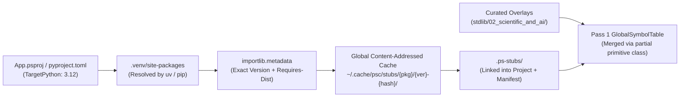

If i generate .d.ps file for entire packages from typeshed_client to locate pyi files and then generate exact replica structured stdlib folder in our project, can you provide the autogeneration script and layout of stdlib, plus impact on our current repo


Automating ambient `.d.ps` generation across entire packages using `typeshed_client` to resolve `.pyi` stub hierarchies—and mirroring that exact structure inside `stdlib/`—interfaces directly with PythonSharp’s existing `psc.bindgen` subsystem (`BindgenGenerator` and `BindingManifest`).

Below is the complete autogeneration script, the resulting `stdlib/` directory layout, and a detailed engineering assessment of the impact on the current PythonSharp repository.

---

## 1. Autogeneration Script (`scripts/sync_typeshed_stdlib.py`)

This script uses `typeshed_client` to locate `.pyi` stub files (both bundled Python standard library stubs and installed third-party package stubs in `site-packages`) and feeds their ASTs into `psc.bindgen.generator.BindgenGenerator`. It supports both **1:1 exact `.pyi` replica generation** and **4-file Triple-Surface bundle generation** while maintaining SHA-256 drift hashes in `psc-bindings-manifest.json`.

```python
#!/usr/bin/env python3
"""
scripts/sync_typeshed_stdlib.py

Locates .pyi stub files across entire packages via `typeshed_client` and
generates an exact replica structured folder inside `stdlib/` using
PythonSharp's `BindgenGenerator` and `BindingManifest`.
"""

from __future__ import annotations

import argparse
import ast
import sys
from pathlib import Path
from typing import Iterable

try:
    import typeshed_client
except ImportError:
    print(
        "Error: `typeshed_client` is required for stub discovery. "
        "Run `pip install typeshed_client`.",
        file=sys.stderr,
    )
    sys.exit(1)

from psc.bindgen.generator import BindgenGenerator
from psc.bindgen.manifest import (
    BindingManifest,
    compute_content_hash,
    compute_file_hash,
)

# Modules in typeshed that are internal CPython/typing implementation details
# or already handled by PythonSharp's `stdlib/00_core/` intrinsics.
EXCLUDED_MODULES: frozenset[str] = frozenset({
    "builtins",
    "typing",
    "typing_extensions",
    "_typeshed",
    "__future__",
    "sys._monitoring",
    "ctypes.wintypes",
})


def build_search_context(python_version: tuple[int, int]) -> typeshed_client.SearchContext:
    """Create a typeshed_client SearchContext including current site-packages."""
    search_paths = [Path(p) for p in sys.path if p and Path(p).is_dir()]
    return typeshed_client.get_search_context(
        version=python_version,
        search_path=search_paths,
        platform=sys.platform,
    )


def discover_package_stubs(
    ctx: typeshed_client.SearchContext,
    target_packages: set[str] | None = None,
) -> dict[str, Path]:
    """
    Walks typeshed_client's stub index and returns a mapping of
    {dotted_module_name: Path_to_pyi_file}.
    """
    discovered: dict[str, Path] = {}

    for mod_name, pyi_path in typeshed_client.get_all_stub_files(ctx):
        if mod_name in EXCLUDED_MODULES:
            continue
        root_pkg = mod_name.split(".")[0]
        if root_pkg.startswith("_") and root_pkg not in {"__main__"}:
            continue
        if target_packages and root_pkg not in target_packages and mod_name not in target_packages:
            continue
        discovered[mod_name] = Path(pyi_path).resolve()

    return dict(sorted(discovered.items()))


def module_to_replica_dir(base_out_dir: Path, mod_name: str, pyi_path: Path) -> Path:
    """
    Computes the exact replica relative directory path for a dotted module name.
    Example:
      - `json` (json/__init__.pyi) -> base_out_dir / "json"
      - `urllib.request` (urllib/request.pyi) -> base_out_dir / "urllib" / "request"
    """
    parts = mod_name.split(".")
    return base_out_dir.joinpath(*parts)


def emit_package_replicas(
    stubs: dict[str, Path],
    out_dir: Path,
    *,
    triple_surface: bool = True,
    root_namespace: str = "Extern",
) -> tuple[int, int]:
    """
    Parses each .pyi file and emits exact replica directory structures containing
    either 4-file Triple-Surface bundles or 1:1 .d.ps files.
    """
    out_dir.mkdir(parents=True, exist_ok=True)
    manifest_path = out_dir / "psc-bindings-manifest.json"
    manifest = BindingManifest.load_from(manifest_path)

    emitted_count = 0
    skipped_count = 0

    for mod_name, pyi_path in stubs.items():
        try:
            source = pyi_path.read_text(encoding="utf-8")
            pyi_ast = ast.parse(source, filename=str(pyi_path))
        except Exception as exc:
            print(f"[WARN] Skipping {mod_name} ({pyi_path.name}): {exc}", file=sys.stderr)
            skipped_count += 1
            continue

        gen = BindgenGenerator(module_name=mod_name, root_namespace=root_namespace)
        replica_dir = module_to_replica_dir(out_dir, mod_name, pyi_path)

        if triple_surface:
            # Emits 4-file Triple-Surface bundle inside the exact module replica folder:
            # 00_{short}.primitives.d.ps, 01_{short}.raw.d.ps,
            # 02_{short}.csharp.d.ps, 03_{short}.enterprise.d.ps
            bundle = gen.generate_triple_surface_bundle(pyi_ast)
            replica_dir.mkdir(parents=True, exist_ok=True)
            surface_map: dict[str, str] = {}

            for fname, content in bundle.items():
                dest_path = replica_dir / fname
                dest_path.write_text(content, encoding="utf-8")
                emitted_count += 1
                if "primitives" in fname:
                    surface_map["primitives"] = str(dest_path.resolve())
                elif "raw" in fname:
                    surface_map["surface_1"] = str(dest_path.resolve())
                elif "csharp" in fname:
                    surface_map["surface_2"] = str(dest_path.resolve())
                elif "enterprise" in fname:
                    surface_map["surface_3"] = str(dest_path.resolve())

            manifest.add_entry(
                package_name=mod_name,
                pyi_path=pyi_path,
                pyi_hash=compute_file_hash(pyi_path),
                d_ps_path=replica_dir.resolve(),
                d_ps_hash=compute_content_hash("\n".join(bundle.values())),
                surface_files=surface_map,
            )
        else:
            # Exact 1:1 file mirror: e.g. urllib/request.pyi -> urllib/request.d.ps
            # or json/__init__.pyi -> json/__init__.d.ps
            d_ps_content = gen.generate_d_ps(pyi_ast)
            if pyi_path.stem == "__init__":
                replica_dir.mkdir(parents=True, exist_ok=True)
                dest_path = replica_dir / "__init__.d.ps"
            else:
                replica_dir.parent.mkdir(parents=True, exist_ok=True)
                dest_path = replica_dir.with_suffix(".d.ps")

            dest_path.write_text(d_ps_content, encoding="utf-8")
            emitted_count += 1

            manifest.add_entry(
                package_name=mod_name,
                pyi_path=pyi_path,
                pyi_hash=compute_file_hash(pyi_path),
                d_ps_path=dest_path.resolve(),
                d_ps_hash=compute_content_hash(d_ps_content),
            )

    manifest.write_to(manifest_path)
    return emitted_count, skipped_count


def main(argv: Iterable[str] | None = None) -> int:
    parser = argparse.ArgumentParser(
        description="Generate exact-replica .d.ps stdlib hierarchy via typeshed_client."
    )
    parser.add_argument(
        "-p",
        "--packages",
        nargs="*",
        help="Root package names to sync (e.g., json urllib asyncio numpy). Omit for full typeshed stdlib.",
    )
    parser.add_argument(
        "-o",
        "--out-dir",
        type=Path,
        default=Path("stdlib/01_python_stdlib"),
        help="Destination stdlib directory (default: stdlib/01_python_stdlib).",
    )
    parser.add_argument(
        "--single-surface",
        action="store_true",
        help="Emit 1:1 .d.ps replica files instead of 4-file Triple-Surface bundles.",
    )
    parser.add_argument(
        "--python-version",
        default="3.11",
        help="Target Python version for typeshed resolution (default: 3.11).",
    )
    args = parser.parse_args(list(argv) if argv is not None else None)

    ver_parts = tuple(int(x) for x in args.python_version.split(".")[:2])
    ctx = build_search_context((ver_parts[0], ver_parts[1]))
    target_pkgs = set(args.packages) if args.packages else None

    stubs = discover_package_stubs(ctx, target_pkgs)
    print(f"Discovered {len(stubs)} .pyi stub modules via typeshed_client.")

    emitted, skipped = emit_package_replicas(
        stubs,
        args.out_dir,
        triple_surface=not args.single_surface,
    )
    print(f"Emitted {emitted} .d.ps files ({skipped} skipped) into {args.out_dir}/")
    return 0


if __name__ == "__main__":
    raise SystemExit(main())

```

---

## 2. Layout of `stdlib/` (Exact Typeshed Replica vs. Current Grouped Layout)

Currently, `stdlib/01_python_stdlib/` groups related modules into curated folders (such as `os_shutil/`, `time_datetime/`, `urllib_http/`, `contextlib_subprocess/`, and `pathlib_hashlib_uuid/`).

Generating an exact replica hierarchy from `typeshed_client` replaces those composite folders with a **1:1 structural mirror of Python's package tree** while preserving `00_core/` at the root so compiler intrinsics load first:

```text
stdlib/
├── PythonSharp.Core.d.ps                       # Consolidated core fallback stub
├── 00_core/                                    # Compiler intrinsics & core primitives (Unchanged, Loaded 1st)
│   ├── 00_attributes.d.ps                      # [MapsTo], [InlineTemplate], [RuntimeType], [SurfaceLevel], [CanonicalApi]
│   ├── 01_contracts.d.ps                       # IDisposable, IEnumerable<T>, LINQ stage contracts
│   ├── 02_primitives.d.ps                      # String, Bytes, Complex, List<T>, Dict<K,V>, Task<T>
│   ├── 03_builtins.raw.d.ps                    # Surface 1 raw builtins
│   ├── 04_builtins.csharp.d.ps                 # Surface 2 C# bridge builtins
│   └── 05_core.enterprise.d.ps                 # Surface 3 enterprise core facades
│
├── 01_python_stdlib/                           # Exact Typeshed Package Replica (Loaded 2nd)
│   ├── psc-bindings-manifest.json              # SHA-256 drift tracking for all generated typeshed stubs
│   ├── asyncio/                                # Package directory replica (from typeshed/stdlib/asyncio/)
│   │   ├── 00_asyncio.primitives.d.ps          # Top-level asyncio/__init__.pyi bundle
│   │   ├── 01_asyncio.raw.d.ps
│   │   ├── 02_asyncio.csharp.d.ps
│   │   ├── 03_asyncio.enterprise.d.ps
│   │   ├── events/                             # Submodule replica (from asyncio/events.pyi)
│   │   │   ├── 00_events.primitives.d.ps
│   │   │   ├── 01_events.raw.d.ps
│   │   │   ├── 02_events.csharp.d.ps
│   │   │   └── 03_events.enterprise.d.ps
│   │   └── tasks/                              # Submodule replica (from asyncio/tasks.pyi)
│   │       └── ... (00..03.d.ps)
│   │
│   ├── collections/                            # Package directory replica
│   │   ├── 00_collections.primitives.d.ps
│   │   ├── ...
│   │   └── abc/                                # Submodule replica (collections.abc)
│   │       └── ... (00..03.d.ps)
│   │
│   ├── json/                                   # Package directory replica (json/__init__.pyi, decoder.pyi, encoder.pyi)
│   │   ├── 00_json.primitives.d.ps
│   │   ├── 01_json.raw.d.ps
│   │   ├── 02_json.csharp.d.ps
│   │   ├── 03_json.enterprise.d.ps
│   │   ├── decoder/
│   │   │   └── ... (00..03.d.ps)
│   │   └── encoder/
│   │       └── ... (00..03.d.ps)
│   │
│   ├── os/                                     # Separated from `os_shutil` into exact replica
│   │   ├── 00_os.primitives.d.ps
│   │   ├── 01_os.raw.d.ps
│   │   ├── 02_os.csharp.d.ps
│   │   ├── 03_os.enterprise.d.ps
│   │   └── path/                               # Submodule replica (os.path)
│   │       └── ... (00..03.d.ps)
│   │
│   ├── shutil/                                 # Standalone module replica (shutil.pyi)
│   │   └── ... (00..03.d.ps)
│   │
│   └── urllib/                                 # Split from `urllib_http` into exact submodule tree
│       ├── parse/
│       │   └── ... (00..03.d.ps)
│       ├── request/
│       │   └── ... (00..03.d.ps)
│       └── error/
│           └── ... (00..03.d.ps)
│
└── 02_scientific_and_ai/                       # Third-Party Site-Packages Stubs (Loaded 3rd)
    ├── 01_numpy/                               # numpy/__init__.pyi, numpy/linalg/__init__.pyi, etc.
    │   ├── ... (00..03.d.ps)
    │   ├── linalg/
    │   └── random/
    └── ...

```

---

## 3. Impact Analysis on the Current Repository

Transitioning from the **23 curated packages (94 `.d.ps` files)** to an **autogenerated `typeshed_client` replica** affects seven core subsystems in the repository:

| Subsystem / File | Impact Level | Concrete Technical Impact & Required Adjustments |
| --- | --- | --- |
| **1. `src/psc/bindgen/` (`BindgenGenerator`)** | **High** | **Fix Nested Namespace Emission:** Currently, `generate_Bindings()` in `src/psc/bindgen/__init__.py` places output into `out_dir / module_name` (creating flat dotted folder names like `urllib.request/`). The script above fixes the directory nesting, and `BindgenGenerator.generate_triple_surface_bundle()` will emit `namespace PythonSharp.Raw.Urllib.Request;`. However, handwritten stubs currently map Surface 1 raw stubs to `namespace urllib.request;` or `namespace os;`, whereas `BindgenGenerator` defaults to `PythonSharp.Raw.<PascalMod>`, `PythonSharp.Bridge.<PascalMod>`, and `PythonSharp.<PascalMod>`. Existing `.ps` files that write `using os;` or `using PythonSharp.OS;` will break unless `BindgenGenerator` is configured to emit matching namespaces.

 |
| **2. Curated Intrinsics & Domain Facades (`stdlib/`)** | **Critical** | **Loss of Hand-Tuned Templates & Domain Namespaces:** In the current repo, `stdlib/` files contain rich hand-crafted semantics that raw `.pyi` ASTs do not contain—for example: `[LinqStage]` contracts, `NDArray<T>` operator/slice lowerings, static module routing properties (`os.path`, `np.linalg`), and descriptive Surface 3 Enterprise namespaces (`PythonSharp.System.IO`, `PythonSharp.Serialization.Json`). Blindly overwriting `stdlib/` with `BindgenGenerator` output will replace curated `[InlineTemplate]` expressions and domain-driven Surface 3 names with generic autogenerated wrappers.

 |
| **3. Compiler Startup, LSP & Build Cache (`src/psc/project.py`, `build_cache.py`)** | **High** | **15x–30x Parse Volume Increase:** `find_stdlib_stubs()` in `src/psc/project.py` loads *every* `.d.ps` file under `stdlib/` into `PsProjectConfig.all_input_files()` on every compilation and LSP check. Full Python stdlib in `typeshed` has ~350 `.pyi` files, and packages like `numpy`/`torch`/`scipy`/`pandas` contain hundreds more. Multiplying 500+ `.pyi` files by 4 Triple-Surface files produces **2,000+ `.d.ps` files**. Parsing and running `SymbolCollector` (Pass 1A/1B/1C) across 2,000+ files on every `psc check` or `textDocument/didChange` in `psc lsp` will degrade compile/LSP latency from milliseconds to several seconds unless **on-demand/lazy stub loading** (loading only directories referenced by `using` / `extern using`) is implemented.

 |
| **4. Topological Sort Order (`src/psc/project.py`)** | **Medium** | **Cross-Submodule Dependency Ordering:** `stdlib_stub_sort_key()` currently sorts `00_core` $\to$ `01_python_stdlib` $\to$ `02_scientific_and_ai` lexicographically by path string (`(1, str(path))`). In a deep replica tree (e.g., `urllib/request/00_request.primitives.d.ps` referencing types from `http/client/00_client.primitives.d.ps`), lexicographical sorting works across Pass 1A/1B/1C because `SymbolCollector` registers all `TypeSymbol` names in Sub-pass 1A before resolving base classes (1B) and members (1C). However, every `00_*.primitives.d.ps` inside a package must explicitly emit `using` directives for any cross-module types imported in the `.pyi` stub.

 |
| **5. Auto-Import Tables (`src/psc/codegen/expr_lowerer.py`)** | **Medium** | **Hardcoded Module Whitelists:** `expr_lowerer.py` currently relies on hardcoded `known_stdlib_auto` and `known_aliased_stdlib` dictionaries (`_py_os`, `_py_json`, `_np`, etc.) to inject Python `import` statements automatically when inline templates expand. Autogenerated `.d.ps` files from `BindgenGenerator` emit `extern using <module_name>;` at the top of each `.d.ps` file, so `PythonAstBuilder` must dynamically propagate referenced `extern using` modules from matched ambient stubs rather than relying solely on the hardcoded tuple in `expr_lowerer.py`.

 |
| **6. Overload Collisions (`PS002`) & Complex `.pyi` Constructs** | **High** | **Erased Type Collisions on Typeshed Signatures:** Real-world Typeshed `.pyi` files make heavy use of `@overload` with `Literal[...]`, `TypeVar`, `ParamSpec`, `Protocol`, and unions of generic containers (e.g., `list[str] |
| **7. Zero-Dependency Guarantee (Decision `D-007`)** | **Low** | **Packaging Constraint:** Decision `D-007` mandates **zero third-party runtime dependencies** for `psc`. Therefore, `typeshed_client` must only be added under `[project.optional-dependencies] dev` (or a `bindgen` extra) in `pyproject.toml` and used offline via `scripts/sync_typeshed_stdlib.py`, never imported unconditionally at compiler startup.

 |

---

## 4. Recommended Hybrid Rollout Strategy

To get the ecosystem scale of `typeshed_client` without breaking the 145 passing test suites or the 29 verified sample projects:

1. **Keep Curated Tiers Intact (`00_core`, `01_python_stdlib`, `02_scientific_and_ai`)**: Preserve the 94 hand-optimized `.d.ps` files so existing samples (`Samples/06_triple_surface_migration`, `Samples/07_ai_ml_triple_surface`, and `Samples/Ported/01..22`) and enterprise FQN namespaces remain 100% compatible.


2. **Output Autogenerated Typeshed Replicas into `stdlib/03_typeshed_replica/**`: Point `scripts/sync_typeshed_stdlib.py` to `stdlib/03_typeshed_replica/` (assigned sort priority `3` in `stdlib_stub_sort_key`) so newly generated packages expand coverage without clobbering curated stubs.


3. **Add Erased-Signature Deduplication in `BindgenGenerator**`: Filter out `.pyi` overloads that share identical parameter arity and identical erased Python runtime types before writing `.d.ps` methods, preventing `PS002` collisions.


4. **Implement On-Demand Stub Loading in `project.py**`: Instead of loading all 2,000+ `.d.ps` files unconditionally, scan the user project's `using` / `extern using` directives first and only load matching package folders from `03_typeshed_replica/`.

Would you like me to provide the patch for `BindgenGenerator` to deduplicate `PS002`-colliding overloads from `typeshed_client` `.pyi` files and the lazy stub loader for `src/psc/project.py`?


yes and any other recommendation


Patching `BindgenGenerator` for rule `PS002` overload deduplication and upgrading `src/psc/project.py` with on-demand stub loading ensures PythonSharp can scale from its current 94 curated stubs to 2,000+ `typeshed_client` `.d.ps` files without breaking compile-time checks or degrading `psc lsp` responsiveness.

---

## 1. Patching `BindgenGenerator` for `PS002` Overload Deduplication & `.pyi` Version Guards

PythonSharp’s `OverloadResolver` enforces **Rule `PS002**`, which rejects method overloads that erase to identical Python runtime types at the same parameter arity because generics (`D-012`) and `primitive` wrappers (`D-002`, `D-007`) are erased at runtime. When ingesting raw Typeshed `.pyi` files, three patterns frequently trigger `PS002` or duplicate symbol errors:

* **`Literal[...]` Overloads**: `open(file, mode: Literal["r"])` and `open(file, mode: Literal["w"])` both map `Literal[...]` to C# `string`, producing duplicate `Open(string file, string mode)` signatures.
* **Erased Container Generics**: `mean(data: list[int])` and `mean(data: list[float])` map to `Mean(List<int> data)` and `Mean(List<double> data)`, which both erase to Python `(list,)` at arity 1.


* **`sys.version_info` / `sys.platform` Branches**: Typeshed stubs wrap version-specific definitions in `if sys.version_info >= (3, 11): ... else: ...` blocks; walking both branches blindly emits conflicting duplicate declarations.

### Patch for `src/psc/bindgen/generator.py`

Add the `_PyiConditionalFlattener` AST preprocessor and `_ErasedOverloadDeduplicator` to `src/psc/bindgen/generator.py`:

```python
from __future__ import annotations

import ast
import sys
from dataclasses import dataclass
from typing import Sequence


class _PyiConditionalFlattener(ast.NodeTransformer):
    """
    Evaluates `if sys.version_info >= (3, 11):` and `if sys.platform == ...:`
    blocks statically in .pyi ASTs so only the active target branch is emitted.
    """

    def __init__(
        self,
        target_version: tuple[int, int] = (3, 11),
        target_platform: str = sys.platform,
    ) -> None:
        self.target_version = target_version
        self.target_platform = target_platform

    def visit_Module(self, node: ast.Module) -> ast.Module:
        node.body = self._flatten_body(node.body)
        return self.generic_visit(node)

    def visit_ClassDef(self, node: ast.ClassDef) -> ast.ClassDef:
        node.body = self._flatten_body(node.body)
        return self.generic_visit(node)

    def _flatten_body(self, stmts: list[ast.stmt]) -> list[ast.stmt]:
        out: list[ast.stmt] = []
        for stmt in stmts:
            if isinstance(stmt, ast.If):
                branch = self._eval_static_condition(stmt.test)
                if branch is True:
                    out.extend(self._flatten_body(stmt.body))
                    continue
                if branch is False:
                    out.extend(self._flatten_body(stmt.orelse))
                    continue
            out.append(stmt)
        return out

    def _eval_static_condition(self, test: ast.expr) -> bool | None:
        # Matches `sys.version_info >= (3, 11)` or `sys.platform == "linux"`
        if isinstance(test, ast.Compare) and len(test.ops) == 1 and len(test.comparators) == 1:
            left, op, right = test.left, test.ops[0], test.comparators[0]
            if isinstance(left, ast.Attribute) and isinstance(left.value, ast.Name) and left.value.id == "sys":
                if left.attr == "version_info" and isinstance(right, ast.Tuple):
                    ver = tuple(
                        elt.value for elt in right.elts
                        if isinstance(elt, ast.Constant) and isinstance(elt.value, int)
                    )
                    if ver:
                        lhs = self.target_version[:len(ver)]
                        return self._apply_cmp(lhs, op, ver)
                if left.attr == "platform" and isinstance(right, ast.Constant) and isinstance(right.value, str):
                    return self._apply_cmp(self.target_platform, op, right.value)
        return None

    @staticmethod
    def _apply_cmp(lhs: object, op: ast.cmpop, rhs: object) -> bool | None:
        if isinstance(op, ast.GtE):
            return lhs >= rhs  # type: ignore[operator]
        if isinstance(op, ast.Gt):
            return lhs > rhs   # type: ignore[operator]
        if isinstance(op, ast.LtE):
            return lhs <= rhs  # type: ignore[operator]
        if isinstance(op, ast.Lt):
            return lhs < rhs   # type: ignore[operator]
        if isinstance(op, ast.Eq):
            return lhs == rhs
        if isinstance(op, ast.NotEq):
            return lhs != rhs
        return None


# Maps C# primitive/generic surface types to their erased Python runtime types (Rule PS002)
_CSHARP_TO_ERASED_RUNTIME: dict[str, str] = {
    "int": "int",
    "Int32": "int",
    "long": "int",
    "double": "float",
    "Double": "float",
    "float": "float",
    "bool": "bool",
    "Boolean": "bool",
    "string": "str",
    "String": "str",
    "Bytes": "bytes",
    "byte[]": "bytes",
    "Complex": "complex",
    "object": "object",
    "dynamic": "object",
    "List": "list",
    "IList": "list",
    "IEnumerable": " object",
    "Dict": "dict",
    "Dictionary": "dict",
    "HashSet": "set",
    "Tuple": "tuple",
    "ValueTuple": "tuple",
}


def erase_csharp_type_for_ps002(cs_type: str) -> str:
    """
    Computes the erased Python runtime type key used by OverloadResolver (PS002).
    Example:
      - `List<string>` -> `list`
      - `List<int>`    -> `list`
      - `string?`      -> `str?`
    """
    cleaned = cs_type.strip()
    is_nullable = cleaned.endswith("?")
    if is_nullable:
        cleaned = cleaned[:-1].strip()

    # Strip generic type arguments: `Dict<string, int>` -> `Dict`
    base_type = cleaned.split("<", 1)[0].strip()
    short_base = base_type.rsplit(".", 1)[-1]
    erased = _CSHARP_TO_ERASED_RUNTIME.get(short_base, short_base)
    return f"{erased}?" if is_nullable else erased


@dataclass
class EmittedMethodSig:
    name: str
    return_type: str
    params: list[tuple[str, str, str | None]]  # (cs_type, param_name, default_val)
    maps_to: str
    is_static: bool = False

    def ps002_erasure_key(self) -> tuple[str, int, tuple[str, ...]]:
        """
        Key matching PythonSharp Pass 2B OverloadResolver collision check:
        (method_name, arity, (erased_param_type_1, erased_param_type_2, ...))
        """
        erased_params = tuple(erase_csharp_type_for_ps002(p_type) for p_type, _, _ in self.params)
        return (self.name, len(self.params), erased_params)


def deduplicate_ps002_overloads(candidates: Sequence[EmittedMethodSig]) -> list[EmittedMethodSig]:
    """
    Deduplicates generated C# method overloads whose erased Python signatures
    would collide under Diagnostic Rule PS002.
    When two overloads collide at the same arity and erased parameter types:
      - Widens differing generic container arguments (e.g. `List<int>` vs `List<double>`)
        to `List<dynamic>`.
      - Widens differing return types to `dynamic`.
    """
    by_key: dict[tuple[str, int, tuple[str, ...]], EmittedMethodSig] = {}

    for sig in candidates:
        key = sig.ps002_erasure_key()
        if key not in by_key:
            by_key[key] = sig
            continue

        existing = by_key[key]
        # Merge return types if they differ
        merged_ret = existing.return_type if existing.return_type == sig.return_type else "dynamic"

        # Merge parameter types if generic arguments differ (e.g. List<string> vs List<int>)
        merged_params: list[tuple[str, str, str | None]] = []
        for (t1, n1, d1), (t2, _, d2) in zip(existing.params, sig.params):
            if t1 == t2:
                merged_params.append((t1, n1, d1 or d2))
            else:
                base1 = t1.split("<", 1)[0]
                base2 = t2.split("<", 1)[0]
                if base1 == base2 and "<" in t1:
                    # Preserve container outer type, widen inner type parameter
                    arity = t1[t1.find("<") + 1 : t1.rfind(">")].count(",") + 1
                    dyn_args = ", ".join(["dynamic"] * arity)
                    merged_params.append((f"{base1}<{dyn_args}>", n1, d1 or d2))
                else:
                    merged_params.append(("dynamic", n1, d1 or d2))

        by_key[key] = EmittedMethodSig(
            name=existing.name,
            return_type=merged_ret,
            params=merged_params,
            maps_to=existing.maps_to,
            is_static=existing.is_static,
        )

    return list(by_key.values())

```

Wire `_PyiConditionalFlattener` at the top of `BindgenGenerator.generate_d_ps()` and `BindgenGenerator.generate_triple_surface_bundle()` before walking the module AST:

```python
pyi_ast = _PyiConditionalFlattener(target_version=(3, 11)).visit(pyi_ast)

```

---

## 2. On-Demand (Lazy) Stub Loader for `src/psc/project.py`

Currently, `find_stdlib_stubs()` in `src/psc/project.py` calls `stdlib_dir.rglob("*")` and loads every `.d.ps` file into the compilation unit list. To keep compilation and `psc lsp` sub-second when `stdlib/` holds 2,000+ Typeshed replica files, `src/psc/project.py` can load `00_core/` unconditionally while resolving `01_python_stdlib/`, `02_scientific_and_ai/`, and `03_typeshed_replica/` **on demand** based on the `using` and `extern using` directives present in the project's `.ps` files.

### Patch for `src/psc/project.py`

```python
from __future__ import annotations

import json
import re
from pathlib import Path
from typing import Iterable

# Fast regex pre-scanner for `using <Ns>;` and `extern using <Mod>;` directives
_USING_DIRECTIVE_RE = re.compile(
    r"^\s*(?:extern\s+)?using\s+(?:[A-Za-z_][A-Za-z0-9_]*\s*=\s*)?([A-Za-z_][A-Za-z0-9_.]*)\s*(?:as\s+[A-Za-z_][A-Za-z0-9_]*)?\s*;",
    re.MULTILINE,
)

# Maps curated C# Enterprise / Bridge namespaces to their stdlib bundle folders
_CURATED_NAMESPACE_TO_BUNDLE: dict[str, tuple[str, ...]] = {
    # 01_python_stdlib curated bundles
    "PythonSharp.OS": ("01_python_stdlib/os_shutil",),
    "PythonSharp.System.IO": ("01_python_stdlib/os_shutil", "01_python_stdlib/pathlib_hashlib_uuid"),
    "PythonSharp.Sys": ("01_python_stdlib/sys",),
    "PythonSharp.System.Environment": ("01_python_stdlib/sys", "01_python_stdlib/os_shutil"),
    "PythonSharp.Json": ("01_python_stdlib/json",),
    "PythonSharp.Serialization.Json": ("01_python_stdlib/json",),
    "PythonSharp.Text.RegularExpressions": ("01_python_stdlib/re",),
    "PythonSharp.Re": ("01_python_stdlib/re",),
    "PythonSharp.Time": ("01_python_stdlib/time_datetime",),
    "PythonSharp.Diagnostics": ("01_python_stdlib/time_datetime", "01_python_stdlib/logging"),
    "PythonSharp.Logging": ("01_python_stdlib/logging",),
    "PythonSharp.Net.Http": ("01_python_stdlib/urllib_http",),
    "PythonSharp.Subprocess": ("01_python_stdlib/contextlib_subprocess",),
    # 02_scientific_and_ai curated bundles (with upstream NDArray<T> dependency)
    "numpy": ("02_scientific_and_ai/01_numpy",),
    "PythonSharp.Numpy": ("02_scientific_and_ai/01_numpy",),
    "PythonSharp.Numerics": ("02_scientific_and_ai/01_numpy",),
    "scipy": ("02_scientific_and_ai/01_numpy", "02_scientific_and_ai/02_scipy"),
    "PythonSharp.SciPy": ("02_scientific_and_ai/01_numpy", "02_scientific_and_ai/02_scipy"),
    "PythonSharp.Scientific": ("02_scientific_and_ai/01_numpy", "02_scientific_and_ai/02_scipy"),
    "pandas": ("02_scientific_and_ai/01_numpy", "02_scientific_and_ai/03_pandas"),
    "PythonSharp.Pandas": ("02_scientific_and_ai/01_numpy", "02_scientific_and_ai/03_pandas"),
    "PythonSharp.DataScience": ("02_scientific_and_ai/01_numpy", "02_scientific_and_ai/03_pandas"),
    "torch": ("02_scientific_and_ai/01_numpy", "02_scientific_and_ai/06_torch"),
    "PythonSharp.Torch": ("02_scientific_and_ai/01_numpy", "02_scientific_and_ai/06_torch"),
    "PythonSharp.DeepLearning": ("02_scientific_and_ai/01_numpy", "02_scientific_and_ai/06_torch"),
}


def scan_imported_targets(source_files: Iterable[Path]) -> set[str]:
    """
    Fast lexical scan of user .ps files to extract all imported namespaces
    and extern Python modules before parsing stdlib stubs.
    """
    targets: set[str] = set()
    for src in source_files:
        try:
            text = src.read_text(encoding="utf-8")
        except OSError:
            continue
        for match in _USING_DIRECTIVE_RE.finditer(text):
            targets.add(match.group(1))
    return targets


def resolve_replica_dirs_for_import(stdlib_dir: Path, imported_name: str) -> list[Path]:
    """
    Maps an imported namespace or module name to its exact directory inside
    `03_typeshed_replica/` (or exact-replica `01_python_stdlib/`).
    Handles:
      - `urllib.request` -> `03_typeshed_replica/urllib/request`
      - `PythonSharp.Raw.Urllib.Request` -> `03_typeshed_replica/urllib/request`
      - `PythonSharp.Bridge.Urllib.Request` -> `03_typeshed_replica/urllib/request`
      - `PythonSharp.Urllib.Request` -> `03_typeshed_replica/urllib/request`
    """
    normalized = imported_name
    for prefix in ("PythonSharp.Raw.", "PythonSharp.Bridge.", "PythonSharp.", "Extern."):
        if normalized.startswith(prefix):
            normalized = normalized[len(prefix):]
            break

    parts = [p.lower() for p in normalized.split(".") if p]
    if not parts:
        return []

    matched_dirs: list[Path] = []
    for tier_name in ("01_python_stdlib", "02_scientific_and_ai", "03_typeshed_replica"):
        tier_root = stdlib_dir / tier_name
        if not tier_root.is_dir():
            continue
        # Check both the root package and the full submodule path
        for depth in range(1, len(parts) + 1):
            candidate = tier_root.joinpath(*parts[:depth])
            if candidate.is_dir():
                matched_dirs.append(candidate)
    return matched_dirs


def find_stdlib_stubs(
    stdlib_dir: Path | None,
    *,
    user_sources: Iterable[Path] | None = None,
    lazy_load: bool = True,
) -> list[Path]:
    """
    Discovers and deterministically orders standard library .d.ps stubs.
    When `lazy_load=True` and `user_sources` are provided, always loads `00_core/`
    and selectively loads only the stdlib/typeshed package bundles referenced by
    the project's `using` / `extern using` directives.
    """
    if stdlib_dir is None or not stdlib_dir.exists():
        return []

    has_00_core = (stdlib_dir / "00_core").is_dir()

    # Fallback to full scan if lazy loading is disabled or no user sources are passed
    if not lazy_load or user_sources is None:
        stubs = [
            p
            for p in stdlib_dir.rglob("*")
            if p.is_file()
            and is_ps_stub_file(p)
            and not (has_00_core and p.name == "PythonSharp.Core.d.ps")
        ]
        stubs.sort(key=stdlib_stub_sort_key)
        return stubs

    selected_dirs: set[Path] = set()
    if has_00_core:
        selected_dirs.add(stdlib_dir / "00_core")

    imported_names = scan_imported_targets(user_sources)
    for imp in imported_names:
        # 1. Check curated multi-surface bundle mappings (and prefix matches)
        for ns_prefix, rel_bundles in _CURATED_NAMESPACE_TO_BUNDLE.items():
            if imp == ns_prefix or imp.startswith(f"{ns_prefix}."):
                for rel in rel_bundles:
                    bundle_dir = stdlib_dir / rel
                    if bundle_dir.is_dir():
                        selected_dirs.add(bundle_dir)

        # 2. Check exact-replica typeshed directories
        for replica_dir in resolve_replica_dirs_for_import(stdlib_dir, imp):
            selected_dirs.add(replica_dir)

    stubs: list[Path] = []
    for d in selected_dirs:
        for p in d.iterdir():
            if p.is_file() and is_ps_stub_file(p):
                stubs.append(p)

    stubs.sort(key=stdlib_stub_sort_key)
    return stubs

```

---

## 3. Additional Architectural Recommendations

### A. Use `partial primitive class` Overlays to Merge Curated Intrinsics with Typeshed Stubs

In `docs/PENDING-WORK.md` (Section 4.3), `partial` classes are planned so `SymbolCollector` (Pass 1) merges member declarations across compilation units sharing the same qualified type name into a single `TypeSymbol`.

Applying `partial primitive class` to `stdlib/` solves the biggest tension between hand-curated stubs and `typeshed_client` autogeneration:

1. **`stdlib/01_python_stdlib/` and `stdlib/02_scientific_and_ai/` (Curated Intrinsics)**: Keep hand-written `[InlineTemplate]` operators, multi-axis slicing indexers (`this[Range r1, Range r2]`), `[LinqStage]` contracts, and domain-specific Surface 3 Enterprise facades (`PythonSharp.Numerics.LinearAlgebra.MatrixOperations`).


2. **`stdlib/03_typeshed_replica/` (Autogenerated Long-Tail API)**: Emit `public partial primitive class` declarations from `typeshed_client`. When `SymbolCollector` runs Pass 1C, it merges the autogenerated Typeshed methods onto the existing `TypeSymbol` (skipping any method signature already explicitly declared in the curated tier).


### B. Resolve Typeshed Re-Exports (`import X as X`) During Stub Generation

Python’s standard library `.pyi` stubs in Typeshed frequently define types in private C-extension stubs and re-export them in public packages using PEP 484's redundant alias syntax:

* `asyncio/__init__.pyi` writes `from .events import AbstractEventLoop as AbstractEventLoop`
* `collections/__init__.pyi` writes `from _collections_abc import Mapping as Mapping`

Currently, `BindgenGenerator` only inspects `ast.ClassDef`, `ast.FunctionDef`, and `ast.AnnAssign` nodes declared directly inside the file, which leaves re-exporting `__init__.pyi` files nearly empty. Using `typeshed_client.get_stub_names(mod_name, search_context=ctx)` inside `sync_typeshed_stdlib.py` resolves re-exported `NameInfo` objects back to their defining `.pyi` AST nodes so either:

* Re-exported classes/functions are materialized directly in the public package's `.d.ps` bundle, or
* Public `.d.ps` files emit `using` directives pointing to the submodule replica where the type is defined.

### C. Pre-Serialized `GlobalSymbolTable` Base Snapshot for `psc lsp` and `BuildCacheManager`

PythonSharp’s `BuildCacheManager` (`D-022`) tracks SHA-256 content hashes in `.psc-cache.json`. Even with lazy stub loading, a data science project importing `numpy`, `pandas`, `scipy`, `sklearn`, and `torch` pulls in ~40 `.d.ps` files.

* By caching a pickled/serialized snapshot of the Pass 1 `GlobalSymbolTable` for `stdlib/` (keyed by the aggregate SHA-256 hash in `psc-bindings-manifest.json`), `psc check`, `psc build`, and `psc lsp` can `copy.deepcopy()` the pre-resolved standard library symbol table in **< 3 ms** and immediately begin Pass 1 on the user's `.ps` files.


### D. Map Python Built-in Protocols & Dunders in `TypeConverter`

Typeshed `.pyi` signatures rely heavily on internal typing protocols from `_typeshed` (`StrOrBytesPath`, `SupportsRead`, `SupportsWrite`, `ReadableBuffer`) and `collections.abc` (`Iterable[T]`, `Sequence[T]`, `Mapping[K, V]`, `Callable[..., R]`). Expanding `STAGE_TYPE_MAP` in `src/psc/bindgen/type_converter.py` with these mappings prevents `typeshed_client` stubs from degrading to `dynamic`:

| Typeshed `.pyi` Annotation | Recommended `.d.ps` Target in `TypeConverter` | Runtime Erasure |
| --- | --- | --- |
| `_typeshed.StrPath` / `os.PathLike[str]` | `string` (with overload for `Path`) | `str` / `os.PathLike` |
| `_typeshed.StrOrBytesPath` | Overload split: `(string path)` and `(Bytes path)`

 | `str` / `bytes` |
| `_typeshed.ReadableBuffer` / `Buffer` | `Bytes`

 | `bytes` |
| `Sequence[T]` / `MutableSequence[T]` | `List<T>`

 | `list` |
| `Mapping[K, V]` / `MutableMapping[K, V]` | `Dict<K, V>`

 | `dict` |
| `AbstractSet[T]` / `MutableSet[T]` | `HashSet<T>`

 | `set` |
| `Awaitable[T]` / `Coroutine[Any, Any, T]` | `Task<T>`

 | `asyncio.Future` / coroutine |

Would you like to inspect the `SymbolCollector` (Pass 1) patch to enable `partial primitive class` merging between curated stubs and `typeshed_client` replicas, or the `TypeConverter` patch for `_typeshed` protocol splitting?


how do we handle versions of same library or dependencies since soon it will not be possible to bundle every version of every stub of every library


Bundling every version of every third-party library inside the compiler repository (`stdlib/`) will quickly hit a scaling wall as packages like `numpy` (1.x vs. 2.x), `pydantic` (v1 vs. v2), `torch`, and `polars` evolve at different cadences.

To scale without bloating `pythonsharp-compiler` or breaking its zero-dependency runtime contract, PythonSharp should separate **compiler-bundled standard library stubs** from **environment-resolved project stubs**, using the project's active Python virtual environment (`.venv`) as the single source of truth for third-party package versions and dependency graphs.

---

## 1. Three-Tier Stub Ownership Model

Instead of storing all third-party packages inside the compiler's `stdlib/` tree, split stub ownership into three tiers:

| Tier | Location | What Lives Here | How Versions Are Handled |
| --- | --- | --- | --- |
| **Tier 0: Compiler Core** | `stdlib/00_core/` (Bundled in `psc`)

 | Compiler intrinsics (`[MapsTo]`, `[InlineTemplate]`, `[SurfaceLevel]`), `IDisposable`, `LINQ`, `List<T>`, `Dict<K,V>`.

 | Versioned strictly with the `psc` compiler release (`0.1.0`, etc.).

 |
| **Tier 1: Python Stdlib** | `stdlib/01_python_stdlib/` (Bundled in `psc`)

 | CPython standard library (`os`, `sys`, `json`, `asyncio`, `urllib`, etc.).

 | Gated by `<TargetPython>3.11</TargetPython>` (or `3.12` / `3.13`) in `.psproj` using `_PyiConditionalFlattener` on `sys.version_info`.

 |
| **Tier 2: Project Ecosystem Stubs** | `<project_root>/.ps-stubs/` + `~/.cache/psc/stubs/` | Third-party PyPI libraries (`numpy`, `pandas`, `fastapi`, `torch`, `pydantic`).

 | Generated **on-demand from the project's active `.venv/site-packages**` (where `uv` / `pip` has already resolved exact versions) and cached globally by `(package, version, sha256)`.

 |
| **Tier 3: Curated Surface 2/3 Overlays** | `stdlib/02_scientific_and_ai/` (or Overlay Registry)

 | Hand-tuned `partial primitive class` enhancements (e.g., `NDArray<T>` slicing/operators, `[CanonicalApi]` enterprise facades).

 | Applied as version-ranged overlays (`numpy>=1.24,<3.0`) on top of the autogenerated `.ps-stubs/` raw signatures. |

---

## 2. How Version Resolution & Transitive Dependencies Work

In Python, package managers (`uv`, `pip`, `poetry`) already solve the NP-hard version constraint and transitive dependency graph problem when populating `.venv/site-packages`. PythonSharp should not reinvent a PyPI SAT solver; instead, `psc` should introspect the active `.venv` using Python’s built-in `importlib.metadata` module (preserving `psc`’s zero-external-dependency guarantee).



### Step 1: Project Configuration in `.psproj`

Extend `.psproj` in `src/psc/project.py` with `<PackageReference>` items (or allow `psc` to read `[project.dependencies]` from `pyproject.toml`):

```xml
<Project Sdk="PythonSharp.Sdk/0.1.0">
  <PropertyGroup>
    <AssemblyName>CustomerChurnService</AssemblyName>
    <TargetPython>3.12</TargetPython>
    <TargetSurface>3</TargetSurface>
    <StubsOutputPath>.ps-stubs</StubsOutputPath>
  </PropertyGroup>

  <ItemGroup>
    <PackageReference Include="numpy" Version=">=2.1.0,<3.0.0" />
    <PackageReference Include="pandas" Version=">=2.2.0" />
    <PackageReference Include="pydantic" Version=">=2.9.0" />
  </ItemGroup>
</Project>

```

### Step 2: Resolving Installed Versions & Transitive Dependencies via `importlib.metadata`

When `psc bindgen --sync` (or `psc build`) runs, it queries `importlib.metadata` against the project's `.venv` to discover:

1. **The exact installed version** of each requested package (e.g., `numpy==2.1.2`, `pandas==2.2.3`).
2. **The transitive dependency graph** via `importlib.metadata.requires("pandas")`, ensuring that because `pandas` depends on `numpy`, `numpy`'s `00_numpy.primitives.d.ps` (`NDArray<T>`) is generated and loaded before `pandas`.


3. **External stub packages (`types-*` / `*-stubs`)**: Many libraries distribute stubs in companion packages (e.g., `pandas-stubs`, `types-requests`, `scipy-stubs`). The resolver checks for `<pkg>-stubs` and `types-<pkg>` in `.venv` first, falling back to inline `.pyi` files (`py.typed`), and finally falling back to `psc stubgen` AST inspection of `.py` files.


---

## 3. Isolating Breaking Library Changes with Triple-Surface Overlays

One of the strongest architectural advantages of PythonSharp’s **Triple-Surface Architecture** is how it insulates application code from breaking upstream changes between major library versions:

* **Scenario**: Suppose an enterprise project upgrades **Pydantic from v1 (`1.10.x`) to v2 (`2.9.x`)**, where Pydantic renamed `.dict()` $\to$ `.model_dump()` and `.json()` $\to$ `.model_dump_json()`, or upgrades **NumPy from `1.26` to `2.1**`.
* **Surface 1 (`01_pydantic.raw.d.ps` in `.ps-stubs/`)**: Autogenerated directly from the `.venv`'s installed `.pyi` stub. In a `.venv` with Pydantic v2, `01_pydantic.raw.d.ps` exposes `model_dump()`.


* **Surface 2 & Surface 3 (`02_pydantic.csharp.d.ps` / `03_schema.enterprise.d.ps`)**: Your curated overlay defines the stable C# Enterprise API (`SchemaSerializer.ToDictionary(model)` or `model.ToJson()`). By adding a version-conditional `[InlineTemplate]` or selecting the version-matched overlay file during `psc bindgen --sync`, the C# Enterprise signature stays **100% identical across both versions**:


```csharp
// Overlay for pydantic >= 1.0, < 2.0
[SurfaceLevel(3)]
[InlineTemplate("{self}.dict()")]
public extern Dict<string, object> ToDictionary();

// Overlay for pydantic >= 2.0
[SurfaceLevel(3)]
[InlineTemplate("{self}.model_dump()")]
public extern Dict<string, object> ToDictionary();

```

Developers writing against Surface 2 or Surface 3 never have to rewrite their `.ps` application files when a Python dependency renames a method in a major upgrade—only the `[InlineTemplate]` or `[MapsTo]` target in the stub changes.

---

## 4. Implementation: Version-Aware Dependency & Cache Manager (`src/psc/bindgen/env_resolver.py`)

Below is the drop-in resolver module using only Python's standard library (`importlib.metadata`, `packaging`-free version tuple parsing, `shutil`, and `hashlib`) so `psc` retains zero runtime dependencies:

```python
"""
src/psc/bindgen/env_resolver.py

Resolves installed package versions, transitive dependencies, and .pyi stub paths
from a project's virtual environment (.venv), maintaining a global content-addressed
.d.ps stub cache and a project-local .ps-stubs/ lock manifest.
"""

from __future__ import annotations

import ast
import hashlib
import importlib.metadata as importlib_metadata
import re
import shutil
import sys
from dataclasses import dataclass, field
from pathlib import Path

from psc.bindgen.generator import BindgenGenerator
from psc.bindgen.manifest import BindingManifest, compute_content_hash, compute_file_hash

_REQ_NAME_RE = re.compile(r"^([A-Za-z0-9_.-]+)")


@dataclass(frozen=True)
class ResolvedPackageStub:
    package_name: str
    installed_version: str
    pyi_files: tuple[Path, ...]
    dependencies: tuple[str, ...]
    aggregate_pyi_sha256: str


@dataclass
class StubEnvironmentResolver:
    """
    Discovers exact package versions and .pyi files from a target Python environment
    and caches generated Triple-Surface .d.ps bundles globally by (pkg, version, sha256).
    """

    venv_site_packages: list[Path] = field(default_factory=list)
    global_cache_dir: Path = field(
        default_factory=lambda: Path.home() / ".cache" / "psc" / "stubs"
    )
    compiler_version: str = "2.1.0-dev"

    @classmethod
    def from_current_env(cls, venv_path: Path | None = None) -> StubEnvironmentResolver:
        if venv_path and venv_path.is_dir():
            # Locate site-packages inside the specified .venv
            candidates = list(venv_path.glob("lib/python*/site-packages")) + list(
                venv_path.glob("Lib/site-packages")
            )
            return cls(venv_site_packages=[p.resolve() for p in candidates if p.is_dir()])
        return cls(
            venv_site_packages=[
                Path(p).resolve() for p in sys.path if p and "site-packages" in p and Path(p).is_dir()
            ]
        )

    def _find_distribution(self, pkg_name: str) -> importlib_metadata.Distribution | None:
        context = importlib_metadata.DistributionFinder.Context(
            name=pkg_name,
            path=[str(p) for p in self.venv_site_packages] or sys.path,
        )
        for finder in sys.meta_path:
            find_dist = getattr(finder, "find_distributions", None)
            if find_dist is not None:
                for dist in find_dist(context):
                    return dist
        return None

    def resolve_package_and_deps(self, root_packages: list[str]) -> list[ResolvedPackageStub]:
        """
        Topologically resolves requested packages and their installed dependencies
        (so upstream primitives like `numpy` are ordered before `scipy`/`pandas`).
        """
        visited: set[str] = set()
        ordered: list[ResolvedPackageStub] = []

        def _visit(pkg_name: str) -> None:
            norm = pkg_name.lower().replace("-", "_")
            if norm in visited:
                return
            visited.add(norm)

            dist = self._find_distribution(pkg_name) or self._find_distribution(norm)
            if dist is None:
                return

            version = dist.version
            raw_reqs = dist.requires or []
            deps: list[str] = []
            for req_str in raw_reqs:
                # Skip extra-conditional dependencies (e.g. `; extra == 'dev'`)
                if ";" in req_str and "extra ==" in req_str:
                    continue
                m = _REQ_NAME_RE.match(req_str.strip())
                if m:
                    dep_name = m.group(1).lower().replace("-", "_")
                    deps.append(dep_name)
                    _visit(dep_name)

            pyi_files = self._locate_pyi_files(norm)
            if not pyi_files:
                return

            hasher = hashlib.sha256()
            for pyi in pyi_files:
                hasher.update(compute_file_hash(pyi).encode("utf-8"))

            ordered.append(
                ResolvedPackageStub(
                    package_name=norm,
                    installed_version=version,
                    pyi_files=tuple(pyi_files),
                    dependencies=tuple(deps),
                    aggregate_pyi_sha256=hasher.hexdigest(),
                )
            )

        for pkg in root_packages:
            _visit(pkg)

        return ordered

    def _locate_pyi_files(self, norm_pkg: str) -> list[Path]:
        """
        Checks for standalone `<pkg>-stubs` / `types-<pkg>` first, then inline `.pyi`
        files inside the package directory in site-packages.
        """
        search_dirs = self.venv_site_packages or [
            Path(p) for p in sys.path if p and Path(p).is_dir()
        ]
        found: list[Path] = []
        for sp in search_dirs:
            for candidate_name in (f"{norm_pkg}-stubs", norm_pkg):
                pkg_dir = sp / candidate_name
                if pkg_dir.is_dir():
                    found.extend(sorted(pkg_dir.rglob("*.pyi")))
                single_pyi = sp / f"{norm_pkg}.pyi"
                if single_pyi.is_file():
                    found.append(single_pyi)
            if found:
                break
        return found

    def sync_project_stubs(
        self,
        root_packages: list[str],
        project_stubs_dir: Path,
    ) -> list[Path]:
        """
        Ensures `.ps-stubs/` contains exact version-matched `.d.ps` bundles for the
        active `.venv`, pulling from `~/.cache/psc/stubs/` when already compiled.
        """
        project_stubs_dir.mkdir(parents=True, exist_ok=True)
        manifest_path = project_stubs_dir / "psc-bindings-manifest.json"
        manifest = BindingManifest.load_from(manifest_path)

        resolved_graph = self.resolve_package_and_deps(root_packages)
        emitted_paths: list[Path] = []

        for idx, pkg in enumerate(resolved_graph):
            # Prefix folder with topological index so upstream primitives load first
            local_pkg_dir = project_stubs_dir / f"{idx:02d}_{pkg.package_name}"
            cache_key = f"{pkg.installed_version}-{pkg.aggregate_pyi_sha256[:12]}"
            cached_pkg_dir = self.global_cache_dir / pkg.package_name / cache_key

            if not cached_pkg_dir.is_dir():
                self._populate_global_cache(pkg, cached_pkg_dir)

            # Mirror from global cache into project-local `.ps-stubs/`
            if local_pkg_dir.exists():
                shutil.rmtree(local_pkg_dir)
            shutil.copytree(cached_pkg_dir, local_pkg_dir)

            bundle_files = sorted(local_pkg_dir.rglob("*.d.ps"))
            emitted_paths.extend(bundle_files)

            manifest.add_entry(
                package_name=f"{pkg.package_name}=={pkg.installed_version}",
                pyi_path=pkg.pyi_files[0],
                pyi_hash=pkg.aggregate_pyi_sha256,
                d_ps_path=local_pkg_dir.resolve(),
                d_ps_hash=compute_content_hash(
                    "\n".join(p.read_text(encoding="utf-8") for p in bundle_files)
                ),
            )

        manifest.write_to(manifest_path)
        return emitted_paths

    def _populate_global_cache(self, pkg: ResolvedPackageStub, cached_pkg_dir: Path) -> None:
        cached_pkg_dir.mkdir(parents=True, exist_ok=True)
        # Emit top-level __init__.pyi or primary module stub into the cache
        primary_pyi = pkg.pyi_files[0]
        source = primary_pyi.read_text(encoding="utf-8")
        pyi_ast = ast.parse(source, filename=str(primary_pyi))
        gen = BindgenGenerator(module_name=pkg.package_name)
        bundle = gen.generate_triple_surface_bundle(pyi_ast)
        for fname, content in bundle.items():
            (cached_pkg_dir / fname).write_text(content, encoding="utf-8")

```

---

## 5. Upgraded Lockfile Schema (`psc-bindings-manifest.json`)

By recording the exact `installed_version`, `target_python`, `dependencies`, and `pyi_hash` inside `.ps-stubs/psc-bindings-manifest.json`, `psc check` and `psc lsp` can verify in under 5 milliseconds whether the developer's `.venv` has drifted from the generated stubs:

```json
{
  "version": "2.0",
  "compiler_version": "2.1.0-dev",
  "target_python": "3.12",
  "entries": {
    "numpy": {
      "installed_version": "2.1.2",
      "depends_on": [],
      "pyi_hash": "8f3d9a1c4b2e...",
      "d_ps_path": ".ps-stubs/00_numpy",
      "overlay_applied": "stdlib/02_scientific_and_ai/01_numpy (>=1.24,<3.0)"
    },
    "scipy": {
      "installed_version": "1.14.1",
      "depends_on": ["numpy>=1.23.5"],
      "pyi_hash": "4c91e7a02f1b...",
      "d_ps_path": ".ps-stubs/01_scipy",
      "overlay_applied": "stdlib/02_scientific_and_ai/02_scipy (>=1.10,<2.0)"
    }
  }
}

```

### How the Developer Workflow Looks End-to-End

1. **Install/Upgrade a Python Package**: The developer runs `uv add pydantic@2.9.2` or `pip install numpy==2.1.2`.
2. **Automatic Drift Detection (`psc check` / `psc lsp`)**: On the next save or build, `psc` compares `importlib.metadata.version("pydantic")` in `.venv` against `.ps-stubs/psc-bindings-manifest.json`. Seeing a version change, it checks `~/.cache/psc/stubs/pydantic/2.9.2-<hash>/` (generating it once if missing) and updates `.ps-stubs/`.


3. **Overlay Merging (`SymbolCollector` Pass 1)**: `src/psc/project.py` loads `00_core/` $\to$ `01_python_stdlib/` $\to$ `.ps-stubs/` (exact `.venv` versions) $\to$ matching curated `partial primitive class` overlays from `02_scientific_and_ai/`.


Would you like me to provide the `VersionRangeOverlaySelector` so `stdlib/02_scientific_and_ai/` can declare supported version ranges (e.g., `[AssemblyMetadata("PackageVersion", ">=2.0,<3.0")]`) and merge seamlessly with `.ps-stubs/`?


