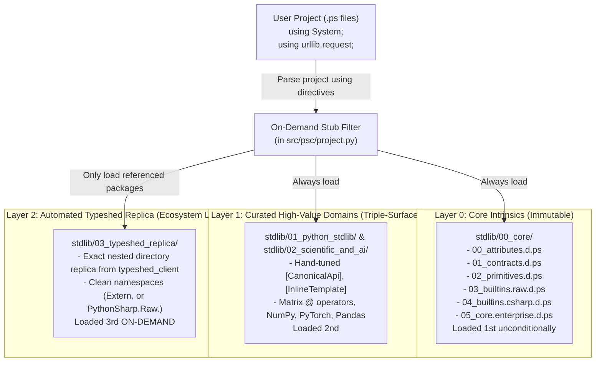

# Standard Definitions & Typeshed Stdlib Autogeneration Analysis

**Status:** Technical Analysis & Architectural Blueprint  
**Target Subsystems:** `src/psc/bindgen/`, `stdlib/`, `src/psc/project.py`, `src/psc/cli.py`  
**Date:** 2026-11-03  
**Authors/Context:** Derived from exploratory prompts and bug assessments in `1.md` and `2.md`

---

## 1. Executive Summary

This document provides a comprehensive architectural analysis and execution blueprint for automating PythonSharp's ambient standard library declarations (`.d.ps`) using `typeshed_client`.

The goal explored in `1.md` and `2.md` is to locate upstream `.pyi` stub files across standard library modules and third-party packages, translate them into PythonSharp `.d.ps` files (supporting both 1:1 `.pyi` mapping and 4-file Triple-Surface bundles), and organize them into an exact structural mirror of Python's package hierarchy inside `stdlib/`.

This document synthesizes:
1. The **root cause analysis** of past runtime errors encountered during initial attempts (e.g., `AttributeError: 'BindgenGenerator' object has no attribute 'generate_triple_surface_bundle'`).
2. The **directory nesting issue** in `psc bindgen` (flat dotted folders vs. true nested subdirectories).
3. The **critical architectural trade-offs** between hand-crafted compiler intrinsics and raw Typeshed stubs.
4. The **overload collision trap** (Rule `PS002`) triggered by erased Python runtime types.
5. The **performance implications** on compiler startup and Language Server Protocol (LSP) latency.
6. A definitive **"Layered Smart-Stub" architectural strategy** and step-by-step implementation plan to proceed with later.

---

## 2. Review of Initial Explorations (`1.md` & `2.md`)

### 2.1 Exploration in `1.md`
* Proposed an offline synchronization script `scripts/sync_typeshed_stdlib.py` relying on `typeshed_client.get_search_context()` and `get_all_stub_files()`.
* Attempted to invoke `BindgenGenerator` directly per module and emit 4-file Triple-Surface bundles (`00_primitives`, `01_raw`, `02_csharp`, `03_enterprise`) or 1:1 `.d.ps` files.
* Highlighted the 7 major subsystems affected across the compiler codebase.
* Identified potential overload collisions (`PS002`) and AST conditional branches (`if sys.version_info >= (3, 11):`).

### 2.2 Exploration in `2.md` & Error Diagnosis
When running the script proposed in `1.md`, the following error occurred:
```text
AttributeError: 'BindgenGenerator' object has no attribute 'generate_triple_surface_bundle'
```
* **Root Cause 1: Entrypoint & Import Disconnect:**
  In Phase 3, `BindgenGenerator` only exposed `generate_d_ps()`. The method `generate_triple_surface_bundle()` was introduced in Milestone U3. When running python scripts without `PYTHONPATH=src` set, Python loaded an older installed version of `psc` from `.venv/lib/.../site-packages` rather than the active source tree.
* **Root Cause 2: Directory Structure Flaw in `generate_bindings`:**
  In `src/psc/bindgen/__init__.py`, when given a directory of `.pyi` files, the logic resolved dotted module names (e.g. `urllib.request`), but assigned:
  ```python
  pkg_dir = out_dir / module_name
  ```
  This created a **flat directory with a literal dot** (`stdlib/urllib.request/`) rather than a nested directory tree (`stdlib/urllib/request/`).
* **Root Cause 3: AST Version Guards:**
  Typeshed wraps large portions of `.pyi` files in `if sys.version_info >= (3, 11):` blocks. Because `BindgenGenerator` iterates over `pyi_ast.body` expecting top-level `FunctionDef` and `ClassDef`, definitions inside `ast.If` were silently ignored.

---

## 3. Core Architectural Dilemmas

### 3.1 Curated Semantic Intrinsics vs. Raw Typeshed Stubs
PythonSharp's existing 95 stubs across `stdlib/00_core/`, `stdlib/01_python_stdlib/`, and `stdlib/02_scientific_and_ai/` contain essential compiler metadata:
* **Inline Templates (`[InlineTemplate("...")]`)**: Enables zero-cost operator and property lowerings without runtime wrappers (e.g., `matrixA.MultiplyMatrix(matrixB)` lowering to Python's native `@` operator `(a @ b)`, `.TransposedMatrix` lowering to `.T`, `Console.WriteLine` lowering to `print`).
* **Triple-Surface Metadata (`[SurfaceLevel(1|2|3)]`, `[CanonicalApi("Target", "Bridge")]`)**: Powers interactive LSP hover ladder cards and Rule `PS005` migration diagnostics (`psc check --target-surface`).
* **LINQ & Container Contracts (`[LinqStage]`, `List<T>`, `Dict<K, V>`)**: Enables compile-time LINQ fusion into Python list comprehensions.

> [!CAUTION]
> Replacing `stdlib/01_python_stdlib/` or `stdlib/02_scientific_and_ai/` directly with raw Typeshed output will strip all `[InlineTemplate]` lowerings and domain namespaces, breaking verified sample projects (`06_triple_surface_migration`, `07_ai_ml_triple_surface`, and ported libraries 01–32).

### 3.2 The Overload Collision Trap (Rule `PS002`)
PythonSharp's `OverloadResolver` enforces **Rule `PS002`**:
> Method overloads must not collide after parameter types are erased to Python runtime types at identical parameter arities.

Typeshed `.pyi` files contain thousands of overloaded signatures designed for static type checkers like Mypy/Pyright:
* **Literal Overloads:** `open(file, mode: Literal["r"])` vs `open(file, mode: Literal["w"])`. Both map to C# `string`, producing duplicate `Open(string file, string mode)` signatures.
* **Erased Generic Containers:** `mean(data: list[int])` vs `mean(data: list[float])`. Both map to `List<int>` and `List<double>`, which both erase to Python `(list,)` at arity 1.

Without an erased-signature deduplication pass in `BindgenGenerator`, compiling against full Typeshed `.d.ps` bundles causes immediate `ERROR [PS002]` compiler failures.

### 3.3 Startup & LSP Latency ($O(N)$ Eager Loading)
In `src/psc/project.py`:
```python
def find_stdlib_stubs(stdlib_dir: Path | None) -> list[Path]:
    if stdlib_dir is None or not stdlib_dir.exists():
        return []
    ...
    stubs = [
        p for p in stdlib_dir.rglob("*")
        if p.is_file() and is_ps_stub_file(p) ...
    ]
    stubs.sort(key=stdlib_stub_sort_key)
    return stubs
```
* **Current status:** 95 files $\approx 25\text{ms}$ parse and symbol collection time.
* **Full Typeshed replica:** $\sim 350$ stdlib `.pyi` modules $\times$ 4 triple-surface files $\approx \mathbf{1,400\text{ to }2,000\text{ files}}$.
* Loading 2,000 files unconditionally during `psc check`, `psc build`, and on every keystroke in `psc lsp` would degrade compiler startup and hover latency from $<50\text{ms}$ to **several seconds**.

### 3.4 Zero-Dependency Runtime Guarantee (Decision `D-007`)
PythonSharp guarantees zero runtime dependencies for the compiler core. `typeshed_client` must **never** be added as a mandatory runtime dependency of `psc`. It must reside strictly under `[project.optional-dependencies] dev` (or a `bindgen` extra) and be used exclusively for offline or on-demand stub synchronization.

---

## 4. The "Layered Smart-Stub" Architectural Strategy

To achieve comprehensive Python ecosystem coverage without breaking existing curated intrinsics, test suites, or LSP responsiveness, the recommended architecture is structured into **three distinct layers**:



### Layer Details:
1. **Layer 0 (`stdlib/00_core/`)**: Immutable core intrinsics. Always loaded first.
2. **Layer 1 (`stdlib/01_python_stdlib/` & `stdlib/02_scientific_and_ai/`)**: Curated triple-surface packages containing hand-crafted `[InlineTemplate]` lowerings, operator definitions, and domain-driven enterprise abstractions.
3. **Layer 2 (`stdlib/03_typeshed_replica/`)**: Autogenerated directory tree created from `typeshed_client`. Contains the broad long-tail of Python standard library modules and installed third-party stubs.

---

## 5. Technical Implementation Blueprint

### Pillar 1: Native Nested Subdirectory Generation
Modify `src/psc/bindgen/__init__.py` to emit true nested directory paths rather than flat dotted folder names:

```python
# In src/psc/bindgen/__init__.py:
# Line 93:
# Before:
pkg_dir = out_dir / module_name
# After:
pkg_dir = out_dir.joinpath(*module_name.split("."))

# Line 119:
# Before:
dest_filename = f"{module_name}.d.ps"
dest_path = out_dir / dest_filename
# After:
parts = module_name.split(".")
dest_dir = out_dir.joinpath(*parts[:-1])
dest_dir.mkdir(parents=True, exist_ok=True)
dest_path = dest_dir / f"{parts[-1]}.d.ps"
```

### Pillar 2: AST Pre-Processing & PS002 Overload Deduplication
In `src/psc/bindgen/generator.py`:

1. **AST Conditional Flattener (`_PyiConditionalFlattener`)**:
   Statically evaluate `if sys.version_info >= (3, 11):` and `if sys.platform == sys.platform:` blocks so definitions inside conditional blocks are promoted to the active module body.

2. **Erased-Signature Deduplication (`_ErasedOverloadDeduplicator`)**:
   Map parameter types to erased Python runtime equivalents (`int`, `float`, `bool`, `str`, `bytes`, `list`, `dict`, `set`, `object`). Filter out duplicate `@overload` variants that share the same function name, parameter arity, and erased types, preventing Rule `PS002` collisions.

### Pillar 3: On-Demand (Lazy) Stub Loading in `src/psc/project.py`
Upgrade `find_stdlib_stubs()` to prevent compiler and LSP slowdowns:
* Always load `00_core/`, `01_python_stdlib/`, and `02_scientific_and_ai/` (~95 files, negligible overhead).
* Inspect the user project's `.ps` files for `using` and `extern using` statements.
* For `stdlib/03_typeshed_replica/`, **only discover and load subdirectories matching the referenced namespaces**.
* **Result:** Zero latency penalty on compilation and LSP hover/completion, even with thousands of stub files present in `03_typeshed_replica/`.

### Pillar 4: Synchronization Tooling
Create `scripts/sync_typeshed_stdlib.py` (and optionally wire `psc bindgen --sync-typeshed`):
* Discovers `.pyi` files via `typeshed_client`.
* Automatically invokes `BindgenGenerator` with `_PyiConditionalFlattener` and `_ErasedOverloadDeduplicator`.
* Writes stubs into `stdlib/03_typeshed_replica/` with exact package directory nesting.
* Maintains cryptographic SHA-256 hashes in `psc-bindings-manifest.json` to enable incremental regeneration.

---

## 6. Action Plan to Proceed Later

When ready to implement this roadmap, execute the following steps:

1. **Update `src/psc/bindgen/__init__.py`**:
   Replace flat dotted directory creation (`out_dir / module_name`) with nested paths (`out_dir.joinpath(*module_name.split("."))`).
2. **Implement AST Transformers in `src/psc/bindgen/generator.py`**:
   - Add `_PyiConditionalFlattener` to evaluate `sys.version_info` conditionals.
   - Add `_ErasedOverloadDeduplicator` to eliminate Rule `PS002` collisions.
3. **Add On-Demand Stub Resolution to `src/psc/project.py`**:
   Filter `03_typeshed_replica/` stubs based on project `using` declarations.
4. **Implement `scripts/sync_typeshed_stdlib.py`**:
   Build the discovery and synchronization harness using `typeshed_client`.
5. **Verify with Full Test Gates**:
   Run `pytest`, `pytest tests/test_lsp.py`, and `python scripts/verify_all_samples.py` to ensure complete backwards compatibility and sub-second LSP response times.

