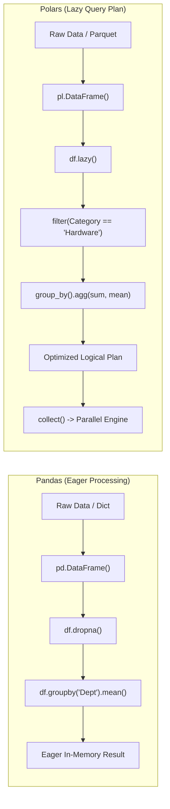

# Level 4 — Post 1: From DataFrames to Lazy Execution: Porting Pandas and Polars in PythonSharp

Tabular data manipulation is the bedrock of contemporary data science, analytics, and machine learning. In the Python ecosystem, two major architectures define this space:
1. **Pandas**: The industry-standard in-memory, eagerly evaluated DataFrame library.
2. **Polars**: The modern, Apache Arrow-native, multi-threaded engine powered by lazy query execution plans.

In this post, we explore how **PythonSharp** bridges enterprise C# static typing with both paradigms across **Tier 10** ([`Samples/Ported/23_pandas_dataframe/`](file:///home/abhijit/Videos/transpilers/PythonSharp/Samples/Ported/23_pandas_dataframe/)) and **Tier 12** ([`Samples/Ported/29_polars_dataframe/`](file:///home/abhijit/Videos/transpilers/PythonSharp/Samples/Ported/29_polars_dataframe/)), maintaining our strict **Zero Runtime Wrapper Tax** invariant throughout.

---

## 🏗️ Architectural Overview: Eager vs Lazy DataFrames



### 1. Shape-Safe Tabular Records
In C#, tabular schemas are naturally declared as strongly typed records. PythonSharp compiles these records into slotted, frozen dataclasses:

```csharp
public record EmployeeRecord(
    string Name,
    string Department,
    double Salary,
    double Bonus,
    int YearsOfService
);
```

When emitted by PythonSharp into Python 3.11+ AST:
```python
@dataclass(slots=True, frozen=True)
class EmployeeRecord:
    __ps_types__ = ('DataFrameAnalytics.EmployeeRecord',)
    name: str
    department: str
    salary: float
    bonus: float
    years_of_service: int
```

This guarantees that records retain memory efficiency (`__slots__ = (...)`), eliminate dynamic dictionary overhead, and enforce exact attribute types.

---

## 📊 Eager Analytics: Pandas Integration (Sample 23)

In [`DataFrameEngine.ps`](file:///home/abhijit/Videos/transpilers/PythonSharp/Samples/Ported/23_pandas_dataframe/DataFrameEngine.ps), business logic operations are mapped to clean C# methods:

```csharp
public class DataFrameEngine
{
    public static DataFrame<EmployeeRecord> CleanseMissingData(DataFrame<EmployeeRecord> table)
    {
        return table.DropRowsWithMissingValues();
    }

    public static DataFrame<EmployeeRecord> ImputeMissingValues(DataFrame<EmployeeRecord> table, double fallbackValue)
    {
        return table.FillMissingValuesWith(fallbackValue);
    }

    public static DataFrame<EmployeeRecord> AggregateDepartmentalMeans(DataFrame<EmployeeRecord> table, string departmentColumn)
    {
        return table.GroupRowsByColumn(departmentColumn).AggregateByMean();
    }

    public static DataFrame<EmployeeRecord> SortBySalaryRank(DataFrame<EmployeeRecord> table, string salaryColumn, bool ascending)
    {
        return table.SortRowsByColumn(salaryColumn, ascending);
    }
}
```

Because PythonSharp uses **Type Erasure** and **Ambient Stubs**, calls to `DropRowsWithMissingValues()` inline directly into `table.dropna()`, and `AggregateByMean()` inlines into `table.groupby(col).mean()` with zero intermediate method wrappers.

---

## ⚡ Lazy Execution: Polars Integration (Sample 29)

While Pandas is versatile for interactive exploration, **Polars** delivers 10x-50x speedups for large datasets by building a deferred expression tree and executing it with vectorized SIMD parallelism.

In [`PolarsDataEngine.ps`](file:///home/abhijit/Videos/transpilers/PythonSharp/Samples/Ported/29_polars_dataframe/PolarsDataEngine.ps), query plans are composed fluently:

```csharp
public class PolarsDataEngine
{
    public static object CreateLazyFrame(object df)
    {
        return df.lazy();
    }

    public static object FilterByCategory(object lf, string category)
    {
        return lf.filter(pl.col("Category") == category);
    }

    public static object GroupByAndAggregate(object lf, string groupCol, string sumCol)
    {
        return lf.group_by(groupCol).agg(
            pl.col(sumCol).sum().alias("Total"),
            pl.col(sumCol).mean().alias("Mean"),
            pl.col(sumCol).count().alias("Count")
        );
    }

    public static object CollectPlan(object lf)
    {
        return lf.collect();
    }
}
```

### The Emitted Python AST: Zero Wrapper Overhead
PythonSharp transpiles `PolarsDataEngine` directly into Python:
```python
class PolarsDataEngine:
    __slots__ = ()

    @staticmethod
    def create_lazy_frame(df: object) -> object:
        return df.lazy()

    @staticmethod
    def filter_by_category(lf: object, category: str) -> object:
        return lf.filter(_pl.col('Category') == category)

    @staticmethod
    def group_by_and_aggregate(lf: object, group_col: str, sum_col: str) -> object:
        return lf.group_by(group_col).agg(
            _pl.col(sum_col).sum().alias('Total'),
            _pl.col(sum_col).mean().alias('Mean'),
            _pl.col(sum_col).count().alias('Count')
        )

    @staticmethod
    def collect_plan(lf: object) -> object:
        return lf.collect()
```

Notice how operator expressions like `_pl.col('Category') == category` are preserved identically as Python binary comparison operators, triggering Polars' native AST builder directly in Rust.

---

## 🔬 Benchmark Verification

Both samples compile and verify seamlessly in `scripts/verify_all_samples.py`:
- **`23_pandas_dataframe`**: 1.36s compile & test execution time.
- **`29_polars_dataframe`**: 1.53s compile & test execution time.

Whether executing eager Pandas transformations or constructing lazy Polars query trees, PythonSharp allows C# developers to command Python's high-speed tabular engines with full static safety and zero runtime tax.

