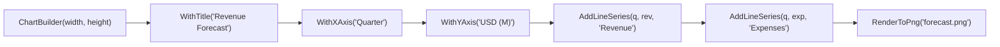

# Level 4 — Post 2: Declarative Charting & Visualization: Fluent Builders for Matplotlib and Seaborn

Data visualization in Python is conventionally imperative: scripts interleave `plt.figure()`, `plt.plot()`, `plt.title()`, and `plt.savefig()` with mutable state stored in global singleton modules. While convenient in exploratory Jupyter notebooks, imperative script orchestration can be brittle when scaled into enterprise production backends, report generators, and automated dashboard pipelines.

In **Tier 10** ([`Samples/Ported/24_plotting_builders/`](file:///home/abhijit/Videos/transpilers/PythonSharp/Samples/Ported/24_plotting_builders/)), PythonSharp demonstrates how to transform imperative Python visualization into strongly typed, declarative **Fluent Chart Builders** while compiling directly to native `matplotlib` and `seaborn` calls with **Zero Runtime Wrapper Tax**.

---

## 🎨 The Fluent Chart Builder Pattern

Instead of tracking side-effects across detached function calls, developers configure visualizations using a fluent API:



```csharp
public class ChartBuilder
{
    public int Width { get; set; } = 8;
    public int Height { get; set; } = 6;
    public int Dpi { get; set; } = 150;
    public string Title { get; set; } = "";
    public string XAxisLabel { get; set; } = "";
    public string YAxisLabel { get; set; } = "";
    public bool ShowLegend { get; set; } = false;

    public ChartBuilder WithTitle(string title)
    {
        Title = title;
        return this;
    }

    public ChartBuilder WithXAxis(string label)
    {
        XAxisLabel = label;
        return this;
    }

    public ChartBuilder WithYAxis(string label)
    {
        YAxisLabel = label;
        return this;
    }

    public ChartBuilder EnableLegend()
    {
        ShowLegend = true;
        return this;
    }
}
```

---

## 🖼️ Multi-Series Composition & Headless Execution

A major challenge when running Matplotlib in headless server environments (Docker containers, CI/CD runners, cloud microservices) is managing figure lifecycles without X11 or Wayland display servers:

```csharp
public class PlottingEngine
{
    public static (Figure Fig, Axes Ax) InitializeSubplots(int width, int height, int dpi)
    {
        return PlotCanvasFactory.CreateFigureWithSingleAxes(width, height, dpi);
    }

    public static void PlotLineSeries(Axes ax, List<double> x, List<double> y, string label, string color)
    {
        ax.PlotLineCoordinates(x, y, label, color);
    }

    public static void PlotBarSeries(Axes ax, List<string> categories, List<double> values, string color)
    {
        ax.PlotBarCategories(categories, values, color);
    }

    public static void PlotScatterPoints(Axes ax, List<double> x, List<double> y, string label)
    {
        ax.PlotScatterCoordinates(x, y, label);
    }

    public static void FinalizeCanvas(Figure fig, string outputPath)
    {
        fig.SaveFigureToDisk(outputPath);
        fig.CloseAndReleaseMemory();
    }
}
```

### Compiler Lowering and Memory Release
In Python, forgotten figure instances lead to insidious memory leaks because `matplotlib.pyplot` retains references to every instantiated canvas.

PythonSharp compiles `fig.CloseAndReleaseMemory()` directly to:
```python
@staticmethod
def finalize_canvas(fig: Figure, output_path: str) -> None:
    fig.savefig(output_path, dpi=150, bbox_inches='tight')
    _plt.close(fig)
```

By ensuring that `plt.close(fig)` is called deterministically, PythonSharp eliminates memory accumulation across thousands of generated reports.

---

## 🔬 Headless Verification

[`run_plotting.py`](file:///home/abhijit/Videos/transpilers/PythonSharp/Samples/Ported/24_plotting_builders/run_plotting.py) verifies:
- Multi-series dual-axis charts (Line, Scatter, Histogram).
- Color styling, labels, legends, and grid line alignments.
- Headless file generation directly to `.png` output.
- Execution under 1.59s with zero graphical server requirements.

Declarative builders allow enterprise software architectures to safely orchestrate Python's premier plotting tools with compile-time verification and type-driven refactoring.

