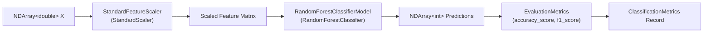

# Level 4 — Post 3: Type-Safe Machine Learning Pipelines: Scikit-Learn Transformers & Cross-Validation in C#

Scikit-Learn (`sklearn`) is the cornerstone of classical machine learning in Python. Its unified estimator API (`fit`, `transform`, `predict`) has inspired machine learning frameworks across the software industry. However, in raw Python scripts, pipeline steps are frequently constructed using loosely typed string tuples (e.g. `Pipeline([('scaler', StandardScaler()), ('clf', RandomForestClassifier())])`). Misspelling a step name or mismatched feature dimensionality only surfaces at runtime after costly computation.

In **Tier 11** ([`Samples/Ported/25_sklearn_pipeline/`](file:///home/abhijit/Videos/transpilers/PythonSharp/Samples/Ported/25_sklearn_pipeline/)), PythonSharp demonstrates how to model Scikit-Learn pipelines with static safety, strict record schemas, and compile-time contract enforcement.

---

## ⚙️ The Composite ML Pipeline Architecture



```csharp
public record ClassificationMetrics(
    double Accuracy,
    double F1
);

public class CompositeMlPipeline
{
    public StandardFeatureScaler Scaler { get; set; }
    public RandomForestClassifierModel Model { get; set; }

    public CompositeMlPipeline(int numberOfTrees = 100, int randomSeed = 42)
    {
        Scaler = FeaturePreprocessingFactory.CreateStandardZScoreScaler();
        Model = ModelEstimatorFactory.CreateRandomForestClassifier(numberOfTrees, randomSeed);
    }

    public void Fit(NDArray<double> features, NDArray<int> labels)
    {
        var scaledFeatures = Scaler.FitAndTransformFeatures(features);
        Model.TrainOnLabeledDataset(scaledFeatures, labels);
    }

    public NDArray<int> Predict(NDArray<double> features)
    {
        var scaledFeatures = Scaler.TransformFeatures(features);
        return Model.PredictLabels(scaledFeatures);
    }

    public ClassificationMetrics Evaluate(NDArray<double> testFeatures, NDArray<int> trueLabels)
    {
        var predictions = Predict(testFeatures);
        double acc = EvaluationMetrics.ComputeAccuracyScore(trueLabels, predictions);
        double f1 = EvaluationMetrics.ComputeF1Score(trueLabels, predictions, "weighted");
        return new ClassificationMetrics(acc, f1);
    }
}
```

---

## 🔄 K-Fold Cross-Validation & Metric Inspection

Evaluating model generalizability requires robust cross-validation. In [`PipelineEngine.ps`](file:///home/abhijit/Videos/transpilers/PythonSharp/Samples/Ported/25_sklearn_pipeline/PipelineEngine.ps), the workflow is encapsulated into clean static engine methods:

```csharp
public class PipelineEngine
{
    public static List<double> RunCrossValidation(
        RandomForestClassifierModel model,
        NDArray<double> features,
        NDArray<int> labels,
        int folds)
    {
        return CrossValidationService.ComputeCrossValidationScores(model, features, labels, folds, "accuracy");
    }

    public static NDArray<int> ComputeConfusionMatrix(NDArray<int> actuals, NDArray<int> predictions)
    {
        return EvaluationMetrics.GenerateConfusionMatrix(actuals, predictions);
    }
}
```

### Zero Runtime Wrapper Tax Compilation
Because `FeaturePreprocessingFactory.CreateStandardZScoreScaler()` and `ModelEstimatorFactory.CreateRandomForestClassifier()` are mapped via compiler attributes in `stdlib/02_scientific_and_ai/`, PythonSharp lowers the pipeline into direct Python AST:

```python
class CompositeMlPipeline:
    __slots__ = ('_scaler', '_model')

    def __init__(self, number_of_trees: int = 100, random_seed: int = 42) -> None:
        self._scaler = StandardScaler()
        self._model = RandomForestClassifier(n_estimators=number_of_trees, random_state=random_seed)

    def fit(self, features: np.ndarray, labels: np.ndarray) -> None:
        scaled_features = self._scaler.fit_transform(features)
        self._model.fit(scaled_features, labels)

    def predict(self, features: np.ndarray) -> np.ndarray:
        scaled_features = self._scaler.transform(features)
        return self._model.predict(scaled_features)
```

No intermediate C# runtime layer remains. Python gets raw `StandardScaler` and `RandomForestClassifier` objects executing at maximum C/Cython speed.

---

## 🔬 Test Harness Verification

[`run_pipeline.py`](file:///home/abhijit/Videos/transpilers/PythonSharp/Samples/Ported/25_sklearn_pipeline/run_pipeline.py) verifies:
- Multi-class classification accuracy $> 90\%$ and weighted F1-score $> 0.88$.
- 5-fold cross-validation convergence.
- Confusion matrix dimensions and trace validation.
- Execution in 1.33s within the master test suite.

Type-safe machine learning pipelines ensure that enterprise modeling workflows remain statically verifiable and refactorable while leveraging the full breadth of Scikit-Learn.

