# Level 4 — Post 5: Deep Learning Autograd & Gradient Descents: PyTorch Tensors in PythonSharp

Deep learning workloads demand maximum hardware acceleration. Modern neural networks rely on automatic differentiation (Autograd) and CUDA GPU kernel dispatching provided by **PyTorch** (`torch`). Interfacing C# with PyTorch traditionally required heavy interop bindings, native C++ wrappers, or serialized IPC calls across process boundaries, each incurring substantial memory copying and latency penalties.

In **Tier 11** ([`Samples/Ported/27_torch_tensors/`](file:///home/abhijit/Videos/transpilers/PythonSharp/Samples/Ported/27_torch_tensors/)), PythonSharp demonstrates the transpilation of neural networks directly into native PyTorch operations with **Zero Runtime Wrapper Tax**.

---

## 🧠 Neural Architecture & The Forward Pass

```mermaid
flowchart LR
    X["Input x\n(batch, in_features)"] --> L1["Layer1: nn.Linear(in, hidden)"]
    L1 --> H["Hidden State h"]
    H --> ReLU["F.relu(h)"]
    ReLU --> Act["Activated Hidden"]
    Act --> L2["Layer2: nn.Linear(hidden, out)"]
    L2 --> Pred["Predictions y_pred"]
    Pred --> MSE["MSELoss(y_pred, y_true)"]
    MSE --> Loss["Scalar Loss"]
    Loss --> Backprop["loss.backward()"]
    Backprop --> Step["optimizer.step()"]
```



In [`TorchEngine.ps`](file:///home/abhijit/Videos/transpilers/PythonSharp/Samples/Ported/27_torch_tensors/TorchEngine.ps), the two-layer perceptron is structured cleanly:

```csharp
public class TwoLayerPerceptron
{
    public FullyConnectedLinearLayer Layer1 { get; set; }
    public FullyConnectedLinearLayer Layer2 { get; set; }
    public MeanSquaredErrorLoss LossCriterion { get; set; }
    public GradientOptimizer Optimizer { get; set; }

    public TwoLayerPerceptron(int inFeatures, int hiddenFeatures, int outFeatures, double learningRate)
    {
        Layer1 = NeuralLayerFactory.CreateFullyConnectedLinearLayer(inFeatures, hiddenFeatures);
        Layer2 = NeuralLayerFactory.CreateFullyConnectedLinearLayer(hiddenFeatures, outFeatures);
        LossCriterion = LossCriterionFactory.CreateMeanSquaredErrorLoss();
        Optimizer = OptimizerFactory.CreateAdamOptimizer(Layer1.GetTrainableParameters(), learningRate);
    }

    public TorchTensor<double> Forward(TorchTensor<double> x)
    {
        var h = Layer1.ExecuteForwardPass(x);
        var activated = ActivationFunctions.ApplyRectifiedLinearUnit(h);
        return Layer2.ExecuteForwardPass(activated);
    }
}
```

---

## ⚡ The Training Loop: Zero-Grad, Backprop, and Optimization

Each optimization step involves:
1. Resetting previous iteration gradients: `optimizer.zero_grad()`.
2. Executing the forward pass to compute predictions.
3. Calculating the loss function: $\mathcal{L}_{\text{MSE}} = \frac{1}{N} \sum (y_i - \hat{y}_i)^2$.
4. Backpropagating gradients through the dynamic computation graph: `loss.backward()`.
5. Updating model weights: `optimizer.step()`.

```csharp
public double TrainStep(TorchTensor<double> x, TorchTensor<double> y)
{
    Optimizer.ResetAllGradientsToZero();
    var predictions = Forward(x);
    var loss = LossCriterion.ComputeLoss(predictions, y);
    loss.ComputeBackpropagationGradients();
    Optimizer.UpdateModelParameters();
    return loss.ExtractScalarValue();
}

public TrainingHistory Fit(TorchTensor<double> x, TorchTensor<double> y, int epochs)
{
    var losses = new List<double>();
    int i = 0;
    while (i < epochs)
    {
        var l = TrainStep(x, y);
        losses.Add(l);
        i += 1;
    }
    var initialLoss = losses[0];
    var finalLoss = losses[losses.Count - 1];
    return new TrainingHistory(losses, initialLoss, finalLoss);
}
```

### Compiler Lowering
PythonSharp lowers `TrainStep` into direct PyTorch calls:
```python
def train_step(self, x: torch.Tensor, y: torch.Tensor) -> float:
    self._optimizer.zero_grad()
    predictions = self.forward(x)
    loss = self._loss_criterion(predictions, y)
    loss.backward()
    self._optimizer.step()
    return loss.item()
```

Every C# abstraction (`ExecuteForwardPass`, `ComputeBackpropagationGradients`, `ExtractScalarValue`) dissolves into raw, unmediated PyTorch C extension operations.

---

## 🖥️ Hardware Device Acceleration

[`TensorAnalyticsService`](file:///home/abhijit/Videos/transpilers/PythonSharp/Samples/Ported/27_torch_tensors/TorchEngine.ps) automatically probes for available acceleration hardware:

```csharp
public class TensorAnalyticsService
{
    public string DetectAccelerator()
    {
        return AcceleratorRuntime.SelectOptimalDeviceName();
    }
}
```

When compiled:
```python
@staticmethod
def detect_accelerator() -> str:
    if _torch.cuda.is_available():
        return 'cuda'
    if hasattr(_torch.backends, 'mps') and _torch.backends.mps.is_available():
        return 'mps'
    return 'cpu'
```

---

## 🔬 Test Harness Verification

[`run_torch.py`](file:///home/abhijit/Videos/transpilers/PythonSharp/Samples/Ported/27_torch_tensors/run_torch.py) verifies:
- Multi-epoch training convergence (initial loss $> 1.0$, final loss $< 0.15$).
- Dimension inspection across batched tensor inputs.
- Hardware accelerator detection.
- Fast execution in 1.67s inside our headless test runner.

