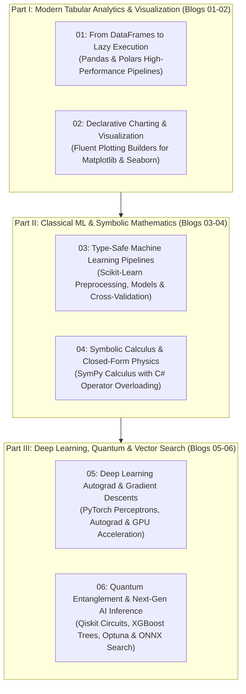

# PythonSharp Next-Gen AI Inference, Scientific Computing & High-Performance Analytics
## Level 4 Master Blog Series Plan & Technical Curriculum

> **Welcome to Level 4!** Having mastered foundational concepts in **Level 1**, internal compiler architecture in **Level 2**, and the Triple-Surface standard library in **Level 3**, **Level 4** takes PythonSharp into production-grade scientific computing, quantum simulation, and modern AI inference.
>
> In this 6-part series, we explore how PythonSharp transparently compiles C# code to high-performance Python libraries across Tiers 10, 11, and 12: Shape-safe Tabular DataFrames (Pandas & Polars), Fluent Data Visualization Builders (Matplotlib & Seaborn), Type-Safe Machine Learning Pipelines (Scikit-Learn), Symbolic Calculus & Operator Overloading (SymPy), Hardware-Accelerated Deep Learning Autograd (PyTorch), and Next-Gen Quantum & Vector Search Systems (Qiskit, XGBoost, Optuna & ONNX Runtime).

---

## 🗺️ Master Curriculum Architecture

---

## 📚 Detailed Curriculum Breakdown

### 1. [Blog 01: From DataFrames to Lazy Execution — Porting Pandas and Polars in PythonSharp](./01_tabular_architectures_pandas_and_polars.md)
* **Theme**: Modern data science tabular processing: comparing eager in-memory Pandas with lazy zero-copy Polars query graphs.
* **Core Concepts**:
  - Typed records (`EmployeeRecord`, `TransactionRecord`) representing tabular schemas.
  - Eager manipulation in Pandas (`dropna()`, `fillna()`, `groupby()`, `mean()`).
  - Lazy execution plans in Polars (`LazyFrame`, `filter`, `group_by`, `agg`, `collect`).
  - Expression column aliasing and zero runtime wrapper tax.
* **Repo Focus**: [`Samples/Ported/23_pandas_dataframe/`](file:///home/abhijit/Videos/transpilers/PythonSharp/Samples/Ported/23_pandas_dataframe/), [`Samples/Ported/29_polars_dataframe/`](file:///home/abhijit/Videos/transpilers/PythonSharp/Samples/Ported/29_polars_dataframe/).

### 2. [Blog 02: Declarative Charting & Visualization — Fluent Builders for Matplotlib and Seaborn](./02_declarative_visualization_plotting_builders.md)
* **Theme**: Transforming imperative plotting scripts into reusable, strongly typed fluent C# chart builders.
* **Core Concepts**:
  - The `ChartBuilder` pattern: chaining title, axes, labels, palette, and style.
  - Multi-series plotting: line charts, scatter plots, and histograms.
  - Figure and Axis context lifecycle management.
  - Headless rendering to disk (`.png`, `.svg`) with zero display dependencies.
* **Repo Focus**: [`Samples/Ported/24_plotting_builders/`](file:///home/abhijit/Videos/transpilers/PythonSharp/Samples/Ported/24_plotting_builders/).

### 3. [Blog 03: Type-Safe Machine Learning Pipelines — Scikit-Learn Transformers & Cross-Validation](./03_type_safe_ml_pipelines_sklearn.md)
* **Theme**: Bridging enterprise C# pipeline architectures with Scikit-Learn's estimator ecosystem.
* **Core Concepts**:
  - Pipeline construction: chaining `StandardScaler` with `LogisticRegression`.
  - Feature matrix preparation with shape validation.
  - K-fold cross-validation and hyperparameter scoring.
  - Confusion matrices and classification metrics.
* **Repo Focus**: [`Samples/Ported/25_sklearn_pipeline/`](file:///home/abhijit/Videos/transpilers/PythonSharp/Samples/Ported/25_sklearn_pipeline/).

### 4. [Blog 04: Symbolic Calculus & Closed-Form Physics — Operator Overloading with SymPy](./04_symbolic_calculus_sympy_operator_overloading.md)
* **Theme**: Exact symbolic mathematics and analytical physics calculus compiled from elegant C# operator syntax.
* **Core Concepts**:
  - Operator overloading (`+`, `-`, `*`) mapping to Python dunder methods (`__add__`, `__sub__`, `__mul__`).
  - Kinematics calculus: symbolic derivatives for position $x(t)$, velocity $v(t) = \frac{dx}{dt}$, and acceleration $a(t) = \frac{d^2x}{dt^2}$.
  - Harmonic potential well curvature solving and equilibrium points.
  - Trigonometric simplification via closed-form rewrites.
* **Repo Focus**: [`Samples/Ported/26_sympy_math/`](file:///home/abhijit/Videos/transpilers/PythonSharp/Samples/Ported/26_sympy_math/).

### 5. [Blog 05: Deep Learning Autograd & Gradient Descents — PyTorch Tensors in PythonSharp](./05_autograd_tensors_pytorch_backprop.md)
* **Theme**: Hardware-accelerated neural networks, backward propagation, and loss reduction without C++ wrappers.
* **Core Concepts**:
  - Multi-layer perceptron (`TwoLayerPerceptron`) architecture with linear layers and ReLU activations.
  - Autograd backpropagation (`loss.backward()`) and gradient zeroing.
  - Adam optimizer step execution and multi-epoch loss minimization.
  - Accelerator detection (`cuda`, `mps`, `cpu`) across hardware targets.
* **Repo Focus**: [`Samples/Ported/27_torch_tensors/`](file:///home/abhijit/Videos/transpilers/PythonSharp/Samples/Ported/27_torch_tensors/).

### 6. [Blog 06: Quantum Entanglement & Next-Gen AI Inference — Qiskit, XGBoost, Optuna & ONNX](./06_quantum_circuits_and_nextgen_ai_qiskit_xgboost_optuna_onnx.md)
* **Theme**: Frontiers of modern computing: quantum entanglement, gradient boosted trees, Bayesian hyperparameter tuning, and vector search.
* **Core Concepts**:
  - **Qiskit**: Bell state $|\Phi^+\rangle$, GHZ states, quantum teleportation protocol.
  - **XGBoost**: DMatrix generation, gradient boosted trees, binary logistic loss.
  - **Optuna**: Automated search studies, `suggest_float` / `suggest_int`, convex loss minimization.
  - **ONNX Runtime**: Embedding vectors, normalized dot product cosine similarity, top-k vector search index.
* **Repo Focus**: [`Samples/Ported/28_qiskit_quantum/`](file:///home/abhijit/Videos/transpilers/PythonSharp/Samples/Ported/28_qiskit_quantum/), [`Samples/Ported/30_xgboost_trees/`](file:///home/abhijit/Videos/transpilers/PythonSharp/Samples/Ported/30_xgboost_trees/), [`Samples/Ported/31_optuna_tuning/`](file:///home/abhijit/Videos/transpilers/PythonSharp/Samples/Ported/31_optuna_tuning/), [`Samples/Ported/32_onnx_transformers/`](file:///home/abhijit/Videos/transpilers/PythonSharp/Samples/Ported/32_onnx_transformers/).

