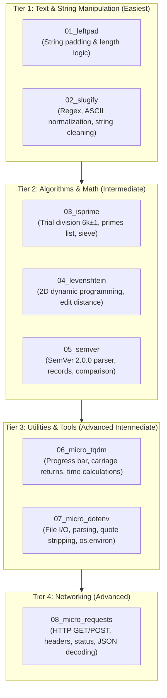

# PythonSharp Ported Libraries Roadmap & Plan

This roadmap tracks the step-by-step porting of canonical, zero-external-dependency Python libraries into **PythonSharp** projects inside `Samples/Ported/`.

The primary goal is real-world **dogfooding** and stress-testing of the PythonSharp compiler (`psc`), LSP server, semantic analyzer, and emitted Python 3.11+ bytecode on concrete codebases from easiest to most advanced.

---

## Porting Tier Overview

---

## Detailed Project Specifications

### Tier 1: Text & String Manipulation (Easiest)

#### 1. `01_leftpad`
* **Target Package**: `left-pad` / `pad-left`
* **Features**:
  - `LeftPad(string str, int len, string ch = " ")`
  - `RightPad(string str, int len, string ch = " ")`
  - String length handling, negative length checks, repetitive concatenation.
* **Compiler Stress Tests**: Default parameter values, string interpolation, loops, boundary condition guards.

#### 2. `02_slugify`
* **Target Package**: `python-slugify` (minimal core)
* **Features**:
  - `Slugify(string text, string separator = "-", bool lowercase = true)`
  - Removal of non-alphanumeric characters, duplicate separator collapsing, leading/trailing separator stripping.
* **Compiler Stress Tests**: `Regex` / `extern using re`, string character inspection, ternary operators, collection manipulation.

---

### Tier 2: Algorithms & Math (Intermediate)

#### 3. `03_isprime`
* **Target Package**: `is-prime` / `prime-numbers`
* **Features**:
  - `IsPrime(long n)`: Fast $6k \pm 1$ primality test.
  - `NextPrime(long n)`: Finds the next prime number.
  - `PrimesUpTo(int limit)`: Sieve of Eratosthenes generating `List<int>`.
  - `PrimeFactors(long n)`: Integer prime factor decomposition.
* **Compiler Stress Tests**: 64-bit integer (`long`) operations, while/for loops, mathematical formulas (`Math.Sqrt`), generic `List<int>` emission.

#### 4. `04_levenshtein`
* **Target Package**: `Levenshtein` (minimal distance algorithm)
* **Features**:
  - `Distance(string s1, string s2)`: Wagner–Fischer 2D dynamic programming matrix.
  - `Ratio(string s1, string s2)`: Normalized similarity score ($0.0 \dots 1.0$).
* **Compiler Stress Tests**: 2D array / multidimensional indexing, nested loops, min/max calculations, floating-point division.

#### 5. `05_semver`
* **Target Package**: `semver`
* **Features**:
  - `record SemanticVersion(int Major, int Minor, int Patch, string Prerelease = "", string Build = "")`
  - `Parse(string versionString)`
  - `Compare(SemanticVersion v1, SemanticVersion v2)`
  - `IsGreaterThan`, `IsLessThan`, `IsCompatibleWith`
* **Compiler Stress Tests**: C# Records with primary constructors, string splitting, numeric parsing (`int.Parse`), custom comparison logic.

---

### Tier 3: Utilities & Tools (Advanced Intermediate)

#### 6. `06_micro_tqdm`
* **Target Package**: `tqdm` (micro subset)
* **Features**:
  - `ProgressBar`: Formatted CLI progress bar with `\r` (carriage return).
  - Elapsed time, estimated remaining time (ETA), iterations per second.
  - Progress bar track rendering `[=====>....] 50%`.
* **Compiler Stress Tests**: System console output (`Console.Write`), system time calculations (`time`), class state encapsulation, custom formatting.

#### 7. `07_micro_dotenv`
* **Target Package**: `python-dotenv` (core reader)
* **Features**:
  - `Parse(string content)`: Parses key-value pairs, strips `#` comments, handles single and double quotes, handles `export KEY=VAL`.
  - `Load(string filePath = ".env")`: Reads file from disk, parses, and injects into runtime environment.
* **Compiler Stress Tests**: File I/O (`File.ReadAllText` / ambient os/io stubs), dictionary manipulation (`Dict<string, string>`), string trimming/splitting.

---

### Tier 4: Networking (Advanced)

#### 8. `08_micro_requests`
* **Target Package**: `requests` (micro core)
* **Features**:
  - `record HttpResponse(int StatusCode, string Text, Dict<string, string> Headers)` with `Json<T>()` helper.
  - `Get(string url, Dict<string, string>? headers = null, double timeout = 10.0)`
  - `Post(string url, string data, Dict<string, string>? headers = null, double timeout = 10.0)`
* **Compiler Stress Tests**: Ambient interop (`urllib.request`, `http.client`), typed HTTP response records, nullable parameters, exception handling (`try / catch (Exception ex)`).

---

## Execution Status

| # | Project | Directory | Tier | Status |
| :-: | :--- | :--- | :--- | :---: |
| 1 | `leftpad` | `Samples/Ported/01_leftpad` | Text & String | Completed |
| 2 | `slugify` | `Samples/Ported/02_slugify` | Text & String | Completed |
| 3 | `isprime` | `Samples/Ported/03_isprime` | Algorithms & Math | Completed |
| 4 | `levenshtein` | `Samples/Ported/04_levenshtein` | Algorithms & Math | Completed |
| 5 | `semver` | `Samples/Ported/05_semver` | Algorithms & Math | Completed |
| 6 | `micro_tqdm` | `Samples/Ported/06_micro_tqdm` | Utilities & Tools | Completed |
| 7 | `micro_dotenv` | `Samples/Ported/07_micro_dotenv` | Utilities & Tools | Completed |
| 8 | `micro_requests` | `Samples/Ported/08_micro_requests` | Networking | Completed |

---

## Standard Port Structure

Each ported package must contain:
1. `<Name>.psproj`: Project manifest specifying assembly name and target Python 3.11+.
2. `src/` (or root `.ps`): The PythonSharp source code defining classes/records under a clean namespace.
3. `run_<name>.py`: Verification harness comparing the compiled output with known expected outputs or Python standard tests.
4. `README.md`: Compilation commands (`psc build`) and usage examples.
