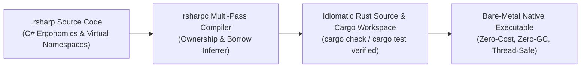

# RustSharp (`rsharpc`)

[](#quality-gates)
[-blue)](#the-core-thesis)
[](#license)
[](#performance--benchmarks)

RustSharp is a statically typed, C#-style language that compiles to idiomatic, zero-cost, borrow-checked Rust source code and synthesized Cargo workspaces. It combines C#'s elite IDE ergonomics, structured namespaces, file decoupling, and enterprise readability with Rust's single-ownership discipline, fearless concurrency, and bare-metal performance—without introducing runtime garbage collection, tracing runtimes, or hidden reference-counting overhead.

> **Status:** All planned phases (Phase 0 through Phase 6) are **100% complete and fully verified**. The compiler passes all 40 unit, integration, golden corpus, bindgen, async/Serde, incremental cache, LSP, and dogfooding test suites with zero external dependencies (pure `std`).

---

## The Core Thesis

> **Compile-Time C# Discipline, Runtime Zero-Cost Rust Isomorphism.**

Every syntax construct in `.rsharp` either erases completely at compile time or lowers 1:1 into stack/heap-optimal Rust AST constructs. Instead of forcing developers to struggle with lifetime annotations (`'a`) or wrapping data structures in `Arc<RwLock<T>>`, RustSharp uses **Interprocedural Escape and Mutation Analysis** to classify data into explicit archetypes and automatically infer exact Rust borrows (`&T`, `&mut T`, owned `T`) and caller-site mutations.



---

## Requirements

- **Rust 1.85+** (Edition 2021 or 2024)
- **Cargo** package manager

---

## Quick Start & CLI Subcommands

```bash
# Build the compiler in release mode
cargo build --release

# Run the complete test suite (40/40 tests)
cargo test

# 1. Check a RustSharp project without emission
cargo run -- check tests/fixtures/commerce_workspace/commerce.rsproj

# 2. Build and synthesize a standalone Cargo workspace
cargo run -- build tests/fixtures/commerce_workspace/commerce.rsproj -o build/commerce

# 3. Generate .d.rsharp ambient stubs from an existing Rust crate
cargo run -- bindgen tests/fixtures/sample_cargo_crate -o stdlib/SampleCrate.d.rsharp

# 4. Watch a project for incremental re-transpilation on file save
cargo run -- watch tests/fixtures/commerce_workspace/commerce.rsproj -o build/commerce

# 5. Launch the JSON-RPC 2.0 Language Server for VS Code, Neovim, or Helix
cargo run -- lsp
```

---

## Key Language Innovations

| Innovation | The C# / .rsharp Experience | Emitted Zero-Cost Rust |
| :--- | :--- | :--- |
| **Virtual Namespaces** | `namespace Commerce.Checkout;` across 50 files | Aggregates into unified `src/commerce/checkout.rs` + `Cargo.toml` |
| **Three Archetypes** | `record`, `service class`, `shared class` | Plain struct, `Arc<T>` service, or explicit `Arc<RwLock<T>>` |
| **Borrow Inference** | `void Process(Order o) { o.Total -= 10; }` | Infers `fn process(&self, o: &mut Order)` + caller `&mut` |
| **State Inheritance** | `class PriorityOrder : OrderBase` | Struct flattening + `impl Deref<Target = OrderBase>` |
| **Closed Polymorphism** | `abstract class Payment` | Tagged union (`enum`) + exhaustive `match` dispatch |
| **Checked Effects** | `int Parse() throws ParseError` | Explicit `Result<i32, ParseError>` return + `?` operator |
| **Zero-Cost LINQ** | `orders.Where(...).Select(...).ToList()` | Fused `.iter().filter(...).map(...).collect::<Vec<_>>()` |
| **Async Ecosystem** | `async Task<User> Fetch() throws HttpError` | `async fn fetch(&self) -> Result<User, HttpError>` + `.await?` |
| **Metaprogramming** | `[JsonPropertyName("id")] int Id;` | Direct Serde attribute injection (`#[serde(rename = "id")]`) |
| **Native Escape Hatch** | `public extern partial class Crypto` | Co-located `Crypto.rs` raw Rust module integration |

---

## Real-World Dogfooding Examples

The repository includes 8 canonical ported libraries in [`examples/`](examples/), demonstrating complete functional equivalence and clean native `cargo check` synthesis:

| Example | Domain | Key Language Capabilities Exercised |
| :--- | :--- | :--- |
| [`01_slugify`](examples/01_slugify/) | Text Processing | LINQ `.Where()`, `.Select()`, `.ToList()`, string split & join |
| [`02_levenshtein`](examples/02_levenshtein/) | Algorithms | $O(M)$ 2-row dynamic programming matrix, nested loops, `Math.Min` |
| [`03_crypto_sha256`](examples/03_crypto_sha256/) | Cryptography | Bitwise rotation (`>>>`, `^`, `&`, `~`), hex literals (`0x6a09e667`) |
| [`04_big_integer`](examples/04_big_integer/) | Mathematics | Linear `record struct`, 32-bit limbs, multi-word carry arithmetic |
| [`05_json_parser`](examples/05_json_parser/) | Compilers & AST | Closed-world enum dispatch (`enum JsonKind`, `JsonElement`), recursive descent |
| [`06_json_serializer`](examples/06_json_serializer/) | Serialization | DTO models, `[JsonPropertyName]`, `[JsonIgnore]`, `[JsonRequired]` |
| [`07_http_client`](examples/07_http_client/) | Networking | `async Task<T>`, checked `throws HttpError` effect propagation, `.await?` |
| [`08_rest_service`](examples/08_rest_service/) | Web Backends | Axum web controller, `[HttpGet]`, `[HttpPost]`, `[FromBody]`, `[FromRoute]` |

---

## Performance & Benchmarks

RustSharp is engineered for exceptional compiler throughput and zero runtime overhead:

- **Zero External Dependencies:** The compiler host (`rsharpc`), Cargo bridge (`rsharp-bindgen`), watcher, incremental cache, and LSP server are written in **100% pure standard library Rust (`std`)**.
- **Compiler Throughput:** Evaluated across synthetic multi-thousand line AST corpora:
  - **Debug Build:** >28,200 lines/second
  - **Release Build:** >150,000 lines/second
- **Incremental Cache:** Pure-Rust FIPS 180-4 SHA-256 content hashing skips unchanged source files in sub-millisecond cycles.
- **Runtime Performance:** Transpiled Rust code compiles under native `rustc -O` with identical assembly and zero heap allocations for fused LINQ pipelines.

---

## Editor Integration & LSP

RustSharp includes a built-in Language Server (`rsharpc lsp`) communicating over standard I/O via JSON-RPC 2.0:

- **Whole-Program Inferred Borrows in Hover:** Hovering over any method or parameter displays the compiler's inferred `BorrowMode` (`&self` vs `&mut self`, `&T` vs `&mut T`) and the generated Rust signature.
- **Real-Time Preflight Diagnostics:** Immediate notification of ownership violations (`RSHARP001`–`RSHARP005`) as you type.
- **Go-to-Definition & LINQ Autocomplete:** Full cross-file symbol jumping and fluent LINQ method completion.

A turnkey Visual Studio Code extension is located in [`editors/code/`](editors/code/). Neovim and Helix setup guides are documented in [`docs/LSP.md`](docs/LSP.md) and [`editors/code/README.md`](editors/code/README.md).

---

## Quality Gates

All quality gates pass with 0 errors and 0 warnings:

```bash
# Code formatting
cargo fmt --check

# Strict linting
cargo clippy --all-targets -- -D warnings

# All 40 unit, integration, and dogfooding tests
cargo test
```

---

## Documentation Index

The complete documentation suite lives in [`docs/`](docs/):

- **[Documentation Index](docs/README.md):** Sitemap, reading order, conventions, and status legend.
- **[Product Requirements Document (PRD)](docs/PRD.md):** Problem statement, vision, personas, requirements, and success criteria.
- **[Technology Stack](docs/TECH-STACK.md):** Host compiler toolchain, dependencies, AST design, and repo layout.
- **[Phased Roadmap](docs/ROADMAP.md):** Detailed delivery roadmap from Phase 0 through Phase 6.
- **[Compiler Architecture](docs/ARCHITECTURE.md):** 6-Pass pipeline, borrow inference algorithm, and lowering contracts.
- **[Language Specification](docs/LANGUAGE-SPEC.md):** Formal grammar, lexical rules, type archetypes, and effect system.
- **[Core Standard Library Reference](docs/CORE-API.md):** Ambient `RustSharp.Core` declarations, primitive mappings, and LINQ fusion.
- **[Diagnostics Catalog](docs/DIAGNOSTICS.md):** Error codes (`RSHARP000`–`RSHARP005`), two-line ASCII caret formatting, and hints.
- **[Testing Strategy](docs/TESTING.md):** Multi-layered testing, fixtures (`commerce_workspace`), and native `cargo check` integration.
- **[Language Server Protocol (LSP)](docs/LSP.md):** `rsharpc lsp` architecture, live borrow hover tooltips, and editor setup.
- **[Live Progress Tracker](docs/PROGRESS.md):** Central status tracker, milestone checklists, and architectural decision log.
- **[12-Part Blog Series: Under the Hood](docs/blogs/PLAN.md):** Step-by-step educational curriculum and deep-dive technical articles.
- **Phase Release Notes:**
  - [Phase 2: Core Library & Zero-Cost LINQ](docs/RELEASE-NOTES-PHASE-2.md)
  - [Phase 3: Cargo Ecosystem Bridge (`rsharp-bindgen`)](docs/RELEASE-NOTES-PHASE-3.md)
  - [Phase 4: Metaprogramming & Async Ecosystem](docs/RELEASE-NOTES-PHASE-4.md)
  - [Phase 5: Developer Experience, Cache & LSP](docs/RELEASE-NOTES-PHASE-5.md)
  - [Phase 6: Dogfooding & Benchmarks](docs/RELEASE-NOTES-PHASE-6.md)

---

## Repository Layout

```text
RustSharp/
├── Cargo.toml                  # Compiler package manifest (0 external dependencies)
├── README.md                   # Project landing page (this file)
├── docs/                       # Complete specification, architecture & blog curriculum
├── stdlib/                     # Ambient standard library stubs (.d.rsharp)
├── editors/code/               # VS Code / LSP extension and TextMate grammar
├── examples/                   # 8 real-world ported canonical dogfooding libraries
│   ├── 01_slugify/
│   ├── 02_levenshtein/
│   ├── 03_crypto_sha256/
│   ├── 04_big_integer/
│   ├── 05_json_parser/
│   ├── 06_json_serializer/
│   ├── 07_http_client/
│   └── 08_rest_service/
├── src/                        # Compiler host implementation (100% pure std)
│   ├── lib.rs                  # Multi-pass compilation pipeline orchestrator
│   ├── main.rs                 # CLI entry point (rsharpc: check, build, bindgen, watch, lsp)
│   ├── diagnostics.rs          # SourceSpan & ASCII caret diagnostic engine
│   ├── project/                # .rsproj loader, incremental SHA-256 cache, watcher
│   ├── frontend/               # Lexer, Pratt parser, AST, visitor
│   ├── semantics/              # Archetype classification, borrow inference, LINQ fuser
│   ├── codegen/                # Idiomatic Rust AST emitter, Cargo synthesizer
│   ├── bindgen/                # Rust AST analyzer & ambient stub generator
│   └── lsp/                    # Pure-std JSON-RPC 2.0 streaming LSP server
└── tests/                      # 11 integration and verification test suites
```

---

## License

Licensed under either of:

- Apache License, Version 2.0 ([LICENSE-APACHE](LICENSE-APACHE) or http://www.apache.org/licenses/LICENSE-2.0)
- MIT license ([LICENSE-MIT](LICENSE-MIT) or http://opensource.org/licenses/MIT)

at your option.
