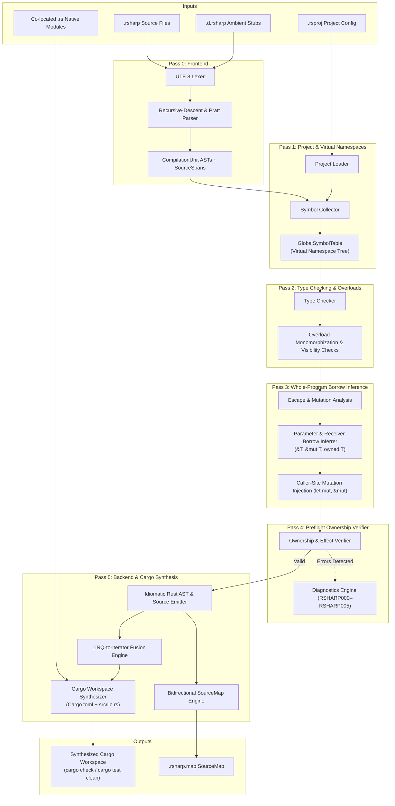

# RustSharp Compiler Architecture

| Field | Value |
| :--- | :--- |
| **Compiler Binary** | `rsharpc` |
| **Pipeline Strategy** | Multi-Pass with Interior Semantic Decoration Slots |
| **Status** | Active |
| **Owner** | RustSharp Core Team |
| **Related Documents** | [PRD.md](PRD.md), [LANGUAGE-SPEC.md](LANGUAGE-SPEC.md), [TECH-STACK.md](TECH-STACK.md), [DIAGNOSTICS.md](DIAGNOSTICS.md) |

---

## 1. High-Level Architectural Thesis

The RustSharp compiler (`rsharpc`) converts high-level, statically typed `.rsharp` source files into zero-cost, idiomatic, borrow-checked Rust crates. 

Its architecture is governed by three non-negotiable principles:
1. **Compile-Time C# Discipline, Runtime Zero-Cost Rust Isomorphism:**
   Language constructs that exist for architectural cleanliness (such as virtual namespaces, visibility boundaries, and interfaces) either erase completely at compile time or lower 1:1 into optimal Rust structs, enums, and trait implementations.
2. **Whole-Program Ownership & Borrow Inference:**
   Instead of forcing developers to write complex lifetime annotations (`'a`) or wrapping objects in runtime reference-counting wrappers (`Arc<RwLock<T>>`), the compiler uses **Interprocedural Escape and Mutation Analysis** to infer exact Rust borrows (`&T`, `&mut T`, owned `T`) and caller-site coercions.
3. **Decoupled Virtual Namespaces:**
   Physical directory structures do not dictate Rust `mod` trees. `rsharpc` aggregates all types belonging to a logical namespace across arbitrary directories into unified Rust modules and synthesizes the Cargo crate hierarchy automatically.

---

## 2. Multi-Pass Compiler Pipeline

The compilation pipeline consists of six distinct, sequential passes:



---

## 3. Detailed Pass Specifications

### 3.1 Pass 0: Frontend (Lexer, Tokens, AST, Pratt Parser)
- **Input:** Raw UTF-8 source strings from `.rsharp` and `.d.rsharp` files.
- **Lexer (`src/frontend/lexer.rs`):** Converts character streams into structured `Token` instances while preserving exact `SourceSpan` (file ID, line, column). Handles interpolated strings `$"..."`, decimal literals `10.0m`, and multi-character operators (`..`, `??`, `?.`, `::`).
- **AST with Semantic Decoration Slots (`src/frontend/ast.rs`):** Instead of duplicating AST node types across passes, every declaration, statement, and expression contains interior `Option<T>` fields:
  ```rust
  pub struct ParamDecl {
      pub span: SourceSpan,
      pub name: String,
      pub type_name: String,
      pub inferred_borrow: Option<BorrowKind>, // Populated in Pass 3
  }
  ```
- **Parser (`src/frontend/parser.rs`):** Combines recursive-descent parsing for top-level constructs (`namespace`, `using`, `class`, `record`, `interface`) with a Pratt parser for binary and unary expressions. Recovers from syntax errors to collect multiple diagnostics (`RSHARP000`) before halting.

---

### 3.2 Pass 1: Project Loader & Virtual Namespace Collector
- **Input:** `.rsproj` configuration and parsed `CompilationUnit` ASTs.
- **Virtual Namespace Aggregator (`src/semantics/collector.rs`):** Discovers all types declared under `namespace Foo.Bar` across any number of files in the project.
- **GlobalSymbolTable (`src/semantics/symbols.rs`):**
  - Maintains a hierarchical `NamespaceNode` tree where namespaces contain types, and types contain fields, constructors, and methods.
  - Resolves circular type references across files (e.g. `Order` references `Customer`, and `Customer` has a `List<Order>`) in a single indexed pass without requiring C++-style forward declarations.

---

### 3.3 Pass 2: Type Checker & Static Overload Monomorphization
- **Input:** Populated `GlobalSymbolTable` and method ASTs.
- **Type Checker (`src/semantics/type_checker.rs`):**
  - Verifies assignment compatibility, method call signatures, and return expressions.
  - Validates access modifiers: `public` (crate external), `internal` (crate internal), `private` (enclosing type), `protected` (hierarchy).
- **Static Overload Monomorphization:** Rust does not permit multiple methods with the same name in an `impl` block. Pass 2 identifies overloads and assigns deterministic monomorphized Rust identifiers (e.g., `find_by_id` vs `find_by_email`) with zero runtime overhead.

---

### 3.4 Pass 3: Whole-Program Ownership & Borrow Inference
- **Input:** Type-checked AST and global call graph.
- **Inference Engine (`src/semantics/borrow_inferrer.rs`):**
  This pass executes **Interprocedural Escape & Mutation Analysis**:
  1. **Receiver Inference:** Inspects method bodies for field mutations on `this`:
     - If fields are mutated $\rightarrow$ `&mut self`.
     - If fields are only read $\rightarrow$ `&self`.
     - If the instance is moved or converted into another type $\rightarrow$ `self`.
  2. **Parameter Borrow Inference:** Inspects how arguments are used across callees:
     - Argument is only inspected/read $\rightarrow$ infer `&T` (or `&str` for `string`, `&[T]` for collections).
     - Argument has fields mutated or mutating methods called $\rightarrow$ infer `&mut T`.
     - Argument is stored in a struct field or returned out of the function $\rightarrow$ infer owned `T`.
  3. **Caller-Site Mutation Injection:** When a call site passes an argument to a parameter inferred as `&mut T`, the inferrer:
     - Injects `let mut` on the caller's local variable declaration.
     - Lowering emits `&mut arg` at the invocation site.

---

### 3.5 Pass 4: Preflight Ownership Verifier
- **Input:** Decorated AST with inferred borrows.
- **Verifier (`src/semantics/preflight_verifier.rs`):**
  Verifies that ownership invariants are upheld before generating Rust code:
  - **`RSHARP001` (Illegal Shared Mutability):** Detects if an object has two active mutable aliases in the same scope or is mutated while borrowed immutably.
  - **`RSHARP002` (Escaping Local Borrow):** Detects if a reference to stack-local memory escapes its creating scope.
  - **`RSHARP003` (Uncaught Checked Effect):** Detects if a method invokes a `throws E` function without declaring `throws E` in its own signature or wrapping the call in `try { ... } catch (E err)`.

---

### 3.6 Pass 5: Backend Emitter, Cargo Synthesizer & SourceMap
- **Input:** Verified AST and project configuration.
- **Rust AST & Source Emitter (`src/codegen/rs_ast_emitter.rs`):** Emits idiomatic, formatted Rust code according to type archetypes:
  - **`record` / `struct`:** Emitted as `#[derive(Clone, Debug, PartialEq)] pub struct` with automatic borrow parameters.
  - **`service class`:** Emitted as an immutable struct holding `Arc<T>` dependencies with a `pub fn new(...) -> Self` constructor.
  - **`shared class`:** Emitted with fields wrapped in `Arc<RwLock<T>>` for safe multi-owner mutability.
  - **State Inheritance:** Emits embedded base struct + `impl Deref<Target = Base>` and `impl DerefMut`.
  - **Closed-World Polymorphism:** Lowers abstract class hierarchies into Rust tagged unions (`enum`) with exhaustive `match` dispatch.
  - **LINQ-to-Iterator Fusion:** Emits chained `.iter().filter(...).map(...).collect()` calls.
- **Cargo Synthesizer (`src/codegen/cargo_synthesizer.rs`):** Synthesizes `Cargo.toml`, generates `src/lib.rs` wiring up modular namespace files, and integrates co-located `.rs` native modules.
- **SourceMap Engine (`src/codegen/sourcemap.rs`):** Emits a `.rsharp.map` file correlating emitted Rust line/column intervals with original `.rsharp` spans.

---

## 4. Architectural Archetypes and Lowering Rules

| RustSharp Construct | Architectural Semantics | Emitted Idiomatic Rust |
| :--- | :--- | :--- |
| `public record Order(...)` | Linear value type / DTO | `#[derive(Clone, Debug, PartialEq)] pub struct Order { ... }` |
| `public service class OrderService` | Dependency-injected service | Struct holding `Arc<T>` fields; `&self` receivers |
| `public shared class SessionCache` | Multi-owner mutable state | Struct wrapping fields in `Arc<RwLock<T>>` |
| `public class Sub : Base` | State inheritance | Flattened struct embedding `pub base: Base` + `impl Deref` |
| `public abstract class Shape` | Closed-world hierarchy | `pub enum Shape { Circle(...), Rect(...) }` + `match` |
| `public extensible interface IPlugin` | Open external trait | `pub trait IPlugin { ... }` |
| `throws PaymentError` | Checked effect | `Result<T, PaymentError>` return type + `?` operator |
| `order.Items.Where(...).ToList()` | LINQ pipeline | `order.items.iter().filter(...).cloned().collect::<Vec<_>>()` |

---

## 5. Bidirectional SourceMap & Traceback Architecture

When native Rust compilation fails or when a panic occurs at runtime, the developer needs to correlate the Rust stack frame back to their `.rsharp` source file:

```text
[Emitted Rust (src/commerce/orders.rs:149)]
             │
             ▼ SourceMap Lookup (.rsharp.map)
[Original Source (Domain/OrderHandler.rsharp:106)]
```

The SourceMap engine maintains a sorted table of mappings:
```rust
pub struct MappingEntry {
    pub emitted_line: u32,
    pub emitted_col: u32,
    pub source_file: String,
    pub original_line: u32,
    pub original_col: u32,
}
```
This enables `rsharpc check` and the LSP server to translate native `rustc` diagnostic output back into original `.rsharp` file coordinates.

