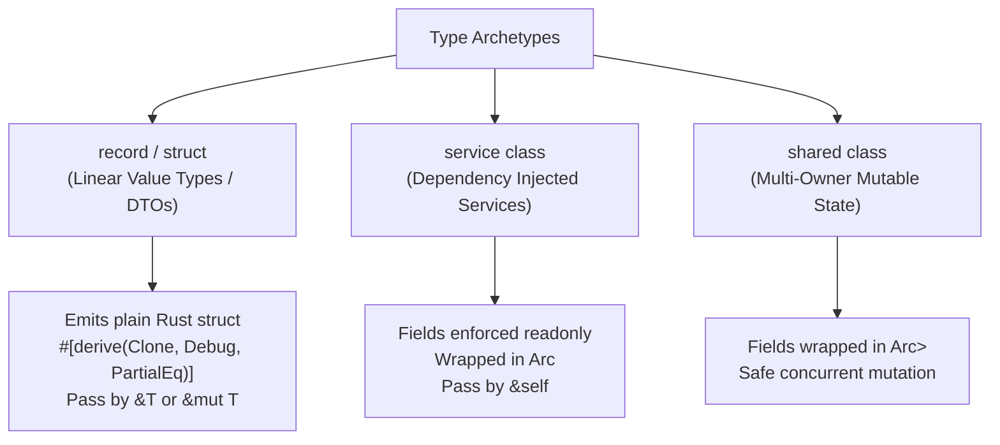

# RustSharp Language Specification

| Field | Value |
| :--- | :--- |
| **Language** | RustSharp |
| **File Extensions** | `.rsharp` (Source), `.d.rsharp` (Ambient Stubs), `.rsproj` (Project) |
| **Status** | Active |
| **Owner** | RustSharp Core Team |
| **Related Documents** | [PRD.md](PRD.md), [ARCHITECTURE.md](ARCHITECTURE.md), [CORE-API.md](CORE-API.md), [DIAGNOSTICS.md](DIAGNOSTICS.md) |

---

## 1. Design Rules & Core Philosophy

The overarching rule of RustSharp is **Compile-Time C# Discipline, Runtime Zero-Cost Rust Isomorphism**.
- Every construct declared in `.rsharp` must either erase completely at compile time or lower 1:1 into stack/heap-optimal Rust AST constructs.
- No ambient garbage collector or tracing runtime is introduced.
- Multi-owner reference counting (`Arc<RwLock<T>>`) is only used when explicitly requested via the `shared class` archetype.

---

## 2. Source Files & Compilation Units

- **Source Files (`.rsharp`):** Contain declarations and implementation code.
- **Ambient Declaration Files (`.d.rsharp`):** Contain signatures and metadata attributes for external crates or standard library types. Emitted without generating implementation bodies.
- **Project Files (`.rsproj`):** Specify project metadata, dependencies, and compilation targets.
- **File Encoding:** UTF-8 without BOM.

---

## 3. Lexical Structure

### 3.1 Identifiers and Keywords
RustSharp distinguishes between contextual keywords and reserved keywords:

- **Reserved Keywords:**
  `namespace`, `using`, `extern`, `public`, `internal`, `private`, `protected`, `class`, `record`, `struct`, `interface`, `abstract`, `sealed`, `virtual`, `override`, `readonly`, `service`, `shared`, `primitive`, `extensible`, `throws`, `throw`, `try`, `catch`, `finally`, `if`, `else`, `switch`, `case`, `default`, `while`, `for`, `foreach`, `in`, `return`, `break`, `continue`, `new`, `this`, `base`, `null`, `true`, `false`.

### 3.2 Literals
- **Integer Literals:**
  - `42` $\rightarrow$ `i32`
  - `100L` $\rightarrow$ `i64`
  - `50u` $\rightarrow$ `u32`
  - `0xFF`, `0b1010_0101` $\rightarrow$ Hex and binary integers
- **Floating-Point Literals:**
  - `3.14` $\rightarrow$ `f64`
  - `3.14f` $\rightarrow$ `f32`
- **Decimal Literals:**
  - `10.0m`, `150.99m` $\rightarrow$ Lowers to `rust_decimal::Decimal::new(...)`
- **String Literals:**
  - Standard string: `"Hello, World!"` $\rightarrow$ `String` / `&str`
  - Interpolated string: `$"Order {order.Id} for {customer.Name}"` $\rightarrow$ Lowers to `format!("Order {} for {}", order.id, customer.name)`
- **Boolean Literals:** `true`, `false` $\rightarrow$ `bool`
- **Null Literal:** `null` $\rightarrow$ Lowers to `None` for optional types.

### 3.3 Operators and Delimiters
- **Null-Coalescing:** `??`
- **Safe Navigation:** `?.`
- **Range / Slicing:** `..`
- **Namespace Resolution:** `::`
- **Lambda Arrow:** `=>`
- **Arithmetic:** `+`, `-`, `*`, `/`, `%`
- **Relational & Equality:** `==`, `!=`, `<`, `<=`, `>`, `>=`
- **Logical:** `&&`, `||`, `!`
- **Bitwise:** `&`, `|`, `^`, `~`, `<<`, `>>`

---

## 4. Namespaces, Imports, and Visibility

Physical folder paths do not dictate Rust module trees. Developers organize `.rsharp` files by domain or feature.

```csharp
// File: src/Features/Checkout/OrderHandler.rsharp
namespace Commerce.Checkout;

using Commerce.Domain.Models;
extern using tokio::time as time;
extern using rust_decimal::Decimal;
```

### Lowering Strategy
1. The compiler groups all files declaring `namespace Commerce.Checkout` and generates a unified Rust module file `src/commerce/checkout.rs`.
2. `extern using <crate_path> [as <Alias>];` emits Rust `use <crate_path> [as <Alias>];`.
3. Access modifiers map as follows:
   - `public` $\rightarrow$ `pub` (visible outside the crate)
   - `internal` $\rightarrow$ `pub(crate)` (visible within current crate)
   - `private` $\rightarrow$ item omitted from `pub` (private to struct/module)
   - `protected` $\rightarrow$ `pub(super)` or scoped hierarchy visibility

---

## 5. The Three Type Archetypes

RustSharp explicitly classifies data structures into three architectural roles:



### 5.1 `record` and `struct` (Linear DTOs)
- **Semantics:** Value types with value-based equality, linear ownership, and zero heap indirection.
- **Lowering:** Emits a plain Rust `pub struct` with `#[derive(Clone, Debug, PartialEq)]`. Parameters are inferred as `&T` or `&mut T` automatically.

```csharp
public record Order(int Id, decimal Total, List<string> Items);
```
Lowers to:
```rust
#[derive(Clone, Debug, PartialEq)]
pub struct Order {
    pub id: i32,
    pub total: rust_decimal::Decimal,
    pub items: Vec<String>,
}
```

### 5.2 `service class` (Orchestrators & Services)
- **Semantics:** Stateless or dependency-injected services. All fields are implicitly `readonly` after construction.
- **Lowering:** Held via `Arc<T>` or references. Emits `pub fn new(...) -> Self` and `&self` receiver methods.

```csharp
public service class OrderProcessor
{
    private readonly Database _db;
    public OrderProcessor(Database db) => _db = db;
    public void ProcessOrder(Order order) { _db.Save(order); }
}
```
Lowers to:
```rust
pub struct OrderProcessor {
    db: std::sync::Arc<Database>,
}

impl OrderProcessor {
    pub fn new(db: std::sync::Arc<Database>) -> Self {
        Self { db }
    }
    pub fn process_order(&self, order: &Order) {
        self.db.save(order);
    }
}
```

### 5.3 `shared class` (Multi-Owner Mutable State)
- **Semantics:** Explicitly designed for shared mutable graphs, caches, or state machines.
- **Lowering:** Mutable fields are wrapped in `Arc<RwLock<T>>` to ensure thread-safe interior mutability without runtime borrow panics.

---

## 6. Object-Oriented Semantics in a Zero-Cost World

### 6.1 State Inheritance $\rightarrow$ Struct Flattening + `Deref`
To avoid dynamic vtables while supporting base-field reuse:
```csharp
public class OrderBase
{
    public int Id { get; set; }
    public decimal Total { get; set; }
}

public class PriorityOrder : OrderBase
{
    public int PriorityLevel { get; set; }
}
```
Lowers to:
```rust
pub struct OrderBase {
    pub id: i32,
    pub total: rust_decimal::Decimal,
}

pub struct PriorityOrder {
    pub base: OrderBase,
    pub priority_level: i32,
}

impl std::ops::Deref for PriorityOrder {
    type Target = OrderBase;
    fn deref(&self) -> &Self::Target { &self.base }
}

impl std::ops::DerefMut for PriorityOrder {
    fn deref_mut(&mut self) -> &mut Self::Target { &mut self.base }
}
```

### 6.2 Closed-World Polymorphism $\rightarrow$ Tagged Union (`enum`) Dispatch
When an `abstract class` hierarchy is fully contained within the project, it lowers to a zero-cost Rust `enum` with exhaustive `match` dispatch:
```csharp
public abstract class Payment
{
    public decimal Amount { get; set; }
    public abstract string Summarize();
}

public class CardPayment : Payment
{
    public string LastFour { get; set; }
    public override string Summarize() => $"Card *{LastFour}: {Amount}";
}

public class CryptoPayment : Payment
{
    public string WalletHash { get; set; }
    public override string Summarize() => $"Wallet {WalletHash}: {Amount}";
}
```
Lowers to:
```rust
pub enum Payment {
    Card(CardPayment),
    Crypto(CryptoPayment),
}

impl Payment {
    pub fn summarize(&self) -> String {
        match self {
            Payment::Card(c) => format!("Card *{}: {}", c.last_four, c.base.amount),
            Payment::Crypto(w) => format!("Wallet {}: {}", w.wallet_hash, w.base.amount),
        }
    }
}
```

### 6.3 Open Polymorphism $\rightarrow$ Native Rust `trait`
Marking an interface `extensible` tells the compiler to emit a native `pub trait`:
```csharp
public extensible interface IPlugin
{
    void Execute();
}
```
Lowers to:
```rust
pub trait IPlugin {
    fn execute(&self);
}
```

---

## 7. Checked Effect System (`throws` / `try-catch`)

RustSharp models errors as explicit algebraic effects:

```csharp
public static int ParsePort(string raw) throws ParseError
{
    if (raw.IsEmpty) throw new ParseError("Port string cannot be empty");
    return 8080;
}

public static int LoadPort(string input)
{
    try {
        return ParsePort(input);
    } catch (ParseError err) {
        return 80;
    }
}
```
Lowers to:
```rust
pub fn parse_port(raw: &str) -> Result<i32, ParseError> {
    if raw.is_empty() {
        return Err(ParseError { message: "Port string cannot be empty".to_string() });
    }
    Ok(8080)
}

pub fn load_port(input: &str) -> i32 {
    match parse_port(input) {
        Ok(val) => val,
        Err(_err) => 80,
    }
}
```

---

## 8. Null-Safety & Optionals

- Any type annotated with `?` (e.g. `User?`) lowers to `Option<User>`.
- The safe-navigation operator `user?.Profile?.AvatarUrl` lowers to monadic `.and_then()` chaining:
  ```rust
  user.as_ref().and_then(|u| u.profile.as_ref()).map(|p| p.avatar_url.clone())
  ```
- The null-coalescing operator `user ?? defaultUser` lowers to:
  ```rust
  user.unwrap_or(default_user)
  ```

---

## 9. Ambient Primitives & Co-Located Modules

### 9.1 Primitive Intrinsic Attributes
Used in `.d.rsharp` to map high-level types to native Rust symbols with zero runtime cost:
- `[MapsTo("target_symbol")]`: Rewrites the method or type identifier.
- `[ParamType("borrowed_type")]`: Specifies the exact borrowed representation (e.g., `&str` instead of `String`).
- `[InlineTemplate("{self}.push({0})")]`: Emits inline Rust code expressions.
- `[Moves]`: Informs the ownership analyzer that this argument consumes the value.

### 9.2 Co-Located Native Modules (`extern partial`)
```csharp
// File: HashService.rsharp
public partial class HashService
{
    public extern byte[] ComputeSha256(byte[] data);
}
```
Linked directly to `HashService.rs`:
```rust
// File: HashService.rs
impl HashService {
    pub fn compute_sha256(&self, data: &[u8]) -> Vec<u8> {
        use sha2::{Sha256, Digest};
        Sha256::digest(data).to_vec()
    }
}
```

