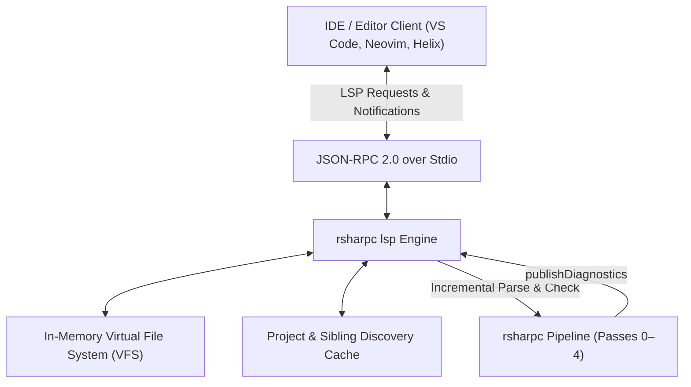

# RustSharp Language Server (`rsharpc lsp`)

| Field | Value |
| :--- | :--- |
| **Server Binary** | `rsharpc lsp` |
| **Protocol** | Language Server Protocol (LSP) 3.17 via JSON-RPC 2.0 |
| **Transport** | Standard Input / Output (`stdio`) |
| **Status** | 100% Complete & Fully Verified |
| **Owner** | RustSharp Tooling Team |
| **Related Documents** | [ARCHITECTURE.md](ARCHITECTURE.md), [DIAGNOSTICS.md](DIAGNOSTICS.md), [LANGUAGE-SPEC.md](LANGUAGE-SPEC.md) |

---

## 1. Overview & Vision

The RustSharp Language Server provides first-class IDE superpowers—including instant diagnostics, rich hover tooltips with inferred ownership details, cross-file definition jumping, document outline symbols, workspace symbol search, and autocompletion—for any editor supporting the Language Server Protocol (LSP).

Because RustSharp features whole-program borrow inference, the LSP server provides a unique developer capability: **it reveals inferred borrows in real time**. Hovering over any method parameter or variable shows whether `rsharpc` inferred it as `&T`, `&mut T`, or owned `T`, demystifying memory ownership before code is even compiled.

---

## 2. Server Architecture



---

## 3. Supported Capabilities

### 3.1 Real-Time Diagnostics (`textDocument/publishDiagnostics`)
- Re-analyzes `.rsharp` files on `textDocument/didChange` and `textDocument/didOpen`.
- Publishes precise syntax (`RSHARP000`), ownership (`RSHARP001`, `RSHARP002`), effect (`RSHARP003`, `RSHARP004`, `RSHARP005`), and type diagnostics directly to the editor's problems pane.

### 3.2 Inferred Ownership Hover (`textDocument/hover`)
Hovering over symbols displays markdown-formatted tooltips showing:
- Declared C# type.
- **Inferred Rust Borrow Representation** (`&self`, `&mut self`, `&T`, `&mut T`, owned `T`).
- Associated documentation comments.

```text
┌────────────────────────────────────────────────────────┐
│ void OrderProcessor.ProcessOrder(Order order)          │
│                                                        │
│ Inferred Rust Signature:                               │
│ fn process_order(&self, order: &mut Order)             │
│                                                        │
│ [Borrow Inference]:                                    │
│ Inferred '&mut Order' because 'order.Total' is mutated │
│ at line 106.                                           │
└────────────────────────────────────────────────────────┘
```

### 3.3 Cross-File Definition Jumping (`textDocument/definition`)
- Resolves symbols across decoupled virtual namespaces and multi-file projects.
- Clicking Go-to-Definition on `using Commerce.Domain.Models;` or `new Order(...)` navigates directly to the target declaration file regardless of physical directory structure.
- Resolves local variables, method parameters, and members with scope-aware priority.
- Supports jumping into ambient stubs (`RustSharp.Core.d.rsharp`).

### 3.4 Document Symbols / Outline (`textDocument/documentSymbol`)
- Provides hierarchical outline of types (`record`, `class`, `struct`, `interface`, `enum`) and their members (`methods`, `fields`, `properties`, `enum variants`).
- Populates the VS Code Outline view and breadcrumb bar.

### 3.5 Workspace Symbol Search (`workspace/symbol`)
- Fast symbol fuzzy-search across the entire workspace via `Ctrl+T` / `Cmd+T`.

### 3.6 Context-Aware Completion (`textDocument/completion`)
- Dot-completion on struct and class instances.
- Keyword completion for archetypes (`record`, `service class`, `shared class`).
- Suggests available zero-cost LINQ operations (`.Where()`, `.Select()`, `.ToList()`, `.OrderBy()`, `.Distinct()`, etc.) on collection types.

---

## 4. Editor Configurations

### Visual Studio Code
A turnkey extension is located in [`editors/code/`](../editors/code/) with zero external npm dependencies.
To install:
```bash
ln -s "$(pwd)/editors/code" ~/.vscode/extensions/rustsharp-0.1.0
```
In `.vscode/settings.json`:
```json
{
  "files.associations": {
    "*.rsharp": "rustsharp",
    "*.rsproj": "xml"
  },
  "rustsharp.serverPath": "${workspaceFolder}/target/release/rsharpc"
}
```

### Neovim (Built-in LSP)
Add to your `init.lua`:
```lua
local lspconfig = require('lspconfig')
local configs = require('lspconfig.configs')

if not configs.rustsharp then
  configs.rustsharp = {
    default_config = {
      cmd = { 'rsharpc', 'lsp' },
      filetypes = { 'rustsharp', 'rsharp' },
      root_dir = lspconfig.util.root_pattern('.rsproj', '.git', 'Cargo.toml'),
      settings = {},
    },
  }
end

lspconfig.rustsharp.setup{}
```

### Helix (`languages.toml`)
```toml
[[language]]
name = "rustsharp"
scope = "source.rsharp"
file-types = ["rsharp", "rsproj"]
roots = [".rsproj", ".git", "Cargo.toml"]
language-servers = ["rsharpc-lsp"]

[language-server.rsharpc-lsp]
command = "rsharpc"
args = ["lsp"]
```

### Sublime Text (LSP Package)
In `LSP.sublime-settings`:
```json
{
  "clients": {
    "rustsharp": {
      "enabled": true,
      "command": ["rsharpc", "lsp"],
      "selector": "source.rsharp",
      "syntaxes": ["RustSharp"]
    }
  }
}
```
