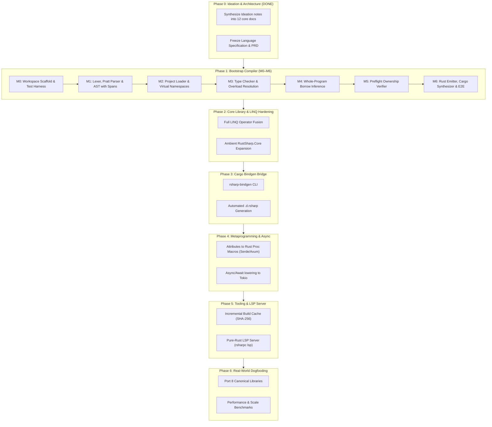

# RustSharp Roadmap

| Field | Value |
| :--- | :--- |
| **Status** | Active |
| **Current Target** | Phase 0 (Ideation & Docs Complete) $\rightarrow$ Phase 1 Bootstrap (M0–M6) |
| **Owner** | RustSharp Core Team |
| **Related Documents** | [PRD.md](PRD.md), [ARCHITECTURE.md](ARCHITECTURE.md), [TECH-STACK.md](TECH-STACK.md), [PROGRESS.md](PROGRESS.md) |

---

## 1. High-Level Phase Overview

RustSharp follows a strict multi-phase delivery model where each phase delivers verifiable functionality with clear exit criteria:

---

## 2. Phase 0: Ideation & Architecture Documentation (DONE)

### Deliverables
- [x] Read and analyze all ideation notes in `Ideation/`.
- [x] Synthesize requirements and constraints into a formal [PRD.md](PRD.md).
- [x] Author technical stack selection in [TECH-STACK.md](TECH-STACK.md).
- [x] Specify complete multi-pass compiler architecture in [ARCHITECTURE.md](ARCHITECTURE.md).
- [x] Define exact grammar, archetypes, and lowering rules in [LANGUAGE-SPEC.md](LANGUAGE-SPEC.md).
- [x] Catalog error codes, source spans, and hints in [DIAGNOSTICS.md](DIAGNOSTICS.md).
- [x] Specify standard library ambient declarations in [CORE-API.md](CORE-API.md).
- [x] Formulate multi-layer testing and verification strategy in [TESTING.md](TESTING.md).
- [x] Establish live progress tracking and decision log in [PROGRESS.md](PROGRESS.md).
- [x] Detail Language Server Protocol contracts in [LSP.md](LSP.md).
- [x] Map out 12-part technical blog series curriculum in [blogs/PLAN.md](blogs/PLAN.md).
- [x] Create project root [README.md](../README.md).

### Exit Gate
Complete documentation set committed; architecture frozen; ready to bootstrap Phase 1 source implementation.

---

## 3. Phase 1: The Bootstrap Compiler & Ownership Analyzer (M0–M6)

The core goal of Phase 1 is to build a self-contained, working prototype compiler (`rsharpc`) that transpile multi-file `.rsharp` projects into idiomatic, zero-cost Rust code that passes `cargo check` and `cargo test`.

### Milestone 0 (M0): Workspace Scaffold & Build Configuration
- **Objective:** Establish the Cargo workspace, directory layout, build configuration, and testing fixtures.
- **Deliverables:**
  - `Cargo.toml` configured for `rsharpc` binary and library.
  - Source directory hierarchy: `src/{frontend, semantics, codegen}`.
  - Test harness directories: `tests/` and `tests/fixtures/commerce_workspace/`.
  - Ambient standard library stub: `stdlib/RustSharp.Core.d.rsharp`.
- **Exit Gate:** `cargo check` and `cargo test` execute cleanly with zero errors.

### Milestone 1 (M1): Frontend Foundation
- **Objective:** Implement lexical analysis, Pratt expression parsing, recursive-descent declaration parsing, and source span tracking.
- **Deliverables:**
  - `src/diagnostics.rs`: `SourceSpan`, `Diagnostic`, `DiagnosticEngine`.
  - `src/frontend/tokens.rs`: `TokenKind`, `Token`.
  - `src/frontend/lexer.rs`: Hand-written UTF-8 lexer supporting comments, interpolation, decimals (`10.0m`), and symbols.
  - `src/frontend/ast.rs`: Multi-pass AST nodes with interior semantic decoration slots.
  - `src/frontend/parser.rs`: Recursive-descent declaration parser + Pratt operator precedence expression parser.
  - `tests/m1_parser_tests.rs`: Verification of archetypes, operators, `throws`, pattern matching, and syntax error recovery (`RSHARP000`).
- **Exit Gate:** All M1 unit tests pass; parser recovers gracefully from errors and attaches exact 1-indexed source spans.

### Milestone 2 (M2): Pass 1 - Project Loader & Virtual Namespaces
- **Objective:** Aggregate multi-file `.rsharp` sources across arbitrary folders into unified namespaces and resolve circular references.
- **Deliverables:**
  - `src/project.rs`: Discovery of `.rsproj`, `.rsharp`, `.d.rsharp`, and co-located `.rs` files.
  - `src/semantics/symbols.rs`: `GlobalSymbolTable`, `TypeDecl`, `MethodDecl`, `FieldDecl`, `NamespaceNode`.
  - `src/semantics/collector.rs`: Pass 1 collector aggregating declarations across files and resolving circular references.
  - `tests/m2_collector_tests.rs`: Multi-file namespace aggregation and circular reference resolution tests.
- **Exit Gate:** Types declared across decoupled folders resolve in the global symbol table without order dependency.

### Milestone 3 (M3): Pass 2 - Type Checker & Overload Resolution
- **Objective:** Type check method bodies, verify encapsulation/visibility, and resolve overloaded methods at compile time.
- **Deliverables:**
  - `src/semantics/type_checker.rs`: Type checking, visibility enforcement (`public`, `internal`, `private`, `protected`), and static monomorphized overload dispatch.
  - `tests/m3_type_checker_tests.rs`: Tests verifying method overload disambiguation and access modifier violation reporting.
- **Exit Gate:** Method calls correctly bind to monomorphized symbols; illegal private accesses trigger compile errors.

### Milestone 4 (M4): Pass 3 - Whole-Program Borrow & Mutation Inference
- **Objective:** Analyze call graphs to infer receiver (`&self`/`&mut self`) and parameter (`&T`/`&mut T`/owned `T`) borrowing without manual lifetime annotations.
- **Deliverables:**
  - `src/semantics/borrow_inferrer.rs`: Interprocedural Escape and Mutation Analysis tracking field writes and reference lifespans.
  - Caller-site mutation injection logic (annotating `let mut` and passing `&mut`).
  - `tests/m4_borrow_inferrer_tests.rs`: Assertions confirming inferred borrow kinds and caller mutations across call chains.
- **Exit Gate:** Call graph correctly tags read-only parameters as `&T`, mutating functions as `&mut T`, and records caller mutation coercions.

### Milestone 5 (M5): Pass 4 - Preflight Ownership Verifier
- **Objective:** Enforce Rust's ownership invariants at the `.rsharp` level before emitting code.
- **Deliverables:**
  - `src/semantics/preflight_verifier.rs`: Detection of simultaneous alias mutations (`RSHARP001`), escaping stack references (`RSHARP002`), and undeclared checked effects (`RSHARP003`).
  - `tests/m5_preflight_verifier_tests.rs`: Negative test suite asserting exact diagnostic codes and span formatting.
- **Exit Gate:** Unsafe aliasing or escaping references are rejected with clear `.rsharp` diagnostics before code emission.

### Milestone 6 (M6): Pass 5 - Rust Emitter, Cargo Synthesizer & E2E Verification
- **Objective:** Emit idiomatic Rust code, synthesize Cargo workspaces, map source spans bidirectionally, and execute end-to-end integration tests.
- **Deliverables:**
  - `src/codegen/sourcemap.rs`: Line-to-line SourceMap engine.
  - `src/codegen/rs_ast_emitter.rs`: Emitter generating clean Rust structs, enums, `impl` blocks, and fused LINQ iterators.
  - `src/codegen/cargo_synthesizer.rs`: Generator for `Cargo.toml`, `src/lib.rs`, and modular `.rs` source files.
  - `src/main.rs`: CLI binary supporting `rsharpc check` and `rsharpc build`.
  - `tests/fixtures/commerce_workspace/`: Complete multi-file enterprise fixture.
  - `tests/m6_e2e_tests.rs`: End-to-end integration test validating compilation, emitted Rust validity (`cargo check`), and test execution (`cargo test`).
- **Exit Gate:** `commerce_workspace` transpiles cleanly; emitted Rust code compiles under native `cargo` and passes execution assertions.

---

## 4. Phase 2: Core Library & Zero-Cost LINQ Hardening

- **P2.1 Extended LINQ Operators:** Implement fusion for `.OrderBy()`, `.GroupBy()`, `.Distinct()`, `.Take()`, `.Skip()`, `.Aggregate()`, `.First()`, and `.FirstOrDefault()`.
- **P2.2 Primitive Helper Classes:** Add ambient stubs for `Math`, `Console`, `DateTime`, `Guid`, `TimeSpan`, and `Environment`.
- **P2.3 Fallback Iterators:** Provide zero-allocation iterator adaptors when complex LINQ chains cannot fuse into a single pass.
- **P2.4 Golden Output Corpus:** Establish a golden snapshot test suite asserting exact emitted Rust code across 50+ language constructs.

---

## 5. Phase 3: The Cargo Ecosystem Bridge (`rsharp-bindgen`)

- **P3.1 Crate Header Analyzer:** Use `syn` to inspect native Cargo crates and their public API signatures.
- **P3.2 Ambient Stub Generator:** Emit typed `.d.rsharp` ambient declarations with `[MapsTo]` and `[ParamType]` attributes.
- **P3.3 Cargo.toml Dependency Sync:** Synchronize external `using` statements with synthesized `Cargo.toml` dependency entries automatically.

---

## 6. Phase 4: Rust Metaprogramming, Attributes & Async Ecosystem

- **P4.1 Serde Attribute Lowering:** Lower `[JsonPropertyName("id")]` to `#[serde(rename = "id")]` and `[JsonIgnore]` to `#[serde(skip)]`.
- **P4.2 Async/Await Lowering:** Lower `async Task<T>` methods into native Rust `async fn ... -> Result<T, E>` executed via Tokio.
- **P4.3 Async Streams:** Lower `IAsyncEnumerable<T>` and `yield return` into native asynchronous streams (`tokio_stream::Stream`).
- **P4.4 Web Framework Interop:** Map ASP.NET-style controller attributes (`[HttpGet]`, `[Route]`) to native `axum` routing macros.

---

## 7. Phase 5: Developer Experience, Incremental Cache & LSP Server

- **P5.1 Incremental Build Cache:** SHA-256 fingerprinting of input files and symbol graphs to achieve sub-20ms rebuilds on incremental changes.
- **P5.2 Watch Mode (`rsharpc watch`):** Background file watcher recompiling on change with immediate terminal feedback.
- **P5.3 Language Server Protocol Server (`rsharpc lsp`):** Pure-Rust LSP implementation providing:
  - Real-time diagnostic publication (`textDocument/publishDiagnostics`).
  - Type and borrow hover tooltips (`textDocument/hover`).
  - Cross-file definition navigation (`textDocument/definition`).
  - Contextual autocomplete (`textDocument/completion`).

---

## 8. Phase 6: Real-World Dogfooding & Ecosystem Libraries

- **P6.1 Ported Library Matrix:** Port 8 canonical libraries to `.rsharp`:
  1. String algorithms (`Slugify`, `Levenshtein`).
  2. Math & crypto utilities (`BigInteger`, `SHA256`).
  3. JSON parsing / serialization.
  4. HTTP client / REST wrapper.
- **P6.2 Benchmark Harness:** Continuous benchmarking measuring:
  - Compiler lines-per-second throughput.
  - Memory consumption during multi-pass AST processing.
  - Execution speed of emitted Rust vs hand-written Rust.

