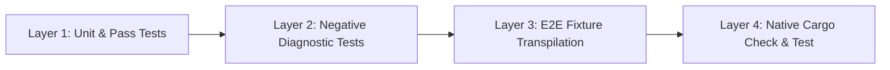

# RustSharp Testing Strategy

| Field | Value |
| :--- | :--- |
| **Status** | Active |
| **Owner** | RustSharp Core Team |
| **Harness** | Rust Native `cargo test` |
| **Related Documents** | [ROADMAP.md](ROADMAP.md), [TECH-STACK.md](TECH-STACK.md), [ARCHITECTURE.md](ARCHITECTURE.md) |

---

## 1. Testing Objectives

The RustSharp test suite enforces correctness across every compiler pass. Beyond standard unit assertions, our testing strategy features a non-negotiable end-to-end requirement: **emitted Rust code must compile cleanly under native `cargo check` and execute expected runtime logic in `cargo test`**.



---

## 2. Test Layers

### Layer 1: Unit & Component Tests
- Verifies isolated behavior of the lexer, parser, symbol tables, type checker, and borrow inferrer.
- Validates operator precedence, token spans, and AST structure.

### Layer 2: Negative Diagnostics Verification
- Ensures that code violating syntax, encapsulation, ownership, or effect rules is rejected with exact diagnostic codes (`RSHARP000`–`RSHARP005`).
- Verifies line and column coordinates and the presence of actionable `= help:` remediation hints.

### Layer 3: End-to-End Fixture Transpilation
- Compiles multi-file workspaces across decoupled directories.
- Verifies that virtual namespaces aggregate into cohesive modules, `Cargo.toml` is correctly synthesized, and `.rsharp.map` files are generated.

### Layer 4: Native Cargo Integration
- Automates running `cargo check` and `cargo test` inside the synthesized project folder.
- Asserts that emitted Rust contains zero warnings, zero borrow-checker rejections, and produces correct runtime behavior.

---

## 3. Milestone Test Matrix (Phase 1)

| Suite File | Milestone | Focus Area | Success Criteria |
| :--- | :--- | :--- | :--- |
| `tests/m1_parser_tests.rs` | M1 | Lexer, Pratt expression precedence, declarations, `throws`, `??`, `?.`, `..` | All tokens parsed; precedence trees correct; syntax errors produce `RSHARP000`. |
| `tests/m2_collector_tests.rs` | M2 | Project loading, virtual namespace aggregation, circular references | Cross-file type references resolve in `GlobalSymbolTable` without order dependency. |
| `tests/m3_type_checker_tests.rs` | M3 | Type compatibility, static overload monomorphization, access modifiers | Overloads mapped to unique names; illegal private accesses rejected with `RSHARP005`. |
| `tests/m4_borrow_inferrer_tests.rs` | M4 | Escape analysis, field mutations, receiver/parameter borrow inference | Read-only $\rightarrow$ `&T`; mutating $\rightarrow$ `&mut T`; caller mutation injection verified. |
| `tests/m5_preflight_verifier_tests.rs` | M5 | Ownership invariants, effect checking | Rejects aliased mutations (`RSHARP001`), escaping locals (`RSHARP002`), uncaught effects (`RSHARP003`). |
| `tests/m6_e2e_tests.rs` | M6 | Full pipeline, Cargo synthesis, SourceMaps, native execution | `commerce_workspace` transpiles, compiles under `cargo check`, and passes all assertions in `cargo test`. |

---

## 4. Test Fixture Architecture (`commerce_workspace`)

The primary integration fixture is `tests/fixtures/commerce_workspace/`:

```text
tests/fixtures/commerce_workspace/
├── commerce.rsproj                          # Project configuration
├── Domain/
│   ├── Models.rsharp                        # Records & value types (Order, Customer, Payment)
│   └── OrderProcessor.rsharp                # Service class with borrow mutation logic
├── Infrastructure/
│   └── Database.rsharp                      # Service class wrapping storage
├── Features/
│   └── Discounts.rsharp                     # Static utility & LINQ operations
├── Native/
│   ├── CryptoHelper.rsharp                  # extern partial class declaration
│   └── CryptoHelper.rs                      # Co-located raw Rust module
└── App/
    └── Program.rsharp                       # Entry point with main()
```

### Verification Flow for `commerce_workspace`:
1. `rsharpc` loads `commerce.rsproj`.
2. Emits synthesized workspace to `target/tmp/commerce_synthesized/`.
3. Runs `cargo check --manifest-path target/tmp/commerce_synthesized/Cargo.toml`.
4. Runs `cargo test --manifest-path target/tmp/commerce_synthesized/Cargo.toml`.
5. Confirms exit code 0 and all integration assertions pass.

---

## 5. Local Quality Gates

Run these commands before any commit or pull request:

```bash
# 1. Format Verification
cargo fmt --check

# 2. Clippy Strict Lints
cargo clippy --all-targets -- -D warnings

# 3. Full Test Suite Execution
cargo test -- --nocapture
```

