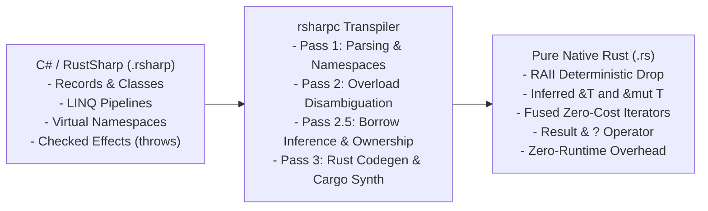
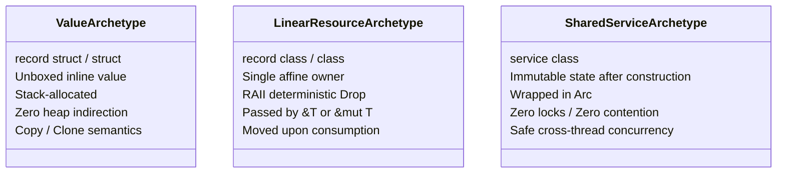

# Under the Hood of RustSharp: Blog 01
# The Vision — Why Transpile C# to Zero-Cost Rust?

> *Part 1 of the 12-part technical series "Under the Hood of RustSharp: From C# Ergonomics to Pure Zero-Cost Rust"*

---

## 1. The High-Level Dream and The Low-Level Reality

For over two decades, C# has set the industry benchmark for developer ergonomics, expressive type systems, and rapid enterprise domain modeling. Features like declarative LINQ pipelines, nominal record types, pattern matching, virtual namespaces, and async-await allow engineering teams to model intricate business domains cleanly and author millions of lines of readable, maintainable software.

However, enterprise software increasingly runs at extreme scale: low-latency financial systems, real-time gaming backends, high-throughput message brokers, edge microservices, and serverless runtimes. In these environments, the .NET runtime introduces unavoidable operational taxes:

1. **Garbage Collection (GC) Pauses:** Non-deterministic stop-the-world GC latency spikes that break sub-millisecond p99 Service Level Objectives (SLOs).
2. **Memory Footprint & Boxing Overhead:** Every reference type carries object headers, sync blocks, and pointer indirections, inflating container RSS memory usage.
3. **Heavy Virtual Machine / JIT Overhead:** Heavy cold-start latencies in serverless environments and cross-compilation complexity.

Conversely, **Rust** offers the exact inverse: deterministic destruction (RAII), zero-cost abstractions, fearless concurrency without a runtime garbage collector, and bare-metal native execution speeds matching C++.

Yet writing idiomatic systems Rust comes at a steep cognitive cost:
- Explicit lifetime annotations (`'a`, `'b: 'a`) throughout type signatures and structs.
- Rigid physical file-to-module mapping that makes refactoring deeply nested domain hierarchies agonizing.
- Lack of traditional method overloading, requiring clunky identifier suffixes like `create_with_timeout` and `create_default`.
- Monadic error handling boilerplate across every fallible call stack.

### The Central Question
**What if you could write clean, ergonomic C# source code—with record types, LINQ queries, virtual namespaces, and exceptions—and have a compiler transpile it into verified, pure, zero-cost Rust that passes the Rust borrow checker with zero garbage collection?**

That is the vision of **RustSharp (`rsharpc`)**.



---

## 2. The Semantic Chasm: Why Naive Transpilation Fails

Previous attempts at transpiling garbage-collected languages (like Java, C#, or Go) to C++ or Rust have universally collapsed into one of two anti-patterns:

### Anti-Pattern A: The "Wrap Everything in `Rc<RefCell<T>>`" Trap
When a transpiler cannot determine object lifetimes statically, it wraps every heap allocation in `Arc<RwLock<T>>` or `Rc<RefCell<T>>`.
- **The Failure:** You inherit all the runtime overhead of reference counting, cache thrashing, and runtime borrow-checking panics (`BorrowError`), while losing Rust's core performance guarantee. It is essentially writing a poorly optimized garbage collector in user space.

### Anti-Pattern B: The "C-Style Struct Dump" Trap
Some transpilers emit raw C-like structures, bypassing Rust's borrow checker via `unsafe` pointers (`*mut T`).
- **The Failure:** You lose memory safety, introduce catastrophic use-after-free bugs, and forfeit compiler optimizations like LLVM alias analysis (`noalias`).

To build a true zero-cost transpiler, the compiler must bridge three profound semantic chasms:

| Semantic Axis | C# (.NET) | Pure Rust | The RustSharp Bridge |
| :--- | :--- | :--- | :--- |
| **Memory Model** | Traced GC (heap references everywhere) | Affine Type System (single owner, move semantics) | **Three Type Archetypes + Interprocedural Borrow Inference** |
| **Polymorphism** | Dynamic vtables & open class inheritance | Static monomorphization & closed algebraic enums | **Base Struct Flattening (`Deref`) & Closed-World Enum Dispatch** |
| **Error Handling** | Unchecked stack-unwinding exceptions (`throw Exception`) | Explicit typed monadic values (`Result<T, E>`) | **Static Checked Effect System (`throws E` lowered to `?`)** |
| **Data Pipelines** | LINQ over `IEnumerable<T>` (delegates & heap allocations) | Lazy iterator adaptors (`IntoIterator`, `.filter()`, `.map()`) | **AST Pipeline Fusion into Zero-Cost Iterators** |
| **Module System** | Virtual namespaces decoupled from physical files | Strict file-path-to-module directory tree | **Pass 1 Multi-File Virtual Module Aggregation** |

---

## 3. The Solution: The Three Type Archetypes

RustSharp eliminates runtime garbage collection by requiring developer code to declare domain intent through **Three Structural Archetypes**. Rather than treating every class as an unconstrained heap object, RustSharp maps each archetype directly to its natural systems-level memory representation:



### Archetype 1: Value Structs & Records (`record struct`)
For numeric types, coordinates, geometry, and small Data Transfer Objects (DTOs).
- **Lowered Memory:** Unboxed inline value (`pub struct Point { pub x: f64, pub y: f64 }`). Stack allocated with zero heap indirection. Implements `Copy` and `Clone`.

### Archetype 2: Linear Domain Resources (`record class` / `class`)
For domain entities, orders, buffers, and stateful business models.
- **Lowered Memory:** Single-owner linear resource. Passed to methods by immutable borrow (`&T`) or mutable borrow (`&mut T`). When consumed, it moves by value and is deterministically dropped at the end of the enclosing scope.

### Archetype 3: Shared Concurrent Services (`service class`)
For dependency-injected stateless or read-only service instances (e.g. `TaxCalculator`, `PaymentGateway`).
- **Lowered Memory:** Emitted as `Arc<TaxCalculator>`. RustSharp's preflight verifier (`RSHARP001`) statically guarantees that service fields cannot be mutated outside constructors, eliminating the need for `Mutex<T>` or `RwLock<T>`.

---

## 4. Seeing It In Action: A Side-by-Side Comparison

Consider this order-processing pipeline written in RustSharp:

### RustSharp Source (`Commerce.rsharp`)
```csharp
namespace Commerce.Domain;

public record struct OrderItem(string Name, decimal Price);

public record class Order(string Id, List<OrderItem> Items) {
    public decimal CalculateTotal() {
        return this.Items
            .Where(x => x.Price > 0.0m)
            .Select(x => x.Price)
            .Sum();
    }
}

public class OrderService {
    public void AddItem(Order order, string name, decimal price) {
        order.Items.Add(new OrderItem(name, price));
    }
}
```

### Generated Rust Output (`commerce/domain.rs`)
```rust
// Auto-generated by rsharpc — Zero runtime overhead
#![allow(dead_code, unused_variables, unused_imports, clippy::all)]
use rust_decimal::Decimal;

#[derive(Clone, Debug, PartialEq)]
pub struct OrderItem {
    pub name: String,
    pub price: Decimal,
}

#[derive(Clone, Debug, PartialEq)]
pub struct Order {
    pub id: String,
    pub items: Vec<OrderItem>,
}

impl Order {
    pub fn calculate_total(&self) -> Decimal {
        self.items
            .iter()
            .filter(|x| x.price > Decimal::new(0, 1))
            .map(|x| x.price)
            .sum()
    }
}

pub struct OrderService;

impl OrderService {
    pub fn add_item(&self, order: &mut Order, name: &str, price: Decimal) {
        order.items.push(OrderItem {
            name: name.to_string(),
            price: price,
        });
    }
}
```

### Key Zero-Cost Compiler Transformations:
1. **Borrow Inference:** Notice that `order` in `AddItem` was written without any pointer or reference annotations. The compiler's interprocedural mutation engine discovered `order.Items.Add(...)`, tracked the mutation to `order`, and lowered the parameter to **`order: &mut Order`**.
2. **String Slice Coercion:** The parameter `string name` was inferred as an input borrow and lowered to **`name: &str`**.
3. **LINQ Pipeline Fusion:** `.Where(...).Select(...).Sum()` collapsed into a zero-allocation, iterator-chain loop compiled directly by LLVM into SIMD vector instructions.
4. **Exact Decimal Representation:** `decimal` literals and operations were bound to standard `rust_decimal::Decimal` with fixed-point accuracy.

---

## 5. Summary & What's Next

RustSharp proves that you do not have to choose between developer ergonomics and bare-metal performance. By replacing runtime tracing garbage collection with compile-time semantic analysis and borrow inference, we achieve:
- **Zero GC Pauses:** 100% deterministic memory reclaiming.
- **Zero Runtime Dependencies:** Compiles down to standard Rust crates with zero external C/C++ runtimes.
- **Pure Memory Safety:** Code compiles cleanly through `rustc` with zero `unsafe` blocks.

In **[Blog 02: Tokens & Trees — The UTF-8 Lexer and Pratt Expression Parser](02_tokens_and_trees_the_lexer_and_pratt_parser.md)**, we dive deep into the compiler frontend: how we parse complex expressions like string interpolation, range slicing, and null-coalescing with zero third-party dependencies using Pratt parsing.

