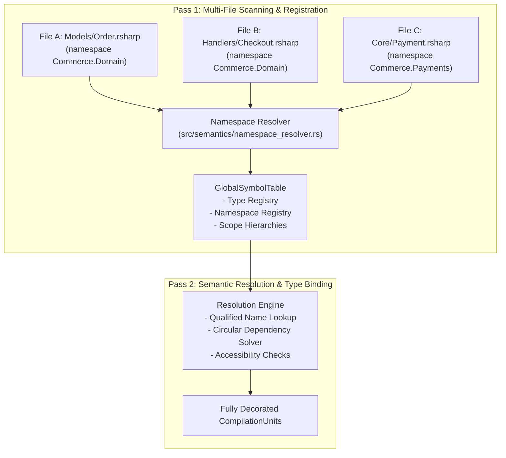
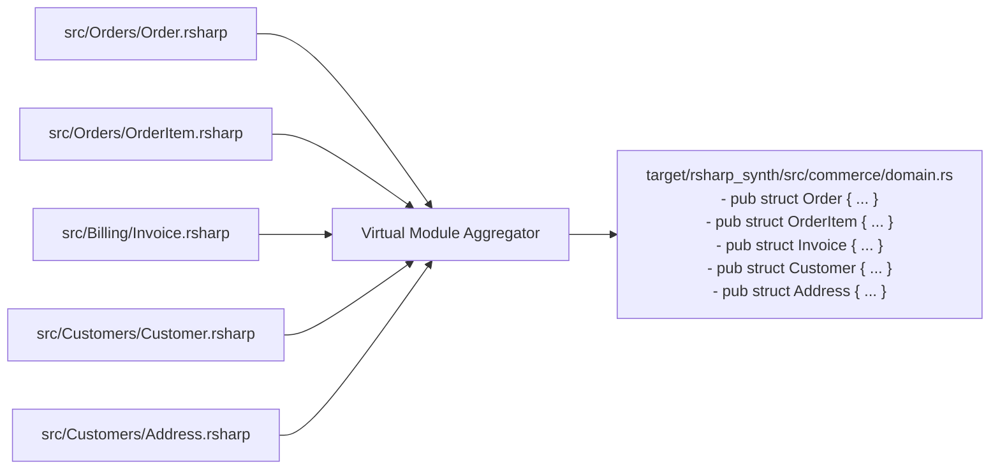

# Under the Hood of RustSharp: Blog 03
# Virtual Namespaces — Freeing Code from the Physical File System

> *Part 3 of the 12-part technical series "Under the Hood of RustSharp: From C# Ergonomics to Pure Zero-Cost Rust"*

---

## 1. The Physical File Hierarchy Problem in Rust

In Rust, the module hierarchy is strictly coupled to the physical layout of files and folders on disk:
- A module named `crate::commerce::checkout` must reside at `src/commerce/checkout.rs` (or `src/commerce/checkout/mod.rs`).
- Every subdirectory must be explicitly declared in its parent module with `pub mod checkout;`.
- Bidirectional or circular dependencies between sibling files (e.g. `Order` referencing `Customer` while `Customer` holds a list of `Order`s) require delicate `use super::...` maneuvering or consolidating code into an overly bloated single file.

In large enterprise systems with hundreds of domain entities, this physical coupling becomes an enormous bottleneck:
- Moving a file to a new folder breaks public import paths across downstream modules.
- Splitting a large domain entity across multiple files requires exposing internal structs as public submodules.
- Circular domain dependencies across files cause Rust compilation errors.

In C#, developers have enjoyed **Virtual Namespaces** for decades:
```csharp
// In folder: src/Orders/Entities/Order.cs
namespace Commerce.Domain;
public class Order { ... }

// In folder: src/Customers/Internal/Customer.cs
namespace Commerce.Domain;
public class Customer { ... }
```
Regardless of where these files live on disk, both classes share the single virtual namespace `Commerce.Domain`. They access each other's types directly without import declarations or relative directory traversal.

RustSharp bridges this gap. In this post, we explore how **Pass 1 Multi-File Virtual Module Aggregation** in [`src/semantics/namespace_resolver.rs`](file:///home/abhijit/Videos/transpilers/RustSharp/src/semantics/namespace_resolver.rs) and [`src/codegen/cargo_synthesizer.rs`](file:///home/abhijit/Videos/transpilers/RustSharp/src/codegen/cargo_synthesizer.rs) provides C#-style virtual namespaces while emitting idiomatic, cleanly structured Rust module trees.

---

## 2. The Two-Phase Symbol Resolution Model

To support decoupled files and circular cross-file type references, RustSharp operates a **Two-Phase Multi-File Loader**:



### Phase 1: Symbol Declaration Indexing
Before any method body or expression is evaluated, Pass 1 sweeps through all files declared in the `.rsproj` project manifest:
1. It reads every `namespace Foo.Bar;` declaration.
2. It extracts all top-level type signatures (`class`, `struct`, `record`, `interface`, `enum`) and their member prototypes without checking method bodies.
3. It registers each type into the `GlobalSymbolTable` under its fully qualified name (e.g. `Commerce.Domain.Order`).

Because all type names are indexed upfront:
- `Order` can refer to `Customer` in `src/Orders/Order.rsharp`.
- `Customer` can refer to `Order` in `src/Customers/Customer.rsharp`.
- Neither file needs to know the physical disk path of the other.

---

## 3. Virtual Namespace Aggregation & The Module Planner

Once the semantic analysis passes (Passes 2 and 2.5) are complete, Pass 3 (`CargoWorkspaceSynthesizer`) must output valid Rust code. Rust's compiler (`rustc`) requires actual files and modules.

How does RustSharp convert virtual namespaces into valid Rust modules?

### The Namespace Module Planner
The compiler groups all declarations not by their originating file path on disk, but by their logical virtual namespace:

```rust
// In src/semantics/symbols.rs
pub struct NamespaceModulePlan {
    pub namespace: String,           // e.g. "Commerce.Domain"
    pub rust_mod_segments: Vec<String>, // ["commerce", "domain"]
    pub target_rs_file: String,      // "src/commerce/domain.rs"
}
```

If a project has five different files scattered across different subdirectories that all declare `namespace Commerce.Domain`:
1. `src/Orders/Order.rsharp`
2. `src/Orders/OrderItem.rsharp`
3. `src/Billing/Invoice.rsharp`
4. `src/Customers/Customer.rsharp`
5. `src/Customers/Address.rsharp`

The module planner aggregates all five files into a single unified Rust module: **`src/commerce/domain.rs`**.



### The Synthesized Module Hierarchy in `src/lib.rs`
Rust requires every file in `src/` to be declared in `src/lib.rs`. RustSharp inspects the namespace segments and automatically constructs the tree:

```rust
// Auto-generated by rsharpc in target/rsharp_synth/src/lib.rs
pub mod commerce {
    pub mod domain;
    pub mod payments;
    pub mod notifications;
}
```

No manual `mod.rs` files. No manual `pub mod` declarations. You organize your source files by whatever directory layout makes sense for your team, and the compiler handles the native Rust module hierarchy.

---

## 4. Solving Circular References across Files

In C#, circular references between classes in different files are standard:
```csharp
// File 1: Node.rsharp
namespace DataStructures;
public class Node {
    public Graph ParentGraph;
    public string Name;
}

// File 2: Graph.rsharp
namespace DataStructures;
public class Graph {
    public List<Node> Nodes;
}
```

In naive C++ or Rust transpilation, emitting two separate modules (`node.rs` and `graph.rs`) with mutual imports creates an unresolvable cycle:
- `node.rs` imports `graph::Graph`
- `graph.rs` imports `node::Node`

Because RustSharp aggregates declarations by their virtual namespace, both `Node` and `Graph` are placed inside the same generated Rust file: **`src/data_structures.rs`**.

Within a single Rust module:
- Types can reference each other freely in any order.
- Rust's type-checker resolves recursive type definitions cleanly.
- If the type is a reference or recursive pointer, RustSharp automatically wraps the reference in `Option<Box<T>>` or `Option<Arc<T>>` based on the archetype.

---

## 5. Bidirectional Source Mapping: Keeping Debugging Painless

When declarations from multiple `.rsharp` files are merged into a single generated `.rs` module, how do compiler errors and stack traces map back to the original source lines?

RustSharp generates a companion **`.rsharp.map`** source map for every emitted Rust module:

```rust
// target/rsharp_synth/src/commerce/domain.rs.rsharp.map
src/commerce/domain.rs:5 => src/Orders/Order.rsharp:3:1
src/commerce/domain.rs:18 => src/Orders/OrderItem.rsharp:2:1
src/commerce/domain.rs:32 => src/Customers/Customer.rsharp:4:1
```

When `rsharpc build` runs and `rustc` reports an error:
```text
error[E0308]: mismatched types
  --> src/commerce/domain.rs:22:9
```

The RustSharp CLI translates the line via the source map and prints:
```text
Compilation Error: Mismatched types
  --> src/Orders/OrderItem.rsharp:7:14
   |
 7 |         this.Price = "invalid";
   |                      ^^^^^^^^^ expected decimal, found string
```

Developers get the ergonomic freedom of C# virtual namespaces while preserving pinpoint accuracy in compiler errors and debugger stack frames.

---

## 6. Summary & What's Next

Virtual namespaces decouple software design from physical file systems:
- Developers organize code logically by business domain rather than filesystem limitations.
- Sibling files can reference each other circular-free without import boilerplate.
- The compiler synthesizes clean, idiomatic Rust module hierarchies automatically.

In **[Blog 04: The Compiler Police — Static Overload Monomorphization & Encapsulation](04_the_compiler_police_overloads_and_visibility.md)**, we tackle another major conflict between C# and Rust: how we support method overloading in a language that strictly forbids it.

