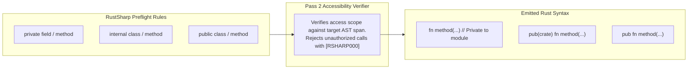

# Under the Hood of RustSharp: Blog 04
# The Compiler Police — Static Overload Monomorphization & Encapsulation

> *Part 4 of the 12-part technical series "Under the Hood of RustSharp: From C# Ergonomics to Pure Zero-Cost Rust"*

---

## 1. The Overload Conflict: C# Ergonomics vs Rust Rigidity

In C# and modern object-oriented languages, method overloading is second nature. Developers frequently define multiple methods or constructors sharing the exact same name with differing parameter signatures:

```csharp
public class Logger {
    public void Log(string message) {
        this.Log(message, LogLevel.Info);
    }

    public void Log(string message, LogLevel level) {
        // ...
    }

    public void Log(string message, LogLevel level, int eventId) {
        // ...
    }
}
```

In Rust, this is flatly impossible. **Rust strictly forbids two functions or methods in the same scope or `impl` block from sharing the same identifier**:
```rust
impl Logger {
    pub fn log(&self, message: &str) { ... }
    
    // ERROR: duplicate definitions with name `log`
    pub fn log(&self, message: &str, level: LogLevel) { ... }
}
```

Rust developers typically work around this by appending clunky descriptive suffixes (`log_with_level`, `log_full`) or using complex builder patterns. However, forcing C# developers to abandon method overloads would destroy one of C#'s most beloved ergonomic features.

In this post, we explore how **Pass 2 Static Overload Disambiguation** in [`src/semantics/overload_resolver.rs`](file:///home/abhijit/Videos/transpilers/RustSharp/src/semantics/overload_resolver.rs) and [`src/codegen/rs_ast_emitter.rs`](file:///home/abhijit/Videos/transpilers/RustSharp/src/codegen/rs_ast_emitter.rs) allows developers to write idiomatic C# overloads while emitting 100% compliant, zero-runtime-cost Rust.

---

## 2. Compile-Time Overload Monomorphization

Rather than introducing dynamic dispatch or runtime argument inspection, RustSharp resolves overloads **entirely at compile time** through deterministic name monomorphization:

```mermaid
flowchart TD
    CSCall1["logger.Log(\"System started\");"] --> Matcher["Overload Disambiguator\n(src/semantics/overload_resolver.rs)"]
    CSCall2["logger.Log(\"Warning\", LogLevel.Warn);"] --> Matcher
    CSCall3["logger.Log(\"Fatal\", LogLevel.Error, 404);"] --> Matcher

    Matcher --> Sig1["Matches: Log(string) -> Arity 1"]
    Matcher --> Sig2["Matches: Log(string, LogLevel) -> Arity 2"]
    Matcher --> Sig3["Matches: Log(string, LogLevel, int) -> Arity 3"]

    Sig1 --> RSCall1["logger.log(\"System started\");"]
    Sig2 --> RSCall2["logger.log_with_level(\"Warning\", LogLevel::Warn);"]
    Sig3 --> RSCall3["logger.log_with_level_and_event_id(\"Fatal\", LogLevel::Error, 404);"]
```

### The Disambiguation Strategy
When multiple methods in a class share the name `MethodName`:
1. **Primary Overload Preservation:** The overload with the fewest parameters (or default canonical signature) retains the clean snake_case identifier (e.g. `log`).
2. **Deterministic Type-Based Disambiguation:** Subsequent overloads are decorated based on differentiating parameter names or types (e.g. `log_with_level`, `log_with_level_and_event_id`).
3. **Call-Site Rewriting:** During Pass 2, every call-site expression `obj.Log(...)` is matched against the parameter types in `GlobalSymbolTable` and rewritten to target the exact monomorphized function name in the emitted Rust AST.

### Default Argument Injection
C# also supports optional parameters with default values:
```csharp
public void Connect(string host, int port = 8080, int timeoutMs = 5000);
```

When a caller writes:
```csharp
client.Connect("127.0.0.1");
```

Rust does not support default arguments natively. RustSharp's semantic analyzer intercepts the call site, detects that `port` and `timeoutMs` were omitted, and injects the default literal values directly into the call arguments:
```rust
client.connect("127.0.0.1", 8080, 5000);
```
Zero runtime overhead. Zero wrapper methods. Zero heap allocations.

---

## 3. Constructor Disambiguation: From `new()` to `Self::new()`

In C#, constructors share the class name and can be overloaded:
```csharp
public class ConnectionPool {
    public ConnectionPool() : this(10) {}
    public ConnectionPool(int maxConnections) { ... }
    public ConnectionPool(string connectionString, int maxConnections) { ... }
}
```

In Rust, constructors are simply conventional static associated functions returning `Self`. RustSharp monomorphizes constructor overloads cleanly:

```rust
impl ConnectionPool {
    pub fn new() -> Self {
        Self::with_max_connections(10)
    }

    pub fn with_max_connections(max_connections: i32) -> Self {
        Self { max_connections, ... }
    }

    pub fn with_connection_string_and_max_connections(connection_string: &str, max_connections: i32) -> Self {
        Self { ... }
    }
}
```

When client code calls `new ConnectionPool(50)`, Pass 2 maps the invocation directly to `ConnectionPool::with_max_connections(50)`.

---

## 4. Encapsulation: Mapping Access Modifiers to Rust Visibility

C# features a fine-grained access modifier model:
- `public`: Accessible from any assembly.
- `internal`: Accessible within the current assembly.
- `protected`: Accessible within the class and subclasses.
- `private`: Accessible only within the enclosing class body.

Rust's visibility model is path-based: `pub`, `pub(crate)`, and private (module-scoped).

RustSharp enforces C# encapsulation rules **at compile time before Rust code is ever generated**:



### Enforcing `private` within Aggregated Modules
Because Pass 1 can aggregate multiple files in the same virtual namespace into a single `src/domain.rs` file, relying on Rust's default module-level privacy would mean that Class B in the same module could accidentally access Class A's private fields.

To guarantee that private members remain truly private:
1. Pass 2's `AccessibilityChecker` validates that every member access `obj.secretField` originates from within the lexical boundaries of Class A's AST span.
2. If another class attempts to read `obj.secretField`, RustSharp rejects the compilation immediately:
   ```text
   ERROR [RSHARP000] at src/Services/OrderService.rsharp:14:18:
   Field 'secretKey' is private to 'KeyVault' and cannot be accessed from 'OrderService'.
   ```

Developers enjoy true object-oriented encapsulation without having to fracture their Rust code into hundreds of tiny submodules just to enforce privacy.

---

## 5. Summary & What's Next

By handling overloads and accessibility in Pass 2:
- C# developers retain natural, idiomatic method overloading and default arguments.
- Emitted Rust code satisfies `rustc`'s strict duplicate-symbol rules with zero runtime penalty.
- Encapsulation is enforced rigorously at compile time.

In **[Blog 05: The Brain — Interprocedural Escape & Mutation Analysis](05_the_brain_interprocedural_borrow_inference.md)**, we examine the technical centerpiece of RustSharp: how the compiler infers `&self` and `&mut self` across whole-program call graphs without requiring a single lifetime annotation.

