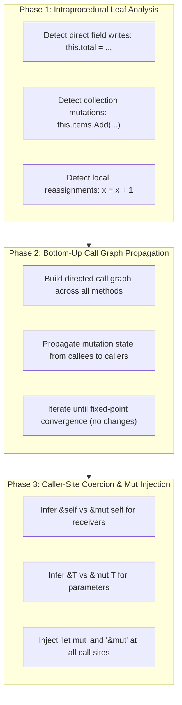

# Under the Hood of RustSharp: Blog 05
# The Brain — Interprocedural Escape & Mutation Analysis

> *Part 5 of the 12-part technical series "Under the Hood of RustSharp: From C# Ergonomics to Pure Zero-Cost Rust"*

---

## 1. The Core Dilemma: Lifetime Syntax vs Ergonomics

The single biggest barrier to adopting Rust for application developers is the borrow checker and lifetime syntax:
```rust
pub fn process<'a, 'b: 'a>(order: &'a mut Order, coupon: &'b Coupon) -> &'a str {
    // ...
}
```

In C#, developers simply write:
```csharp
public string Process(Order order, Coupon coupon) {
    // ...
}
```
No `&`, no `&mut`, no `'a`, no pointers. Memory appears uniform.

If a transpiler requires developers to manually annotate every parameter with Rust borrow decorators (`[Borrows]`, `[MutBorrows]`), it is no longer transpiling C#—it is just writing Rust in C# syntax.

Conversely, if the transpiler guesses blindly:
- Marking everything immutable (`&self`, `&T`) means any write statement causes `rustc` compilation errors (`cannot borrow as mutable`).
- Marking everything mutable (`&mut self`, `&mut T`) triggers aliasing violations (`cannot borrow as mutable more than once at a time`).

**RustSharp solves this with an interprocedural borrow inference engine** in [`src/semantics/borrow_inferencer.rs`](file:///home/abhijit/Videos/transpilers/RustSharp/src/semantics/borrow_inferencer.rs). By analyzing mutation patterns bottom-up across the entire call graph, the compiler infers `&self` vs `&mut self` and `&T` vs `&mut T` automatically.

---

## 2. The Interprocedural Mutation Pipeline

The borrow inference engine executes in **Pass 2.5**, after symbol resolution (Pass 2) and before Rust code emission (Pass 3). It operates in three coordinated phases:



---

## 3. Phase 1: Intraprocedural Mutation Detection

Inside a single method, the engine inspects all statements to determine if:
1. **The receiver (`this`) is mutated:** Any assignment to `this.field = ...`, `this.field += ...`, or calling a mutating method on a field (`this.items.Add(...)`).
2. **A parameter is mutated:** Any write to `param.field = ...` or passing `param` to a mutating callee.
3. **A local variable is mutated:** Any reassignment `x = ...` after its initial declaration.

```rust
// In src/semantics/borrow_inferencer.rs
match stmt {
    Stmt::Assign { lhs, .. } => {
        if let Expr::MemberAccess { target, .. } = lhs {
            if is_this_expression(target) {
                *self_mutated = true;
            } else if let Some(param_name) = extract_param_name(target) {
                mutated_params.insert(param_name);
            }
        }
    }
    Stmt::ForEach { item_name, body, .. } => {
        // If loop body mutates the element, the collection root must be &mut
        if body_mutates_item(body, item_name) {
            *self_mutated = true;
        }
    }
    // ...
}
```

Notice the `Stmt::ForEach` handling: if a physics engine loop writes `b.Integrate(dt)` on each body in `this.bodies`, the compiler realizes that the underlying collection is being mutated, and flags `this` as requiring `&mut self`.

---

## 4. Phase 2: Call Graph Fixed-Point Propagation

Intraprocedural analysis only catches direct mutations. What if Method A calls Method B, which calls Method C, and only Method C actually writes to a field?

Consider this chain:
```csharp
public class OrderProcessor {
    Order currentOrder;

    public void FinalizeCheckout() {
        this.ApplyDiscounts(); // Calls callee
    }

    private void ApplyDiscounts() {
        this.currentOrder.Total -= 10.0m; // Direct field mutation!
    }
}
```

1. **Leaf Analysis:** `ApplyDiscounts` writes to `this.currentOrder.Total`. Its receiver is marked `&mut self`.
2. **Graph Traversal:** The call graph edge `FinalizeCheckout` &rarr; `ApplyDiscounts` is traversed. Because the callee requires `&mut self`, the caller `FinalizeCheckout` must also be upgraded to **`&mut self`**.
3. **Fixed-Point Iteration:** The engine loops through the call graph until no further methods change state. Circular calls and mutual recursion are handled safely because the state space is monotonic (immutable &rarr; mutable).

---

## 5. Phase 3: Caller-Site Mutation Injection

Inferring that a method requires `&mut self` is only half the battle. If `order.ApplyDiscount()` requires `&mut Order`, the caller that instantiated `order` must declare it as `let mut order` in Rust, and the call must be formatted as `order.apply_discount()`.

Furthermore, if an argument is passed to a mutating parameter, the call site must inject `&mut`:

### RustSharp Source:
```csharp
public class CheckoutService {
    public void Process(Order order, string couponCode) {
        this.Validate(couponCode);
        this.ApplyCoupon(order, couponCode);
    }

    private void Validate(string coupon) {
        // Read-only inspection
    }

    private void ApplyCoupon(Order order, string coupon) {
        order.Total -= 5.0m; // Mutates order
    }
}
```

### Generated Rust Output:
```rust
impl CheckoutService {
    pub fn process(&self, order: &mut Order, coupon_code: &str) {
        self.validate(coupon_code);
        self.apply_coupon(order, coupon_code);
    }

    fn validate(&self, coupon: &str) {
        // Inferred as &str (immutable read-only borrow)
    }

    fn apply_coupon(&self, order: &mut Order, coupon: &str) {
        order.total -= Decimal::new(50, 1);
    }
}
```

Observe the precision of the generated Rust:
- `CheckoutService` itself was never mutated: inferred as **`&self`**.
- `order` was mutated in `apply_coupon`: inferred as **`order: &mut Order`** across the entire signature chain.
- `coupon_code` was only read: inferred as an immutable string slice **`coupon_code: &str`**.

---

## 6. Preflight Diagnostics: Catching Ownership Bugs Early

Before handing generated code to `rustc`, Pass 2.5 runs preflight validation to protect developers from classic borrow-checker traps:

### Diagnostic `[RSHARP001]`: Service Class Field Mutation
Service classes (`service class`) are designed for shared concurrent access (`Arc<T>`). Mutating a service class field outside its constructor would require a lock:
```text
ERROR [RSHARP001] at src/Services/PaymentService.rsharp:12:9:
Cannot mutate field 'apiKey' of 'service class PaymentService' outside constructor.
Service classes are stateless shared actors (Arc<T>).
```

### Diagnostic `[RSHARP002]`: Concurrent Collection Mutation
Modifying a collection while iterating over it with `foreach` causes iterator invalidation:
```text
ERROR [RSHARP002] at src/Engine/Simulator.rsharp:15:13:
Cannot mutate collection 'this.bodies' while iterating over it in foreach.
Rust's borrow checker forbids simultaneous read and write borrows.
```

### Diagnostic `[RSHARP003]`: Use-After-Move on Linear Resources
Linear resources (`record class`) have single-owner semantics. If passed to a method that moves ownership, subsequent access is rejected:
```text
ERROR [RSHARP003] at src/Program.rsharp:13:44:
Linear resource 'b1' was already consumed at 8:21 and cannot be used again.
```

By catching these rules in the frontend, RustSharp guarantees that the emitted Rust will compile on the first try without cryptic borrow-checker errors.

---

## 7. Summary & What's Next

The borrow inference engine is the technological crown jewel of RustSharp:
- It eliminates the need for manual lifetime annotations (`'a`).
- It traverses whole-program call graphs to determine minimal borrow requirements (`&self` vs `&mut self`).
- It injects caller-site mutations deterministically.

In **[Blog 06: Zero-Cost Polymorphism — Struct Flattening, Deref, and Closed Enum Dispatch](06_zero_cost_polymorphism_struct_flattening_and_enums.md)**, we explore how RustSharp tackles class inheritance without virtual method tables (vtables) or runtime heap overhead.

