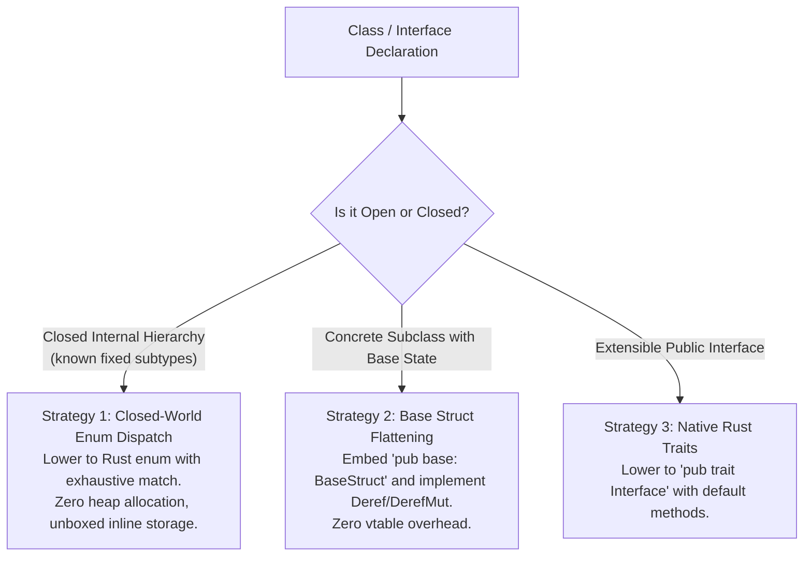

# Under the Hood of RustSharp: Blog 06
# Zero-Cost Polymorphism — Struct Flattening, Deref, and Closed Enum Dispatch

> *Part 6 of the 12-part technical series "Under the Hood of RustSharp: From C# Ergonomics to Pure Zero-Cost Rust"*

---

## 1. The Polymorphism Dilemma: Classes vs Structs

In traditional object-oriented languages like C# and Java, class inheritance is ubiquitous. A base class defines shared state and methods, and derived classes inherit fields and override behaviors:

```csharp
public abstract class Payment {
    public string TransactionId;
    public decimal Amount;
    public abstract void Process();
}

public class CardPayment : Payment {
    public string CardNumber;
    public override void Process() { ... }
}

public class CryptoPayment : Payment {
    public string WalletAddress;
    public override void Process() { ... }
}
```

In standard .NET:
- Every class instance is a heap-allocated pointer.
- Calling `payment.Process()` requires a dynamic vtable dispatch (`callvirt`).
- Polymorphic collections like `List<Payment>` store arrays of pointers, causing cache misses and GC tracing overhead.

In Rust, **class inheritance does not exist**. Rust only has:
1. `struct`: Concrete monomorphic data layout without inheritance.
2. `enum`: Closed algebraic tagged unions without heap indirection.
3. `trait`: Interfaces for static monomorphization (`impl Trait`) or explicit dynamic trait objects (`Box<dyn Trait>`).

If a transpiler translates every C# class into a `Box<dyn Trait>`, the resulting Rust code suffers from heap allocation on every instantiation, pointer indirection, and loss of compiler inlining.

RustSharp takes a completely different path. In this post, we explore how **Pass 2 Polymorphism Inference** lowers C# inheritance hierarchies into pure, zero-cost Rust using **Base Struct Flattening (`Deref`)** and **Closed-World Enum Dispatch**.

---

## 2. The Three Lowering Strategies

During Pass 2, the compiler inspects every class hierarchy and categorizes it into one of three optimal systems representations:



---

## 3. Strategy 1: Closed-World Enum Dispatch (Tagged Unions)

When an `abstract class` or internal domain interface has a known, fixed set of concrete subclasses within the project workspace, RustSharp employs **Closed-World Enum Dispatch**.

Instead of emitting dynamic trait objects, it synthesizes an exhaustive native Rust `enum`:

### Generated Rust Output:
```rust
#[derive(Clone, Debug, PartialEq)]
pub enum Payment {
    Card(CardPayment),
    Crypto(CryptoPayment),
}

impl Payment {
    pub fn process(&mut self) {
        match self {
            Payment::Card(inner) => inner.process(),
            Payment::Crypto(inner) => inner.process(),
        }
    }
}
```

### Why Closed-World Enums Win:
1. **Zero Heap Allocation:** A `Payment` can be stored directly on the stack or inline inside a `Vec<Payment>`. No `Box<dyn Trait>` pointer is required.
2. **Deterministic CPU Cache Locality:** All variants are contiguous in memory.
3. **Compiler Inlining:** LLVM can inline the method bodies directly into the match arms, eliminating function call overhead entirely.

---

## 4. Strategy 2: Base Struct Flattening & Deref

What about shared fields? In C#, `CardPayment` inherits `TransactionId` and `Amount` from `Payment`.

Rust does not allow a struct to inherit fields from another struct. RustSharp solves this with **Base Struct Flattening**:

```rust
// 1. Emitted base struct holding inherited state
#[derive(Clone, Debug, PartialEq)]
pub struct PaymentBase {
    pub transaction_id: String,
    pub amount: Decimal,
}

// 2. Concrete derived struct embeds base
#[derive(Clone, Debug, PartialEq)]
pub struct CardPayment {
    pub base: PaymentBase,
    pub card_number: String,
}

// 3. Implement Deref so all base fields are accessible transparently
impl std::ops::Deref for CardPayment {
    type Target = PaymentBase;
    fn deref(&self) -> &Self::Target {
        &self.base
    }
}

// 4. Implement DerefMut for in-place mutable access
impl std::ops::DerefMut for CardPayment {
    fn deref_mut(&mut self) -> &mut Self::Target {
        &mut self.base
    }
}
```

### Transparent Field Access
Because `CardPayment` implements `Deref<Target = PaymentBase>`:
- Calling `card.amount` in Rust transparently accesses `card.base.amount`.
- Calling `card.transaction_id` accesses `card.base.transaction_id`.
- Base methods defined on `PaymentBase` can be invoked directly on `CardPayment`.

There is **zero memory overhead**: `CardPayment` is just a contiguous struct in memory with `card_number` laid out immediately after `base`.

---

## 5. Strategy 3: Open Traits for Public Interfaces

When an interface is marked `public` and intended for external crate consumers, or when open extensibility is required, RustSharp lowers the interface into a native Rust `pub trait`:

### RustSharp Source:
```csharp
public interface IRepository<T> {
    T? FindById(string id);
    void Save(T item);
}
```

### Generated Rust Output:
```rust
pub trait Repository<T> {
    fn find_by_id(&self, id: &str) -> Option<T>;
    fn save(&mut self, item: T);
}
```

Concrete implementations implement the trait using standard Rust syntax:
```rust
impl Repository<Order> for SqlOrderRepository {
    fn find_by_id(&self, id: &str) -> Option<Order> { ... }
    fn save(&mut self, item: Order) { ... }
}
```

When client code requires dynamic polymorphism, RustSharp emits `Box<dyn Repository<T>>`. Otherwise, generic method calls are statically monomorphized via `fn process_repo<R: Repository<Order>>(repo: &R)`.

---

## 6. Summary & What's Next

By selecting the optimal polymorphism strategy statically:
- Internal hierarchies are lowered to cache-friendly, zero-allocation **Closed Enums**.
- State inheritance is achieved without vtables through **Base Struct Flattening (`Deref`)**.
- True open extensibility is preserved via native **Rust Traits**.

In **[Blog 07: Taming the Exception Monster — Checked Effects to Result<T, E> and ?](07_taming_exceptions_checked_effects_to_result_and_try.md)**, we examine how RustSharp transforms unchecked stack-unwinding exceptions into safe, lightning-fast Rust `Result<T, E>` types and the `?` operator.

